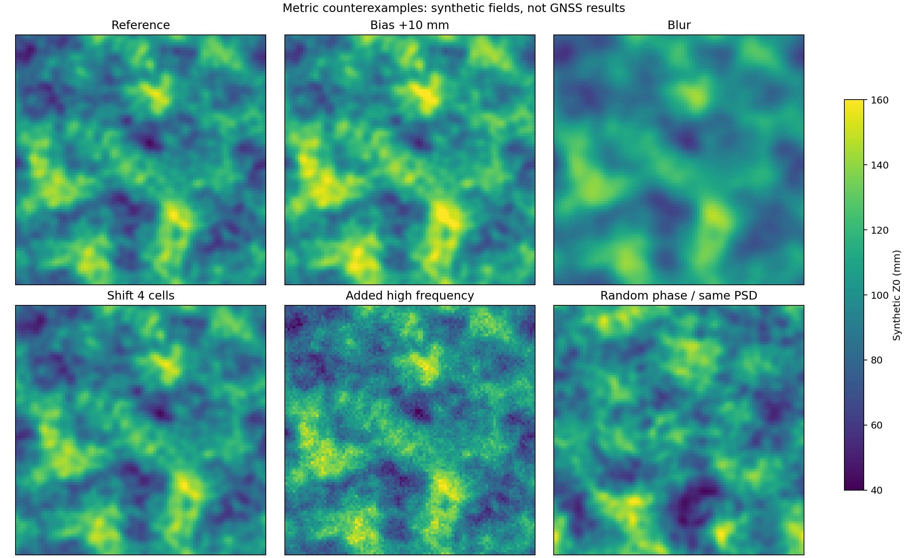
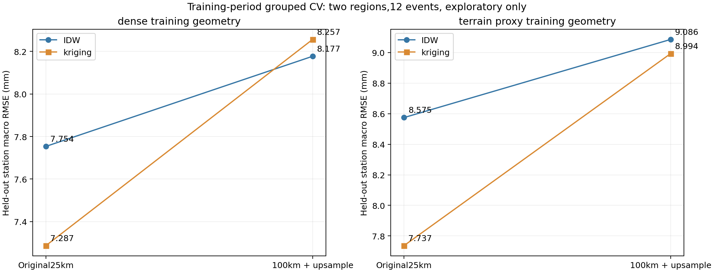
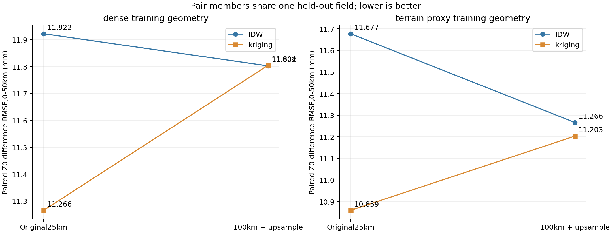
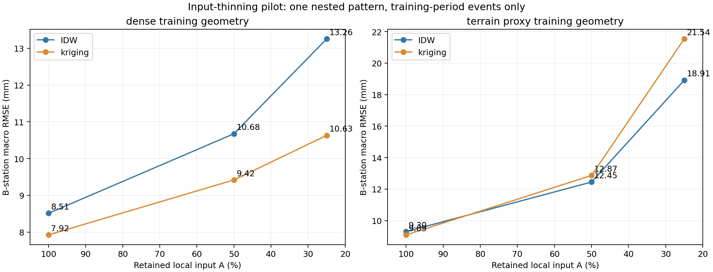

# 评价指标小试验结果

2026-11-17。已完成网页Pro调研、两个合成试验、两类小范围真实数据试验。所有试验共进行0次神经网络优化更新；正式M0训练保持第1021步暂停。

## 1. 功率谱与SSIM的盲点：已数值验证

固定种子20261117生成96×96周期单通道合成场。下列毫米是合成示意单位，不是GNSS模型成绩。

| 合成扰动 | RMSE | SSIM | 去均值功率谱相对L2误差 |
|---|---:|---:|---:|
| 整体增加10 | 10.000 | 0.9951 | 1.2e−16 |
| 模糊 | 5.372 | 0.8136 | 0.1865 |
| 平移4格 | 15.578 | 0.3332 | 2.7e−16 |
| 叠加高频噪声 | 5.000 | 0.8662 | 0.0110 |
| 随机相位，保留功率谱 | 27.432 | 0.0238 | 1.2e−15 |

平移和随机相位能保持完整周期场的功率谱；SSIM可以对显著整体偏差给出高分；全谱汇总误差还可能被强低频支配，掩盖高频噪声。因此需要同时保留毫米误差、配对位置误差、频带误差和空间结构诊断。加窗或海岸mask后的谱不保证仍严格相同，这与周期合成反例分开解释。

重现：在本目录用训练解释器运行 `metric_counterexamples.py`。脚本验证正交FFT的Parseval恒等式，结果保存为CSV/JSON。

## 2. 边缘概率相同，空间概率不同：已数值验证

1024个四维高斯合成案例，每例48成员，真实相关系数0.85。独立打乱每个位置的成员顺序，保持所有位置的边缘集合完全不变。

| 集合 | 平均CRPS | Energy score | Variogram score，p=0.5 |
|---|---:|---:|---:|
| 保持真实相关结构 | 0.57521 | 1.22903 | 0.06695 |
| 逐位置打乱成员 | 0.57521 | 1.29584 | 0.20544 |

分数越低越好。逐点CRPS差异不超过4.3e−15，ES/VS却能识别空间依赖变化。这里验证的是评价逻辑，尚未评价真实Diffusion/GAN。原始结果见 synthetic_dependence_scores.json。

## 3. 真实数据：参考场的多尺度空间交叉验证

限定2016–2018训练期，未用2019开发及2020回顾标签。仅根据训练站几何选定一个站点密集域和一个25km地形起伏代理较大的域，两域各600×600km。各域6个固定日历时刻，加6个输入A出现较大3h变化的时刻；后者只称输入强变化代理，不认定为真实锋面或降雨事件。

将B训练站的50km完整空间组分成3折，隐藏一折，使用A与其余B构建参考场。对保留B的100%和50%分别试验；每组协方差仅在可见源站拟合。IDW为最近4站、距离平方反比、150km半径；无半径内源站时使用明确的最近站回退并计数。克里金为源站估计的平面趋势＋指数协方差残差普通克里金，并非所有克里金方法的代表。

全部先生成24×24的25km格网，再使用统一双线性查询和高度恢复。100km对照由4×4均值降采样后双线性回采样，未改变观测目标。输入源池上限192站，并优先保留所有局地A，使用同一源池比较插值器。密集域258个B站、起伏代理域93个B站；每站只在自己的隐藏折评分。两站的差值必须来自同一时刻同一隐藏折的同一个场，不能混用不同折的场。

完整源密度下的结果如下。所有数值为描述性探索结果；不称全年精度，也不与A-only神经模型比较。

| 局地域 | 方法 | 原25km场：站宏RMSE | 100km回采样：站宏RMSE | 原场：0–50km站对Z0差值RMSE | 100km版：同站对差值RMSE |
|---|---|---:|---:|---:|---:|
| 密集域 | IDW | 7.754 | 8.177 | 11.922 | 11.802 |
| 密集域 | 克里金 | 7.287 | 8.257 | 11.266 | 11.804 |
| 起伏代理域 | IDW | 8.575 | 9.086 | 11.677 | 11.266 |
| 起伏代理域 | 克里金 | 7.737 | 8.994 | 10.859 | 11.203 |

在本小样本中，克里金原场的点值与差值均较其粗化版更好；IDW原场改善点值，但没有同步改善短距离差值。这个结果说明两类指标确实能区分不同收益，不足以证明克里金已在整个区域占优。统计样本由天气时刻和空间组构成，不能用数万个相关站对时刻夸大独立样本数。

144个域×折×密度×时刻案例，分别计算t和t−3h场；累计32616条方法/尺度/密度重复展开的站点预测行，对应每个条件4077个基础目标站时刻。每个方法和尺度的目标键完全一致。详细记录、折划分、源站清单、参数、3h增量误差及高差分组见 local_pilot_manifest.json、local_pilot_results.json 和 local_pilot_station_predictions.csv。

## 4. 真实数据：仅A输入站的稀疏化

另将信息条件严格限定为A输入站：局地完整、50%、25%、固定单站、零站。B仅用于评分，不参与协方差参数拟合。保留名单固定且嵌套，两个方法及所有事件共享名单；每种条件保留同一目标站时刻分母。这里是局地域输入比例，不等于全域174站的同等比例实验，也没有代表全部随机删站组合。

| 局地域 | 局地A保留比例 | IDW站宏RMSE | 克里金站宏RMSE | 距离/密度支持比例 |
|---|---|---:|---:|---:|
| 密集域 | 100% | 8.511 | 7.923 | 99.40% |
| 密集域 | 50% | 10.675 | 9.418 | 76.33% |
| 密集域 | 25% | 13.255 | 10.630 | 20.78% |
| 起伏代理域 | 100% | 9.301 | 9.090 | 100.00% |
| 起伏代理域 | 50% | 12.448 | 12.866 | 66.45% |
| 起伏代理域 | 25% | 18.914 | 21.540 | 15.81% |

支持比例这里只计算“最近源站≤100km且150km内至少3站”，未包含凸包及训练标签距离，因此特意命名为距离/密度支持，而非正式完整支持域覆盖。误差表使用所有预定目标，不因支持下降而丢弃难例。

单站采用常量Z0传播，两种方法都回退到同一规则；密集域RMSE26.571mm、起伏代理域37.552mm。零站采用A训练期平均Z0背景，分别为51.583mm、38.594mm。这些是明确的简单回退，不是原生单站克里金性能，也不证明带独立气象辅助的神经模型会同样退化。

本小试验给出了明确反例：在起伏代理域严重稀疏时，克里金不再优于IDW。后续必须评价方法与站网密度、地形的交互，不能只给一个全域平均值。

## 5. 天气与地形已经验证到哪一步

- 已计算3h增量RMSE和输入强变化时刻分组；它们用于检查时间变化误差。尚未完成独立气象事件识别、连续窗口峰时差和全年极端概率校准。
- 已计算站格高差分组，域选择中的地形量是25km聚合DEM起伏代理。尚未完成高分DEM坡度、坡向、山脊/谷地站对评价，不能将当前结果称为“地形突变认证”。
- 已验证基线在局地输入稀疏、单站和零站时的边界行为。尚未对冻结M0进行输入稀疏化推理，也没有训练缺站增强模型。
- 已验证全场谱及概率评分的已知反例。真实全图缺乏逐格独立真值，因此仍须依靠未见站和尺度相关误差建立证据。

## 6. 数值验收与研究决策

4项小试验数值测试通过：插值/查询常量保持，坐标平移不变性，突变代理的有效输入约束，站对来自同一隐藏场。另独立复算所有站宏RMSE，并核对目标键一致、源站/目标站排斥、非有限预测。首次选事件时出现近全缺站时刻，已保留 failed_pilot_event_audit.json 并修正为同一组前后共同有效A站的增量，不把站网组成变化混作天气变化。

Pro建议的5折、更大事件清单是后续参考协议；本次有意限定为3折、2域、12时刻的低成本试验，未把缩减预算的结果称为全量验证。克里金nugget部分拟合到预设下界，当前没有检验其概率区间，不能据均值RMSE认可其方差。

目前有实测支持的决策是：保留点值误差＋真实站对差值＋固定尺度退化对照；谱/SSIM作为补充诊断；生成模型保留边缘CRPS与ES/VS。下一步值得研究的候选是经过交叉验证的参考场或局地地统计先验，但Diffusion/GAN高分辨率目标来源仍需单独论证。

这些试验验证了评价工具能揭示不同错误，尚未验证某个新损失能提升神经模型。若开展损失短训，优先比较相同初始化下的真实站MSE与MSE＋真实站对差值，其他设置固定；参考频带损失留到可信尺度确认后。

复现命令：在本目录，用 `D:/anaconda3-2025.12-2/envs/pytorch/python.exe` 依次运行 `-m unittest test_local_pilot`、`local_pilot.py`、`local_sparse.py`。原始结果和源站清单全部保存在同目录。
