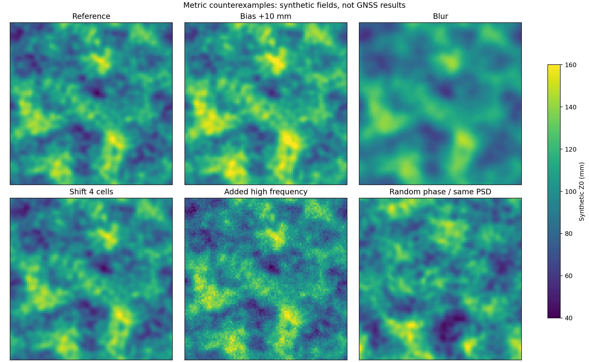
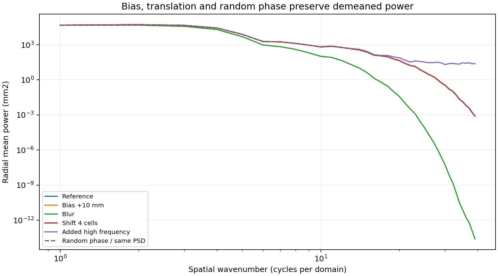

# 稀疏GNSS高分辨率场：评价指标与损失设计

日期：2026-11-17。本文是指标研究与待验证协议；现有训练保持暂停。网页Pro任务：GNSS_METRICS_20261117。Pro完整答复已回收并核查，原始记录见 pro_response_snapshot.txt、pro_prompt.txt、pro_completed.jpg；来源及核验范围见 verified_sources.json。新增两个合成试验和两类小范围真实数据试验已完成，具体数值、适用范围和复现方式见《小试验结果.md》。下列阈值和损失仍是待检验方案。

## 1. 要证明的目标

将各站ZWD按固定经验高度尺度归算为 Z0=ZWD·exp(H/3000)，可以把Z0表示为具有毫米单位的单通道二维场，并应用图像重建技术。该变换没有消除全部地形相关性；高山处观测噪声也被放大。最终需同时评价公共高度Z0及恢复到真实站高的地表ZWD。

IDW或克里金可以构建参考图、训练辅助标签和对照。由有限站点插值生成更密格网，增加的是采样点，不自动增加真实空间信息。模型对参考图的PSNR/SSIM/谱误差，衡量对特定插值器的接近程度。真正的细尺度收益需由未参与构图的独立站及站对提供证据。

评价分别记录四类结论：

| 证据类别 | 要回答的问题 | 优先指标 |
|---|---|---|
| 物理观测主证据 | 未见站及真实空间差异是否更准确 | 站宏RMSE、MAE、偏差、站对差值误差、原场与100km场的配对比较 |
| 参考图一致性 | 生成场与指定参考构造是否一致 | 格网MAE/RMSE、SSIM、多尺度/频带误差；IDW和克里金分别报告 |
| 空间统计合理性 | 幅度、尺度、方向及平滑程度是否合理 | 二维及方向功率谱、半变异函数、梯度/小波能量、异常物体统计 |
| 生成分布校准 | 随机场是否包含合理的不确定性和空间依赖 | CRPS、区间覆盖/宽度、rank/PIT、energy score、variogram score |

## 2. 五类场景的固定评价

所有分组先记录站数、站时刻数、空间组数、独立天气事件数和覆盖率。主要比较共享站时刻；非有限预测记失败。图像统计固定共同区域，不能每个模型各自挑选有利mask。

### 2.1 稀疏站区及缺站压力测试

自然稀疏分组以当前有效输入站计算：最近站距离0–25、25–50、50–100、100–150、>150km；150km内邻站数0、1、2、3–5、≥6；凸包内外另列。样本不足时合并相邻箱，合并规则先固定。训练标签站距离也另列，以区分输入稀疏和监督稀疏。

压力测试仅改变输入A：保留100%、75%、50%、25%，以及按投影格整块挖空。每个保留比例使用5个固定种子；四帧粗场和所有衍生支持/距离/邻站数同步重建。主试验在当前及历史帧统一移除同一站组，另做仅当前帧故障诊断。不能只删token却让粗场保留该站信息。B/C/D目标和评分清单固定。

每种输入退化都要重新计算M0条件场，缓存键加入保留站清单/时序掩码哈希；不能复用全输入网络生成的均值缓存。模型及训练统计保持冻结。此时测得的是输入退化鲁棒性；若随后加入缺站增强重新训练，须作为单独实验。

指标：站宏RMSE随稀疏程度曲线、相对IDW/克里金/粗场误差、支持覆盖损失、域外误差、生成区间覆盖和宽度。固定全队列与共同支持队列并列；预测不可用率单列，不把不可用样本从分母静默删掉。

仅1站/全缺站属于可辨识性边界。没有足够空间约束时，有限输出只证明程序可运行；应比较粗背景或训练气候场及相应不确定性。IDW单站可定义常量延伸但不能声称空间细节；克里金按预登记先验与单观测条件更新，其结果高度依赖先验。当前代码主支持条件要求至少3个输入站，需把此类压力测试作为独立域外报告。

### 2.2 单点与局地异常

逐独立站给RMSE、MAE、偏差、绝对误差P95、CRPS、覆盖/宽度、样本数与季节；总体采用站宏统计，并给最差十分位站。短序列相关系数仅作补充，不能替代偏差和幅值误差。

单点周围的峰谷是否恢复：在密集独立站组中固定距离箱，比较站对Z0差值误差；相近高程站对再评地表ZWD。站对数并非独立样本数，同一站参加多个站对时需按空间站组和天气过程重采样。实际观测只支持到站组覆盖范围，不从单个高值站推断完整湿峰面积。

另做格网几何诊断：目标位置在单元边缘/中心、patch拼接带内外分组，确认误差或方差没有人工周期性。所有均值均从发布场查询。

### 2.3 全图与空间尺度

对发布Z0场计算完整二维谱、径向谱及主要方向谱；同时计算总场、扣除相同背景后的残差。对参考图给固定范围SSIM及多尺度误差。25km、50km、100km、200km的固定平滑/降采样算子需记录具体实现，先在格网上处理再用同一查询算子对独立站评分。

面积平均格网误差需要足够可信的面积参考；独立站误差仍是站点覆盖下的误差。全陆地输出率、输入支持域面积、可评分站时刻覆盖必须并列。图像上看见的细节与独立证据支持的细节分别说明。

主细尺度检验：每个模型原场与固定4×4均值降到100km再双线性回采样的版本配对比较。检查未见站RMSE和短距离差值是否同时改善。单纯增强高频而未降低独立误差，属于统计纹理变化。

### 2.4 地形突变

用原始高分DEM在25km格内聚合地形起伏、标准差、坡度统计及坡向；另记站高与格网代表高程之差。不要只对已平滑25km DEM求坡度后把它当全部地形复杂度。

按起伏/坡度训练期分位数划低、中、高复杂度；高程及站格高差独立分组。重点报告：地表ZWD与Z0的RMSE/偏差、误差对高程/高差/坡度的关系、跨山脊及沿谷方向站对差值、概率覆盖率。方向站对必须确有观测支持；坡向和水汽输送方向的关系需有风场依据。

地形边界不等于水汽真实不连续。真实Z0近似平滑时，不应奖励模型复制DEM纹理。若高地Z0变差而地表ZWD变化小，要检查指数归算造成的误差放大；若地表误差随站格高差系统变化，优先检验高度恢复。高度尺度的任何重新估计只用训练期资料，并作为单独消融，不根据开发结果随意调整。

交叉组至少列出“稀疏×高起伏”和“稀疏×高起伏×突变事件”。各组报告计数及不确定区间；事件太少时只列个案，不给稳定排名。

### 2.5 天气突变与极端湿状态

三种事件分开：时间突变（1/3/6h ZWD增量）、极端湿状态（训练期季节湿度分位数）、空间突变（密集站组的差值或异常湿峰）。季节阈值只用2016–18训练B估计，2019开发观测用于事件命中标记。不能把ZWD突变自动称为降雨、锋面或对流，后者需外部气象证据。

可登记起点：训练季节分布的高湿P95及绝对3h变化P95；同时列P90/P99敏感性，正式比较前锁定。邻近事件合并为独立天气过程，事件窗口±12h；合并间隔与峰匹配容差固定。缺测时不跨缺口计算增量。稀疏留出站的季节标准化不使用该站开发期分布回拟。

指标：事件宏RMSE/MAE、峰值幅度误差、峰出现时间差、Δ1/3/6h增量误差、增量正负方向正确率、高湿阈值的命中/漏报/虚警。对概率预测给Brier score、可靠性图、CRPS及事件分组覆盖。同期重建τ=0的峰时差称重建滞后，不能称预报提前量。时间位移诊断后仍保留原时刻误差，不以事后时间对齐提高主分数。

存在可验证高分辨率事件参考时，可用FSS（阈值后邻域占比得分）或SAL（结构/幅度/位置）作为物体级诊断。参考仅是插值图时，这些仍是参考一致性；个别站点不足以确认湿峰面积和形状。事件检测阈值及物体匹配规则固定，不依模型输出选择事件。

## 3. 图像指标如何取舍

| 指标 | 项目建议 | 用作损失的条件 |
|---|---|---|
| MAE/RMSE | 必须保留毫米物理误差；格网和独立站分开 | 真站监督优先；网格误差需说明参考来源 |
| PSNR | 可作CV格式补充，固定动态范围时与MSE单调等价 | 通常直接用MSE更清晰 |
| SSIM | 可作局部结构诊断，需固定动态范围和以km表示的窗口 | 小权重辅助需消融；不能替代幅度/偏差 |
| MS-SSIM | 有足够大图幅时可探索 | 24×24小patch不宜套默认五尺度参数 |
| 梯度/拉普拉斯误差 | 检查边界、过平滑、棋盘格；导数注明mm/km或mm/km² | 匹配可信参考导数；与惩罚导数大小的平滑正则区分 |
| 多尺度/小波误差 | 推荐定位局部尺度与方向误差 | 只在参考可信尺度监督，统一边界处理 |
| 功率谱/频带能量 | 推荐作统计诊断，不能判位置是否正确 | 仅作为尺度先验时须明确来源及置信度 |
| 复数频域误差/FFL | 比仅幅度谱更能惩罚错位 | 可信逐样本配对参考；无权重全复数L2与像素L2等价 |
| SAM | 单通道正值逐像元角度退化，优先级低 | 多变量具有合理尺度/单位定义时再讨论 |
| LPIPS/DISTS | 通常不作主指标；自然图像特征未经ZWD领域校准 | 领域特征编码器必须只用训练期并检验物理相关性 |
| FID/KID | 不能确认单个条件下的湿峰位置；默认特征域不匹配 | 作为分布诊断仍需域内特征、样本量和条件检验 |
| NIQE/BRISQUE | 不作首轮评价，天然图像统计先验与毫米场不一致 | 不作为首轮损失 |

所有指标直接对单通道物理数组计算，不能把伪彩色PNG送入网络后称ZWD精度。禁止逐图min-max归一化掩盖幅值/偏差。PSNR/SSIM动态范围来自训练期固定规则，范围外值保留，不为分数裁剪。掩膜采用共同有效窗口，不能把海洋/缺测置0后当真实边缘。

## 4. 空间频率谱、相位和半变异函数

令 m 为发布场、y 为参考场，F为固定归一化二维离散傅里叶变换。功率为 P(k)=|F(m)(k)|²；去均值后DC项另报。功率误差只检查每一波数的能量，平移会改变相位而保持能量。

复数误差可写为 E(k)=|F(m−y)(k)|²。按频带汇总可定位哪类尺度误差最大。正交变换、全频等权且同边界下，Parseval恒等式给出 sum|m−y|²=sum|F(m−y)|²，因此“再加一个等权FFT-MSE”没有提供新的目标。频带加权、局地化或自适应权重才改变优化偏好；仍需解释为什么这些权重反映任务。

交叉谱 C(k)=E[F(m)(k)F(y)(k)*]，相干性 |C|²/(P_m P_y) 需先跨事件、子窗或波数箱平均再取比。单个系数直接代入时相干性退化为1，不能当有效结果；方向相反的相位也可能需要单列。

谱计算采用同投影、格距、域、趋势处理和窗口；窗口能量校正与频带计数固定。陆地不规则mask乘场会卷积污染频谱，零填充会造海岸高频。首轮优先固定完整矩形陆地窗口；无法取得时，谱仅作掩膜一致的敏感性诊断，并用站点半变异函数作独立检查。完整窗口所覆盖的地理分布必须报告。

25km格距对应Nyquist波长50km，这是采样上限，不能推导已恢复50km真实结构。24×24 patch长600km，低频独立模态很少，单patch谱波动大；优先在统一发布场的预登记较大窗口和多个事件平均，600km patch谱只作局地补充。波长箱先登记50–100、100–200、200–400、>400km，其中50–100km首先标为探索频带，是否可用于损失由训练期观测密度和交叉验证决定。站对距离箱与傅里叶波长箱不是一一对应。

经验半变异函数 γ(h)=1/(2|P_h|) sum_(i,j in P_h)(Z0_i−Z0_j)²，可直接用不规则站点计算，无需先插值。先扣除共同训练期趋势或明确非平稳分区，沿主要方向分别估计。平稳条件下 γ(h)=C(0)−C(h)，与功率谱通过协方差联系；它同样不能识别所有相位或空间位置错误。

独立站对差值误差更直接：E_pair(h)=sqrt(mean([m_i−m_j]−[y_i−y_j])²)。此项比较同一时刻同一站对的实际差异，而非仅比较差异分布。需配合单点偏差，因为共同常数偏差会被差分抵消。

## 5. 参考图与站点角色

| 数据角色 | 训练期2016–18 | 开发2019 | 回顾2020 |
|---|---|---|---|
| A固定输入站 | 模型输入、粗场构建、允许参与训练参考 | 仍为模型输入 | 仍为模型输入 |
| B训练监督站 | 真站损失；A+B可构建辅助参考 | A+B参考仅作为离线诊断，B2019观测不进模型 | 同样仅离线参考 |
| C开发站 | 全程排除训练统计、teacher及条件构造 | 独立点与站对评价 | 角色保持，不改作新训练站 |
| D回顾站 | 全程排除训练与调参 | 全程排除调参 | 锁定后独立点与站对评价 |

只用A插值的参考不会增加新的观测信息；A+B参考含更多训练监督信息，但细节仍由插值模型决定。训练teacher不可使用C/D任何时段的观测。训练期B内按空间组交叉验证，估计插值器在不同站距、地形和季节下的误差；用训练期稀疏化估计可信尺度，不能在开发集反复调变异函数。

IDW与克里金共用来源站、共同评价域和目标时刻；克里金先拟合训练期局地/季节趋势及残差协方差，报告nugget、range、sill及拟合稳定性。逐小时样本不足时不独立乱拟变异函数。克里金条件方差取决于所设协方差、观测误差和参数，不能当全部真实误差。IDW双参考与克里金双参考用于检测模型排名是否由teacher选择驱动。

开发参考若由C构建，只能作为事后空间诊断；它不等于连续面积真值，与C点评分也不是两套独立证据。更严谨的参考审核需C_ref/C_audit再按物理组隔离，但现有110开发站未必支撑可靠全图，优先保留独立点/站对证据。不得因插值像素变多而将统计样本量写成像素数。

## 6. 训练损失的分阶段建议

以下是待验证设计，不是已证明最优权重。

确定性均值的基础项：L_obs=mean_i[(exp(−H_i/3000)·Interp_i(m)−ZWD_i)/s_y]²，s_y只来自训练B。与站宏评价一致时，以站均匀采样或站权重控制密集站支配。

如果密集训练站组有同时观测，优先试 L_pair=sum_h a_h mean_P_h ρ(((m_i−m_j)−(Z0_i−Z0_j))/s_h)。ρ为平方或Huber，s_h为训练期差值尺度，a_h固定归一化。站对噪声尤其短距离会被放大；不强制拟合低于观测噪声的结构。该项使用真实站差异，保留独立C/D验证。

有可信辅助参考T时，再考虑 L_aux=sum_l α_l ||W_l(m−T)/s_l||² 或可信频带复数误差。W_l为固定小波/带通算子；可信度低的细频带权重设低或0。参考不可靠的位置不能仅用逆方差无限增权，需截断并归一化。总目标先从L_obs起，仅加入一个辅助项作配对短训；不同时堆SSIM、梯度、FFL和GAN。

曲率正则 mean[(Δm)/s0]²是平滑先验；梯度匹配 ||∇m−∇T|| 则是参考结构监督，二者科学含义不同。权重根据训练期损失及梯度量级设有限候选，用固定开发协议比较，不以多个未经验证的常数宣称最优。F分支概率NLL继续对均值与共享特征停止梯度；J分支联合训练作为对照。

标准残差EDM：r=(Y−μ)/s，L_EDM=E[λ(σ)||Dθ(r+σϵ,σ,c)−r||²]，按共同有效域归约。它要求训练目标Y的来源已经确定。若Y是IDW/克里金均值，学到的是该参考构造的条件分布，其高频/噪声结构受插值器支配。加频谱损失不能凭空补出缺少的高分辨率观测。

对生成成员逐个加很强的配对L1/MSE，可能把本应随机的成员压向同一个条件均值并削弱离散度。需要逐样本图像目标时，先沿用标准EDM去噪目标，后续辅助项检查成员方差、CRPS和VS。GAN判别器也只会学“真图”提供的分布；把插值图当真图会鼓励插值纹理。真实观测主证据、配对监督与分布监督要分别检查。

生成训练有三条候选来源：可信高分辨率数值模拟/外部场作先验后在GNSS上验证；经交叉验证标定的地统计条件模拟作先验对照；专门的稀疏观测逆问题/似然训练。地统计模拟不是新实测标签；第三条需要新的观测模型和可辨识性研究，不能直接套入标准全图EDM训练。

## 7. 概率评价

集合均值用于RMSE/MAE，成员场用于功率谱与空间统计；分别给mean(P(member))与P(mean(member))，两者不相等。条件均值高频较弱不必意味着生成分布缺细节。M2边缘高斯没有完整空间协方差，不能据其独立抽样结果冒充联合场或与EDM的空间概率产品等同。

CRPS及覆盖/宽度对真实独立站计算；有限成员固定K并给采样稳定性。Energy score评价同一小时独立站向量；variogram score评价固定站对增量，弥补边缘分数对相关结构的不敏感。两者要用同一个生成成员在所有位置的联合查询，不能每站独立重采样。公平有限成员估计与普通经验分布估计分别注明，比较时K一致。

VS_p=sum_(i,j) w_ij[ E|X_i−X_j|^p−|y_i−y_j|^p ]²，建议先登记p=0.5或1并归一化距离箱权重；与energy/CRPS/偏差并列，因为VS看不见共同常数偏差。秩/PIT直方图是校准诊断，聚合均匀不证明每一季节、稀疏区和山区都校准，应按场景分组。

按实际高湿观测筛选后的事件CRPS/覆盖是事件条件诊断；不能把这种事后子集上的分数称为对所有预报情景仍proper的全局选模目标。全时刻CRPS保留主概率评分；若研究重点是尾部，应另登记适当的阈值加权proper score，并说明阈值和观测噪声处理。

## 8. 已完成的合成反例

使用固定种子生成96×96周期单通道场，单位为示意毫米；这些结果不是本项目真实精度。功率谱计算先去均值；SSIM采用固定100动态范围、7×7均匀窗口及周期边界。每个反例数值均保存，Parseval等式已核验。

| 扰动 | RMSE | SSIM | 相对去均值功率谱L2误差 |
|---|---:|---:|---:|
| 整体+10 | 10.000 | 0.9951 | 约1.2e−16 |
| 模糊 | 5.372 | 0.8136 | 0.1865 |
| 平移4格 | 15.578 | 0.3332 | 约2.7e−16 |
| 叠加高频噪声 | 5.000 | 0.8662 | 0.0110 |
| 随机相位、保留功率 | 27.432 | 0.0238 | 约1.2e−15 |

因此功率谱、差分及结构指标分别有盲点，不能合并成一个未经验证的万能总分。

另做1024个四维高斯合成案例，每例48成员，真实位置间相关系数0.85。将每个位置的成员编号独立打乱，保持每个位置的边缘集合完全相同，但破坏成员内空间关系。逐点CRPS为0.57521且数值相同；energy由1.22903变为1.29584，p=0.5的variogram score由0.06695变为0.20544。两类分数均越低越好。该反例说明逐点概率校准不能替代空间联合检验；这些是无物理单位的合成数值，不是GNSS模型排名。结果见 synthetic_dependence_scores.json。

## 9. 下一步本机筛选

现有M0第1000步开发子集记录提供了一个具体审计结果：110个预登记开发站中有76站进入当前支持评分，共42540站时刻；这些已评分位置150km内输入站数为3–10，因此原主表无法评价0/1/2邻站的极稀疏情况。新增压力测试必须额外保留域外分母。76站在几何上形成0–25km候选站对58对，其中高差≤100m为22对；25–50km为76对，其中高差≤100m为22对。它们说明可以开始短距离差值检验，但实际同时有效站对时刻、独立空间组与天气过程数量仍须逐时统计。这些计数来自已有暂停模型的评价文件，不是新增训练结果。

1. 先固定指标和数据角色，不启动完整训练。采用2019每月15日12时的12个日历事件作展示清单；无资格时记录原因，不按模型误差换事件。天气突变评价另外按训练阈值自动扫描2019并归并事件。
2. 在B训练期资料内做3折整组空间交叉验证，检查IDW及固定候选克里金在密度、地形及季节中的误差。先取均匀日历时刻的小清单确定数值稳定性，再决定是否扩样。该过程估计reference可信尺度，不能证明全区域高频真实。
3. 用暂停的M0候选、粗场、输入IDW/克里金、M0+创新IDW生成同小时场。计算独立点、站对、100km退化对照、谱/小波和五场景统计。当前M0短训状态必须标注，不能称最终基础场。
4. 如需辨别损失，最多只做“L_obs”与“L_obs+L_pair”两组500–1000步探索，不作多损失/多架构网格搜索；采用同初始化、同样本顺序和同短预算。此项尚未启动，需在指标诊断后确定。
5. 若细尺度变化有独立站对支持，再选择残差EDM目标来源并准备服务器实验。若仅参考图指标改善，则定位为参考拟合；若主要是整体偏差改善，则定位为纠偏。小样本不能据此排除Diffusion，只能决定当前监督是否支撑该假设。

## 10. 主要来源与适用范围

- [Wang等，2004，SSIM原始作者页面](https://ece.uwaterloo.ca/~z70wang/publications/ssim.html)：局部结构相似性，与毫米物理误差互补。
- [Jiang等，2021，Focal Frequency Loss](https://arxiv.org/abs/2012.12821)：自适应频域误差；实现采用复数FFT，不等于仅匹配径向能量。
- [Zhang等，2018，LPIPS](https://arxiv.org/abs/1801.03924)：自然图像感知特征；迁移到单通道物理场需独立验证。
- [CorrDiff，2025正式版](https://www.nature.com/articles/s43247-025-02042-5)，[可读取作者预印本](https://arxiv.org/html/2309.15214v4)：均值回归与残差扩散，使用高分辨率气象目标；不能证明插值图具备同样监督信息。
- [RainFARM，2006](https://iris.cnr.it/handle/20.500.14243/47684)：随机降尺度及尺度统计；不是GNSS独立真值恢复的证据。
- [Ballarotta等，2019](https://os.copernicus.org/articles/15/1091/2019/index.html)：利用独立观测和误差谱研究有效分辨率；NSR阈值属于研究约定，GNSS需重新论证。
- [Scheuerer与Hamill，2015](https://doi.org/10.1175/MWR-D-14-00269.1)：variogram score及多变量概率检验。
- [Pic等，2025](https://ascmo.copernicus.org/articles/11/23/2025/index.html)：变换/聚合proper scores、局地energy和空间依赖检验。
- [Roberts与Lean，2008，FSS](https://doi.org/10.1175/2007MWR2123.1)：阈值事件的邻域尺度评价，迁移ZWD需重新定义事件。
- [Wernli等，2008，SAL](https://doi.org/10.1175/2008MWR2415.1)：降水物体的结构/幅度/位置诊断。
- [GStatSim，2023](https://gmd.copernicus.org/articles/16/3765/2023/)及[ArcGIS官方条件模拟说明](https://pro.arcgis.com/en/pro-app/3.3/help/analysis/geostatistical-analyst/key-concepts-of-geostatistical-simulation.htm)：区分插值条件均值和条件随机实现。
- [WeatherBench 2，2024](https://doi.org/10.1029/2023MS004019)：点值误差、概率技能与能量谱的互补评价。

本文的场景阈值、频带、交叉验证预算和损失组合是基于上述方法及当前项目约束提出的可检验方案，尚未在当前GNSS数据上证明最优。
