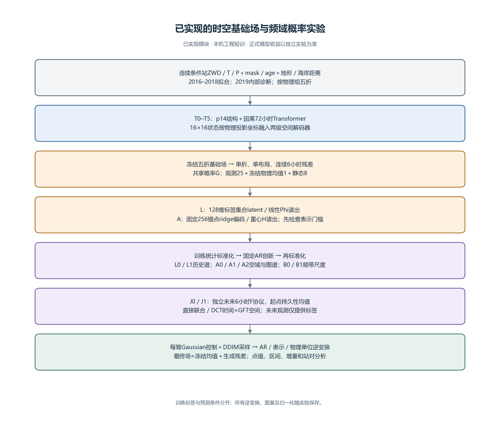

# 时空融合与频域残差扩散：代码及实验入口

本页对应已实现的模型，设计依据为[频域可行性方案](2026-11-25-spectral-diffusion-feasibility.md)。代码位于工程 `tools/terrain_diffusion/`。修正版本机实验登记在 `results/20261125_joint_spectral_pilot_v2/`；原`pilot`保留为定位支撑错位问题的首轮记录。机器记录区分60步工程短训与3000步候选训练。



## 各实验的全流程架构图

共15张架构图，同时提供PNG和SVG，GitHub直接显示PNG。

| 模型 | 流程图 |
|---|---|
| T0–T5基础场及消融 | [基础场](../figures/joint_spectral_implementation_20261125/foundation.png) |
| L0时间latent／L1历史谱 | [L0](../figures/joint_spectral_implementation_20261125/L0.png) · [L1](../figures/joint_spectral_implementation_20261125/L1.png) |
| A0空域／A1图谱／A2双域 | [A0](../figures/joint_spectral_implementation_20261125/A0.png) · [A1](../figures/joint_spectral_implementation_20261125/A1.png) · [A2](../figures/joint_spectral_implementation_20261125/A2.png) |
| B0控制／B1频带标准化 | [B0](../figures/joint_spectral_implementation_20261125/B0.png) · [B1](../figures/joint_spectral_implementation_20261125/B1.png) |
| J0未来直接联合／J1双频域 | [J0](../figures/joint_spectral_implementation_20261125/J0.png) · [J1](../figures/joint_spectral_implementation_20261125/J1.png) |
| 高噪声端v预测稳定性控制 | [v预测全流程](../figures/joint_spectral_implementation_20261125/velocity_control.png) |
| 既有10mm模型上的正式精度衔接 | [旧GRU+p14＋新Transformer融合](../figures/joint_spectral_implementation_20261125/warm_10mm.png) |
| 查询级时间融合与raw／EMA | [直接查询点残差解码](../figures/joint_spectral_implementation_20261125/query_10mm.png) |
| 原始站点时间编码＋连续查询＋U-Net背景 | [原始站点序列融合](../figures/joint_spectral_implementation_20261125/station_10mm.png) |

进一步的[原始站点编码方案](../superpowers/specs/2026-11-25-direct-station-query-fusion.md)已实现，并通过5项CPU合同测试，真实训练排队等待Q完成。该分支保留每站原始72小时序列，将条件方向、高差、海岸及物理创新直接用于查询注意力，再融合原U-Net两级特征。尚未据此报告精度提升。

用户追加的精度要求对应[3000步配对优化计划](../superpowers/plans/2026-11-25-warm-joint-precision.md)：保留已完成的约10mm模型权重及所有分支，新增Transformer修正头严格零初始化；当前正在执行双种子T2/T5冻结与联合微调，未改善则继续调整。下文从头短训结果用于定位问题，不替代此性能要求。

结果入口：[真实本机训练、表示审计与概率模型报告](../../experiments/us/20261125_joint_spectral_pilot_v2/REPORT.md)。完整九臂及四个v控制已经跑完，属于60/100步工程验证；尚无新架构3000步正式收益结论。

## 数据与基础场

`joint_data.py` 建立连续小时、折隔离、分段重置age的适配器。训练2016–2018，2019内部诊断；2020标签未参与拟合、选择或评分，底层适配器仍整体载入2016–2020训练站数组。410训练站按物理组形成固定五折。每次只抽样条件站，所有历史与当前帧使用相同站集合；目标站由可用标签与物理组隔离共同确定。

新模型沿用p14的固定144×96支撑、113维点读出及海岸/地形分支。`MaskedP14Fusion`在其上添加时间修正。为检验严格空间折外残差，新折模型从头训练并重算本折2016–2018的ZWD/T/P统计；已经训练到2019的旧p14权重不用于内部2019选择或折外模型。此处保留的是p14结构，成绩应与同样从头训练的控制比较。

`CausalSpatialEncoder`每个目标时刻独立取72小时观测窗。动态25通道：三个半径各提供ZWD/T/P加权均值、三种覆盖率、ZWD观测龄，共21通道，加四个日历通道。静态8通道含位置、高程、地形和海岸距离。投影至64维，每层在单个时刻做3×3空间运算，再在单个位置做带上三角掩码的四头时间注意力；两层前馈宽128。没有跨越目标窗边界缓存时间隐藏状态。

| 实验 | 时间支撑 | 融合方式 |
|---|---|---|
| T0 | 旧8×8 | 旧时序分支相加，作为结构控制 |
| T1 | 16×16 | 时间状态直接输出单通道修正并查询 |
| T2 | 16×16 | 两级空间融合，门控固定1 |
| T3 | 16×16 | T2加观测支撑/地形/日历门控 |
| T4 | 16×16 | T3加逐帧空间、逐位置因果时间交替 |
| T5 | 16×16 | T4加静态FiLM，比例1、平移0初始化 |

两级融合：`F0(16)+T0(16)+S0(8)→40→16`；`F1(32)+T1(32)+S1(8)→72→32`；上采样后`16+32→48→16→1`。门控输入`support30+static8+calendar4=42`，最后偏置−2。修正头权重与偏置均为0，所以初始化严格等于参考场。修正直接使用原surface ZWD归一化单位，不重复施加高程衰减。

两套支撑覆盖范围不同：时间支撑按训练站范围扩25km，p14支撑覆盖更大区域。T2–T5按**投影坐标**计算`fusion_uv`并采样；低层位置使用池化后像元中心，时间支撑以外使用边界值。按张量大小直接resize会造成地理错位，首轮小试已因此由v2替代。边界延拓影响仍应在区域边缘单列分析。

## 折外残差与表示

`joint_experiment.py`按固定五折训练T5。每个事件保留`(fold,layout0,6小时起点)`；拼接的是事件轴，各折目标标签不会混成同一空间场。条件只来自该折其余站。当前工程版先使用一个固定布局，增加布局和完整季节覆盖属于正式扩展。

残差`r=y−mu`，仅用训练折外残差拟合`u=(r−b)/s`，尺度下限0.1mm。概率条件编码器G重新训练，输入观测25通道和同一时刻冻结基础场均值1通道；不继承任何折模型的隐藏状态。历史72个均值各自使用独立72小时原始观测窗生成，因而需要143小时有效预热。

L表示：训练标签集合`[u,static9]→64→128`，掩码均值与最大值拼成256维后映射至128维z。读出`Phi(q,c)z`对z线性；Phi使用8静态+64维G查询特征+1基础场均值，共73维。标签编码器用于构造训练目标，预测时由生成器产生z，目标真值不进入条件。

A表示：固定16×16、256个锚点；Delaunay重心读出H在锚点处为单位矩阵。标签编码求解

`a = (H_valid' H_valid + 0.01 I + 0.01 L)^−1 H_valid' u_valid`。

正定ridge使稀疏标签下的解唯一，图为固定八邻域对称图。区域外使用最近锚点并单列标记。该算子能稳定求解，不保证稀疏标签可以恢复未观测细节。L、A/B及J分别报告各自训练和2019自重构、遮标签重构及实际人口。前两项工程门槛为≤1mm；遮标签检查要求非空且有限，并单报误差。正式概率启动在相应家族门槛超限时中止，`--diagnostic`允许继续检查下游代码，结果保存`eligibility.json`。

## 时间创新与概率链

先用训练状态拟合`w=(a−ba)/sa`或latent的相应标准化；按通道拟合固定`rho`并裁剪至[−0.95,0.95]。每个6小时块首态为0，`e_t=w_t−rho*w_(t−1)`，再按训练创新均值和尺度变成v。真实前态只用于训练标签变换；生成时每个成员使用自己的生成前态，保持成员身份。

`InnovationDiffusion`采用100级余弦日程、epsilon预测、20步DDIM。每帧创新按每8个值分组形成token，投影128维，两层四头注意力、前馈256。每层先进行帧内token双向注意力，再对G的4×4、64通道空间记忆交叉注意力，并注入物理小时、块起点和扩散步。固定token次序标识锚点组或图频序，记忆位置嵌入保留16个支撑单元身份。时间相关来自因果G和固定AR逆变换。这里没有在相关整块上套用不成立的严格三角联合score。

空间/图谱双域模型只使用一份`x_k`、一份白噪声及一条反向链。两个分支分别处理`x_k`和`U' x_k`，图谱输出转换回同一状态坐标，再经过共享输出头预测同一个epsilon目标。

| 实验 | 状态和条件 | 所检验的机制 |
|---|---|---|
| L0 | 128维latent创新，时间G | 原latent控制 |
| L1 | L0+过去72h LS谐波系数、功率、覆盖率 | 历史谱条件是否补充状态信息；用实际覆盖率掩码缺测、保留相位 |
| A0 | 256锚点创新，空间去噪 | 同锚点表示控制 |
| A1 | 相同状态，固定GFT去噪 | 完整正交换域与有限容量归纳偏置 |
| A2 | 相同状态，空间/GFT共享链 | 两域有机融合 |
| B0 | 与A2相同，频带缩放控制 | 保留重复控制以核查重现 |
| B1 | A2加训练期图频系数标准化 | 区分尺度效应与域结构效应 |
| J0 | 未来6h直接联合创新 | 独立F预报协议控制 |
| J1 | 同一6h块，DCT时间×GFT空间 | 时间与空间双谱联合去噪 |

每个实验都训练同信息条件的对角Gaussian创新控制；其时序关联来自同一AR逆变换。它不是完整空间相关Gaussian上限。G的初始化相同，各自按Gaussian或diffusion损失训练。B1在频带标准化坐标中加标准白噪声，空间分支使用显式可逆线性变换；回写epsilon时使用相同逆变换，没有把各频带噪声倍数硬插入DDIM。

## 实测后补充：表示几何与v预测

原规则256锚点在当前稀疏残差上未通过1mm门槛。`audit_representation.py`固定同一残差、比较规则256、最远点256及站点410支撑。最远点256在正则1e-4时训练/2019自重构0.609/0.677mm，而物理组留出20.209mm；改善了已观测残差保真，尚未解决未知位置推断。这是后验诊断，原A/B/J成绩保留原表示。

`velocity_diffusion.py`追加同网络的v参数化：`v=sqrt(a)*epsilon−sqrt(1−a)*x0`。反向恢复`x0_hat=sqrt(a)*xk−sqrt(1−a)*v_hat`，减少epsilon短训在高噪声端的除小量放大。A0同100步由344.626mm变成33.128mm，表明数值幅度得到控制；该数值仍是小试，不能解释为正式基础场精度。四组控制及Gaussian、来源哈希见`velocity_control/`。

J组当前使用**起点基础场持久性**作为未来均值控制。所有未来动态条件复制起点72小时历史，未来真值仅用于标签；不能把此均值称为已经训练的Transformer未来均值。未来均值预报头和滚动跨块状态需要后续独立对照。

## 运行与产物

从工程目录执行：

```powershell
$py = 'D:/anaconda3-2025.12-2/envs/pytorch/python.exe'
& $py -m pytest tools/terrain_diffusion/test_joint_spectral.py -q
& $py -m tools.terrain_diffusion.joint_experiment --out results/joint_spectral_new_run --diagnostic --steps 60 --oof-steps 60 --representation-steps 100 --probability-steps 100 --train-hours 120 --eval-hours 24 --members 16
```

既有v2使用提交`d3c643b`的原epsilon代码，后续v控制记录新增代码哈希，原始协议不改写。复现原epsilon结果可检出该提交；当前版本新目录运行提供同样的默认epsilon路径，附加的v控制由`maintenance/joint_spectral_implementation_20261125/velocity_control.py`读取新目录并登记独立来源。

正式步数默认基础场/折模型/概率各3000，表示2000；仍需明确登记残差年份覆盖、布局、双种子和完整年度开发评价。单独把`--diagnostic`去掉并不自动完成这些研究合同。工程默认720小时残差缓存是一个连续训练子段，不代表2016–2018全覆盖。

输入校验要求五折完整划分410站、条件与留出站分离、相同几何及数组哈希一致。每帧保存目标时间、来源72小时及均值来源时间；F组验证来源不晚于起报时刻。结果目录禁止切换数据、代码、诊断模式或同阶段参数后静默复用。未完成子目录不会当成完成结果跳过。

输出包含不可替代的本地权重、OOF数组、采样数组，以及可同步的协议、训练曲线数值、指标、表示门槛和来源哈希。GitHub只归档后者。每阶段实际完成状态以结果目录中的JSON为准。
