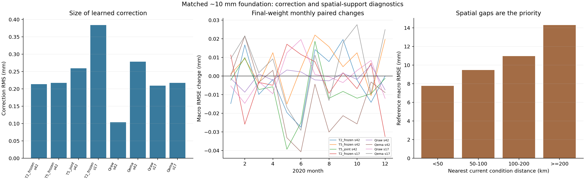
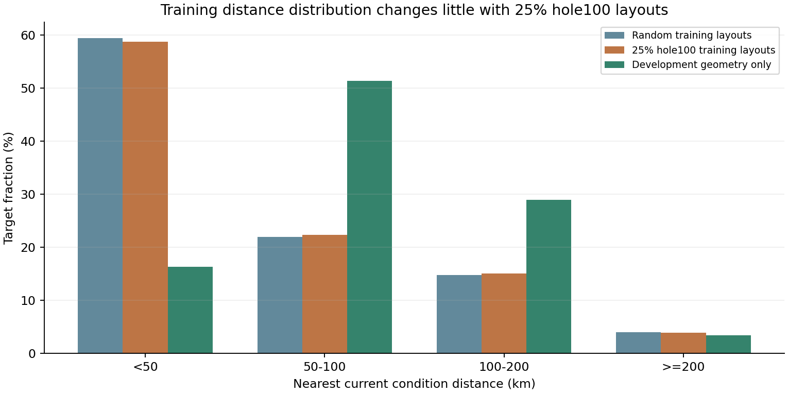
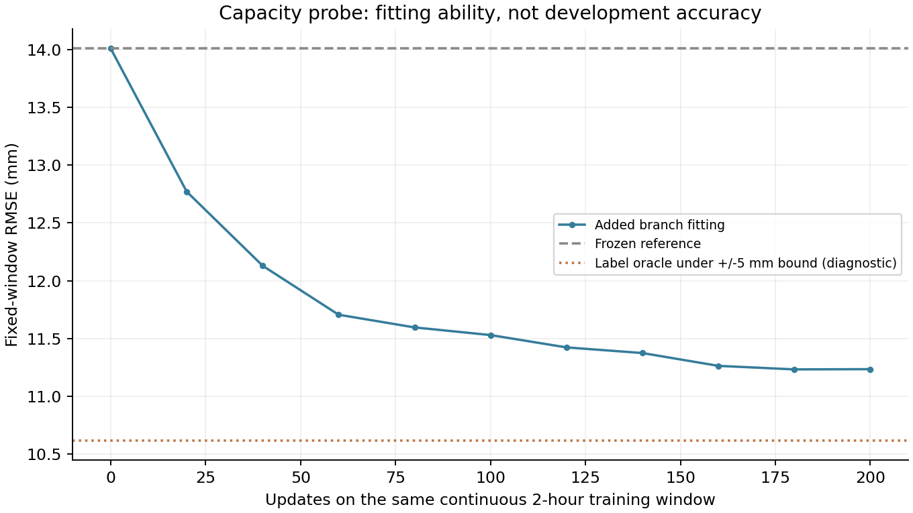

# 在既有约10 mm基础场上继续提高精度

本轮以已训练的GRU+p14为参照，检查新增时间和空间编码是否提供可重复的点精度收益。训练覆盖2016–2019连续小时，每批12小时，条件站可抽样，时间按顺序推进。评价固定为2020每月8–10日72小时、3个条件布局和137个登记开发站，其中135站有有效真值，共327330个有效布局—小时—站记录。该2020队列已用于开发。

## 同口径起点与已完成结果

| 模型 | seed42宏RMSE/mm | seed17宏RMSE/mm | 两种子平均/mm | 相对参考变化/mm |
|---|---:|---:|---:|---:|
| 原GRU+p14 | 9.998357 | 9.859944 | 9.929151 | 0 |
| T2：冻结参考、格点时间融合 | 9.996576 | 9.859874 | 9.928225 | −0.000926 |
| Qraw：查询位置时间融合 | 9.997529 | 9.860637 | 9.929083 | −0.000068 |
| Qema：同一Q训练轨迹的EMA权重 | 9.982291 | 9.864955 | 9.923623 | −0.005527 |

各候选均为最终3000步，不按2020评价挑选中间检查点。Qraw与Qema共享训练轨迹。T2的共同月份配对95%区间为[−0.004923, 0.003387] mm，Qema为[−0.014113, 0.003366] mm；当前继续保留原GRU+p14。查询分支seed17重跑已完成，原中断目录及检查点核验记录保留。

逐项指标、源权重哈希和真值核验见[统一配对报告](../../research_pipeline/studies/us_dense_zwd_20261105_v1/03_code/gnss_field_server/results/20261125_warm_joint_precision/combined_precision/REPORT.md)。双种子平均指各次独立拟合分数的平均，与预测集合平均分开解释。

## 从误差定位编码问题

原参考的分层宏RMSE表明，空间观测稀疏与局地差异值得优先处理：距最近当前有效条件站超过200 km时，两种子为14.44/14.20 mm；海岸距离小于50 km时为11.30/11.13 mm；粗糙度超过300 m时为10.90/10.75 mm。夏季为11.16/10.85 mm，冬季为8.31/8.23 mm。

已有新分支输出修正的RMS约0.10–0.38 mm。Qraw修正与参考残差的相关系数为−0.027/−0.012，Qema为0.083/0.003。该现象支持进一步检查新增表示中的有效局地信息；目前不能将它归因为训练未收敛或Transformer模型本身的上限。

诊断脚本为`maintenance/joint_spectral_implementation_20261125/precision_diagnostics.py`。其中oracle幅度使用开发真值解释修正方向，属于事后诊断，不用于模型输出或成绩。

原始站点S的seed42最终EMA宏RMSE为9.980218 mm，参考为9.998357 mm，第二种子继续训练。在2020年1月和7月各一个固定2小时窗口中，只移除新增分支的过去71小时信息，输出变化RMS为0.05146/0.02715 mm；原GRU的历史输入保持原样。该结果度量新增路径的输入敏感性，不替代完整时间消融。

容量探针固定2016-07-08连续2小时、82个条件站和其余隐藏物理组，仅在同一训练窗口上优化新增分支200步。CPU上恢复误差由14.00696降至11.23480 mm，说明新增网络能拟合该窗口残差；±5 mm输出约束对应的逐点标签oracle下界为10.61885 mm。该探针使用lr1e-3，检验拟合能力，不进入正式精度表，也不据此判断开发泛化。记录见`results/20261125_native_capacity_probe`。

## 正在验证的原始站点编码

下一项候选保留每站独立的72小时序列，经因果Transformer后再将局地状态传递给查询点。时间汇总之前保留站点坐标、方向、高差和海岸信息；原U-Net同时提供两个尺度的区域背景。模型最后输出相对原参考的±5 mm残差，零初始化时严格复现原模型。

完整[网络和训练设计](../superpowers/specs/2026-11-25-direct-station-query-fusion.md)已实现。正式运行目录为`results/20261125_station_query_precision`，3000步、seed42/17、最终raw与EMA权重；75%随机条件布局与25%100 km空洞布局。该臂同时改变编码与布局，作为整体性能候选；若有收益，再以随机布局控制分解贡献。

接续时新增的同配置副本`20261125_native_station_precision`在600步取消，以保留更早的正式运行并释放GPU资源。副本协议、曲线和中断记录保留，不计作独立结果。

已追加[条件站空间异常编码对照](../superpowers/specs/2026-11-25-station-anomaly-precision.md)：将时间路径的ZWD输入替换为相对其他条件站的空间异常，按固定10 mm归一化，原始观测仍由基础场和空间边保留。网络和训练预算与S臂相同。该设计用于检验残差尺度与时序特征语义的对齐，尚未报告正式收益。

进一步重放全部3000个训练块发现，随机布局训练目标59.4%距条件站不足50 km，75/25空洞布局仍为58.7%；开发坐标的纯几何比例为16.3%。[距离加权D对照](../superpowers/specs/2026-11-25-distance-balanced-precision.md)据此保持S的网络与输入，固定四档损失权重0.278/2.297/1.922/0.879，提高50–200 km目标的水平损失权重占比。权重由训练有效记录比例和开发坐标分布计算，开发真值不进入计算，属于已知开发几何下的适配。D排在warm队列完成后运行。

## 后续判据

1. 所有结果与对应种子的旧权重、数据合同及真值逐项配对，独立复算宏/微RMSE、MAE、bias和小时增量。
2. 双种子均改善且共同月份区间支持改进后，再检查距离、海岸、高程、地形、季节和站对差值。增量误差每种子采用0.01 mm容忍线；重点分层变化超过0.10 mm触发专门分析。
3. 若修正仍接近零，先检验训练样本上的残差拟合与输入扰动响应，再调整物理创新输入、残差尺度或联合微调。若训练收益存在而开发不稳定，优先检查布局距离差异和连续更新的季节偏置。
4. 达到基础场晋级条件后，重新训练严格空间折外模型生成残差，用训练折拟合标准化；Gaussian与diffusion共用残差表示、输入和采样预算。概率收益另以CRPS、区间校准及空间/时间联合评分评价。

本轮冻结源权重已经见过2016–2019训练站标签，因此本轮权重用于基础场精度优化；严格折外扩散标签从相应折的允许训练数据重新生成。
