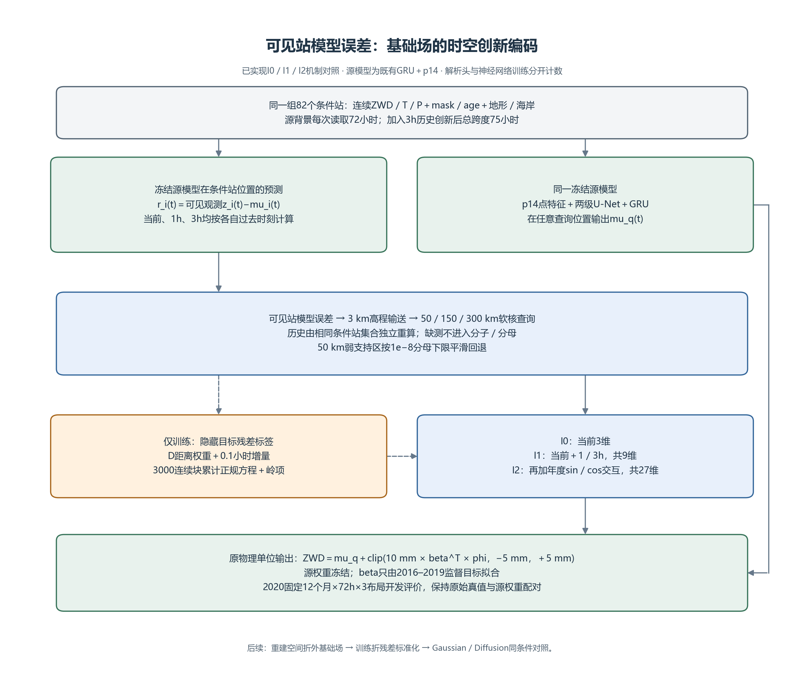
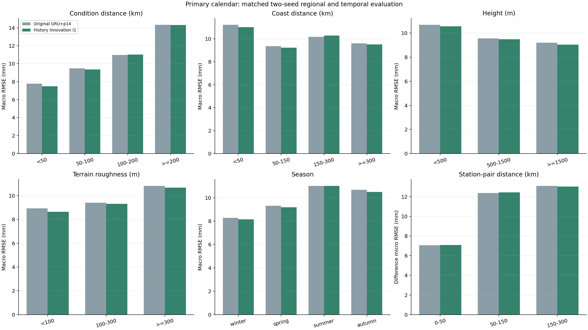
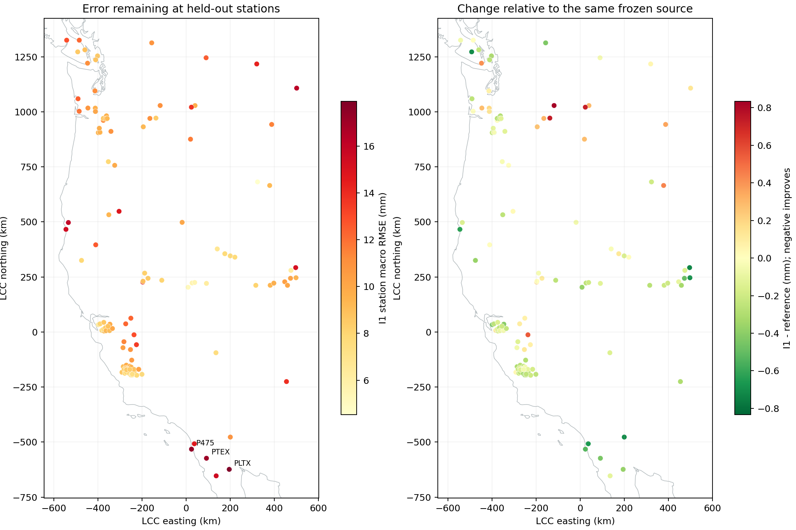
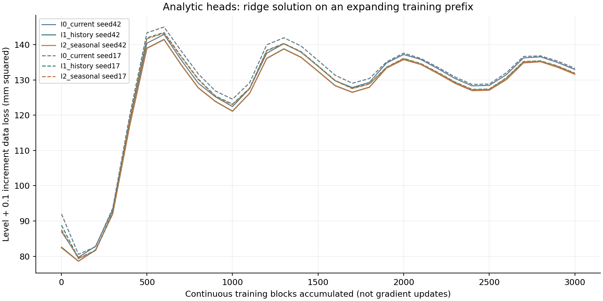

# 约10 mm基础场优化：结果、架构与下一步编码

在相同主队列上，历史观测创新校正I1将双种子宏RMSE从9.929151降至9.817064 mm，改善0.112086 mm（约1.13%），月份配对95%区间为[−0.193456,−0.042281] mm。冻结同一模型后，补充日历从10.869282降至10.740343 mm，两种子也均改善。

研究任务为当前时刻空间重建R：2016–2019训练，2020条件站截至当前时刻的观测用于重建隐藏位置；两个日历均为开发评价。主日历每月8–10日，补充日历每月15–17日，各12×72小时×3布局、137登记站/135有效站。主队列327330条有效记录，补充326937条；它们共享站点、月份、年份和布局，分别报告。

## 模型选择与关键证据

| 模型 | 主日历宏RMSE/mm | 主日历小时增量/mm | 补充日历宏RMSE/mm | 补充日历小时增量/mm |
|---|---:|---:|---:|---:|
| reference | 9.929151 | 5.583871 | 10.869282 | 6.355685 |
| I0_current | 9.849247 | 5.749572 | 10.775106 | 6.540967 |
| I1_history | 9.817064 | 5.577307 | 10.740343 | 6.334460 |
| I2_seasonal | 9.814186 | 5.575887 | 10.742945 | 6.334827 |

I0只用当前创新，点精度改善而小时增量增加；I1加入1h/3h创新后同时保留点精度与动态表现。I1相对I0的宏RMSE差为−0.032182 mm，配对区间[−0.049616,−0.017093] mm。I2相对I1的额外差为−0.002878 mm，区间[−0.008967,0.002346] mm，故在补充日期读取前冻结9维I1；补充日历中I1也略优于I2。

合并两个日历为72个抽样日、1728个不重复小时，每个72h段分别处理；先累计每站平方误差及有效数，再开方，未直接平均两张表的RMSE。月份重采样同时带上该月两段日期，增量不跨日期空档。

| 72个抽样日合并 | 宏RMSE/mm | 小时增量/mm | 相对参考月份配对95%区间/mm |
|---|---:|---:|---|
| reference | 10.441761 | 5.995593 | [0.0, 0.0] |
| I0_current | 10.352559 | 6.171377 | [-0.1283901911593764, -0.05169904554001908] |
| I1_history | 10.319804 | 5.981712 | [-0.17453421092559337, -0.07693059016170106] |
| I2_seasonal | 10.319798 | 5.981316 | [-0.17458873291583238, -0.07528126011132258] |

该合并分数代表更广的开发日期样本，仍非完整年度；模型选择已在补充日历读取前冻结。

神经分支T2/T5、查询融合Q、原始站点Transformer S、IDW空间异常A和距离加权D均已完成两种子3000更新，共14条成功轨迹、42000次梯度更新。D对S的EMA改善约0.008096 mm且两种子同方向，但相对原GRU参考的seed17仍略增。I系列另累计每种子3000个连续训练块，以解析岭回归拟合三组头，不计作新增神经梯度更新。

[完整30组记录（28候选＋2参考）、指标及配对门槛](../../research_pipeline/studies/us_dense_zwd_20261105_v1/03_code/gnss_field_server/results/20261125_warm_joint_precision/combined_precision/REPORT.md)｜[补充日历逐项结果](../../research_pipeline/studies/us_dense_zwd_20261105_v1/03_code/gnss_field_server/results/20261125_innovation_calendar15/REPORT.md)

## 当前架构

冻结原GRU+p14及地形/海岸分支，在每个可见条件站计算观测减去同位置模型预测的误差。将误差按3 km高程尺度输送，并在50/150/300 km软核上查询；当前、1h、3h组成9维创新编码。训练目标是隐藏位置的基础场残差，采用D距离权重、0.1小时增量与岭项；最终修正限制±5 mm。每次背景输入72h，历史创新使总原始观测跨度达到75h，同一条件站集合贯穿全部历史。

该提升来自历史观测创新校正。新增Transformer分支尚未对原参考形成稳定双种子优势，新diffusion也尚未在该基础场上重训。

## 六类误差与重点区域

时间留出使用2020年，空间留出使用137个登记开发站；训练监督只来自410站池中不属于条件物理组的目标。小时增量在每个72小时连续段内部评价，包含12小时计算批的边界。站对差值采用micro RMSE，其他分层采用站宏RMSE，所有表中数值为双种子均值。

| 分层 | 主参考/mm | 主I1/mm | 主变化/mm | 补充参考/mm | 补充I1/mm | 补充变化/mm |
|---|---:|---:|---:|---:|---:|---:|
| Condition distance (km) <50 | 7.776 | 7.485 | -0.291 | 8.425 | 8.117 | -0.308 |
| Condition distance (km) 50-100 | 9.477 | 9.361 | -0.116 | 9.992 | 9.811 | -0.181 |
| Condition distance (km) 100-200 | 10.973 | 11.024 | +0.051 | 16.206 | 15.692 | -0.514 |
| Condition distance (km) >=200 | 14.318 | 14.294 | -0.024 | 15.692 | 15.648 | -0.044 |
| Coast distance (km) <50 | 11.217 | 11.024 | -0.193 | 12.561 | 12.395 | -0.166 |
| Coast distance (km) 50-150 | 9.360 | 9.226 | -0.134 | 10.522 | 10.427 | -0.095 |
| Coast distance (km) 150-300 | 10.175 | 10.279 | +0.104 | 11.192 | 11.082 | -0.110 |
| Coast distance (km) >=300 | 9.603 | 9.511 | -0.092 | 9.613 | 9.444 | -0.169 |
| Height (m) <500 | 10.673 | 10.556 | -0.117 | 11.880 | 11.757 | -0.123 |
| Height (m) 500-1500 | 9.549 | 9.475 | -0.074 | 10.623 | 10.579 | -0.044 |
| Height (m) >=1500 | 9.198 | 9.032 | -0.166 | 9.428 | 9.147 | -0.281 |
| Terrain roughness (m) <100 | 8.925 | 8.640 | -0.285 | 10.604 | 10.174 | -0.429 |
| Terrain roughness (m) 100-300 | 9.397 | 9.319 | -0.079 | 10.190 | 10.117 | -0.073 |
| Terrain roughness (m) >=300 | 10.824 | 10.665 | -0.159 | 11.972 | 11.765 | -0.207 |
| Season winter | 8.272 | 8.141 | -0.131 | 8.604 | 8.473 | -0.131 |
| Season spring | 9.315 | 9.178 | -0.138 | 9.995 | 9.938 | -0.057 |
| Season summer | 11.006 | 11.015 | +0.008 | 13.082 | 12.918 | -0.164 |
| Season autumn | 10.679 | 10.488 | -0.192 | 11.107 | 10.929 | -0.178 |
| Station-pair distance (km) 0-50 | 7.066 | 7.078 | +0.012 | 7.803 | 7.795 | -0.008 |
| Station-pair distance (km) 50-150 | 12.360 | 12.442 | +0.081 | 13.585 | 13.570 | -0.015 |
| Station-pair distance (km) 150-300 | 13.099 | 13.021 | -0.077 | 14.842 | 14.738 | -0.104 |

主日历海岸150–300 km档增加0.104 mm，触发重点审阅；补充日历同档改善0.110 mm。距条件站100–200 km档也从主日历增加0.051 mm转为补充改善0.514 mm，说明固定地理分档内仍有明显天气过程差异。夏季主日历基本持平，补充改善0.164 mm；远条件站200 km以上仍约14–16 mm。后续应同时利用天气状态与地形约束创新传递，而不是按主日历的局部误差直接设置固定地理开关。

[逐站经纬度、高程、海岸距离、粗糙度与误差表](../../research_pipeline/studies/us_dense_zwd_20261105_v1/03_code/gnss_field_server/results/20261125_warm_joint_precision/combined_precision/station_changes.csv)。主日历最大剩余误差站依次为：PLTX 17.91 mm, P475 17.42 mm, PTEX 17.11 mm, P049 16.27 mm, P786 15.97 mm。这些站点用于下一轮天气过程和空间支撑诊断。

其中PLTX/P475/PTEX位于美墨边境及下加利福尼亚一带，改善后仍约17–18 mm；研究域东北侧P049约16.27 mm且增加0.134 mm，北加州近海P786约15.97 mm。后续须分别核对这些站点的天气过程、条件站方向/距离及高差，而不把单一日历的分档变化解释为固定地理规律。

## 曲线、验证与来源

I曲线是岭解在逐渐扩大的连续训练前缀上的水平＋0.1增量数据目标，既不是随机批点RMSE，也不是固定总体的收敛曲线。原始数据、预测大数组、训练统计张量和系数留本机；Git同步代码、协议、指标、哈希与图件。六组系数均由最终训练统计独立重解，逐元素完全一致；主候选及系数哈希在读取补充日期前锁定。

## 下一步模型与实验

以I1为性能下限，下一版因果Transformer应编码逐站模型误差、原始GNSS/T/P、mask/age及地形/海岸关系。保留原始站点身份与方向，经过时间编码再用地形/海岸条件查询注意力传递；新增均值头零初始化。优先比较GRU、LSTM、Transformer在同等有效历史范围下的表现，并检验创新表示与包含同等信息的原始值＋模型预测表示。

误差历史会扩大所需原始观测跨度：若每次源背景72h、校正滞后3h，再读取L小时的校正后站点误差，总跨度为72＋3＋L−1；L=12/24/72/168分别需要86/98/146/242小时。条件站集合须覆盖整个跨度保持一致；缓存键应包含条件站集合、时间范围、权重和数据合同哈希，不直接拼接不同条件布局的上一个训练块。

两个2020日历现均已开发暴露。后续残差训练重建严格空间折外来源，重新拟合基础场及I1系数，再用训练折统计标准化残差；Gaussian与diffusion共享条件编码、表示和采样预算，检验CRPS、区间校准、时间增量及站对联合误差。频域/图谱分支继续作为同条件表示对照。当前结果未给出新diffusion相对该9.817 mm基础场的收益数值。
