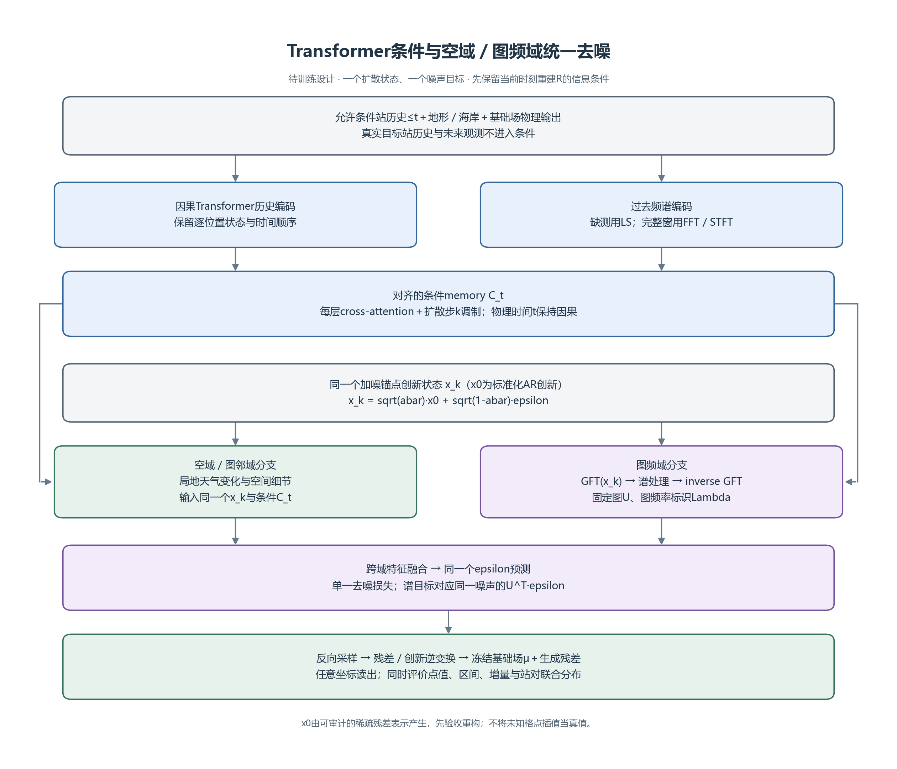
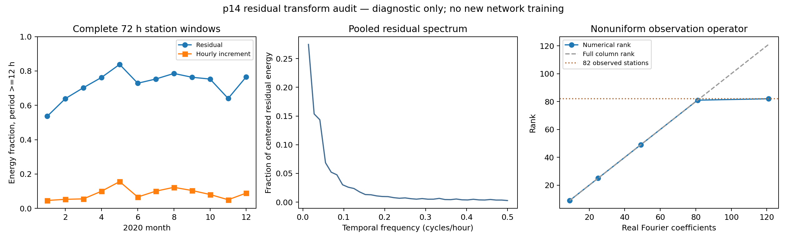

# Transformer与时空频域残差扩散：可行性、问题及验证方案

日期：2026-11-25。状态：原始文献定向调研、架构设计与本机变换核验完成；新增频域网络尚未训练。本文接续[已有时序扩散对照](2026-11-25-temporal-diffusion-comparison.md)与[当前Transformer架构](../superpowers/specs/2026-11-25-masked-transformer-fusion-residual-design.md)。

## 1. 研究判断

频域、图频域与时空双频域diffusion都有数学可行性，其中已有直接研究先例。对本项目，优先级是：因果历史谱条件→空间/图谱双分支去噪→固定起报时刻的时间频率×图频率联合生成。NUFFT作为不规则坐标上的分析/读出候选，先检验逆问题的可识别性。

diffusion是学习分布及其去噪/score的生成方法，适用向量、序列、图信号、空间场或潜变量，并不要求输入为二维图像。图像U-Net只是网络实现之一。将序列转换成谱图后可以使用二维网络，但坐标轴语义、复数相位、噪声协方差与任务信息条件仍需定义。

全频可逆变换不会增加信息。潜在收益来自频谱能量集中、尺度分工、噪声/特征归一化和合适的归纳偏置；这些收益通过同条件对照检验。

## 2. 已核对的直接来源

| 来源 | 原文机制 | 本项目可借鉴部分 |
|---|---|---|
| [Time Series Diffusion in the Frequency Domain，ICML 2024](https://proceedings.mlr.press/v235/crabbe24a.html) | 对时域SDE作傅里叶变换，频域噪声需满足镜像/共轭约束；比较两种域中的生成 | 频域diffusion有明确先例；全复频谱的噪声不能逐复系数任意独立采样 |
| [SpecSTG，2024预印本](https://arxiv.org/abs/2401.08119) | 用图Laplacian特征向量变换每个时刻的空间信号，在图谱域作概率预测 | 与GNSS多站空间依赖直接相关。它主要变换空间图轴，不应误称已同时做时间FFT |
| [LSCD，ICML 2025](https://proceedings.mlr.press/v267/fons25a.html) | 用可微Lomb–Scargle谱编码不规则观测，作为时域扩散的条件 | 缺测历史可先形成谱条件，不必先插值成完整等间隔序列 |
| [Frequency-Conditioned Diffusion，CIKM 2025](https://pure.korea.ac.kr/en/publications/frequency-conditioned-diffusion-models-for-time-series-generation/) | 在去噪骨干中处理按谱密度划分的频率成分，再与时域特征融合 | 支持双域特征在去噪器内部融合；该条本轮核对作者机构摘要，未作全文复现 |
| [FIDE，NeurIPS 2024](https://proceedings.neurips.cc/paper_files/paper/2024/hash/cfce727868dcaf5295c0125f9d6fbc0b-Abstract-Conference.html) | 高频增强与极值条件生成 | 提示检查快速变化和极值，而非只保低频；真实未来block maxima不属于本项目允许条件 |
| [图信号处理综述，Shuman等](https://arxiv.org/abs/1211.0053) | 将Fourier、滤波和多尺度分析推广到不规则图 | 提供图谱定义。图频率表示相对图连接的变化，不直接等于Hz或1/km |
| [FINUFFT数学定义](https://finufft.readthedocs.io/en/latest/math.html)与[逆问题教程](https://finufft.readthedocs.io/en/latest/tutorial/inv1d2.html) | 支持非均匀位置/频率的快速求和，逆变换需解线性系统；type1/type2互为伴随而非一般互逆 | 可对GNSS坐标定义傅里叶基，但必须核验秩、采样空洞、正则化与噪声传播 |

论文“生成图的拓扑/邻接矩阵”与“生成固定图上的ZWD信号”是不同任务。本项目借鉴后者，不把一般图生成论文的性能当作站点场证据。图上的热扩散或随机游走也不等同于生成式DDPM。

## 3. Transformer和diffusion怎样形成统一模型



[可放大的SVG](../figures/spectral_diffusion_20261125/joint_architecture.svg)。此图表示待训练候选，标准化AR创新是唯一扩散状态，两个域共用同一噪声。

确定性阶段继续采用p14＋海岸/地形分支与因果Transformer的两级空间融合。概率阶段冻结均值mu，在空间折外残差上训练共享概率条件编码器G，跨折输入同单位的物理均值与允许站历史，不直接混用各折自由学习的F/H。

有机结合落实到每一个去噪层：

```text
允许条件站历史≤t、地形/海岸、基础场物理输出
  ├─ 因果Transformer：逐位置历史状态 H_time
  └─ 历史谱编码：LS / 右对齐STFT / 图谱摘要 H_spec
         ↓ 按位置与时间对齐的cross-attention
       共享条件memory C_t
         ↓ 每层cross-attention + 噪声步条件调制
当前加噪残差 x_k
  ├─ 空域/图邻域分支
  └─ GFT(x_k) → 谱域分支 → inverse GFT
         ↓ 统一读出同一个epsilon预测
        反向采样 → 残差逆标准化 → 冻结mu + 残差
```

Transformer提供动态条件与局地对应关系；diffusion拟合剩余随机量的条件分布。每层用带物理位置的cross-attention及noise-step调制接入条件，不只在最终结果上附加一个时间标量。条件历史因果，扩散步k与物理时间t分别编码。若转移/尺度头学习a(c)、m(c)、s(c)，先拟合、冻结，再使用完整逆变换；对应Gaussian对照共享这些头。

当前固定AR＋创新diffusion仍为控制：扩散学习每帧创新，AR负责时间随机递推。新增频域分支不自动解除这一分布假设。未来6小时整块联合生成另作F任务；物理噪声图中的二维坐标不意味着时空已经联合建模。

## 4. 不规则空间的频域表示

### 4.1 非均匀Fourier与NUFFT

在固定投影坐标q_i上定义`A[i,m]=exp(i*k_m·q_i)`，观测满足`y≈A a+eta`。NUFFT加速A或A*的运算，并不自动给出唯一的频谱a。

建议从加权正则最小二乘开始：

`a_hat = argmin_a ||W_obs^(1/2)(A a−y)||² + lambda*||D_band a||²`。

仅用允许训练期选取频率集合与正则。预测到新坐标q时，评估同一组基函数，不重新定义频率基；查询点增减不改变既有点结果。原始经纬度先转换到登记的物理投影，周期边界与研究区域边界分别记录。

如果`a_hat=P y`，观测白噪声变换后一般有`Cov(a_hat)=P Sigma_y P*`，不是单位矩阵。小样本、高频或大空洞可能使问题欠定；正则解是建模选择，不是观测唯一决定的真频谱。

### 4.2 图Fourier变换GFT

固定空间支撑/锚点与静态图，令`L=U Lambda U^T`，完整U为实正交基。图信号x的系数为`a=U^T x`，恢复`x=U a`。边权可编码距离和高差；加入海岸/地形的形式独立消融，不能直接将“连边弱”解释为真实水汽输送屏障。

先用固定256个空间锚点、8近邻对称图作候选；锚点可规则或不规则，但在所有窗口、fold、种子和查询中保持一致。仅根据允许静态几何生成图，缓存L/U及哈希。条件站缺测改变输入mask，不改变图基；查询点通过固定坐标读出H(q)映射到锚点场，不加入图后重算U。

稀疏残差标签先经E_anchor形成完整支撑表示，按真实站点读出损失训练；它是待检验的表示，不是密集残差真值。与当前全局128维latent不同，只有空间索引明确的支撑信号才能作有物理空间含义的GFT。不能对任意学习潜维的数组顺序做FFT后称作空间频率。

首轮将节点语义与编码固定下来：H(q)采用固定锚点三角剖分的分片线性重心读出，在锚点a_j满足`H(a_j)=e_j^T`；凸包外退化为最近锚点，并单列边界标记。剖分、投影和图均缓存，不随查询集合变化。原p14地形/海岸条件保留，图连边独立表达静态空间关系。

E_anchor首个版本定义为唯一的正则重构算子：`a_t=argmin_a ||W_label^(1/2)(H a−u_t)||² + lambda0*||a||² + lambdag*a^T L a`，lambda0>0、lambdag≥0。W_label首轮取有效标签等权；正则参数仅用训练/2019内层选择，然后冻结。这锁定a_j是第j个锚点的重构信号，避免自由学习E/H的可逆旋转使“图频率”失去空间含义。选择/重构都按单fold单布局事件进行，缺测标签不补成真值。

只有该固定H/E版本通过站点与空间留出重构门槛后，才产生图谱diffusion目标。若换成学习式读出，必须另登记锁定节点语义的约束、重构测试与版本，不能沿用本版本的物理图谱解释。

完整U可逆，截断U_K会丢信息。截断误差必须在站点、增量和地形分层中公开；首轮不预设只保低频。图频率越高表示沿图边变化越快，既可能是观测噪声，也可能是真实地形/天气梯度。

### 4.3 Lomb–Scargle与局地时间谱

LS主要估计不规则时间采样的功率谱，适合进入条件G；功率谱本身没有完整相位，不能作为唯一生成状态来恢复原序列。原始时序和必要的正弦/余弦系数继续保留。

对完整规则小时窗可用FFT/DCT；缺测时优先LS或显式加权谱估计，不把缺测标签填0后当真观测。STFT使用右对齐历史窗与`center=False`，必要padding也限于已知过去边界。72小时窗只能支持其时间跨度内的频率分辨率，年周期仍依赖日历或长期训练统计。

## 5. 四类联合方案

| 方案 | 表示 | 对本项目的用途与先后 |
|---|---|---|
| 时间域＋时间频域 | 原历史token＋LS/STFT谱token，残差生成链不变 | 第一优先，先检验频谱条件的额外收益 |
| 空间域＋图频域 | 同一加噪支撑场，分别做局地与GFT处理，再统一预测epsilon | 第二优先，适合当前R重建与任意坐标读出 |
| 时间域＋空间图频域 | 保持物理时间顺序，逐时生成图谱创新；沿用因果状态递推 | 与当前AR创新控制兼容；检查图谱表示是否改善空间联合分布 |
| 时间频率×空间图频率 | 对连续块R作`C=F_t R U`，保持全部复数/实正交自由度 | 后续F任务固定起报时刻下的联合未来生成；先用实DCT×GFT简化复数约束 |

其中R为`[L,M]`残差块，F_t是正交/酉时间变换，U是固定图基。完整表示恢复为`R=F_t* C U^T`。两轴分别有小时频率与图频率语义；不能把二者混成同一种“高频”。

在当前在线R任务中，用完整未来时间块计算条件谱会泄漏。仅历史谱可直接进入条件；未来块的变换只能作为训练标签分支，且整块生成的条件统一截止起报时刻。若条件随各帧在线更新，仍用逐帧创新路线，不将其分数与固定起报F混排。

F任务的未来均值`mu(t0+h|t0)`也必须仅来自起报信息；不能用逐小时R基础场读取t0+h的真实条件站观测。没有合规未来mu时，先建立确定性预测头和持久性对照，再启动双频域未来生成。

## 6. 首轮推荐：共享状态的空域/图谱双分支

为单独比较域的作用，锚点组所有方案统一扩散标准化AR创新。完整链为：`r(mm)→u=(r−b)/s→a=E_anchor(u)→w=(a−ba)/sa→e_t=w_t−rho*w_(t−1)→x0=(e_t−be)/se`。ba/sa、rho、be/se仅从允许训练事件拟合并冻结，块首start与wprev=0沿用原合同；尺度均有正下界。真实过去w仅用于标签变换，不进入条件网络。

因此x0是按固定空间位置组织的标准化创新，不是原mm残差。它的图谱描述归一化创新沿图的变化；物理残差谱另行评价。保持原前向过程：

`x_k=sqrt(alpha_bar_k)*x0+sqrt(1−alpha_bar_k)*epsilon`，`epsilon~N(0,I_M)`。

同一个x_k进入两个分支：

```text
h_s = SpatialBlock(x_k, C_t, k)
h_f = SpectralBlock(U^T x_k, Lambda, C_t, k)
epsilon_hat = SharedHead(concat[h_s, U h_f])
loss = MSE(epsilon_hat, epsilon)
```

这是一个采样链、一个去噪目标，两个表示分支在网络内部交换信息。U对支撑轴变换，通道轴不变。谱token输入特征值/频带标识和尺度条件；位置对齐的cross-attention处理谱基与空间memory的关系。不能把谱token序号误当作地理位置。

不分别生成两个独立残差场再平均；这样会改变方差和相关结构。若谱分支输出epsilon_f，监督目标必须为同一噪声的`U^T epsilon`；带频权损失另立消融。GFT完整基下，不加权的谱MSE与空域MSE等价，重复相加只改变损失整体倍数。

采样先生成标准化残差/创新，再严格恢复潜状态与mm单位，最后加mu。E_anchor不能通过站点重构门槛时，先保留原latent生成链，仅使用历史谱条件，不直接推进图谱目标。

锚点组采样逆链固定为`e_hat=be+se*x0_hat`、`w_hat_t=rho*w_hat_(t−1)+e_hat_t`、`a_hat=ba+sa*w_hat`、`u_hat(q)=H(q)*a_hat`、`y_hat=mu+b+s*u_hat(q)`。每个成员延续自身状态。直接生成支撑残差而不作AR的方案另列实验，不混入域比较。

## 7. 噪声、相位和概率一致性

对实正交Q，若`epsilon~N(0,I)`则`Q epsilon~N(0,I)`。因此完整正交旋转保持白高斯与二范数；仅换域、完全等价的函数族与损失不会天然获得更多信息。网络的有限容量、局地/频带结构和训练归一化才是需要检验的变化。

复数FFT需保持`a[-f]=conj(a[f])`；DC与Nyquist系数为实数。最简单的噪声构造是先生成实噪声，再作正交FFT；半谱打包需按自由度与sqrt(2)权重保持能量。分别独立采样全复谱再强制取实部会改变分布。首轮使用DCT或实GFT以减少此类接口错误。

若每个频带另设噪声幅度sigma_m(k)，或做非正交白化，前向协方差随之改变，反向更新和loss需按同一坐标推导。可先在冻结、可逆的频带标准化后使用标准高斯，并保存完整逆变换；不在标准DDIM公式里任意插入频带噪声倍数。

保功率谱不等于保概率分布。相位决定事件发生时间和空间位置，跨站复相干/相位差对应联合结构；随机打乱相位也能保持单站功率谱，却改变时域结果。频谱诊断须与站点CRPS、增量CRPS和站对差值一起报告。

## 8. 本机真实数据变换核验

来源：已开发暴露的p14 seed42续训3000步预测，2020每月8–10日72小时、layout0、登记验证137站。仅读取已有预测/真值及训练410站静态坐标，未读确认/C/D标签。[核验JSON](../../maintenance/spectral_diffusion_20261125/transform_audit.json)、[可复现脚本](../../maintenance/spectral_diffusion_20261125/audit_transforms.py)。



- 共1384个完整72小时站点窗；残差及增量分别按每站每窗去均值，无插值、无补零。合并能量中，周期≥12小时部分占残差能量73.99%，但占小时增量能量8.40%。残差为72点谱，非循环增量为71点谱：前者含12小时频点，后者纳入的最短周期为14.2小时。这是同物理阈值下的描述，不能解释为完全相同离散频带的能量转移。该子集排除了不完整窗口，不代表全部站时；12小时阈值不是2020选出的模型超参。
- 实值FFT往返最大误差约2.84e-14 mm。固定训练410站几何图的GFT正交误差约2.36e-13，支持本机变换代数可运行；没有据此测得图谱残差建模收益。
- 对同一82站坐标子集，9/25/49/81个实Fourier系数的矩阵条件数约5.04/45.89/3915/7.05e7；121系数时秩82，至少39个自由度未被唯一确定。三个固定布局均出现39维零空间。这检验的是该坐标与频率集合的逆问题，不是FINUFFT库性能。

这些结果只验证变换、数据谱形和逆问题条件。2020诊断不用于拟合模型归一化、频带噪声或选检查点。频域diffusion的RMSE、CRPS与校准收益尚待同条件训练。

AR去相关、支撑重构及逐位置标准化会改变频谱。上述74%是原残差的性质，不保证最终创新x0仍有相同低频集中；正式训练前须在训练折外x0上重做谱诊断。

## 9. 主要问题与对应检查

| 问题 | 对应处理或实验 |
|---|---|
| 原始ZWD有低频，不代表基础场误差也同样集中 | 对训练折外r、增量、创新分别估计谱，不能只分析原始ZWD |
| 高频也包含真实快速天气变化和地形细节 | 不默认滤掉；分开报告峰值、增量、大高差和高粗糙度误差 |
| 不规则Fourier的伴随被误作逆变换 | 检查秩、条件数、正则、重构和噪声协方差 |
| 隐藏站或未来谱进入条件 | 角色/时间mask双审计；扰动不可用标签不得影响条件或早帧输出 |
| 图随条件站抽样/查询变化导致基漂移 | 固定图与缓存U，记录符号/简并特征子空间；图更新另立协议 |
| 只拟合幅度谱，事件时刻或空间位置错误 | 保留复相位；报告相干、站对和时间事件误差 |
| 谱域插值、截断或latent压缩损失被归给扩散 | 先做表示重构与空间留出，再训练生成器 |
| 两域独立采样后相加/平均改变方差 | 单状态单噪声、统一epsilon目标，域间变换保持一致 |
| 频带缩放使高频观测噪声被过度放大 | 仅训练统计、尺度下界与质量分层，配匹配Gaussian对照 |
| 全局Fourier周期边界造成跨区域伪关联 | 对照DCT、局地窗或图谱，并核查区域边缘与海岸 |
| 谱损失看似改善但点值/校准退化 | 同报主fair CRPS、RMSE、覆盖宽度、增量、站对及谱统计 |
| 6小时目标块的时间频率分辨率有限 | 不宣称恢复24小时周期；长期背景通过72小时历史与日历提供 |
| 各折隐藏通道/标准化不同 | 使用共享G、同定义物理均值、单fold事件及分别登记的逆变换 |
| 加入观测引导重复使用已条件化信息 | 与SDA式先验/似然分工区分，单独核验而非直接乘一个额外似然 |

## 10. 分阶段验证

1. **P0基础场与来源**：按原T0–T5先完善Transformer空间融合；冻结mu及OOF合同。频域只作用于残差/创新，不接管确定性主场。
2. **P1表示与训练谱**：在2016–2018训练折外残差中复算谱、相位/相干、频带能量、NUFFT秩与图谱重构；2019内层选择，2020仅开发评价。
3. **L0/L1历史谱条件**：在原128维latent/创新表示下，比较原时间条件与新增过去LS/STFT条件；控制参数量、输入人口和训练事件，检验历史谱是否有额外信息。
4. **A0/A1/A2空间域对照**：在通过重构门槛的固定256锚点标准化创新x0上比较纯空域、纯GFT域与双域去噪；三者共用H/E_anchor、ba/sa/rho/be/se、mu、G、噪声日程、3000步、两种子42/17及K64。L组与A组表示不同，不能把两组分差全部归给GFT。
5. **B0/B1频带**：在选定A组结构上单独加入训练期频带标准化/权重；与同归一化Gaussian对照，区分尺度、结构和非高斯分布收益。
6. **J0/J1**：仅在新F协议下比较未来6小时的直接时空联合与DCT_t×GFT联合；所有动态条件截止同一起报时刻，保持未来标签只在目标分支。
7. **完整评价**：沿用六类误差及海岸/季节分层，补充频带能量、跨站相干、相位/时滞、峰值时刻和时空聚合事件评分。成员shuffle保持边际样本，用来检查联合结构；额外幅度保留/相位随机化仅作频谱诊断，不作模型收益证明。

主fair CRPS沿用站宏、布局等权；新谱指标作为辅助，不单独决定晋级。配置冻结后的K128和采样步复核、全年2020开发评价与轻量Git归档按原计划执行。

本轮完成文献、设计、真实残差变换诊断与代数核验。所有S/J网络训练均未开始；物理/图谱/双频域的预测收益均为待验证假设。
