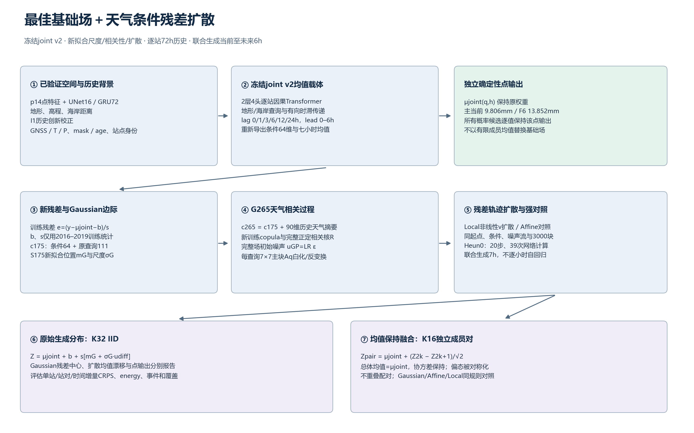
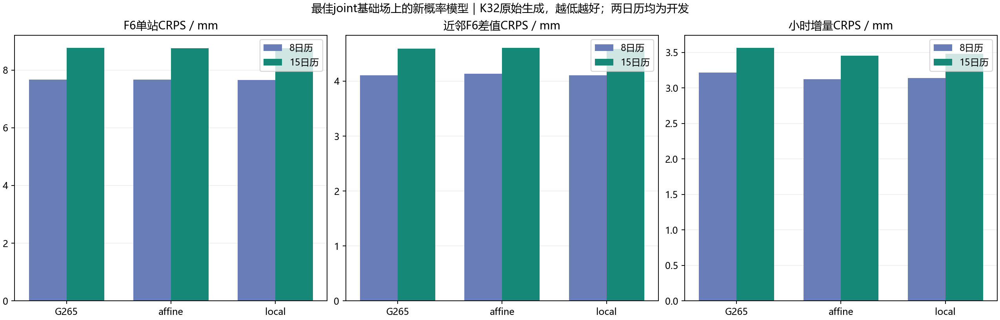
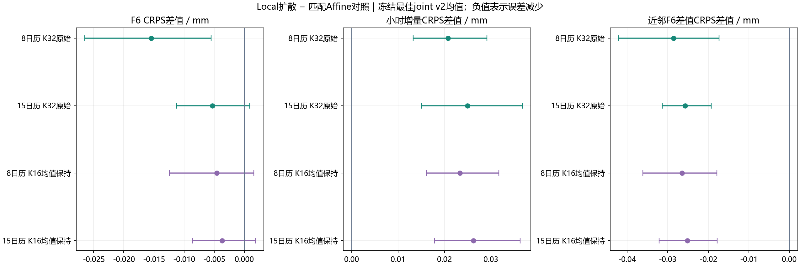
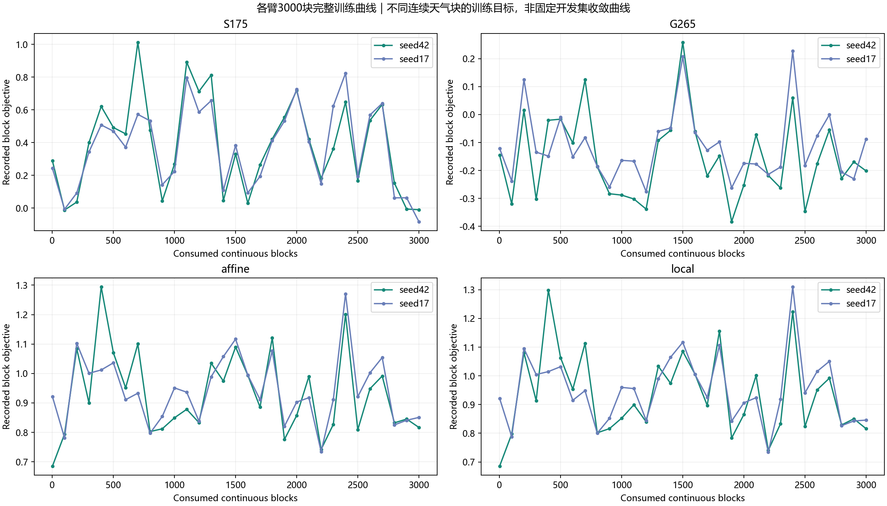

# 最佳基础场与扩散融合：实测架构与结果

本实验把已验证的joint v2/last载体冻结，重新拟合其训练残差上的S175、G265及Affine/Local扩散。两种子各四臂3000连续块完成；点输出与原joint v2数组逐值一致。原始K32生成与独立双场差分K16均完整评价两组2020开发日期。

## 点预测与生成场怎样连接

确定性均值使用p14/I1背景、逐站因果Transformer和地形/海岸条件有向时滞传递。新概率分支接收其64维查询状态、111维原始查询条件和90维固定可见站历史天气摘要。72h状态依赖146h原始数值，输入截至预测起点。

设冻结点场为μjoint，训练残差均值/尺度为b、s，先标准化e=(y−μjoint−b)/s。S175学习条件残差位置mG与尺度σG；G265学习完整时空相关矩阵R。用同一Gaussian场作为Affine与Local的初值，逐查询7×7轨迹块白化后执行v扩散/仿射流，再恢复物理mm。

原始输出为Z=μjoint+b+s[mG+σG·udiff]。μjoint仍作为独立点输出，概率中心可以因S175及扩散而变化。中心保持输出用两个独立完整场之差：Zpair=μjoint+(Z−Z′)/√2，其总体均值严格等于μjoint、协方差等于原Z；偏态被对称化。它不等于将同一成员集合减样本均值，实际K16成员均值仍有采样方差。

## 当前实际效果

融合模型提供两类输出：确定性点预测保持原joint；Local生成场用于概率预测。两种子平均点精度如下，未把采样均值混入点模型成绩。

| 日历 | 当前站宏RMSE/mm | 六小时站宏RMSE/mm |
|---|---:|---:|
| 8 | 9.806169 | 13.852222 |
| 15 | 10.767129 | 16.077837 |

| 概率模型 | 主F6 CRPS/mm | 补充F6 CRPS/mm | 主增量CRPS/mm | 补充增量CRPS/mm |
|---|---:|---:|---:|---:|
| G265 | 7.675242 | 8.771587 | 3.214113 | 3.565154 |
| affine | 7.672983 | 8.755594 | 3.119629 | 3.455852 |
| local | 7.657557 | 8.750280 | 3.140358 | 3.480811 |

Local相对新G265的F6 CRPS主/补改善0.230%/0.243%，内部增量改善2.295%/2.366%、energy改善0.239%/0.190%，这些比较的月份区间均支持改善。与同预算Affine相比，单站F6额外收益为0.201%/0.061%，只有主日历区间完全低于零；内部增量分别增加0.664%/0.722%，区间均为正。

Local的近邻F6差值CRPS相对Affine改善0.691%/0.558%，但Affine本身相对G265有局地代价。Local相对G265的近邻改善为0.077%/0.171%，主日历区间跨零、补充区间低于零。因而较强证据是保留天气核的局地关系并改善边际/轨迹分布，额外空间收益须按对照解释。

20mm减湿Brier相对G265改善约0.532%/0.529%；相对Affine则增加约0.598%/1.141%，补充日历区间为正。当前单站CRPS和相对Affine的energy额外收益区间跨零。局地、时间变化和尾部评分因此分别报告，不能合并称为全面升级。

## 完整评分与额外收益

- 日历8，local_vs_affine：F6 CRPS差值-0.015427mm，95%共同月份区间[-0.026485,-0.005474]mm；负值表示Local改善。
- 日历8，paired_local_vs_paired_affine：F6 CRPS差值-0.004540mm，95%共同月份区间[-0.012448,0.001589]mm；负值表示Local改善。
- 日历15，local_vs_affine：F6 CRPS差值-0.005314mm，95%共同月份区间[-0.011222,0.000898]mm；负值表示Local改善。
- 日历15，paired_local_vs_paired_affine：F6 CRPS差值-0.003686mm，95%共同月份区间[-0.008557,0.001833]mm；负值表示Local改善。

与此前TF3000＋Local完整方案相比，同主日历F6 CRPS由7.760754变为7.657557mm，描述性改善1.330%。这包含更强基础场/编码及匹配概率重训的共同作用，不是扩散模块的单独收益。旧Local方案没有同口径补充日历成绩，本轮不补造。

## 严格保持基础场均值的版本

K16差分版本的总体均值等于joint，其确定性点场仍为上述精度。相对K16 Affine，单站F6额外收益约0.059%/0.042%，两区间均跨零；近邻差值CRPS改善0.639%/0.545%，但对K16 G265主日历反而增加0.129%，补充也没有稳定改善。内部增量相对K16 Affine增加0.752%/0.762%。

这是冻结模型后的中心保持变换，尺度与扩散原先围绕S175校准中心训练，未在固定joint中心条件下重新拟合。它证明本轮可以保留基础场均值并生成相关场，同时保留对称化、中心重置的实际代价；这些分数不代表所有零均值扩散的可达上限。

K16表中的方差扣除均值MSE是单次噪声流的Monte Carlo诊断，可能给出偏离零的月份区间；解析总体均值与保存点场仍严格joint。月份重采样固定本次训练种子与采样流，不包含独立重抽成员的全部不确定性。

## 重点站与使用选择

重点站的收益并不均匀：主日历PLTX的Local F6 CRPS为13.0043mm、Affine为12.9716mm；P786则为11.4475/11.5035mm。PLTX与P786等站的点RMSE保持原joint，不把概率评分改善写成点误差降低。完整137站及两日历见下面补充报告。

点预测保留joint；要求严格概率均值一致时使用中心保持版本。原始Local可作为侧重边际与局地关系的概率候选，Affine继续作为时间增量及减湿事件的强参考。当前证据支持按任务选择，并未产生同时提升全部指标的新融合冠军。

## 本轮定位的条件接口

源码核对显示，joint返回的64维h生成于显式物理创新及有向transport读出之前；导出时另外保存最终七小时均值。概率网使用h＋原查询111维，Local再加90维天气摘要。新均值已用于残差定义与还原，但最终七小时预测、有向分支数值和注意力统计尚未作为独立条件通道直连概率网。已有h仍可间接反映相关输入；本轮没有证明这些信息被完全丢失。

后续可用同预算消融检验最终预测/有向修正的显式条件接口，再比较固定中心下重拟合尺度和扩散。这里记录具体可检验的接口，未据此继续启动新训练，也不将其写成已取得收益。

[完整数值、点预测与采样均值表](../../experiments/us/20261126_best_base_diffusion_fusion/paired/REPORT.md) · [全部区间与分层JSON](../../experiments/us/20261126_best_base_diffusion_fusion/paired/summary.json) · [覆盖和重点站](../../experiments/us/20261126_best_base_diffusion_fusion/paired/DIAGNOSTICS.md)

## 训练与核验

训练曲线展示每100块记录的当前块目标；连续天气块分布变化引起波动，不能把最后一个点与第一个点直接解释为固定总体的收敛。均值保持、来源、真实监督时钟及K16/K32秩覆盖测试均有RED→GREEN记录。每个正式模型核对最终checkpoint与last逐张量一致，优化器/scheduler时钟由原始标签掩码重算。

## 数据范围与复现

训练2016–2019、410站训练池；连续3000×12h块，末91块顺序重放，历史不跨回绕拼接。2020每月8–10日及15–17日、三布局、137注册查询（R/F6实际135站有标签）均为已暴露开发，未作多重探索校正。严格折外残差尚未构建：strict_oof=false。历史PWV制包筛选、原Q128未来可用性选站限制保留，确认138及原C/D未读。

新模型不使用PWV/IWV/TCWV/Tm条件或教师。原始数据、权重、大数组留本机；Git同步代码、协议、指标、图和哈希。本实验的概率成绩来自重新拟合的新joint残差，不与旧TF3000概率成绩混用。

[冻结科学合同](../superpowers/specs/2026-11-26-best-base-diffusion-fusion.md) · [实施计划](../superpowers/plans/2026-11-26-best-base-diffusion-fusion.md) · [逐步执行与纠错记录](../../research/joint_fusion_20261126/progress.md)
