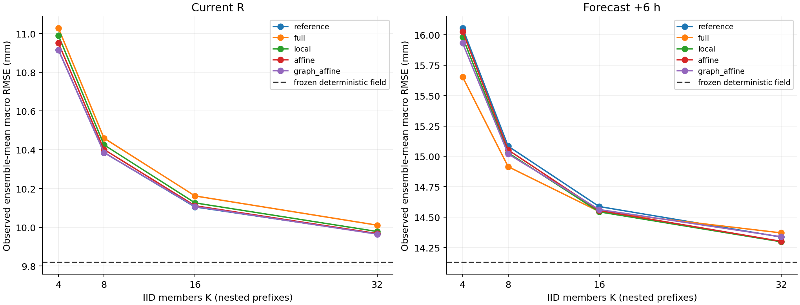

# 扩散的实际收益与均值误差

当前扩散最明确的收益是未来局地空间差值的概率预测。基础场继续提供约9.8mm点预测；Full扩散改善未来近邻站间关系，同时出现当前均值和全场概率评分的代价。两类结果需要同时决定下一步架构。

## 明显改善的角度

同一冻结Transformer3000均值、S175条件与训练统计，双种子均完成3000连续块；Heun0×20、32个IID成员。下表CRPS为连续秩概率评分，越低越好，用于评价完整预测分布。站对指标以两个站ZWD之差为目标，区别于单站ZWD精度。

| 角度 | seed42改善 | seed17改善 | 解释 |
|---|---:|---:|---|
| Full，0–50km站对F6差值CRPS | 14.88% | 12.99% | 最强局地未来联合收益 |
| Full，50–150km站对F6差值CRPS | 6.80% | 5.83% | 邻域相关作用扩展到150km |
| Full，150–300km站对F6差值CRPS | 3.95% | 3.36% | 收益随距离减弱 |
| Local，0–6h轨迹内部增量CRPS | 3.27% | 2.72% | 时间变化分布改善 |
| Local，单站F6边际CRPS | 0.234% | 0.257% | 单站概率改善幅度小 |

同图GraphAffine高斯对照已复现约11%的近邻收益。Full相对GraphAffine另改善4.14%/2.07%，差值共同月份95%区间分别为[−0.222870,−0.163123]和[−0.121146,−0.070639]mm。这支持本开发日历内的局地非线性增益，完整空间依赖的贡献更大；独立新日期上的Full−GraphAffine额外收益尚未验证。

Local时间增量收益也要与Affine比较：Affine相对原GP改善2.90%/2.81%，Local相对Affine的方向在两个种子间不一致。因此目前时间概率收益主要支持轨迹建模，不能全部归为非高斯扩散贡献。所有区间为已暴露2020开发比较、未做多重比较校正。

冻结seed42补充日期每月15–17日，Full的近邻F6差值CRPS由6.001020降到5.094155mm，约15.1%改善；Local为5.890182mm。它复现Full相对原GP的局地收益，同时energy由9.540595升至9.623988mm。第二种子同政策补充验证仍在运行。

## 当前的损失

Full当前时刻0–50km差值CRPS在两种子均约增加1.95%；F6的≥300km差值增加1.34%/1.16%。全场fair energy也增加。收益集中在未来局地结构，现有结果不支持将它作为全局替代模型。

双种子当前场macro RMSE如下：

| 输出 | RMSE/mm | 数值含义 |
|---|---:|---|
| 冻结确定性基础场 | 9.818254 | 正式保留的点预测 |
| S175高斯解析均值 | 9.832159 | 含原Gaussian均值头修正，无采样误差 |
| 原GP，K32采样均值 | 9.966152 | 含有限成员误差 |
| Full，K32采样均值 | 10.010537 | 有限成员误差与模型均值修正共同作用 |
| Local，K32采样均值 | 9.977826 | 同上 |

同一基础场数值未变；当前实验接入源Transformer3000，尚未换入H/S续训或新H+S。9.818254与历史I1的9.817064是相近精度的不同候选，来源分别保留。主日历约9.8mm也不能代替补充日期或全年精度。

## 采样误差与模型均值修正的实测分离

独立成员数为K时，条件均值为m、预测方差为v，对给定真值y有：

$$E[(\bar Y_K-y)^2]=(m-y)^2+v/K.$$

因此在平方损失下，直接用K32集合均值比较确定性基础场会额外承担有限采样方差。标准化残差只调整数值坐标，不会自动保证m优于基础场。

对已保存的真实样本计算`(barY-y)^2-s²/K`，其中s²为无偏样本方差；这个量对条件均值MSE无偏。先按原layout/站点聚合再开方，仅作描述性RMSE估计：

| 模型 | 原K32当前RMSE/mm | 扣除方差项后的当前估计/mm | F6估计/mm |
|---|---:|---:|---:|
| 原GP | 9.966152 | 9.821699 | 14.078024 |
| Full | 10.010537 | 9.854385 | 14.186204 |
| Local | 9.977826 | 9.823225 | 14.044784 |
| Affine | 9.967303 | 9.817399 | 14.042103 |
| GraphAffine | 9.964183 | 9.819600 | 14.106636 |

开平方后的估计量本身不具无偏性，也保留K32的统计波动。正式判断使用micro MSE差值：Full相对基础场当前增加1.112595mm²，共同月份95%区间[0.169655,2.188010]mm²；相对原GP增加0.851137mm²，区间[0.081915,1.732681]。因此当前Full的损失包含有害均值修正。Local相对基础场当前差值区间跨零，F6相对基础场也跨零；相对原GP的F6 MSE改善区间为[−2.011758,−0.546280]mm²，Affine给出相近改善。

完整推导、嵌套K曲线说明、各类指标、来源哈希和区间见[均值采样分析](../../experiments/us/20261126_diffusion_mean_sampling_audit/REPORT.md)及[收益归因JSON](../../experiments/us/20261126_diffusion_mean_sampling_audit/benefit_attribution.json)。分析不训练模型，确认138及原C/D标签保持隔离。

## 下一步如何使用这些收益

1. 点预测保留基础场，新增均值候选通过同起点、同预算的MSE配对后再替换。概率输出单独评价条件均值；K32集合均值不作为基础场精度的直接替代。
2. 已启动的天气GP冻结S175解析中心与边际尺度，只学习随天气、距离、地形和lead变化的相关性。它用于检验近邻联合收益能否在保持原边际分布的同时实现。
3. G265完成后按预注册比较Local与Affine。相同条件、噪声流和NFE；报告概率均值漂移、单站CRPS、四档站对、内部增量和energy。没有净收益的分支保留为机制对照。
4. 后续中心约束与独立均值头需另立实验：均值用点预测损失监督，概率训练对基础场停止梯度；检验中心化残差生成能否保留局地联合优势。当前零初始化保证初始继承，不保证训练后分布均值始终为零。
