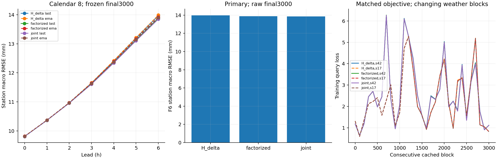
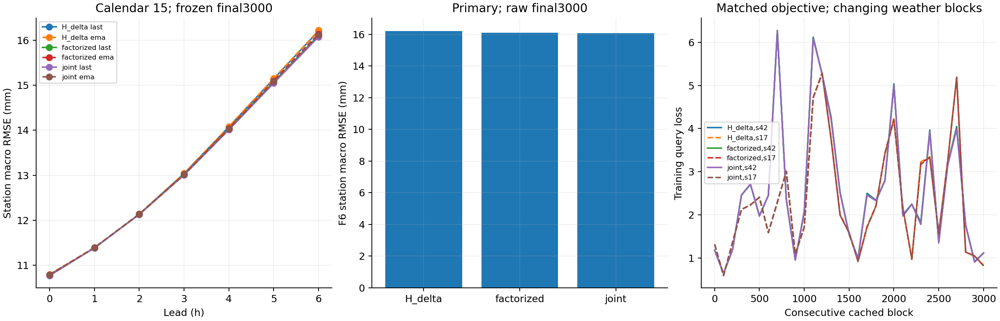

# 有向站点×时滞传递：六小时收益在两组日期上复现

## 结果与含义

同源TF3000、同连续3000块及同损失下，joint相对H_delta的六小时站宏RMSE在主/补充日历分别减少0.120905/0.129961mm；相对同参数factorized减少0.025453/0.031809mm。两种子、两组日期方向一致，共同月份区间均为负。当前场保持约9.8mm，主日历当前差异区间跨零；这支持把历史key与地理/lag交互的联合传递作为继续研究方向。

历史key和非可分离edge在joint中共同变化，本轮不能将全部收益单独归因其中一项。结果是确定性均值改进，不是新增diffusion收益；旧概率来源继续冻结。

## 架构与训练

两臂117757参数，相同四头和六滞后0/1/3/6/12/24h。factorized重复使用末时刻站点key并分解地理/lag评分；joint读取历史因果key并联合建模空间、滞后与lead。显式数值保留post-I1 self创新、GNSS及T/P小时变化，地形和海岸关系进入查询传递。当前/未来新增修正分别限幅3/6mm，新增读出零初始化。

两种子从各自原TF3000恢复，同H_delta损失、Adam/RNG及学习率续训3000；raw final3000为主，EMA并列。v2使用每变量独立masked maximum归一，缺失变量精确为零。v1归一化工程缺陷已停止并保留，不参与排名。

## 核验数值

| 日历 | raw模型 | 当前站宏RMSE/mm | 六小时站宏RMSE/mm | 跨起点当前增量站宏RMSE/mm | 同起点内部增量microRMSE/mm |
|---|---|---:|---:|---:|---:|
| 主 | H_delta | 9.811195 | 13.973126 | 5.544171 | 5.801856 |
| 主 | factorized | 9.806618 | 13.877675 | 5.516887 | 5.792387 |
| 主 | joint | 9.806169 | 13.852222 | 5.494214 | 5.789937 |
| 补充 | H_delta | 10.786318 | 16.207798 | 6.317700 | 6.597349 |
| 补充 | factorized | 10.770065 | 16.109646 | 6.282639 | 6.584765 |
| 补充 | joint | 10.767129 | 16.077837 | 6.253898 | 6.580253 |

joint−H_delta六小时差值主/补充95%月份区间为[-0.174916,-0.063798]/[-0.171330,-0.087528]mm；joint−factorized为[-0.039400,-0.011613]/[-0.049137,-0.013653]mm。相对H_delta的主当前区间[-0.014379,0.006674]mm跨零，补充当前[-0.037862,-0.001255]mm。

joint相对H_delta主/补充六小时两种子差值分别为[-0.132235,-0.109574]/[-0.140654,-0.119268]mm。两种增量口径在两日历两种子均改善；本轮不以该幅度宣布重大突破。

## 区域收益与后续重点

- 海岸距离150–300km的F6 MSE相对H_delta减少2.8053%/2.5166%，相对factorized减少0.7724%/0.8032%，两日历区间均为负。
- 海拔<500m相对H_delta的F6 MSE减少1.8704%/1.6277%；三个高度档、所有海岸距离档均有F6改善且区间为负。
- 最近有效GNSS站>300km尚无稳定F6收益，主日历相对H_delta改善0.8373%，补充增加0.0446%，区间均跨零。该档继续作为空间外推重点。
- 主日历joint相对factorized的当前<50km站对差值MSE增加0.0468564mm²（0.09361%），区间[0.0145011,0.0846949]。补充该项没有正区间；保留该局地代价。
- 季节只有各三个月，相关区间为NA；仅作描述，不宣称季节显著性。

后续先保持本轮来源，检验更细的有向传播与多尺度历史。若将joint作为新概率中心，须重新构造匹配残差、尺度和相关模型，再与Gaussian/Affine/diffusion对照，不能直接继承旧概率分数。

## 核验与范围

四个模型各3000次监督更新，raw/EMA与final3000逐tensor一致。seal、原TF来源、训练缓存、参数、模式、代码与评价依赖、导出数组和几何/nearest哈希均通过。独立审阅从12份raw数组重算点值和2000次共同月份区间，误差<1e-12；未发现新Critical/Important。

训练2016–2019；2020每月8–10日和15–17日均三布局，137注册/135当前和F6有标签查询，均为已暴露开发。strict_oof=false、原未来可用性选站、历史PWV筛选来源和末91块复用限制保留，未经多重探索校正；确认及原C/D未读。

## 复现入口

- [完整架构与修正合同](../superpowers/specs/2026-11-26-directed-lag-v2.md)
- [主日历报告](../../experiments/us/20261126_directed_lag_v2/paired_calendar8/REPORT.md)
- [补充日历报告](../../experiments/us/20261126_directed_lag_v2/paired_calendar15/REPORT.md)
- [下一步研究排序](2026-11-26-next-research-checkpoint.md)
