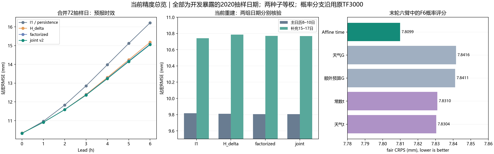
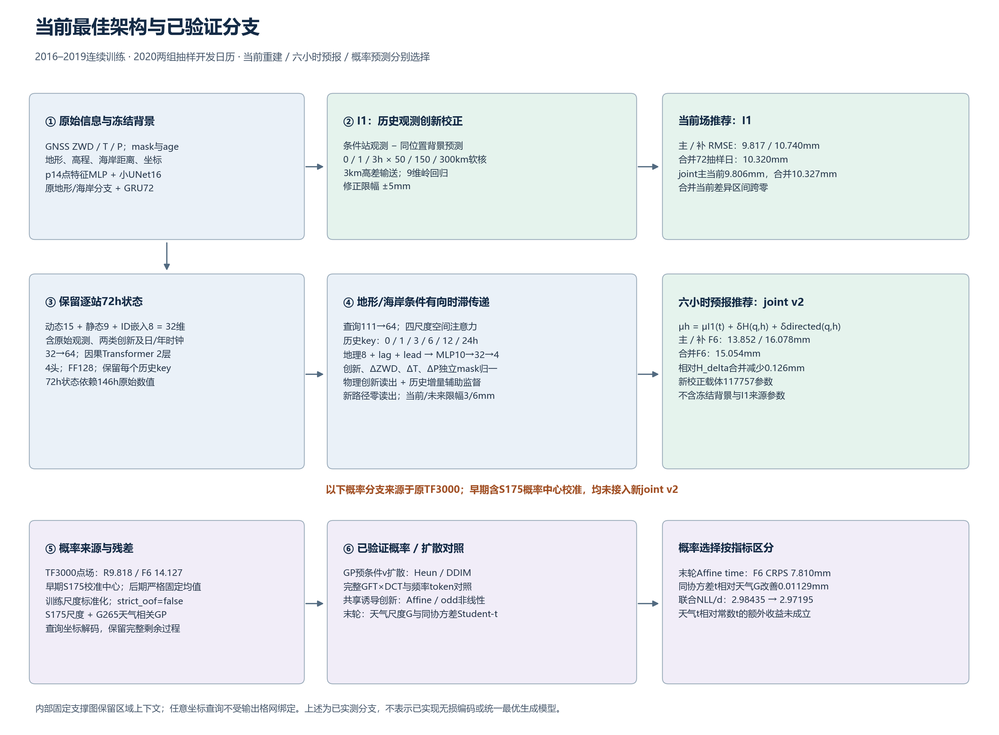
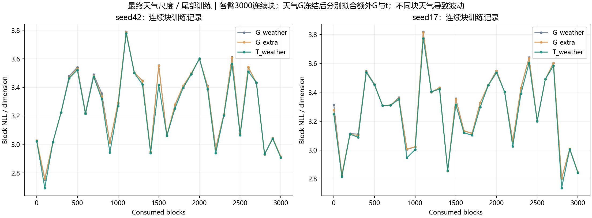

# 阶段研究总报告：最佳基础场、时空预报与生成式残差

本轮研究已按用户要求收束：最后一轮天气条件尺度与同协方差Student-t训练、评价、独立核验全部完成，随后停止新增实验。当前形成三个清晰的模型选择：**当前场重建保留I1；六小时预报采用有向时滞Transformer joint v2；概率预测按边际、联合与事件指标分别选择，尚未建立一个全面优于强Gaussian的扩散模型。**

## 1. 当前精度与模型选择

下面四臂均在相同两种子、三条件布局和两组2020抽样日历上复核。站宏RMSE先在每站、每布局累积有效平方误差，再平均站点、布局和种子。合并日历先合并有效误差及计数再开方，不能直接平均两张RMSE表。I1的未来项是起点持久性，不代表I1含预报模块。

| 模型 | 主当前/mm | 补充当前/mm | 合并当前/mm | 主F6/mm | 补充F6/mm | 合并F6/mm |
|---|---:|---:|---:|---:|---:|---:|
| I1／起点持久性 | 9.817064 | 10.740343 | **10.319804** | 14.959594 | 17.297820 | 16.219944 |
| H_delta | 9.811195 | 10.786318 | 10.339474 | 13.973126 | 16.207798 | 15.179783 |
| factorized | 9.806618 | 10.770065 | 10.328865 | 13.877675 | 16.109646 | 15.082875 |
| joint v2 | **9.806169** | 10.767129 | 10.327014 | **13.852222** | **16.077837** | **15.053927** |

I1是当前重建的稳健选择。joint主日历当前达到9.806mm，但合并当前相对I1差值为+0.007210mm，95%共同月份区间[-0.040866,+0.057260]mm。这个结果支持保留当前重建来源，而不是按单一日历小数点选模型。历史I2季节交互的合并当前为10.319798mm，与I1近乎相同；其额外收益未成立，既有冻结选择仍为I1。

joint是当前已测候选中六小时预报的推荐架构。合并F6相对H_delta减少0.125856mm，区间[-0.166287,-0.084262]mm；相对同参数factorized减少0.028948mm，区间[-0.042988,-0.015651]mm。主/补充日历的改善均复现。相对I1持久性的合并F6减少1.166017mm，约7.19%；其中包含新增时序预报能力，不能全部归因于最后的有向模块。

| joint v2的其他指标 | 主日历 | 补充日历 | 合并日历 |
|---|---:|---:|---:|
| 当前microRMSE/mm | 10.3278 | 11.2940 | 10.8214 |
| 当前MAE/mm | 7.5565 | 8.1726 | 7.8644 |
| F6 microRMSE/mm | 14.2891 | 16.5219 | 15.4445 |
| F6 MAE/mm | 10.6788 | 12.2245 | 11.4507 |
| F6 Bias/mm | -0.3400 | -1.0944 | -0.7167 |
| F6绝对误差P95/mm | 29.0925 | 33.9631 | — |
| 跨起点当前小时增量站宏RMSE/mm | 5.4942 | 6.2539 | 5.9001 |
| 同起点内部小时增量microRMSE/mm | 5.7899 | 6.5803 | 6.1973 |

合并增量分别在各72h段内部计算，不跨日期空档。点值、空间差值、未来轨迹增量和概率CRPS是不同评价对象，保留各自单位与汇总口径。

[合并精确数值、区间与源哈希](../../research_pipeline/studies/us_dense_zwd_20261105_v1/03_code/gnss_field_server/results/20261126_final_research_summary/point_metrics.json)｜[有向时滞完整结果](2026-11-26-directed-lag-v2-results.md)｜[逐站尾部指标](../../research_pipeline/studies/us_dense_zwd_20261105_v1/03_code/gnss_field_server/results/20261126_directed_lag_v2/station_tail_audit/REPORT.md)

## 2. 当前最佳确定性架构

[SVG矢量图](../figures/final_research_20261126/best_architecture.svg)。图中三类输出对应各自已测模型。概率分支来源于原TF3000基础点场：早期GP与Local/Affine含S175概率中心校准，后期固定中心对照、诱导创新流和末轮才严格固定TF3000解析均值；这些分支均未在joint v2上重训。

### 2.1 背景场：点特征、小U-Net和既有时间分支

p14使用113维点特征的128宽MLP与30通道固定内部支撑U-Net16。点路径保留站点到查询的细节，U-Net提取区域上下文；既有地形/海岸分支和GRU72通过8×8内部历史支撑接入。当前方案保留这套已验证背景，新增模块从冻结来源上学习修正。

输出能够查询任意坐标，内部仍使用固定支撑图。当前证据支持“坐标查询解码”，没有证明“全部空间信息无损”或“整模型完全没有格网”。这一点与强行将最终输出绑定规则像素不同。

### 2.2 I1：用观测创新改善当前空间重建

创新是可见条件站的观测减去同位置背景预测。将0/1/3h创新按3km高差尺度输送，再在50/150/300km软核上聚合，构成9维特征；训练池拟合岭回归头，输出限幅±5mm。

I1把主当前站宏RMSE从9.929151降至9.817064mm，补充从10.869282降至10.740343mm；合并从10.441761降至10.319804mm。历史创新同时保持小时增量表现，比只使用当前创新更适合时序重建。

### 2.3 原生逐站编码与因果Transformer

新编码保留每个站的身份、观测及历史，而不是先把全部站压成一张粗图。每站每时刻输入32维：动态15维、静态9维和站点ID嵌入8维。动态项包含原始GNSS/T/P、三变量mask/age、背景及I1后创新、日/年时钟。静态项与查询关系提供地形、高程和海岸条件。

32→64投影后进入2层、4头、FF128的因果Transformer，dropout=0；每个历史时刻的key被保留。72h状态窗口依赖上游146h原始数值，因此缓存必须绑定条件站集合、时间范围及源权重，不能拼接不同条件布局的历史。

查询111→64，采用四尺度50/100/200/400km注意力接收逐站状态。物理创新读出和6×3因果站点增量辅助监督促使编码器保留可用于未来预测的信息。相同72h有效状态历史的完整联合GRU/LSTM/Transformer F6为14.177009/14.251512/14.127401mm；这是骨干对照。joint另从Transformer续训3000块，其13.852222mm不能作为同训练预算的纯骨干排名。

### 2.4 joint v2：空间、历史滞后与预报时效联合传递

joint读取0/1/3/6/12/24h历史key，4个头分别学习有方向的传播关系。地理8维、lag和lead进入10→32→4的边MLP。显式数值路径保留I1后创新、ΔGNSS、ΔT、ΔP，并对每变量独立mask归一；高差输送与海岸/地形关系参与查询。

新增路径零读出初始化，当前/未来新增修正限幅3/6mm；原载体头限幅5/30mm。输出为：

$$\mu_h(q)=\mu_{I1}(q,t)+\delta_H(q,h)+\delta_{directed}(q,h).$$

新校正载体117757参数，不含冻结p14、GRU和I1来源。factorized与joint同参数、同起点和同预算；joint同时改变历史key读取与非可分离边评分，当前消融支持这两项的组合，尚未分别量化单项贡献。

v1曾出现异步缺测归一化稀释GNSS创新的问题：仅增加温度有效站也会改变GNSS读出。已保留停止证据，v2改为每变量有效集合上稳定归一，并从原TF3000重新训练。正式结果全部来自v2。

## 3. 扩散与概率场：哪些收益已经成立

概率路线以原TF3000为基础点场来源（当前9.818254/F6 14.127401mm）。早期S175另外校准概率残差中心与条件尺度，G265继承其中心/尺度并建立天气相关Gaussian过程；Local还可移动概率均值。后续centered对照、共享诱导创新流与末轮严格把概率解析均值固定为TF3000。基础点输出与概率分布中心分别记录，才能比较GP预条件v扩散、局部传输、Affine及非线性创新流。

| 机制与比较 | 已验证收益 | 解释 |
|---|---|---|
| G265天气相关核相对原空间概率参考 | 近邻F6站对差值CRPS主/补改善20.76%/22.42% | 主要收益来自相关结构；基础点输出保持TF3000，概率中心/尺度继承S175，不是点RMSE降低20% |
| 轨迹Full扩散 | 近邻F6差值CRPS改善约13%–15% | 同图Gaussian约11%；当前、远距离和全场指标有代价，未作为当前均值替换 |
| Local相对Affine | F6边际额外改善约0.165%、近邻约0.454% | 内部增量有代价；非Gaussian额外收益需强控制 |
| Affine time相对冻结Gaussian | F6 CRPS改善0.366%、增量1.855%、近邻1.853% | 20mm增湿/减湿Brier改善1.029%/2.118%；主要由Gaussian调整实现 |
| odd_frequency相对Affine frequency | F6差值+0.002953mm，区间跨零 | 未触发补充日历；不作为频域或非线性突破 |

共享诱导创新流保留完整剩余GP，在8个几何锚点的共享创新上演化；该实验使用终端联合proper评分，属于概率流对照，不能将它等同传统加噪去噪score matching。无标签线性代理诊断显示，odd time/frequency进入最终场的非线性残差方差约0.01745%/0.00372%，解释了这组模型为何接近条件Gaussian。

标准化残差使模型在训练尺度上处理小幅误差，输出再还原mm。它解决数值量级组织，不保证采样自动改善RMSE。有限K成员均值带有采样方差；扩散还可能移动均值。因此本阶段专门核验了均值保持、协方差匹配、采样器参考方差、成员独立性和联合评分。

**目前没有实测证据表明：把diffusion接到9.806mm的joint v2上，已经得到更低RMSE。** 该组合尚未重建匹配残差并训练。当前最有依据的生成方案是“可靠确定性均值＋天气条件尺度/相关过程＋受强Gaussian控制的残差生成”，其中扩散是否必要由额外概率收益决定。

[天气对照完整归因](2026-11-26-weather-controls-final.md)｜[共享诱导创新流](2026-11-26-inducing-flow-results.md)｜[均值误差与采样分解](2026-11-26-diffusion-benefits-and-mean-error.md)

## 4. 最后一轮：天气尺度与同协方差重尾

两种子分别训练G_weather、G_extra、T_weather，每臂3000连续块；实际监督更新为2999/3000，空标签块不造标签。三种新增MLP均为90→64→64→1、10049参数。先拟合天气尺度G并冻结，再分别以相同额外预算拟合额外Gaussian尺度或天气自由度。常数尺度及常数自由度均只用训练数据选择。

设原协方差为C，天气尺度为s²，三种核心分布为：

$$G_w=\mathcal N(\mu,s^2C),\qquad G_e=\mathcal N(\mu,k^2s^2C),$$
$$T_w=t_\nu\!\left(\mu,\frac{\nu-2}{\nu}s^2C\right),\quad \operatorname{Cov}(T_w)=s^2C.$$

Student-t的shape矩阵与总体协方差不同；乘(ν−2)/ν使总体均值/协方差与天气G严格匹配。每成员、每预报起点共享一个独立Gamma尺度，覆盖该起点全部查询和0–6h；不能对每个像素独立缩放而破坏联合机制。复用原Affine的K32 IID Gaussian成员（seed261126），Student额外Gamma噪声使用seed261128；成员不去均值，负值不后裁剪。

| 末轮模型 | 当前CRPS/mm | F6 CRPS/mm | 内部增量CRPS/mm | 近邻F6差值CRPS/mm | 联合NLL/d | F6参考80%覆盖率 |
|---|---:|---:|---:|---:|---:|---:|
| 冻结Affine time | 5.481342 | **7.809858** | **3.144597** | **4.025022** | 3.000885 | 78.46% |
| 常数尺度G | 5.467178 | 7.832834 | 3.215656 | 4.112488 | 2.983943 | 83.33% |
| 天气尺度G | 5.469979 | 7.841648 | 3.220819 | 4.122178 | 2.984347 | 83.31% |
| 额外预算G | 5.470004 | 7.841116 | 3.220320 | 4.121921 | 2.984542 | 83.29% |
| 常数t | **5.466864** | 7.831004 | 3.203809 | 4.101700 | **2.971949** | 82.73% |
| 天气t | 5.468038 | 7.830358 | 3.204560 | 4.102327 | 2.971953 | 82.75% |

预注册主比较天气t−天气G的F6差值为-0.011290mm，95%共同月份区间[-0.019208,-0.005174]mm；联合NLL/d减少0.012394，区间[-0.015613,-0.009284]。对同额外预算G，F6减少0.010759mm，区间同样为负。这支持完整场重尾机制在匹配协方差后提供小幅概率收益。

天气t相对常数t的F6差值为-0.000646mm，区间[-0.002034,+0.000855]mm，天气自适应尾部尚未带来稳定额外收益。相对冻结Affine，天气t当前CRPS和联合NLL改善，但F6 CRPS增加0.020500mm且区间跨零，内部增量增加0.059963mm且区间为正；20mm增湿/减湿Brier也增加。因此保留Affine作为本轮未来CRPS的推荐，常数t作为联合似然与尾部的简洁对照，不用单个评分把它们合成“全面最好”。

曲线是每100块记录的当前块NLL，不是固定验证集曲线；不同天气块自然波动，不能将末点高低单独作为收敛或晋级判断。正式选择依据冻结开发评价。

[末轮完整报告与配对图](../../research_pipeline/studies/us_dense_zwd_20261105_v1/03_code/gnss_field_server/results/20261126_weather_scale_tail/paired/REPORT.md)｜[全部事件、覆盖、区间和哈希](../../research_pipeline/studies/us_dense_zwd_20261105_v1/03_code/gnss_field_server/results/20261126_weather_scale_tail/paired/summary.json)｜[冻结合同](../superpowers/specs/2026-11-26-weather-scale-tail-final.md)

## 5. 频域研究的结论

完整GFT×DCT可逆变换在实际残差上的最大逆变换误差约0.000107mm；一旦截断128图频，前16/32/64频重构RMSE分别为8.598/7.608/6.232mm。对约10mm目标，这些压缩损失不可忽略。频率表示保留全部系数后，再检验网络归纳偏置更合适。

同C64预算的频率token相对近同容量joint扩散改善F6 CRPS约1.53%–1.96%，但超过强Gaussian的额外收益不稳定。诱导创新流的频域分支也没有建立额外收益；其DCT作用于白化eta，不能直接视为真实ZWD物理时间频谱。非规则Fourier、图谱及双频域的代数可行性已有代码和诊断，物理频域增益仍需另行检验。

[频域统一解释](2026-11-26-spectral-and-mean-centering.md)｜[时空频域实现与12张架构图](2026-11-25-joint-spectral-implementation.md)

## 6. 六类误差与重点区域

| 评价方向 | 当前证据 | 重点问题 |
|---|---|---|
| 时间留出 | 2016–2019训练，2020两组抽样日历；joint F6两日历均改善 | 补充日期F6更高，全年、独立年份及极端过程仍待确认 |
| 空间留出 | 137注册开发查询，当前/F6均135站有标签 | 138确认站与原C/D隔离；本轮不报告确认成绩 |
| 当前有效条件站距离 | I1当前远站≥200km约14–16mm；joint >300km没有稳定额外F6收益 | 稀疏边缘的空间支撑与传播方向 |
| 高程/地形/海岸 | joint所有高度档和海岸距离档相对H_delta的F6改善；海岸150–300km F6 MSE减少2.81%/2.52% | 低海拔/近海过程、地形屏障与真实天气关系尚未完全拆分 |
| 站对差值 | 天气G265近邻F6差值CRPS改善约21%–22% | joint主当前近邻差值MSE相对factorized增加0.09361%，保留局地代价 |
| 小时增量 | joint主/补跨起点5.494/6.254mm，内部5.790/6.580mm | 强化时间模块不必然同时改善采样轨迹；重尾尺度扩大可增加增量CRPS |

夏季误差确实更高。I1主/补当前夏季11.015/12.918mm，冬季8.141/8.473mm；这些是季节描述，不作只有三个月的显著性推断。Transformer与joint对未来有收益，尚未把季节差异消除。

重点站中，主日历PLTX F6为24.745mm、P95为53.847mm，P475为22.309mm、PTEX为22.138mm；补充P786 F6为27.999mm、P95为55.804mm。这些站的局地天气、边缘支撑与未来增量需要区别诊断。例如P510共同标签上的当前误差RMS10.605mm、未来增量误差RMS21.397mm，提示未来变化本身是重要误差源；该RMS口径与站宏RMSE分开。

[逐站误差地图](../../research_pipeline/studies/us_dense_zwd_20261105_v1/03_code/gnss_field_server/results/20261126_directed_lag_v2/station_tail_audit/station_tail_maps.png)｜[精确误差分解](../../research_pipeline/studies/us_dense_zwd_20261105_v1/03_code/gnss_field_server/results/20261126_directed_lag_v2/station_tail_audit/ERROR_COMPONENTS.md)｜[I1六类分层表](2026-11-25-precision-final.md)

## 7. 已完成研究的总台账

以下按科学职责整理，各入口保留设计、来源、正式指标、图件和未晋级结果；早期队列与连续四年队列分开。

| 研究部分 | 完成内容与所得结论 | 证据入口 |
|---|---|---|
| v13 U-Net | 五组双种子；点特征＋UNet16为10.828mm，MLP11.175mm，大UNet48为11.800mm | [早期比较](../../research_pipeline/studies/us_dense_zwd_20261105_v1/03_code/gnss_field_server/results/20261124_unet_foundation_v13/RESULTS.md) |
| p14固定支撑 | 双种子扩展评价10.806mm；建立坐标查询基础场 | [p14报告](../../research_pipeline/studies/us_dense_zwd_20261105_v1/03_code/gnss_field_server/results/20261124_fixed_support_encoder_p14_formal/REPORT.md) |
| p15空间采样 | random/hole/距离分层真实筛查；短时分数不与正式队列混排 | [p15报告](../../research_pipeline/studies/us_dense_zwd_20261105_v1/03_code/gnss_field_server/results/20261124_optimization_campaign_p15/REPORT.md) |
| 连续数据、长历史 | 唯一小时轴、真实缺测、条件集合、mask/age与历史跨度核验 | [数据组织](../superpowers/specs/2026-11-25-temporal-history-data-organization.md) |
| p14完整融合 | 海岸/地形、GRU/LSTM/Transformer与约3000步载体融合 | [连续融合](../superpowers/plans/2026-11-25-p14-continuous-fusion.md) |
| T/Q/S/A/D续训 | 14条双种子神经训练轨迹；检验查询、原站、异常与距离重平衡 | [精度衔接](2026-11-25-precision-continuation.md) |
| I0/I1/I2创新 | 连续训练块解析拟合、冻结后补充日期；I1稳健当前约9.817mm | [I1结果](2026-11-25-precision-final.md) |
| 原生天气与时间骨干 | 两种子各12组3000块，GRU/LSTM/Transformer同72h历史 | [原生编码](2026-11-26-native-weather-diffusion.md) |
| C/H/S与HS | 同源续训、物理创新及时间辅助目标；检验互补性 | [HS结果](2026-11-26-next-research-after-hs.md) |
| 内部增量监督 | 双种子3000、两日历；增量及F6微小改善 | [增量消融](2026-11-26-increment-supervision-results.md) |
| self/LOSO/LOGO | 96训练块探针；误差尺度增大不等于额外预测信息，保留self | [留站创新](2026-11-26-leaveout-innovation-panel-results.md) |
| 有向时滞v1/v2 | 缺测归一化修复、重新训练；两日历F6稳定改善 | [joint v2](2026-11-26-directed-lag-v2-results.md) |
| 条件Gaussian与天气GP | 直连信息、G175/G265相关核、近邻与远距分析 | [天气过程](2026-11-26-weather-projective-trajectory.md) |
| 残差扩散与采样器 | 标准化、GP预条件v扩散、Heun/DDIM、IID与均值误差核验 | [完整对照](2026-11-26-weather-controls-final.md) |
| 时空频域 | 可逆性、图谱截断、频率token、同C64正式比较 | [频域结果](2026-11-26-spectral-and-mean-centering.md) |
| 固定均值与中心消融 | shape/scale/both、独立双场配对与42组lead中心诊断 | [中心消融](2026-11-26-lead-mean-results.md) |
| 共享诱导创新流 | 双种子四臂3000、终端联合评分、非线性代理诊断 | [创新流结果](2026-11-26-inducing-flow-results.md) |
| 完整场尾部P0 | 两种子96固定块、2019探针迁移、Gaussian生成自检 | [尾部探针](2026-11-26-full-field-tail-probe-results.md) |
| 天气尺度/尾部P1 | 六个训练模型、十二组评价、同协方差与同预算对照、独立复算 | [最终报告](../../research_pipeline/studies/us_dense_zwd_20261105_v1/03_code/gnss_field_server/results/20261126_weather_scale_tail/paired/REPORT.md) |
| 收束与归档 | 两日历点指标合并、最佳架构PNG/SVG、来源清单和Git核验 | 本文与[绘图来源](../figures/final_research_20261126/manifest.json) |

早期v13/p14主要用2016/17稀疏片段、12个月24h扩展评价；后期使用连续2016–2019与2020每月72h日期。10.8→9.8的数值同时涉及数据与任务变化，不能写成单一架构的提升百分比。

## 8. 数据合同、核验与结论范围

- 区域25–50°N、125–110°W；410训练站池、137开发查询、138确认隔离。原C/D在本轮未读。条件/目标站按合同选取，条件输入截至预测起点。
- 2016–2019连续训练；3000×12h块包含34908个唯一起点小时，末91块顺序重放早期时段；不跨回绕拼接历史。末轮监督更新2999/3000据真实mask核验。
- 2020每月8–10日和15–17日共72抽样日、1728唯一名义小时×3布局，均已开发暴露；末轮概率校准只评主日历。结果不是完整年度、独立盲测或服务器规模验证。
- 新模型条件/教师禁用PWV/IWV/TCWV/Tm。原制包有历史PWV筛选来源；原Q128曾按未来可用性选站，后续Q32改用不据未来标签挑选，但继承原候选池限制。strict_oof=false；这些条件纳入正式新协议重建。
- 末轮六个模型的来源、完整Adam状态、scheduler和监督计数已核验；12份评价在同种子内共用的点场/真值逐值相同，天气G与天气t的尺度/标准差逐值相同。独立SciPy密度、锁定Gamma成员及2000次共同月份区间复算一致。
- 区间条件于固定两个种子、共同月份和已暴露日期；多轮开发探索未经多重比较校正。它们支持本阶段模型选择，正式泛化结论需新的隔离评价。
- 权重、原始数据、NPZ及缓存留本机；Git同步源代码、合同、指标、图和哈希。原科学锁、历史权重、工程停止证据和未晋级结果全部保留。

## 9. 留给下一阶段的具体问题

当前阶段的模型瓶颈已从“是否加入更大网络”转为三件可检验的事：远条件站与极端过程能否获得更有效的信息；确定性中心、条件尺度和时空相关性如何分别校准；非Gaussian形状能否在强对照之上增加稳定收益。

若后续重新授权研究，优先建立严格折外残差与允许变量质控、取消未来可用性选站，再将joint v2作为冻结新均值，重建匹配Gaussian/Affine/t/扩散对照。重点检验>300km、边缘站、夏季和快速增湿/减湿过程，保持原始逐站身份、有向关系与更长历史的信息通路。频域应作用于有物理意义的相关状态，并同时保留完整系数或剩余过程。

上述为归档后的候选工作，未在本轮继续启动。当前交付以已完成结果为止：I1提供稳健当前场，有向时滞Transformer提供最好的已测六小时预报，天气相关过程提供明确的空间概率收益，扩散与重尾的额外价值由匹配控制逐项限定。
