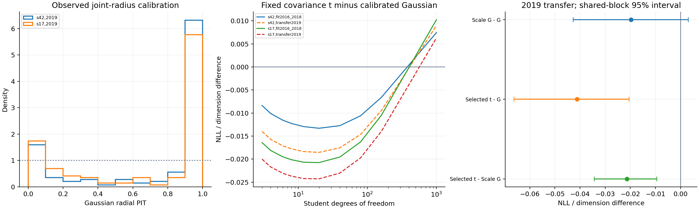

# 完整场重尾探针：联合误差结构中仍有可追踪信号

## 当前发现

在冻结Affine time均值和完整协方差后，两种子都用2016–2018数据选中自由度20的Student-t。2019探针迁移中，相对常数尺度校准Gaussian，平均每维负对数似然减少0.021405，95%共同块区间[-0.034341,-0.009478]。它支持继续研究完整场的误差分布；尚未形成2020预报CRPS、RMSE或事件概率的新收益。

本轮为每种子48个固定唯一时间块、576个起点的解析诊断，2016–2018拟合432起点、2019检验144起点。源TF3000/G265/Affine模型已经拟合2019，因而这里只能称探针迁移，不能称整模型独立留年验证。没有读取2020或确认/C/D标签。

## 同均值、同协方差的数学控制

Gaussian为N(mu,C)。Student-t采用shape=(nu−2)/nu×C，nu>2，故总体均值和协方差同为mu、C。C保留完整剩余GP和已训练Affine映射，未截断全场。源均值仍为TF3000，未接入新有向时滞均值。

先核验低维密度与SciPy一致、大nu极限、partial/empty mask，以及全Affine协方差与完整基底枚举；3项测试通过。真实数据协方差对角与原解析标准差平方最大差约1.82e-12mm²。

真实GNSS诊断使用全部有效坐标子向量的Mahalanobis半径q、维数d及logdet(C)。Q32与原注册规则相同，固定均匀选前2909个唯一块中的48个，不根据标签更换时间或站点。缺失只参与评分掩码。

## 实测评分

| 种子 | 2016–2018选择 | Gaussian方差校准倍数 | 2019固定Gaussian NLL/d | 尺度Gaussian | 同协方差t20 |
|---|---|---:|---:|---:|---:|
| 42 | t20 | 1.27303 | 3.218653 | 3.198150 | 3.179614 |
| 17 | t20 | 1.33799 | 3.187328 | 3.168296 | 3.144020 |

NLL/d单位为nats/观测维度，数值越小越好；不将其百分比当作精度改善。常数尺度只用2016–2018拟合，两个模型共享同一标签人口。2000次重采样以所选12个2019块为单位、跨两种子共享索引，不将块内相邻起点当独立重复。

## 尾部校准仍需改善

2019径向PIT超过95%的比例：

| 种子 | 固定Gaussian | 尺度Gaussian | t20 | 校准参考 |
|---|---:|---:|---:|---:|
| 42 | 57.64% | 30.56% | 18.06% | 5% |
| 17 | 56.25% | 23.61% | 16.67% | 5% |

t20改善径向诊断，但尚未达到校准参考。偏离可能同时来自均值、天气依赖方差或相关结构误配；当前结果不能单独证明剩余误差在充分条件化后仍内禀非Gaussian。

另以四个固定源状态、各4096个实际Gaussian成员做自校验。生成q/d均值0.9996–1.0011，PIT>95%比例约4.76%–5.32%，符合预期。这将真实联合误差信号与明显的协方差计算错误区分开；该生成自检不计作大气预测验证。

## 下一步的重点

下一项应先加入天气条件Gaussian尺度控制，并在相同条件协方差上比较Gaussian和Student-t；同时检查白化残差的均值、时间方向和相关误配。可先以固定协方差收缩探针诊断过强相关，避免将协方差误配误认作尾部形状。

若尾部信号在这些控制后仍存在，再验证作用于完整残差场的天气条件随机尺度和扩散结构；不局限于只覆盖部分原方差的8个诱导模式。白化eta频域与相关诱导物理时间状态的消融另行进行。上述新正式训练和2020评价尚未启动。

## 核验与复现

独立只读复核确认两种子所有48×12实际起点、Q32选择、掩码、来源/seal/代码和矩阵计算一致，SciPy/NumPy重算评分及块区间一致。旧原始实验、代码和锁保留；本轮只新增数学与诊断模块。

strict_oof=false、旧Q128未来可用性筛选、历史PWV质控来源限制保留；该探针无神经3000更新或完整年度成绩。权重、大数组保留本机，代码与轻量证据同步GitHub。

- [完整配对记录与来源](../../research_pipeline/studies/us_dense_zwd_20261105_v1/03_code/gnss_field_server/results/20261126_full_field_tail_probe/paired/summary.json)
- [执行计划与方法公式](../superpowers/plans/2026-11-26-full-field-tail-next.md)
- [上一项诱导创新流结果](2026-11-26-inducing-flow-results.md)
