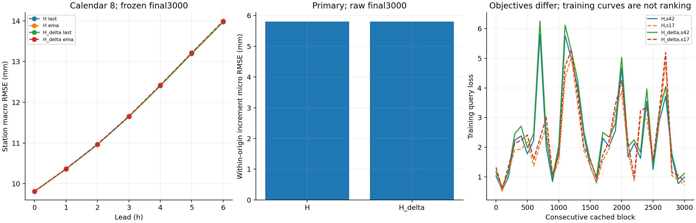
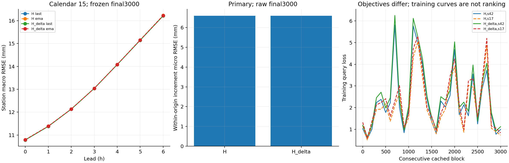

# 固定H架构的增量监督：两日历方向稳定，幅度约千分之一毫米

## 研究结论

新增同一起点内部h0…h6差分损失后，两个固定种子及主/补充日历的内部增量误差均小幅减少，跨起点当前增量也同向改善。当前场基本保持，六小时改善约0.003–0.005mm。它支持在后续训练中保留增量目标作为候选，但未形成实际精度突破；下一项优先检验留站创新的可预测性及有向时滞传递。

## 单因素与实际执行

原H已包含创新读出和相邻预报起点h0差分。本轮网络仍为108393参数的H，新增原mean_loss＋0.5倍同一起点六个lead差分损失。误差按10mm归一化，站权重和相邻两标签联合mask参与计算；每lead单独归一化，再平均六lead。

新独立训练器在lambda0下真实重放4更新，与旧H的model、EMA、AdamW、scheduler、CPU/CUDA RNG及step全部逐值相同。lambda0.5四步改变权重，warm三项差为零，每次10752个有限查询标签。正式代码和规则在训练前固定至`9d914ee`及`increment_lock.json`，未回改旧H/HS源码。

两种子42/17均从各自TF3000 checkpoint续训3000；旧AdamW状态/RNG恢复，旧/新参数lr1e-4/3e-4、cosine3000、辅助因果站点损失0.25、EMA0.999不变。各用约388秒，3000次监督更新完整完成。raw final3000为主，EMA并列；补充日历冻结全部权重，仅导出与评价，无拟合。

## 正式数值

训练2016–2019；主日历2020每月8–10日、补充每月15–17日，均三布局137注册查询。当前/F6有标签站均为135个。表内当前、F6与跨起点增量是站宏RMSE，内部增量是每种子合并有效样本的micro RMSE后再平均两种子，单位均mm。

| 日历 | raw模型 | 当前 | 六小时 | 跨起点当前增量 | 同起点内部增量 |
|---|---|---:|---:|---:|---:|
| 主 | H | 9.811031 | 13.977705 | 5.545044 | 5.803134 |
| 主 | H_delta | 9.811195 | 13.973126 | 5.544171 | 5.801856 |
| 补充 | H | 10.786360 | 16.211124 | 6.318779 | 6.598862 |
| 补充 | H_delta | 10.786318 | 16.207798 | 6.317700 | 6.597349 |

主要内部增量差值H_delta−H，主/补充分别为-0.001279/-0.001513mm，共同月份95%区间分别[-0.001681,-0.000892]/[-0.002039,-0.001099]mm。跨起点当前增量差值约-0.000873/-0.001079mm，区间均为负。

六小时站宏RMSE差值主日历-0.004579mm，区间[-0.008074,-0.000575]mm；补充-0.003326mm，区间[-0.007838,0.001708]mm跨零。两日历当前场差值区间均跨零。EMA内部增量方向一致，主/补充改善0.001124/0.001401mm。

分层中近海、低地与近邻站对六小时MSE有小幅收益，实际幅度仍小；远条件站档的额外收益区间跨零。完整分层保留于JSON，季节只有三个有效月份，原共同月份bootstrap若产生空总体，区间记NA，描述值保留。

## 对后续架构的含义

在本轮固定H和0.5权重下，补充时间变化监督可同时小幅改善两种增量口径。该结果不足以说明训练目标是唯一瓶颈，也不能由此判断更大权重、其他架构或其他数据合同的效果。下一项继续按已登记优先级审计自条件/留站/留组创新，再检验站点×lag有向传递，避免将有限的开发探索预算集中在同一损失权重上。

本轮属于确定性基础场实验，未新增diffusion训练。I1及已封存G265/Local/Affine残差来源继续保留。后续采用H或H_delta作为概率中心时，需在相应新残差上重新拟合尺度/相关结构并完成同条件Gaussian对照。

## 条件距离口径的实数组核验

补充审计在两日历×两种子各355104个查询起点上，以当前历史末帧GNSS mask、条件站ID和空间坐标重建nearest。全部位置在1m容差内一致，最大差0.0755m。单纯几何最近站与缓存不一致的位置，主/补充各13680/15011个，缺测可使最近有效站距离改变数百公里。

因此，现缓存nearest.npy有“当前GNSS有效站距离”的含义。此前研究说明中“仅几何距离”的保守描述已据此更正；未改变已有分层数值、协议锁、训练或数据角色。未来仍需分别统计当前有效距离、历史覆盖和预报时效，不能以一个距离代表所有信息可用性。

## 验证与证据范围

新损失及旧H/HS回归28项、维护35项通过；最终只读审阅及补充结果增补审阅均未发现Critical/Important或需处理Minor。两日历主要估计量及R/F6月份区间由独立审阅复算一致，主日历final3000权重亦独立核验。

汇总逐tensor核对raw/EMA属于final3000，绑定原源checkpoint、训练缓存、导出数组、truth/reference、几何、nearest与评价lineage。补充日期沿同一核验器运行。月份区间条件于两个固定种子，未经多重比较校正；2020抽样日历均已开发暴露，strict_oof=false，结果不代表全年独立验证。

旧未来轨迹可用性选站、末91训练块回绕复用和历史PWV筛选来源限制随匹配合同保留。确认及原C/D标签未读取。原数组和权重本地保留，Git同步轻量代码、指标与图；剩额75%停止线保持有效。

## 复现入口

- [冻结实验原理和合同](../superpowers/specs/2026-11-26-within-forecast-increment.md)
- [实现计划与执行记录](../superpowers/plans/2026-11-26-within-forecast-increment.md)
- [主日历完整报告](../../experiments/us/20261126_within_forecast_increment/paired_calendar8/REPORT.md)
- [补充日历完整报告](../../experiments/us/20261126_within_forecast_increment/paired_calendar15/REPORT.md)
- [四更新全状态等价](../../experiments/us/20261126_increment_smoke/equivalence.json)
- [当前有效距离审计](../../experiments/us/20261126_condition_distance_audit/audit.json)
