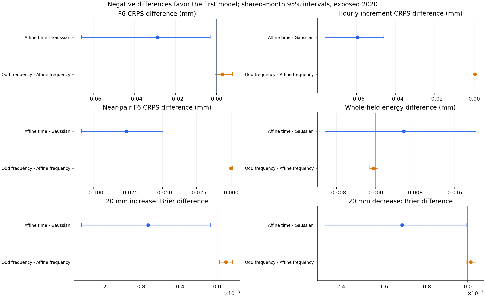

# 共享诱导创新流正式结果：联合概率收益主要由Gaussian调整实现

## 本轮结论

完整天气Gaussian过程上，终端联合评分训练使六小时边际、小时增量、近邻站对和20mm事件概率小幅改善；近同参数非线性流相对线性控制的额外收益尚未成立。固定点均值的策略有效，概率训练没有改写约9.818mm当前基础场。它与新有向时滞均值9.806mm属于不同来源，后续融合须重建匹配残差。

八个模型、两种子四臂均消费3000个连续块，实际监督更新2999/3000；十份主日历Gaussian/模型评价及校准诊断完成。原模型与科学锁保留，[mask时钟补充](2026-11-26-inducing-evaluation-amendment.md)解释空标签块和v2核验。独立审阅核对全部数组、来源、优化器与主要评分通过。

## 架构与原理

G265、TF3000均值和S175输入尺度冻结。8个几何锚点将原Gaussian过程写成独立剩余过程加共享诱导创新：xi=epsilon_perp+W eta。四臂在线性或odd非线性、时域或完整DCT7中演化eta，逐查询解码保留完整剩余GP。初始精确等于同噪声Gaussian，均值始终等于冻结点场。

此训练使用终端联合proper评分，不是传统加噪去噪score matching。输入尺度冻结，输出方差仍可由a、Phi和流改变；Gaussian线性控制用于定位尺度/相关调整和非Gaussian形状的贡献。具体结构见[完整合同与架构图](../superpowers/specs/2026-11-26-inducing-innovation-flow.md)。

## 配对结果

以下为种子42/17等权，2020每月8–10日三布局、K32 IID；负差值表示误差减少。所有月份区间条件于固定两种子、已暴露开发日期，未作多重探索校正。

| 比较：Affine time相对冻结Gaussian | 改善 | 差值95%共同月份区间 |
|---|---:|---|
| 六小时fairCRPS | 0.366% | [-0.065751,-0.003036]mm |
| 同起点小时增量CRPS | 1.855% | [-0.076049,-0.045983]mm |
| 0–50km六小时站对差值CRPS | 1.853% | [-0.108810,-0.049567]mm |
| 20mm增湿事件Brier | 1.029% | [-0.001388,-0.000065] |
| 20mm减湿事件Brier | 2.118% | [-0.002660,-0.000017] |

当前CRPS增加0.005665mm、全场energy增加0.005672mm，两项区间跨零。Affine frequency的六小时改善0.383%，相对Affine time额外改善0.017%，区间跨零，不能据点值称为频域突破。

预注册主比较odd_frequency−affine_frequency的六小时差值+0.002953mm，95%区间[-0.000659,+0.007846]mm；内部增量增加0.000416mm、20mm增湿Brier增加0.000089。Odd time同样没有稳定额外六小时收益。非线性不是本轮改善所必需的因素。

主指标未满足补充触发，本轮不评价15–17日；不以其他模型的最好点值替代注册触发。原始精确数值、事件、季节、高程、海岸、距离和所有比较保留在[完整配对汇总](../../research_pipeline/studies/us_dense_zwd_20261105_v1/03_code/gnss_field_server/results/20261126_inducing_latent_flow/paired_calendar8_v2/summary.json)。

## 校准与物理支撑

有限成员秩校准与解析Gaussian区间分开。Affine time六小时随机化80%参考覆盖率为79.33%/77.58%，冻结Gaussian为82.65%/81.31%；当前由78.08%/78.14%降至75.14%/74.61%。联合评分改善同时伴随区间变窄，下一版需重点检查当前/未来尺度校准，不能用单一平均CRPS代替全部质量。

负ZWD样本仍存在。Affine time六小时比例约0.108%/0.103%，Gaussian为0.141%/0.132%；未裁剪，以保持原分布、均值与公平计分。后续非负支撑应作为单独模型合同检验，而不是评价后截断。

## 非线性进入最终场的实际幅度

补充无标签诊断选择每种子4个固定训练历史，共8个状态、32个模型–状态组合。以1024个Gaussian噪声拟合latent线性代理，再以独立1024个噪声检验。Affine代理残差约1e-15，支持该诊断的线性核验。

| 非线性候选 | latent非线性残差方差比例 | 解码后最终场非线性残差方差比例 |
|---|---:|---:|
| odd_time | 约0.0952% | 约0.01745% |
| odd_frequency | 约0.0240% | 约0.00372% |

这说明所选状态下最终模型接近条件Gaussian，不能将本轮结果扩大解释为所有非Gaussian方法无效。原诱导投影约解释10.18%的原GP方差，剩余过程完整保留；新增Phi也可改变潜场贡献，因此不能单凭该比例推导非线性收益上限。信息条件、潜场覆盖与训练目标的作用仍需独立消融。

另一项解释边界是频域坐标：本轮DCT作用于白化eta的小时索引，白化会混合原过程坐标，它不直接表示实际ZWD的物理频谱。本轮未见额外频域收益，不能据此否定在相关物理状态上进行频域建模。

## 下一步检验

1. 先诊断完整Gaussian场白化残差的半径、尾部与天气依赖，比较固定协方差的Gaussian与Student-t解析探针。用同一均值/协方差区分高阶形状与尺度调整，不先扩大网络。
2. 若完整场有稳定重尾信号，再检验作用于完整场的天气条件随机尺度，并作为扩散的强非Gaussian控制。此方向尚未训练或取得预报收益。
3. 另做白化eta与相关诱导物理状态K_AA^(1/2)eta的时域/频域配对，区分坐标变换和物理时间结构；保留完整剩余过程。
4. 当前/未来尺度、相关结构和尾部各自归因；继续处理严格折外残差、无未来可用性选站合同以及>300km远条件站。新有向均值与概率来源的结合须重新制包，不直接相加成绩。

上述是依本轮结果提出的新验证方向，尚未完成Student-t或相关诱导状态实验，不承诺因此取得突破。剩余额度77%，75%停止新增研究的目标保持。

## 验证与来源

相关模型/GP回归28项、维护6项通过。原模型/seal、源权重、全部10份评价数组哈希、逐值truth/点场、K32/采样种子/CUDA、全部参数组Adam状态、scheduler和实际监督次数均通过独立核验。主要评分与共同月份区间独立重算一致。

训练body约284–493秒/臂，评价主体约66–88秒/臂；存在并发资源共享，Gaussian/Affine另含解析评分，不能作纯采样速度排名。4步Heun包含8次velocity调用，odd每次内部有正/负两次网络计算，实际算术成本不同。

strict_oof=false；原Q128未来可用性选站、历史PWV筛选、末91块复用限制保留。确认及原C/D未读取。权重和大数组留本机，Git同步代码、指标、图、协议与哈希。
