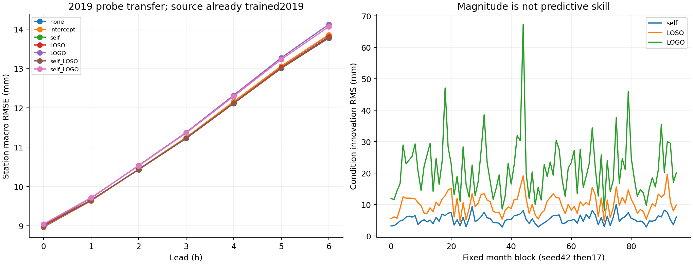

# 留站创新的完整面板：尺度扩大，额外线性预测信号尚未成立

## 本轮结论

两种子各48块、每块连续12h的真实留出计算已完成。自条件self、留单站LOSO和留空间组LOGO的创新RMS中位数约5.25、10.02和20.19mm；LOSO/LOGO均通过源背景输入隔离，但它们相对self的六小时线性探针收益区间跨零。self＋LOSO的额外收益也未在两种子中同向成立，远条件站分层出现代价。因此，目前保留self作为正式连续训练输入，优先研究有向站点×滞后编码，而不立即投入全量LOSO制包。

这项判断针对当前三个核、三个lag的线性传递，不排除新的留出创新编码或严格折外制包有价值。留出创新是同一可见GNSS/T/P的另一种误差表征；较大的数值本身不代表更多可预测信息。

## 数据、源模型与评价角色

两种子42/17各取2016–2019每月8日01:00起的原缓存12个连续起点，48块中36块用于2016–2018探针拟合，12块用于2019迁移诊断。背景使用冻结p14＋GRU，目标为冻结TF3000在相同隐藏查询处的误差；原82个条件站、128个隐藏查询和可用性mask保持。

2019查询在410训练池内随原布局旋转，原基础模型和TF已经拟合过2019。这是训练池信息诊断，表内8.97mm不能与2020主开发的约9.8mm混排，也不代表新神经模型精度。没有新增2020拟合或评价，确认及原C/D标签未读。

探针self/LOSO/LOGO均将条件站误差以50/150/300km高程传递核映射至查询，取lag0/1/3组成9维字段。固定比较none、共同截距、三种单字段和self＋LOSO/self＋LOGO两种18维组合；使用原站点权重，ridge0.01、训练std下限1e-3、截距不惩罚，不按2019评分调权或选候选。

36个月拟合完成后，两种子各六组有参数探针的系数、训练归一化及有效标签数先行封存在`17a8947`。完整面板汇总重拟合与先行封存的全部参数逐值精确相同；none保持零修正。

## 2019探针迁移结果

下表为双种子平均站宏RMSE，单位mm。各候选使用完全相同的标签人口。

| 编码/探针 | 当前场 | 六小时 | 六小时相对self变化 |
|---|---:|---:|---:|
| none：冻结TF，无探针修正 | 8.966562 | 13.842908 | +0.063804 |
| 共同截距 | 8.979617 | 13.855827 | +0.076724 |
| self自条件 | 9.019324 | 13.779104 | 0 |
| LOSO留单站 | 8.996828 | 13.798103 | +0.018999 |
| LOGO留空间组 | 9.024609 | 14.116357 | +0.337253 |
| self＋LOSO | 9.015798 | 13.770374 | -0.008730 |
| self＋LOGO | 9.044619 | 14.057666 | +0.278562 |

负值表示误差减少。LOSO相对self当前差值95%共同月份区间[-0.040879,0.000601]mm，六小时[-0.041844,0.096278]mm，均跨零。self＋LOSO相对self六小时区间[-0.060616,0.043793]mm：seed42改善0.021775mm，seed17增加0.004316mm，不支持双种子一致的额外收益。

self自身相对none，六小时描述值改善0.063804mm，但区间[-0.149533,0.018614]mm跨零；当前误差增加，区间[0.010271,0.085210]mm为正。当前基础场已经吸收部分可预测历史信息，额外线性校正需同时检查当前场代价，不能按六小时最低点值直接替换模型。

## 重点区域与可预测残差

LOSO相对self在近海0–50km的六小时MSE描述性改善约1.40%，区间跨零。self＋LOSO在距当前有效GNSS条件站150–300km档的六小时MSE增加12.903765mm²，区间[1.332136,27.832103]mm²为正。空间外推代价需要作为后续模型门槛；较大的LOO创新包含背景外推误差，不能统一放大后直接传给远查询。

单起点内部增量的额外收益也未成立。地区/季节记录在完整JSON中按micro MSE统计，不与站宏RMSE混用；每季仅3个诊断月，空月份重采样的区间记NA。

独立后处理报告两类比例：预测R²以2019中心化TF残差方差为分母，相对残差能量减少率以原TF残差MSE为分母。self六小时预测R²约0.00798、残差能量减少率0.875%；self＋LOSO约0.00881和0.958%；LOGO残差能量增加约4.20%。这些是对原TF剩余误差的评分，不是对原始ZWD总方差的解释率。各候选当前R²均为负，符合当前校正未改善的数值。

## 实测成本与下一步选择

两种子并行各48块约1205秒。单12h块LOSO82次背景前向的耗时中位数16.18秒，LOGO8次约1.55秒；96块累计各约1556.9/149.5秒。若按该LOSO中位数粗推3000块，仅LOSO前向约13.5h/种子，实际完整制包还包含输入建构和核验；本轮没有执行这项全量制包。

下一轮优先保留self创新，改变它的传递方式。当前H的物理读出对不同lag复用同一站点分数，再混合lag/空间头；可检验的改进是让查询时效、来源站及历史lag共同决定注意力，保留原站ID、GNSS/T/P、mask/age和有向地形/海岸关系，并给创新数值独立通路。

建议以已验证H_delta为同预算结构对照：两者均从原TF3000开始，新增头零初始化，各新增3000连续块，并保留相同内部增量损失、aux和优化器合同。新的有向时滞分支先在相同72h状态合同上验证，再单独延长历史；不能用多训练3000步的结果与原H_delta直接归因架构。该方案尚待实现和实测。

概率支路继续保留冻结基础场与G265强Gaussian/Affine对照。局地轨迹扩散的时空相关训练与真正跨查询联合去噪仍是后续核心问题；本轮没有新增diffusion训练或改变旧概率源。

## 验证与证据边界

96个完整块均核对原缓存及源数组哈希、创新mask、物理站组和隐藏站全依赖窗扰动不变性。self重建字段与原condition前9维在全部96块的最大差0.000964，低于0.005的float16容差。所有先行封存探针的系数、归一化和标签数与完整汇总精确一致。

维护38项及留出几何2项测试通过。最终只读审阅独立从2019数组及先行release重建全部7方案指标，复算关键共享月份区间、R²和全96块字段等价，无Critical/Important或未解决Minor。旧未来可用性选目标、历史PWV筛选与strict_oof=false限制保留；共享月份区间条件于两个固定种子，未经多重比较校正。

## 可复核入口

- [主报告与全部指标、分层、系数](../../experiments/us/20261126_leaveout_innovation_panel/paired/REPORT.md)
- [预测R²及残差能量](../../experiments/us/20261126_leaveout_innovation_panel/paired/RESIDUAL_ENERGY.md)
- [先行系数精确等价核验](../../experiments/us/20261126_leaveout_innovation_panel/paired/probe_release_equivalence.json)
- [96块self字段与缓存等价](../../experiments/us/20261126_leaveout_innovation_panel/paired/feature_equivalence.json)
- [冻结面板合同](../superpowers/specs/2026-11-26-leaveout-innovation-panel.md)
- [真实首块与输入隔离](2026-11-26-leaveout-innovation-engineering.md)

原始数组、权重及缓存留本地，Git同步代码、指标、来源和图。账户剩额75%停止线继续有效。
