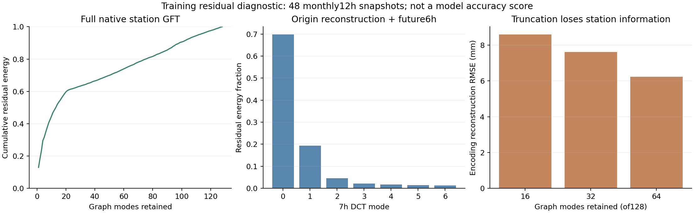

# 原生站点天气编码、因果时序与残差扩散

本轮以[I1已验证结果](2026-11-25-precision-final.md)为对照：当前重建R主日历9.817064 mm、补充日历10.740343 mm。训练数据仍为2016–2019连续小时；2020两个日历均为开发评价。新模型首先完成共同缓存和工程验证，正式精度结果按下方记录更新。

[详细设计与数学原理](../superpowers/specs/2026-11-26-weather-native-diffusion-design.md)｜[逐步实施计划](../superpowers/plans/2026-11-26-weather-native-diffusion.md)｜[执行与审阅记录](../../maintenance/weather_native_20261126/progress.md)

## 研究问题与模型

逐站保留模型误差、原始GNSS ZWD/T/P、mask/age及静态地形/海岸关系；比较相同72h状态历史的GRU、LSTM、因果Transformer，再由地形/海岸条件查询注意力传递到目标位置。新增均值头零初始化，当前值严格从I1起步，未来1–6h从I1起点持久性起步。72h校正状态依赖146h原始数值窗口；age同时保留更早的可用性记录。

均值头冻结后，Gaussian、相关Gaussian及v扩散共享相同条件编码、残差来源和开发日历。完整图谱和时间变换保留全部系数；新增频率token以逐频非线性、图谱消息和局部频带交互检验实际频域归纳偏置。天气Gaussian预条件提供条件位置/尺度，扩散学习其余形状及时空依赖。

R和F分开评价；F包含起点重建和未来1–6h联合轨迹，逐次起点的集合不冒充一条连续72h生成轨迹。所有本轮残差均明确非严格OOF；正式空间折外残差需另行重训来源模型。确认138及原C/D标签保持隔离。

## 已完成的表示与采样诊断

完整3000块缓存的48个月度12h训练窗口中，完整GFT×DCT最大逆变换误差0.00010681 mm；只保留128图频中的前16/32/64个时，平均编码重构RMSE为8.598/7.608/6.232 mm。前两个时间频率约占89.13%能量。这是残差编码诊断，不能当作隐藏位置精度或扩散训练收益；旧28窗口诊断保留原目录。

标准Gaussian参考下，零v模型的DDIM20输出方差比例为0.88414；Heun概率流保持参考样本不变。该差异说明有限步采样器本身会影响校准；真实模型比较使用DDIM40和Heun20各40次网络调用，并另报耗时。

## 连续时间与真实缺测

2018-04-29及2019-12-03部分时段存在原始产品共同缺测；四个原始站文件2018年第119天均无记录，前后天各24条。训练轴35058个可定义7h轨迹的起点中，45个起点不足128条完整轨迹，6个起点无任何完整轨迹。旧缓存1685块后停止，其原目录和协议保留。

v2沿用已核验前缀并继续全部连续时钟。训练目标站按可用标签覆盖率补选，缺失值保留NaN；均值损失逐标签mask，Gaussian和diffusion共享完整观测轨迹子集。无监督时不执行SGD，实际监督更新数另报。未来目标mask不进入推断条件。真实缺测三块的GRU、Gaussian和频率token小试均已运行，标签未填造。

## 正式实验状态

seed42首轮六组均完成3000连续块。以下为最终raw权重；EMA另存同目录。该单种子表用于确定优化方向，完整晋级仍需第二种子和补充日期。

| 模型 | 当前R宏RMSE/mm | 未来6h宏RMSE/mm |
|---|---:|---:|
| I1当前／起点持久性 | 9.867690 | 14.985081 |
| 历史摘要MLP | 9.871648 | 14.537144 |
| 天气摘要MLP | 9.865021 | 14.413849 |
| GRU72 | 9.865684 | 14.355185 |
| LSTM72 | 9.864272 | 14.360795 |
| Transformer72 | 9.862988 | 14.373836 |
| Transformer24 | 9.861574 | 14.380000 |

R基本持平，F6有约0.45–0.63 mm改善；原生时间模块对天气摘要MLP的额外收益较小。[下一轮因果状态监督与显式值传递](../superpowers/specs/2026-11-26-causal-innovation-value-transport.md)以2×2实验检验局地先验、前缀预测目标及物理值通道。未来标签按预测起点延伸6小时，R仍使用原主日历。

[逐模型独立复算与六类误差](../../research_pipeline/studies/us_dense_zwd_20261105_v1/03_code/gnss_field_server/results/20261126_native_mean_analysis/s42/REPORT.md)提供raw/EMA、月份配对区间、距离/高程/地形/海岸分层、站对差值、小时增量及逐站重点图。区间按月份共同重采样，保留实际有效小时数；这是已暴露日历上的探索性比较，候选选择未作多重比较校正。

第二轮先完成的seed42局地先验Transformer为R9.874807/F6 14.365980 mm；加因果历史内辅助监督为R9.868837/F6 14.304259 mm。当前场基本持平，辅助监督相对首轮Transformer的F6改善约0.070 mm；显式值通道及完整GRU/LSTM对照继续运行。

- seed42连续训练缓存3000块、主日历216块均已完成；seed17随后使用同一协议。
- 名义预算为每模型3000连续块，实际监督更新数与消耗时间单列；raw/EMA来自同一轨迹。
- 新模型尚未形成完整双种子配对结论。后续按R宏RMSE/小时增量，F的1/3/6h误差，以及fair CRPS、覆盖和站对差值分开判断。
- 审阅发现的开发角色guard与协议/几何来源锁缺口已通过失败回归测试定位并修复；正式训练使用修复后的代码。
