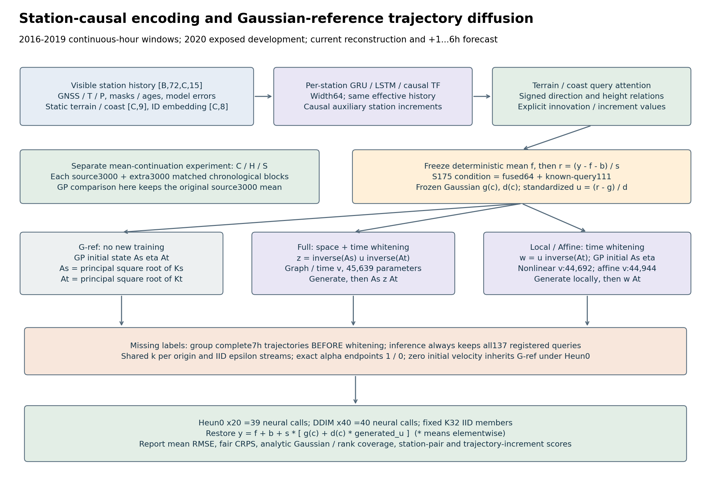

# 原生站点天气编码、因果时序与残差扩散

最新架构、已完成均值续训、空间概率证据及天气GP进展见[统一入口](2026-11-26-weather-projective-trajectory.md)。下文保留各阶段记录，执行状态以该入口及实验锁为准。

最新双种子对照见[统一报告](../../research_pipeline/studies/us_dense_zwd_20261105_v1/03_code/gnss_field_server/results/20261126_native_mean_analysis/paired/REPORT.md)。各12组均值、每组3000块、raw/EMA评价全部完成。完整联合TF的双种子R/F6平均为9.818254/14.127401mm；联合GRU为9.821917/14.177009mm，LSTM为9.817636/14.251512mm。当前R与I1约9.817064mm处于同一水平；F6比较见配对区间。seed42冻结的概率候选政策不因seed17结果改变。

S175直连相对近等参数Lwide的当前fair CRPS区间在两种子均低于零：seed42[−0.105165,−0.056684]mm，seed17[−0.081622,−0.032824]mm；F6两者均跨零。直连信息对当前概率校准有可复现作用，全局收益约1%，尚未达到5%概率门槛。

[最新目标合同](2026-11-26-goal-update.md)固定逐站误差、GNSS/T/P、mask/age、身份、方向及地形/海岸查询。72h是新编码器的状态窗口，底层原始依赖跨度146h；训练缓存有34908个唯一起点小时，2016-01-07T01至2019-12-31T12。第2909块后按时间顺序重放起点，3000块包含一次历遍回绕；各窗口历史与未来标签仍严格在2016–2019内，跨回绕不拼接时间历史。

[地形路径审计](../../maintenance/terrain_path_audit_20261126/REPORT.md)显示，在距离/月/高程共同支撑上，TF高−低屏障RMSE差+0.377mm、95%区间[−0.601,1.670]mm；控制既有特征后的空间块诊断ΔR²为负。因此先完成均值C/H/S及GP参考轨迹过程，暂不新增屏障独立训练臂。

C/H/S均值续训与本轮GP过程是两条独立对照：GP过程仍使用原3000步联合TF均值及S175 Gaussian，未接入尚在选模的续训结果。Heun0为20步39次网络调用，DDIM40为40次；旧Heun数据按其原40次调用保留。

本轮以[I1已验证结果](2026-11-25-precision-final.md)为对照：当前重建R主日历9.817064 mm、补充日历10.740343 mm。训练数据仍为2016–2019连续小时；2020两个日历均为开发评价。新模型首先完成共同缓存和工程验证，正式精度结果按下方记录更新。

[详细设计与数学原理](../superpowers/specs/2026-11-26-weather-native-diffusion-design.md)｜[逐步实施计划](../superpowers/plans/2026-11-26-weather-native-diffusion.md)｜[执行与审阅记录](../../maintenance/weather_native_20261126/progress.md)

## 研究问题与模型

逐站保留模型误差、原始GNSS ZWD/T/P、mask/age及静态地形/海岸关系；比较相同72h状态历史的GRU、LSTM、因果Transformer，再由地形/海岸条件查询注意力传递到目标位置。新增均值头零初始化，当前值严格从I1起步，未来1–6h从I1起点持久性起步。72h校正状态依赖146h原始数值窗口；age同时保留更早的可用性记录。

均值头冻结后，Gaussian、相关Gaussian及v扩散共享相同条件编码、残差来源和开发日历。完整图谱和时间变换保留全部系数；新增频率token以逐频非线性、图谱消息和局部频带交互检验实际频域归纳偏置。天气Gaussian预条件提供条件位置/尺度，扩散学习其余形状及时空依赖。

R和F分开评价；F包含起点重建和未来1–6h联合轨迹，逐次起点的集合不冒充一条连续72h生成轨迹。所有本轮残差均明确非严格OOF；正式空间折外残差需另行重训来源模型。确认138及原C/D标签保持隔离。

## 已完成的表示与采样诊断

完整3000块缓存的48个月度12h训练窗口中，完整GFT×DCT最大逆变换误差0.00010681 mm；只保留128图频中的前16/32/64个时，平均编码重构RMSE为8.598/7.608/6.232 mm。前两个时间频率约占89.13%能量。这是残差编码诊断，不能当作隐藏位置精度或扩散训练收益；旧28窗口诊断保留原目录。

标准Gaussian参考下，零v模型的DDIM20输出方差比例为0.88414；Heun概率流保持参考样本不变。该差异说明有限步采样器本身会影响校准；真实模型比较使用DDIM40和Heun20各40次网络调用，并另报耗时。

## 连续时间与真实缺测

2018-04-29及2019-12-03部分时段存在原始产品共同缺测；四个原始站文件2018年第119天均无记录，前后天各24条。训练轴35058个可定义7h轨迹的起点中，45个起点不足128条完整轨迹，6个起点无任何完整轨迹。旧缓存1685块后停止，其原目录和协议保留。

v2沿用已核验前缀并继续全部连续时钟。训练目标站按可用标签覆盖率补选，缺失值保留NaN；均值损失逐标签mask，Gaussian和diffusion共享完整观测轨迹子集。无监督时不执行SGD，实际监督更新数另报。未来目标mask不进入推断条件。真实缺测三块的GRU、Gaussian和频率token小试均已运行，标签未填造。

## 正式实验状态

seed42首轮六组均完成3000连续块。以下为最终raw权重；EMA另存同目录。该单种子表用于确定优化方向，完整晋级仍需第二种子和补充日期。

| 模型 | 当前R宏RMSE/mm | 未来6h宏RMSE/mm |
|---|---:|---:|
| I1当前／起点持久性 | 9.867690 | 14.985081 |
| 历史摘要MLP | 9.871648 | 14.537144 |
| 天气摘要MLP | 9.865021 | 14.413849 |
| GRU72 | 9.865684 | 14.355185 |
| LSTM72 | 9.864272 | 14.360795 |
| Transformer72 | 9.862988 | 14.373836 |
| Transformer24 | 9.861574 | 14.380000 |

R基本持平，F6有约0.45–0.63 mm改善；原生时间模块对天气摘要MLP的额外收益较小。[下一轮因果状态监督与显式值传递](../superpowers/specs/2026-11-26-causal-innovation-value-transport.md)以2×2实验检验局地先验、前缀预测目标及物理值通道。未来标签按预测起点延伸6小时，R仍使用原主日历。

[逐模型独立复算与六类误差](../../research_pipeline/studies/us_dense_zwd_20261105_v1/03_code/gnss_field_server/results/20261126_native_mean_analysis/s42/REPORT.md)提供raw/EMA、月份配对区间、距离/高程/地形/海岸分层、站对差值、小时增量及逐站重点图。区间按月份共同重采样，保留实际有效小时数；这是已暴露日历上的探索性比较，候选选择未作多重比较校正。

第二轮seed42六臂各3000块已完成，局地先验Transformer为R9.874807/F6 14.365980 mm；加因果历史内辅助监督为R9.868837/F6 14.304259 mm；仅显式值通道为R9.865542/F6 14.286475 mm。两种机制合用后，TF的F6进一步降至14.174626 mm。

| 相同72h状态历史、完整联合机制 | 参数量 | 当前R宏RMSE/mm | 未来6h宏RMSE/mm |
|---|---:|---:|---:|
| GRU | 89,809 | 9.869019 | 14.241080 |
| LSTM | 106,449 | 9.858661 | 14.326339 |
| 因果Transformer | 106,833 | 9.865004 | 14.174626 |

三者同输入、同宽度、同历史及训练块；参数量如表，并非严格等参数预算。以seed42的raw F6最小、R相对I1增加不超过0.05 mm为选择规则，冻结联合Transformer的last权重作为概率候选；同架构/权重政策固定用于seed17。[候选选择与权重哈希](../../maintenance/weather_native_20261126/mean_selection.json)已归档。当前R差异较小，I1仍保留为当前场精度参考。

节点诊断使用2020可见站未来观测作为标签，区分时间预测与空间输送：联合TF的可见站6h ZWD增量RMSE为14.257 mm，持久性为15.159 mm；仅aux为14.208，仅physics为15.931 mm。没有辅助监督的中间物理头尚不构成校准站点预报器。原始GNSS/T/P物理单位、有效标签数量及每个时效见[只读诊断](../../research_pipeline/studies/us_dense_zwd_20261105_v1/03_code/gnss_field_server/results/20261126_native_station_forecast_audit/s42/station_forecast_audit.json)。

## 概率对照进展

联合均值冻结后，seed42七组概率对照开始执行。当前完成Gaussian及使用训练矩估计时空相关的Gaussian copula，余下空域/图谱/频率token及预条件扩散继续运行。

Gaussian解析均值R/F6为9.851468/14.075032 mm；解析CRPS为5.560753/7.805368 mm，K32的fair CRPS为5.557975/7.806791 mm。Gaussian解析80%区间覆盖为74.70%/81.04%；K32样本的10%/90%分位区间覆盖为70.60%/76.63%，后者含有限集合偏差，两种区间分开报告。

额外采用K32第3/30顺序统计量区间，其连续、校准、IID参考覆盖精确为27/33=81.818%；Gaussian实际为76.51%/82.51%。当前场校准缺口主要出现在远距离：150–300km档解析80%覆盖59.57%，标准化误差RMS1.791，而<50km档为84.07%、0.960。该诊断支持优先改进距离相关的条件尺度；六小时边际整体覆盖已接近解析目标，不能根据有限K区间把它误判为相同幅度的分布欠离散。完整审计见Gaussian的`calibration_audit.json`。

相关Gaussian将预报内部小时增量fair CRPS由4.463474降至3.189986 mm，0–50km站对F6差值CRPS由5.826277降至5.135518 mm，完整空时向量fair energy由8.610607降至8.582658 mm。它展示了时空相关建模的作用；扩散须进一步与该联合Gaussian比较，才能识别新增分布机制的收益。该结果仍为单种子、非严格OOF的已暴露开发日历结果。

- 两种子连续训练缓存各3000块、主日历各216块均已完成并逐值审计；seed17均值模型正在按同一协议训练。
- 名义预算为每模型3000连续块，实际监督更新数与消耗时间单列；raw/EMA来自同一轨迹。
- 新模型尚未形成完整双种子配对结论。后续按R宏RMSE/小时增量，F的1/3/6h误差，以及fair CRPS、覆盖和站对差值分开判断。
- 审阅发现的开发角色guard与协议/几何来源锁缺口已通过失败回归测试定位并修复；正式训练使用修复后的代码。
