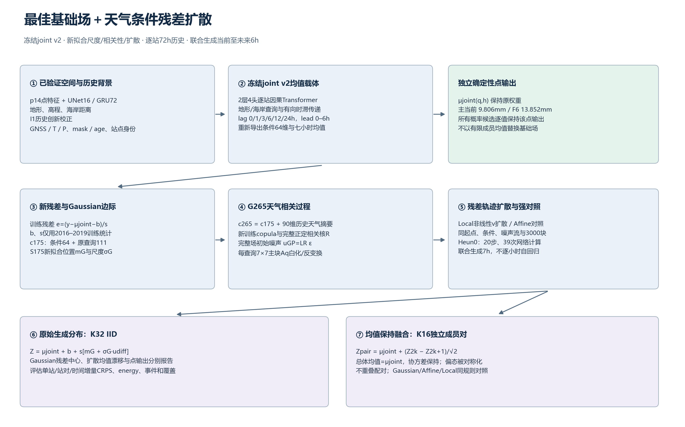
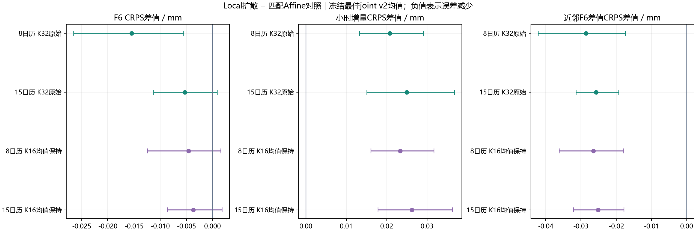

# 当前全部研究成果：基础场、时空预报与残差生成

本报告覆盖v13/p14空间基础场、连续时序、逐站编码、有向传播、天气概率过程、扩散、频域、重尾，以及最新joint v2＋Local融合。当前形成三个可复核的成果：约10mm的隐藏站空间重建、两组日期复现的六小时预报改进，以及保留点场精度的条件概率场生成。各模型按任务选择，点值RMSE与概率评分分别报告。

## 1. 已建立的数据与评价体系

- 美国西部25–50°N、125–110°W，数据覆盖2016–2020。后期模型使用2016–2019连续小时训练；抽样发生在站点身份，历史窗口保持连续。
- 410站训练池、137注册开发查询，当前及六小时实际135站有标签；138确认站隔离，当前实验原C/D标签未读。
- 2020每月8–10日和15–17日，两组日历各12×72h×3条件布局；合计72抽样日、1728唯一名义小时。两组均已开发暴露，不能作为完整年度或独立盲测。
- 72h新编码状态依赖146h原始数值；缓存绑定条件站集合、历史范围、源权重与数据合同。真实缺测保留mask，不填造标签，不跨日历空档或训练回绕拼接增量。
- 3000×12h训练块包含34908个唯一起点小时，末91块顺序重放。监督更新按原标签支持独立核验；最新融合各臂均3000次监督更新。
- 新条件/教师不含PWV/IWV/TCWV/Tm。strict_oof=false、历史PWV制包筛选和原Q128未来可用性选站限制保留；严格折外与允许变量质控仍需正式新协议重建。

六类评价均已实现：时间留出、空间留站、最近有效GNSS条件站距离、高程/地形/海岸、站对差值、小时增量。另有逐站尾部误差、CRPS（连续秩概率评分）、energy联合评分、20mm增湿/减湿事件、有限成员覆盖与均值漂移诊断。分数与区间绑定实际样本、布局和来源。

## 2. 当前确定性模型的最好表现

下表为双种子等权的站宏RMSE。主/补日历分别评价，合并先累积每站有效平方误差及计数再开方；I1未来项是起点持久性。

| 模型 | 主当前/mm | 补当前/mm | 合并当前/mm | 主六小时/mm | 补六小时/mm | 合并六小时/mm |
|---|---:|---:|---:|---:|---:|---:|
| I1／持久性 | 9.817064 | 10.740343 | **10.319804** | 14.959594 | 17.297820 | 16.219944 |
| H_delta | 9.811195 | 10.786318 | 10.339474 | 13.973126 | 16.207798 | 15.179783 |
| factorized | 9.806618 | 10.770065 | 10.328865 | 13.877675 | 16.109646 | 15.082875 |
| joint v2 | **9.806169** | 10.767129 | 10.327014 | **13.852222** | **16.077837** | **15.053927** |

当前空间重建保留I1作为稳健参考。joint主当前略低，但合并相对I1差+0.007210mm，95%共同月份区间[-0.040866,+0.057260]mm，尚无稳定额外当前收益。

六小时预报推荐joint v2。它相对H_delta合并减少0.125856mm，区间[-0.166287,-0.084262]mm；相对同参数factorized减少0.028948mm，区间[-0.042988,-0.015651]mm。相对I1持久性合并减少1.166017mm、约7.19%，包含整个新增预报能力，不能全部归给最后一个模块。

joint主/补跨起点当前小时增量站宏RMSE为5.494/6.254mm，同起点内部增量microRMSE为5.790/6.580mm。F6 MAE为10.679/12.225mm，绝对误差P95为29.093/33.963mm；这些指标与站宏RMSE各自保留口径。

[完整点指标与区间](../../experiments/us/20261126_final_research_summary/point_metrics.json) · [有向时滞结果](2026-11-26-directed-lag-v2-results.md)

## 3. 已形成的最佳架构

确定性路径：

**p14点特征＋小U-Net／既有GRU背景 → I1历史创新 → 原生逐站因果Transformer → 地形/海岸条件有向时滞传递 → 当前与未来1–6h点场。**

I1把条件站观测减去同位置背景预测，在0/1/3h与50/150/300km软核上编码，以3km高差尺度传递，形成9维岭回归修正，限幅±5mm。它将主当前9.929151降至9.817064mm，补充10.869282降至10.740343mm。

新时序编码每站每时刻32维：动态15、静态地形/海岸9和身份嵌入8。动态项保留原始GNSS/T/P、mask/age、背景及I1后创新和日/年时钟。采用32→64、2层4头因果Transformer、FF128，再由查询注意力接收逐站信息。

joint读取0/1/3/6/12/24h历史key，将地理、滞后与预报时效联合建模；显式保留创新、ΔGNSS、ΔT、ΔP，按变量独立mask归一。新增读出零初始化，当前/未来新增修正限幅3/6mm。新校正载体117757参数，不含冻结背景。

内部固定支撑图用于区域上下文，最终输出可按坐标查询。当前验证支持查询解码与信息通路保留，尚未证明全部信息无损或整模型完全无内部格网。

同72h有效历史的完整联合GRU/LSTM/Transformer六小时站宏RMSE分别为14.177009/14.251512/14.127401mm。joint在Transformer上另续训3000块，其13.852222mm不作为纯骨干同预算排名。

## 4. 概率与扩散已经取得什么收益

天气相关结构是此前最明确的概率成果。旧TF3000来源上的G265相对原空间相关参考，近邻六小时站对差值CRPS主/补改善20.76%/22.42%。这是站间关系分布的改善，点输出与边际条件保持各自来源，不是单站RMSE降低约20%。

旧Full图轨迹扩散也曾改善近邻差值CRPS约13%–15%，同图Gaussian控制约11%；它同时有当前、远距及全场评分代价。Local/Affine、固定均值scale/shape/both、共享诱导创新流的对照，使尺度、相关结构、均值漂移和额外形状贡献能够分别判断。

最新融合已真正使用joint v2的新残差重新拟合，而非直接拼接旧权重：

**冻结joint → 训练残差标准化 → S175条件中心/尺度 → G265天气相关场 → Affine／Local v扩散。**

两种子各四臂3000块，共8模型、24000次监督更新；两日历raw K32与独立双场差分K16共24组评价。确定性点输出逐值保持joint。

| 最新概率模型 | 主F6 CRPS/mm | 补F6 CRPS/mm | 主内部增量CRPS/mm | 补内部增量CRPS/mm |
|---|---:|---:|---:|---:|
| G265 | 7.675242 | 8.771587 | 3.214113 | 3.565154 |
| Affine | 7.672983 | 8.755594 | **3.119629** | **3.455852** |
| Local扩散 | **7.657557** | **8.750280** | 3.140358 | 3.480811 |

Local相对G265的F6 CRPS改善0.230%/0.243%、内部增量改善2.295%/2.366%、energy改善0.239%/0.190%，月份区间均支持改善。相对强Affine，F6额外改善0.201%/0.061%，仅主日历区间完全低于零；内部增量增加0.664%/0.722%。

近邻F6差值CRPS相对Affine改善0.691%/0.558%，但Affine本身相对G265有局地代价。Local对G265近邻额外收益为0.077%/0.171%，主区间跨零、补区间为负。空间收益必须与具体对照一起解释。

完整新方案相对旧TF3000＋G265＋Local，主F6 CRPS由7.760754变为7.657557mm，描述性改善1.330%，包含基础场/编码升级与概率重训的共同作用。

[最新融合完整报告](2026-11-26-best-base-diffusion-fusion.md) · [全部评分与分层](../../experiments/us/20261126_best_base_diffusion_fusion/paired/summary.json)

## 5. 均值保持、重尾与频域成果

独立双场差分已实现并验证：`Zpair=mu_joint+(Z−Z′)/sqrt(2)`。在固定条件下，总体均值等于joint，协方差保持原生成场；不重叠成员对保证K16独立性，偏态被对称化。它与同批成员去均值不同，K16实际样本均值仍有采样方差。

最新K16 Local相对K16 Affine的单站F6额外收益，两日历区间均跨零。它是冻结模型后的中心保持后处理，未在固定joint中心条件下重新训练尺度及扩散；不能据此限定所有零均值扩散的收益。解析点场与采样均值分开交付，单次MC方差扣除诊断不改写解析均值。

重尾方向完成了完整场探针和天气尺度/同协方差Student-t正式对照。在旧TF3000概率来源下，天气t对匹配天气Gaussian的F6 CRPS减少0.011290mm，联合NLL/d减少0.012394；相对常数t的额外收益区间跨零。该组原Affine time保持较低未来CRPS，重尾更适合解释联合似然与尾部，而不是作为新joint上的已测成绩。

频域已完成不规则Fourier/图谱代数核验、完整GFT×DCT、频率token和同容量正式训练。完整变换最大逆误差约0.000107mm；前16/32/64图频截断重构RMSE为8.598/7.608/6.232mm，说明低频压缩会损失与目标精度同量级的信息。

旧C64频率token相对近同容量joint扩散，F6 CRPS改善约1.53%–1.96%，超过强Gaussian的额外收益不稳定。共享诱导创新流的频域非线性也未建立额外收益；白化eta的DCT不直接等于真实ZWD物理频谱。

[重尾结果](../../experiments/us/20261126_weather_scale_tail/paired/REPORT.md) · [频域结果](2026-11-26-spectral-and-mean-centering.md) · [共享创新流](2026-11-26-inducing-flow-results.md)

## 6. 已完成的研究资产与实验路线

| 部分 | 已完成工作 | 主要认识 |
|---|---|---|
| v13/p14空间基础场 | 点MLP、小/大U-Net、点＋U-Net、固定支撑 | 点细节与小U-Net区域上下文结合有效；扩大U-Net不自动提高精度 |
| p15及距离分布 | random、空间空洞、距离分层、距离重平衡 | 短时监控与正式泛化分数分开；训练目标距离分布影响外推 |
| 连续时序与特征 | 唯一时轴、海岸/地形、GRU/LSTM/Transformer、同历史比较 | 时间编码的明确收益主要在未来预报 |
| 均值机制 | T/Q/S/A/D、I0/I1/I2、C/H/S/HS、内部增量监督 | I1稳定改善当前；额外结构需同起点/预算控制 |
| 创新与传播 | self/LOSO/LOGO探针、有向站点×lag、v1缺测归一化修复 | 更大误差幅度不等于更多预测信息；有向联合传递获得复现收益 |
| 概率模型 | Gaussian、相关GP、G175/G265、Full/Local/Affine、标准化残差 | 天气相关结构是主要收益来源；非Gaussian贡献需强控制 |
| 生成归因 | 独立成员、有限K均值、scale/shape、中心消融、共享创新流 | 点均值、尺度、时空依赖与形状需分别监督评价 |
| 频域与尾部 | 完整/截断图谱、DCT、频率token、Student-t | 表示可逆性与真实物理频谱不同；重尾有小幅条件收益 |
| 最新融合 | 8正式模型、24评价、原点场直接比对、K16成员逐值重算 | 强基础场可以稳定接入生成分支，额外收益依赖指标 |
| 工程与归档 | 协议、来源锁、检查点/Adam核验、曲线、PNG/SVG、Git轻量同步 | 负结果、缺测和工程停止证据保留，数据/权重留本机 |

早期v13点＋UNet16为10.828mm、p14为10.806mm，采用较早稀疏片段和24h扩展评价；后期是连续四年及72h日历。不能把10.8→9.8直接写成单一架构的纯提升。早期尚未接入真实forward/loss的设计开关不计入结构成果；已训练且完成评价的版本按各实验锁定位。

[早期到最新的完整台账](2026-11-26-final-research-summary.md) · [实验索引](../EXPERIMENT_INDEX.md) · [最新融合训练曲线](../figures/best_base_diffusion_fusion_20261126/training_curves.png)

## 7. 当前困难与下一步优先级

远条件站与快速天气变化仍是重点：I1当前距条件站≥200km约14–16mm；joint在>300km档尚无稳定额外F6收益。历史I1夏季当前误差约11–13mm、冬季约8–8.5mm。主PLTX F6约24.745mm/P95约53.847mm，补P786 F6约27.999mm/P95约55.804mm，代表需单独诊断的边缘/过程场景。

当前最具体的条件接口已经定位：joint的64维h生成于显式物理创新和有向transport读出之前。新最终预测已用于概率残差定义和还原，但七小时最终预测、有向分支数值与注意力统计尚未显式直连概率网。已有h可间接携带相关输入，额外直连是否有收益仍需同预算消融。

后续优先级为：先补上述接口；在固定joint中心条件下重新拟合尺度/相关/扩散，与后处理中心保持区分；建立严格折外残差及新质控/选站合同；针对远站、夏季和快速增湿/减湿补信息与分层监督。频域继续在有物理意义的相关状态上检验，并保留完整系数或剩余过程。

当前阶段属于本机正式训练、两组开发日期及完整归因验证。已具备可复核的确定性与概率研究系统，独立确认、完整年度和服务器规模验证仍是下一阶段。最新融合22项相关测试、8模型完整Adam/权重和24组评价独立复算通过；本报告汇总既有结果，不新增训练。
