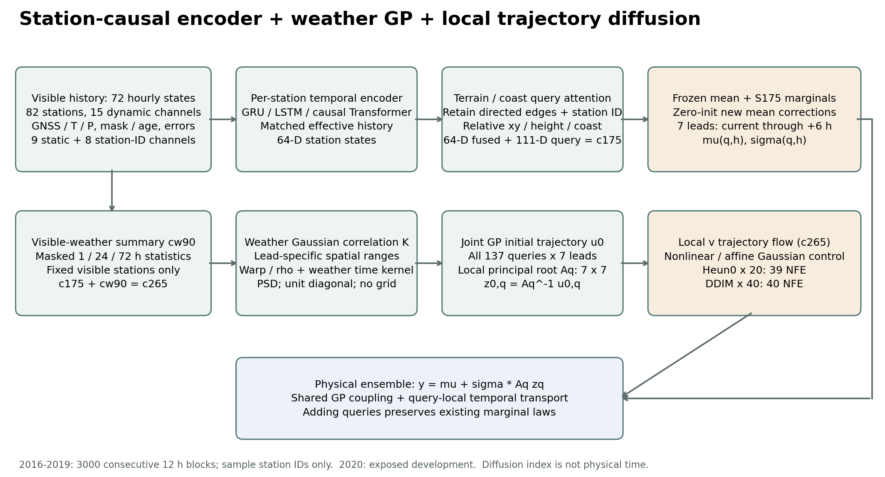

# 从逐站因果编码到天气条件轨迹扩散

逐站误差与原始观测已经接入同历史时间模型比较。当前证据支持两个优化方向：因果时间编码改善未来预报，空间相关结构改善近邻站对的概率差值。新实验将两者连接：保留现有均值和逐站边际尺度，学习随天气、地形和预报时效变化的相关核，再检验非线性扩散的额外作用。

## 同历史时间编码：已经完成

每个可见站保留72个连续小时状态。动态输入15维包含原始GNSS ZWD/T/P、各自mask/age、两个历史模型误差槽及日内/年内时钟；再加入9维地形/海岸和8维站ID嵌入。GRU、LSTM和因果Transformer均先逐站编码，再通过有向地形/海岸查询注意力传给目标点。新增均值头从零影响开始继承旧基础场。

72h指新编码器状态窗口；上游历史误差与背景依赖使原始数据覆盖146h。三种模型的有效输入范围一致。64维状态属于学习压缩，保留身份和方向有明确结构保障，全部数值信息的无损性不作假设。S175将64维融合状态与111维原查询信息直连，用实测检验压缩瓶颈。

| 双种子raw均值 | 当前R宏RMSE/mm | 未来6h宏RMSE/mm |
|---|---:|---:|
| GRU联合机制 | 9.821917 | 14.177009 |
| LSTM联合机制 | 9.817636 | 14.251512 |
| 因果Transformer联合机制 | 9.818254 | 14.127401 |

联合机制包括局地查询、历史内部的前缀预测辅助监督，以及创新值/未来增量显式传递。Transformer相对原Transformer的F6共同月份95%区间为[−0.288695,−0.110130]mm；相对联合GRU为[−0.094287,−0.002653]mm。当前R差异区间跨零。结果为已暴露开发比较，未做多重比较校正。完整raw/EMA、曲线及来源见[同历史配对报告](../../experiments/us/20261126_native_mean_analysis/paired/REPORT.md)。

## 同起点续训：机制与预算分开

从同一个联合Transformer3000步checkpoint出发，C继续训练、H中心化创新读出、S同刻空间消息各新增3000块。保留源AdamW状态，新增头或gate零初始化，真实warm输出差均为0。

| 双种子raw均值 | 当前R/mm | F6/mm | 当前小时增量/mm |
|---|---:|---:|---:|
| 源Transformer3000 | 9.818254 | 14.127401 | 5.542310 |
| C继续训练 | 9.827325 | 13.983685 | 5.535544 |
| H创新读出 | 9.811031 | 13.977705 | 5.545044 |
| S空间消息 | 9.827246 | 13.977733 | 5.535277 |

H−C的当前R区间为[−0.026155,−0.004700]mm，F6区间跨零；H的小时增量高于C。S−C的F6区间为[−0.008950,−0.002752]mm，增益幅度很小。C相对源模型已经明显改善F6，因此续训预算的贡献要单列。H+S为后续独立组合，当前概率实验仍冻结源Transformer3000，没有接入这三条续训权重。详见[续训配对报告](../../experiments/us/20261126_mean_fusion_v2/paired/REPORT.md)。

## 空间联合依赖：已有的明显局地收益

原GP参考、Full非线性图轨迹扩散、Local逐站扩散、逐站Affine及GraphAffine使用同一冻结均值、S175条件和训练统计。Heun0×20实际39次网络计算；DDIM40为40次。

| 0–50km站对F6差值fair CRPS/mm | seed42 | seed17 |
|---|---:|---:|
| 原GP参考 | 5.244664 | 5.103245 |
| Full | 4.464031 | 4.440258 |
| Local | 5.162372 | 5.092960 |
| 逐站Affine | 5.235241 | 5.122397 |
| GraphAffine | 4.656665 | 4.534343 |

Full近邻改善14.9%/13.0%，GraphAffine约11%。GraphAffine在固定条件和图时对全场严格仿射，属于Gaussian控制；其结果表明，大部分收益可以由更好的空间Gaussian依赖解释。Full对≥300km站对、边际分数及全场fair energy存在代价，当前方向是把近邻收益转化为受约束、查询集合一致的相关核。

主日历0–50km档包含720个站对，其他三档分别519/950/7127对；区间按共同月份重采样，不将站对数视为相互独立重复。Full共同路径随查询集合改变；这项路径诊断本身不能证明边际分布随查询改变。Local有逐查询结构保障。详见[seed42](../../experiments/us/20261126_gp_process/s42/summary/REPORT.md)与[seed17](../../experiments/us/20261126_gp_process/s17/summary/REPORT.md)。

冻结补充日期验证不重新拟合。seed42每月15–17日，原GP/Full/Local的近邻F6差值fair CRPS为6.001020/5.094155/5.890182mm，Full约15.1%改善；对应energy为9.540595/9.623988/9.540285mm。该日期源确定性模型R/F6为10.807612/16.500546mm。补充日期曾用于历史I1开发，属于冻结补充开发验证；它与主日历共同说明约9.8mm成绩的适用日期，不能推广为全年精度。第二种子补充验证正在执行。

## 正在执行：天气条件、查询一致的Gaussian核

G175与G265各43893/44027参数，双种子各3000连续块。G265额外使用固定可见站的1/24/72h均值与总体标准差，共90维；摘要先按mask清理GNSS/T/P及历史误差占位。网络学习逐查询、逐lead的相关幅度与空间warp，7×3参数学习各预报时效的空间/高程相关长度；时间相关由可见历史生成。

新增lead长度有实测依据：标准化误差的归一化二阶矩在0–50km档由当前约0.657升到6h约0.819，固定核约0.338。该诊断是归一化未中心化二阶矩，解释为相关结构线索，不等同于条件Pearson系数。核采用归一化Gaussian卷积内积，保证不同lead长度下的PSD与平移不变。精确公式见[设计合同](../superpowers/specs/2026-11-26-weather-projective-gp.md)。

冻结S175的均值和标准差使解析边际CRPS保持相同。新实验主要检验站对差值、预报内部增量和energy，并核验新增查询所得矩阵是否为同一核的主子矩阵。改变Cholesky维度后同seed路径可以不同，分布一致性与路径耦合测试分别解释。

## 已实现、待正式训练：天气GP上的轨迹扩散

固定G265为主连接臂，G175用于天气摘要对照；该连接政策在读取正式GP结果前确定。对每个查询取7×7边际相关块的对称根Aq，训练目标为标准化残差经Aq逆变换的轨迹。推断从完整天气GP取联合初始场，再逐查询白化、进行条件v轨迹流、反变换并恢复mm。

非线性Local为44074参数，Affine为43916参数，均使用c265、相同噪声流、相同3000连续块及采样NFE。零v在Heun0下继承GP；DDIM的离散步长效应另列。条件仿射轨迹流仍是Gaussian，其解析均值与方差单独计算。非线性额外收益必须相对Affine判断。

这一结构对每个起点联合生成0–6h轨迹；因果性来自历史编码和信息截断，扩散步k表示噪声水平，物理时效h表示预报小时。它保留时间依赖，当前实现不执行GPT式逐小时自回归生成。Local训练是边际轨迹score，空间联合结构由GP初值与逐站映射提供。

五项新增CPU合同测试通过；真实缺测两臂各4更新、1435完整轨迹通过，初始两臂loss相同。包括新核及所有相关模型的研究测试165项通过；项目默认测试568项通过。具体执行顺序见[计划](../superpowers/plans/2026-11-26-weather-projective-gp.md)。

## 数据与结果解释

训练2016–2019保持连续时钟，抽样发生在站点身份；3000×12h包含34908唯一小时，最后91块日期顺序回绕，历史不跨回绕边界拼接。2020主/补充日历均为开发，strict_oof=false。410训练、137开发、138确认，确认及原C/D标签隔离。条件/教师排除PWV/IWV/TCWV/Tm，原始数据、权重和大型数组留本地，代码、协议、指标与图同步GitHub。账户剩余额度75%为停止线。

## 审阅后的数据与工件细化

缓存训练目标身份按整块12起点×7h标签完整度选取128站：足够完整时随机抽完整站，不足时按覆盖率排序；给定查询后再逐起点筛完整轨迹用于概率损失。这一策略保持连续日期，使用未来观测的可用性而非数值，拟合样本因而偏向观测完整站。历史编码、天气摘要、相关核和固定137站推断均使用起点及以前的信息。

正式扩散入口固定G265及配对seed。完成模型的last权重与最终checkpoint逐张量核对，工件seal绑定权重/协议/源码；完整评价以lineage、metrics、数组及其SHA为准。独立审阅通过数学实现，新增守卫按RED→GREEN修订，旧工程小试源码/结果保留。
