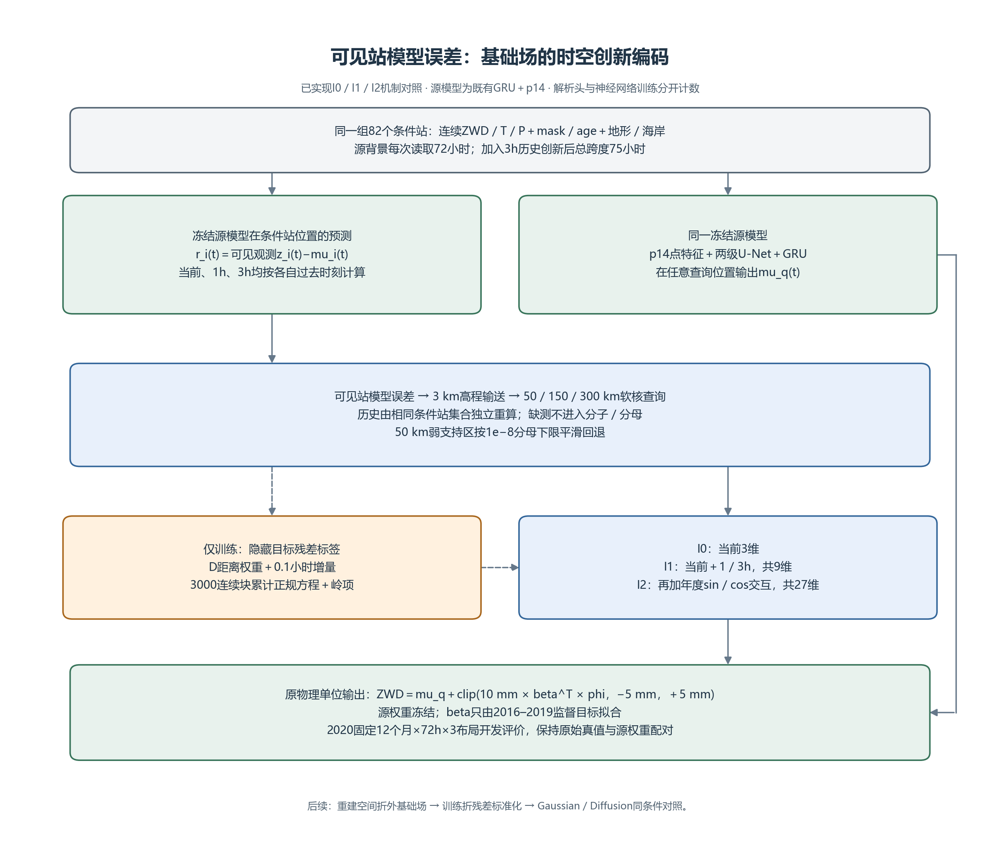

# 条件站模型误差与历史创新校正实施计划

> **For agentic workers:** REQUIRED SUB-SKILL: Use superpowers:executing-plans to implement this plan task-by-task. Steps use checkbox (`- [x]`) syntax for tracking.

**Goal:** 在原GRU+p14约9.929 mm基础场上，检验可见条件站的模型误差能否提供更有用的残差编码。

**Architecture:** 冻结原GRU+p14，在条件站计算观测减去同位置模型预测的创新；按3 km高程尺度输送，并在50/150/300 km软核上查询。比较当前3维、当前及1/3小时历史9维、再加年度sin/cos交互27维的解析岭回归头，最终修正限制±5 mm。原始观测和72小时背景保持完整。

**Tech Stack:** 现有Anaconda pytorch、float64小矩阵正规方程、NumPy与Matplotlib。

**Spec:** 本文件同时记录该小型实验的设计；其总体信息合同与[10mm优化计划](2026-11-25-warm-joint-precision.md)一致。

[SVG架构图](../../figures/observed_innovation_20261125/architecture.svg)。虚线为训练标签与参数拟合路径。

## Global Constraints

- 原始条件为ZWD/T/P、mask/age、地形和海岸；不使用PWV/IWV/TCWV。
- 训练2016–2019连续12小时块，3000块、seed42/17、与S相同75/25布局；只抽样条件站。
- 使用D预先固定的距离权重，水平项与0.1增量项共同拟合；岭项为矩阵对角的0.01倍，无截距，零创新返回原场。
- 这里的3000是连续数据块累计次数，不是新增神经网络的梯度更新次数。三组头共享同一基础场前向和训练数据。
- 2020每月72h×3布局×137站固定开发评价；当前标签只用于评价，确认/C/D标签不读取。
- 固定源模型已经拟合2016–2019；本轨道是基础场开发优化，不作为严格OOF残差来源。
- 条件站模型误差与“观测输送值减查询均值”不同，也与A的留组IDW异常不同；模型误差是在同一个条件站位置计算的。

## 依据与比较解释

`20261125_condition_innovation_probe`已在两个种子的2016/2019训练窗口及2020开发窗口检查条件创新信息，部分50 km核相关约0.12–0.28，冬季开发窗口相关较小。探针中的oracle系数不用于本实验。选择可见站创新而非继续扩大网络，是代理根据该证据作出的选择。

I0_current仅用当前三个尺度；I1_history增加1/3小时；I2_seasonal在9维基础上加入年度sin/cos交互。三组共享训练来源、距离权重、岭强度和修正上限，用于检验历史及季节自适应的贡献。解析拟合优化未截断的线性代理目标，最终输出再限制±5 mm；报告明确该拟合方式。

## Review Focus

1. 在条件站计算误差只读取可见GNSS，隐藏标签只进入监督目标。
2. 1/3小时创新须由对应过去时刻的模型预测计算，不用当前预测冒充历史。
3. 训练首块缺少可运行背景的最初历史创新置零；跨块、跨月不拼接评分增量。
4. 高程单位m、创新单位mm；10 mm归一化及最终反缩放只做一次。
5. 所有I0/I1/I2结果保持同一真值、源权重及最终数据量；不按2020挑训练检查点。

## Task 1：可检验的创新算子

Files: `tools/terrain_diffusion/innovation_refinement.py`、`test_innovation_refinement.py`。

- [x] 新测试验证高程输送、缺测退化、查询集合不变性、滞后因果性、零创新及正规方程已知解；先观察缺少实现时失败。
- [x] 实现`innovation_fields`、`causal_features`、`normal_equations`、`solve_ridge`，核心3项测试及完整研究算子74项测试通过；工程默认568项测试已通过。

## Task 2：连续训练和固定评价

Files: `tools/terrain_diffusion/innovation_experiment.py`。

- [x] 每块在当前12小时及需要的过去3小时计算冻结基础场，提取同条件站创新；累计27维正规方程及增量项。每次背景输入72h，滞后3h使I1/I2总观测跨度达到75h；I0有效跨度72h。
- [x] 实现协议、源权重/代码/数据哈希、每500块的安全Tensor统计检查点和曲线；最终拟合3/9/27维三组头。累计训练代理损失随训练数据前缀增长记录，包含0.1增量项，不当作固定总体的点RMSE。
- [x] 在相同2020队列评价，独立核对原参考与原保存预测，保存三组预测与原始真值。

## Task 3：配对结论与归档

- [x] 接入统一float64指标、月份配对区间、距离/地形/海岸/季节/站对误差；I1−I0和I2−I1直接比较。
- [x] 核对小时增量和分层触发线；根据实测保留原参考或晋级开发候选。
- [x] 归档源代码、轻量证据和图件，提交、推送并核对远端提交；权重和大数组留本机。

## 真实小试及算子说明

2块真实试运行完成三组头和三个开发布局，原参考复现最大差7.6294e-6 mm，真值完全一致。只读CPU审阅复算了首窗零历史和切换条件布局后的过去3h重算，均符合合同。

软核分母下限为1e-8。支持很弱时，50 km核把远处创新衰减回零：实际影响2020有效记录1955/327330，均在200 km以上档，占该档1955/12594（约15.5%）；150/300 km核未受影响。该行为与信息探针一致，保留为远距离低支持的回退规则。

## 冻结后的补充日历

在第二种子完成之前登记：I0/I1/I2全部冻结后，追加2020每月15–17日72小时、3布局、137登记站的开发评价；同一源权重和系数，不重新拟合、不混入原8–10日主表。使用`maintenance/joint_spectral_implementation_20261125/innovation_additional_calendar.py`，原参考也在该新日历重算，逐种子/月配对，报告全部三组结果。它检查对其他日期的迁移，仍属2020开发评价；确认/C/D保持隔离。

## 完成记录（2026-11-26归档）

双种子及三组头、全部主评价和冻结补充评价均已完成。I1主日历9.929151→9.817064 mm，补充日历10.869282→10.740343 mm；72个抽样日合并10.441761→10.319804 mm。六组系数从最终统计独立重解均逐元素相等。详见[最终报告](../../research_notes/2026-11-25-precision-final.md)及其中的哈希与图件。归档同步状态以对应Git提交及远端核验为准。
