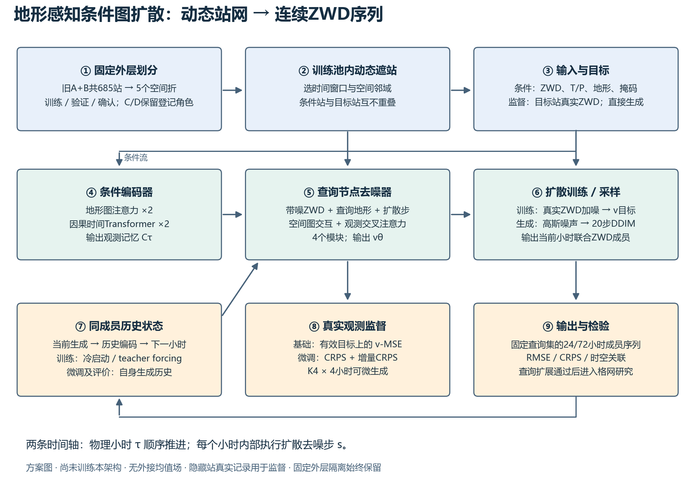
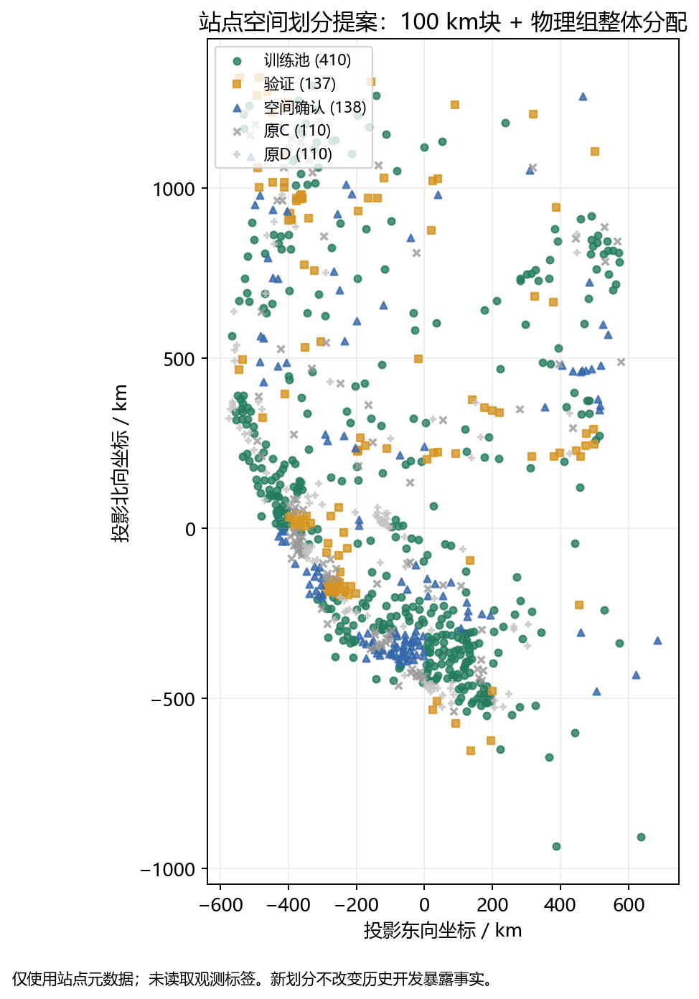
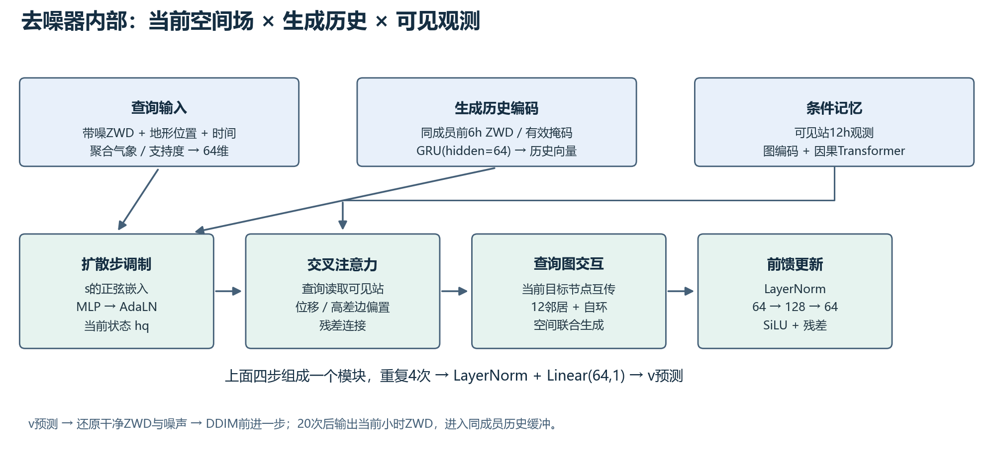

# 地形感知时空图扩散：稀疏GNSS连续ZWD场研究方案

版本：v2，2026-11-23。任务：动态稀疏站网下的地表ZWD概率重建与连续演变。本文是可实施的研究方案；本轮已完成元数据划分、流程图与设计复核，模型训练从下述P0开始。新协议独立于历史ABCD实验，原数据包、权重和实验锁保持完整。

## 1. 方法定位与总流程

本方法把稀疏GNSS重建表述为条件随机场学习：用部分站点的历史ZWD和允许气象变量，结合查询位置的地形，生成整组查询点的ZWD及其连续演变。训练信号来自真实站点，MAE式动态遮站使同一网络适应不同站网布局，图交互表达地形相关的空间联系，时间条件维持成员演变，扩散表达观测不足时的多种可能结果。

主模型直接生成标准化地表ZWD，不接入v04均值、不使用插值图教师。研究价值通过三个问题建立：动态遮站是否改善未见站泛化，地形编码是否改善高差/空间缺口表现，时序扩散是否优于同编码器的简单概率模型。最终论文主张以这些实验支持的机制为中心。



图1同时给出训练监督和部署生成路径。物理小时记为τ，扩散步记为s。每个小时内部联合去噪所有目标节点，小时之间通过同成员生成历史连接。因果模式只使用≤τ的观测；整段双向补全属于单独的事后重建实验。

## 2. 站网重新组织：固定外层，动态内层

### 2.1 已生成的具体站点清单

依据现有`stations.csv`，将旧A174与B511合为685站候选池。使用投影坐标100km方块和`physical_group`建立不可拆分单元：相同方块或相同物理组通过并查集合并，再按单元大小降序分配5折。目标同时平衡各折站数与<500、500–1500、≥1500m三个高程组。相同大小的单元按seed=20261123的SHA256排序；不读取观测误差、ZWD标签或天气值。

| 新角色 | 空间折 | 实际站数 | 来自旧A / 旧B | 用途 |
|---|---|---:|---:|---|
| 训练站池S_tr | 2、3、4 | 410 | 104 / 306 | 动态条件/目标轮换，全部参数学习 |
| 验证S_val | 1 | 137 | 35 / 102 | 超参数、早停、采样配置选择 |
| 空间确认S_conf | 0 | 138 | 35 / 103 | 配置冻结后一次主要确认 |
| 原C | 保留历史角色 | 110 | — | 历史开发扩展 |
| 原D | 保留历史角色 | 110 | — | 锁定产品后的登记回顾评价 |

训练池三个高程组为165/150/95站，验证55/51/31站，确认55/51/32站。分配不拆物理组及100km方块，元数据核验通过。以上为几何分配人数；允许变量QC后的有效站数和站时数在P0重新统计。不会为凑齐人数把剔除站从验证搬入训练。



逐站清单：[station_assignment_proposal.csv](assets/20261123_diffusion_v2/station_assignment_proposal.csv)；来源与划分收据：[station_split_receipt.json](assets/20261123_diffusion_v2/station_split_receipt.json)；复现脚本：[build_assets.py](assets/20261123_diffusion_v2/build_assets.py)。这份清单尚未激活为训练数据合同。

100km方块保证同块整体分配，不保证相邻异块边缘的站点具有100km间距。因此本划分用于分散空间块确认，额外的50/100/150km输入缓冲/缺口实验测量距离外推能力。训练池和确认块之间的最近距离必须发布。C/D相邻站不作为本主实验的观测条件。

### 2.2 历史结果与新研究的关系

旧A-only轨道完整保留，供历史复现。新轨道使用410站训练池动态轮换；训练信息条件已改变，v04旧9.003mm不直接放入新表比较。新基线按相同训练池、条件站、日历和观测算子重新运行。

重新划分不消除历史开发暴露：新S_conf中部分站曾在旧模型学习或评价中出现。因此称“本方案固定空间确认”，不称整个项目全新盲测；模型从头训练，禁止复用旧站点记忆权重。原C2019属于历史开发，D2020的用途仍以全项目访问记录和产品锁为准。

### 2.3 时间划分与启用顺序

参数训练用2016–2017，内层验证用2018的S_val，冻结后空间确认用2018的S_conf。三种主要结论分别来自：2016/17训练站内动态遮站、2018未见站确认、后续登记年度回顾。2019/2020不参与本轮超参数选择。

P2/P3/P4及所有预算、损失、采样器选择只读取S_val标签；S_conf全部年份标签维持访问隔离，直到最终模型、基线、全部消融和评价脚本统一冻结后一次读取。P4三折仅在410站训练池内部以现有fold2/3/4轮换作为局地外层折，每折剩余两折训练，局地验证标签只用于该折评价；每折重新拟合标准化和预训练。原S_val/S_conf不转入训练。交叉验证分数与最终全410站训练模型的确认分数分别报告。

轻训先用与历史相同的2016/17每月8、18、25日，共72段24h输出，但按新站池重建缓存，并补齐12h条件历史。2018选模使用月1日，月22/27日用于冻结后的适应性开发回看；这些日历已有历史暴露。中等确认锁定全年按月均衡抽取的连续窗口，72h滚动另列。

时间边界留足12h输入和输出窗口的间隔；窗口不跨训练/验证年份。所有归一化、事件阈值及基线参数只用S_tr的2016/17数据。S_val、S_conf观测在全部时间都不进入新模型训练。

### 2.4 每个训练批次如何划分条件站与目标站

从S_tr中抽取条件集合C，再从剩余站中抽取Q：

$$C\subset S_{tr},\quad Q\subset S_{tr}\setminus C,\quad C\cap Q=\varnothing.$$

同一窗口内C保持固定，真实缺测可随小时变化；这模拟固定部署站网。主稀疏档为训练池10%、20%、40%，即名义41/82/164个条件站，按物理组取整后记录实际数量。评价每档固定3套几何掩码，训练逐批改变掩码。实际可用站数逐小时另外统计。

内层划分按物理组操作并断言`groups(C) ∩ groups(Q) = empty`。条件/目标两侧均不能出现同址别名对应的另一条记录。MAE整站隐藏覆盖完整12h条件输入；评价全部目标历史仅来自生成。扩散基础训练的teacher forcing是明确标记的训练专用目标历史例外，绝不流入观测条件编码器。

条件采样50%按空间块均衡、30%全池随机、20%带空间空洞；比例在P1之后锁定。Q取64–160个有效候选，混合邻近站群和跨区站，以同时学习局地差值与较大尺度联系。查询数覆盖137/138评价集合规模。单次不必用全部训练站，训练日志记录各站作为条件和目标的次数，季度内保证训练站都有机会参与；低覆盖站按可用性呈现，不能伪造完整样本。

验证/确认时C只来自S_tr，Q分别固定S_val/S_conf；这些目标站不会因为被查询而成为观测条件。时间缺测实验另设固定中断段，避免将偶发缺测补全与整站未知混为一个结果。

## 3. 数据合同与可用特征

### 3.1 现有数据的两种存储

角色包`gnss_field_server_v1`保存A的5通道、B/C/D的地表ZWD标签；其时间轴43848个名义小时，2016–2020。上游`field_generation_v1/observations.npy`实际存在，头部为43848×905×5、float32。本轮只检查文件头及来源元数据，未读取C/D标签或全站气象值。按既有制包源码，前3通道为Z0、T、P。

新训练池包括306个旧B站，因此不能只调用旧`context_values()`读取A。P0建立新的角色访问层：按显式station_ids从允许来源读取前3通道，先核对站序、源哈希、变量定义与单位，再输出新的S_tr条件包。其余水汽柱通道不复制到新包。

正式数据从本地原始记录重建允许变量QC。上游历史数组可用于带明确队列说明的工程筛查，但其PWV完整性筛选遗留必须记录。若源清单路径有历史编码问题，按站名与文件哈希重新解析本地源，不能静默接受损坏字符串或下载替代数据。

### 3.2 变量、尺度及缺测

| 输入 | 定义与单位 | 编码 |
|---|---|---|
| ZWD | 地表湿延迟，mm；若源为Z0，用`ZWD=Z0 exp(-H/3000)`恢复 | 全局训练均值/尺度标准化 |
| T/P | 温度K、气压hPa；现有来源为站点采样ERA5 | 独立标准化、有效性和age |
| x/y/H | 投影米坐标、高程m | x/y按1000km、H按3000m归一化 |
| 地形 | 高程、坡度两分量、局地粗糙度、站高-格网高差 | 固定尺度归一化，附源分辨率 |
| 时间 | 当前小时、年内小时及相对时间间隔 | sin/cos周期及相对位置编码 |
| 支持 | 最近条件站距离、邻域站数、气象有效数 | 与值分开输入，防止缺测被当低值 |

现有格网144×96、25km。坡度和粗糙度由该高程计算，只代表其空间尺度；更细本地DEM核验后再进行地形细尺度消融。海岸距离从可核验海岸数据派生；粗陆海掩码派生值称海岸距离代理，并排除区域裁切边界。

输入明确排除PWV/IWV/TCWV及其教师、Tm派生通道和旧水汽条件权重。标签来源要追溯ZTD/ZHD处理、高程基准和时间系统；压力参与ZHD计算产生的标签关联在数据说明中记录。

### 3.3 两种气象信息模式

主模式W0：每个条件站有自己的T/P（从核验后的前3通道读取），目标站T/P不直接提供。目标气象特征由C中的T/P在多尺度核下聚合，附支持度；这是条件站信息的再表达。

扩展W1：项目中已有、来源核验通过的ERA5地面气象格网同时提供条件点和查询点T/P，训练部署同源。W1的信息量高于W0，单列成绩。若旧B站T/P无法恢复，可先运行ZWD＋地形的W−小试；不能把缺失气象填成“实测0”。此分支切换必须写进实验锁和图注。

每变量掩码独立，条件值允许缺测，age只从过去计算。标准化用训练期允许变量，不依赖验证站统计。主生成输出可取负值，记录比例；P1决定是否使用统一可逆正值变换，若采用则所有对照统一重训，不能评价后单独截断。

## 4. 数学定义与张量

记地形曲面上的查询位置为q=(x,y,H)，观测条件为

$$\mathcal C_\tau=\{q_i,a_i,y_{i,u},w_{i,u},m_{i,u}:i\in C,\ \tau-L+1\le u\le\tau\},$$

其中a是地形、w=(T,P)、m是逐变量有效掩码，L=12。对固定查询集合Q，学习因果条件生成模型：

$$p_\theta(Y_{Q,1:T}\Vert\mathcal C_{1:T})=
\prod_{\tau=1}^{T}p_\theta(Y_{Q,\tau}\mid Y_{Q,<\tau},\mathcal C_{\le\tau},Q).$$

双竖线表示逐时条件化协议。每步可使用当前小时GNSS与历史信息；同小时ERA5再分析可用性是数据条件，不自动等价于业务实时气象到达。

| 张量 | 形状 | 语义 |
|---|---|---|
| c_value、c_mask、c_age | B×12×Nc×3 | 观测站值、有效性、距上次有效值时长 |
| c_static | B×Nc×Fs | 观测站地形位置 |
| q_static | B×Nq×Fs | 目标节点地形位置 |
| x_s | B×Nq×1 | 当前扩散状态 |
| h_gen | B×6×Nq×1 | 同成员过去6h生成ZWD及掩码 |
| v_hat | B×Nq×1 | 当前扩散v预测 |
| samples | B×K×T×Nq | 最终K成员序列 |

隐藏维度d=64。batch与ensemble是不同轴，K个成员使用独立创新噪声；单成员内部空间和时间依赖由模型建立。

## 5. 模型各模块的具体设计



### 5.1 特征与地形边编码

节点初始向量：

$$h_{i,u}^{(0)}=\operatorname{MLP}_{in}([\tilde y,\tilde T,\tilde P,m,\log(1+age),a_i,\phi(q_i),\phi(u)])\in\mathbb R^{64}.$$

坐标使用归一化原坐标和小规模固定Fourier特征，不使用站名/站号嵌入。每轴初始4个频率，对应约50/100/200/400km；频率作为表示尺度，不称已恢复分辨率。地形数值和位置分别投影后相加或拼接MLP，配置中固定一种，主版为拼接。

W0首版输入维数固定如下：静态7维为x/y/H、坡度x/y、粗糙度、高程差；坐标Fourier16维，时间周期4维；条件值/掩码/log-age共9维，加几何近邻距离和邻域数2维，共38维，经MLP(38,64,64)。当前查询输入为带噪值1＋静态7＋Fourier16＋时间4＋气象支持14=42维，经MLP(42,64,64)后与64维历史状态拼接，用Linear(128,64)融合。扩散步64维经独立MLP提供AdaLN调制。

气象支持14维定义为50/150/300km三个核各自的T/P加权均值和T/P有效权重和的log1p（共12维），再加最近有效GNSS条件站距离与150km内有效条件站数（2维）。T/P权重为零时用归一化中性值，权重和通道标识无支持；距离超600km截到600km并保留邻域数。海岸特征、W1格网气象扩展时另立配置与输入维数，不静默改变接口。

空间邻接按当前输入站几何建立：8个近邻（上限300km）＋4个100–600km较远邻居；不足时保留实际邻居和自环，不用任意远站强行补足。验证时邻接重新按可见站几何构建，测试站不影响条件图。边向量

$$e_{ij}=[\Delta x/100\mathrm{km},\Delta y/100\mathrm{km},d_{ij}/100\mathrm{km},\Delta H/1000\mathrm m,\Delta rough/500\mathrm m].$$

这将水平传播与地形高差分开交给网络学习。无风速/风向输入时，边方向权重表示统计方向依赖，不将其命名为已测平流速度。

### 5.2 空间图注意力编码

每个小时使用2层、4头图注意力。第l层单头为

$$a_{ij}=\operatorname{softmax}_{j\in\mathcal N(i)}\left((W_Qh_i)^T(W_Kh_j)/\sqrt{d_h}+b_\theta(e_{ij})\right),$$
$$h_i'=h_i+W_O\operatorname{Concat}_{heads}\sum_j a_{ij}[W_Vh_j+g_\theta(e_{ij})].$$

之后Pre-LayerNorm＋两层FFN（64→128→64，SiLU，dropout0.1）及残差。不可见、padding节点在softmax前屏蔽。几何参数共享，站点重排后对应输出重排。

### 5.3 观测时间编码与目标历史编码

观测时间编码：每个条件节点使用2层因果Transformer，d64、4头、FFN128，时间轴上三角掩码和时间间隔编码。输出当前状态及过去12h记忆，按扩散步缓存复用。

目标历史编码：对每个查询节点的过去6h状态使用1层GRU（输入为标准化生成值、有效性及时间间隔；hidden64），与查询地形嵌入拼接投影为64维。该分支明确区分观测条件与目标状态；所有目标成员采用自己的历史。

使用Transformer编码条件历史、GRU编码短生成历史是第一版的算力分工。消融以全GRU或关闭生成历史为对照，先比较机制，再扩大网络。缺历史输入为专用token和mask，零不代表真实ZWD。

### 5.4 查询条件交叉注意力

查询初始向量由x_s、扩散步s、坐标地形、聚合气象及目标历史组成。s用64维正弦嵌入经MLP调制LayerNorm。每个查询读取最多16个≤600km的条件站及两个远程汇总token；汇总token通过可见站的均值/注意力池化得到，并附空间支持特征。局地邻居为空时仍可读取大尺度条件，但必须标记无局地支持。

查询到条件站的注意力沿用水平位移/高差边偏置：

$$c_q=\sum_{i\in C}\operatorname{softmax}_i\left((W_Qh_q)^T(W_Kc_i)/\sqrt{d_h}+b(e_{qi})\right)W_Vc_i.$$

所有输入来自可见条件。目标站干净当前标签不出现在此分支，teacher forcing历史只进入前一小节的目标状态接口。

### 5.5 扩散去噪模块

4个残差模块，每个依次执行：扩散步调制→查询-条件交叉注意力→查询节点局地图注意力→FFN。查询图使用12个≤300km近邻加自环，边包含地形差异。最后LayerNorm＋Linear(64,1)输出v；不增加外接均值预测分支。

当前节点交互给出联合空间分布，历史状态给出跨小时联系。模型参数对所有位置共享，训练轮换Q，允许新位置查询。这里的几何图适用于地表积分量，不强制任意三维旋转等变。

## 6. 扩散训练和DDIM采样

标准化真实ZWD为x0，扩散s=1…S，S=100；a_s=\bar\alpha_s、\sigma_s=\sqrt{1-a_s}。余弦候选日程采用f(t)=cos²(((t/S+0.008)/1.008)π/2)，先取理论比值f(s)/f(0)，计算β_s=clip(1-f(s)/f(s-1),1e-8,0.999)。随后重新累乘得到实际a_0=1、a_s=product_(j=1…s)(1-β_j)。训练加噪、v转换和DDIM统一使用裁剪后实际数组并保存哈希，不能混用理论端点和实际累计值。

$$x_s=\sqrt{a_s}x_0+\sigma_s\epsilon,\qquad\epsilon\sim\mathcal N(0,I),$$
$$v^*=\sqrt{a_s}\epsilon-\sigma_s x_0.$$

网络预测v后，可以恢复：

$$\hat x_0=\sqrt{a_s}x_s-\sigma_s\hat v,\qquad
\hat\epsilon=\sigma_sx_s+\sqrt{a_s}\hat v.$$

20步DDIM、η=0为主采样器。对选定前一步s'<s：

$$x_{s'}=\sqrt{a_{s'}}\hat x_0+\sqrt{1-a_{s'}}\hat\epsilon.$$

随机性来自每个成员的初始高斯噪声以及其历史随机状态；η=0不意味着所有成员相同。s=0最终还原训练尺度，输出地表ZWD(mm)。6/10步采样用于效率消融，配置独立，性能不能与20步主结果混报。

### 6.1 有效目标与缺测图

基础去噪每个当前小时只选有真实ZWD的目标子集构造x_s；没有x0的节点不经中性值加噪进入目标交互。padding从邻接、attention和损失同时隔离。过去标签缺测用历史mask表示。

自由生成微调和评价使用固定Q，所有节点从噪声生成，当前缺测目标也有模型状态，损失/评价仅在真实记录处计算。辅助v损失另用有效目标子集，历史来自已生成轨迹。训练子图与固定评价图之间的迁移通过后续查询集实验检查。

## 7. 时间演变、冷启动与滚动

基础训练50%窗口使用真实过去标签作teacher forcing，50%屏蔽目标历史；条件站真实历史仍保持可用。这训练有状态和冷启动两种情形。真历史只属于训练目标接口，验证/确认绝不读取隐藏站历史。

微调窗口4h，初始目标历史缺失，之后完全用模型自身生成历史；K个成员分别连续推进。CRPS梯度贯穿20步DDIM和4小时历史链；辅助v损失的历史stop-gradient，以分开保持项与轨迹学习。非重入梯度检查点降低内存。

部署先生成首小时，再将该成员输出写入6h环形缓冲，逐小时重复；A/B旧角色不影响新条件输入，当前C集合才决定可见观测。输出24h或72h时，成员编号、固定Q和随机种子命名空间全程保持。

在线更换查询集合会改变联合分布和历史对应，因此第一版按一次24/72h任务固定Q。需要新增格网点时启动新的完整联合任务并重新评价边缘变化，不能补几个独立样本后称同一连续随机场。条件站掉线通过mask自然处理；条件站网络更换另做部署稳定性实验。

## 8. 掩码学习与损失函数

### 8.1 MAE式预训练

训练池内动态C/Q划分，条件编码器后接轻量查询MLP，预测Q的ZWD。监督损失为站均衡标准化MSE。预训练完成后保留条件编码器、丢弃重建头，新去噪器随机初始化。因此最终模型仍直接扩散ZWD，预训练头不构成均值背景。

目标采样按物理站等概率为主，过采样稀少地形组时记录抽样概率；若改变统计风险目标则显式命名。所有验证使用固定真实站人口，不按模型置信度筛站。

### 8.2 基础去噪损失

对每站有效当前记录先平均，再对站平均：

$$\mathcal L_v=\frac1{|Q_{valid}|}\sum_i\frac{\sum_\tau m_{i\tau}\|v_\theta-v^*\|^2}{\sum_\tau m_{i\tau}}.$$

实际单小时batch按站点抽样概率修正或按窗口累积，实现时明确归一化。扩散步均匀抽样，主版不再叠加未经消融的SNR权重。

### 8.3 观测空间概率微调

K个成员z_k的fair CRPS：

$$\mathrm{CRPS}_{fair}=\frac1K\sum_k|z_k-y|-\frac1{2K(K-1)}\sum_{k\ne l}|z_k-z_l|.$$

时间增量对每个成员计算Δz_{k,τ}=z_{k,τ}-z_{k,τ-1}，再与真实Δy计算CRPS。只在两小时都有真实观测的位置计分。微调主损失：

$$\mathcal L=\frac{\mathrm{CRPS}(Z,Y)}{s_y}
+0.5\frac{\mathrm{CRPS}(\Delta Z,\Delta Y)}{s_\Delta}+0.05\mathcal L_v.$$

s_y/s_Δ由训练数据计算并冻结，两项分别报告。边际-only分支令时间系数为0，构成配对对照。K4用于微调，独立K64/K128用于评价；不以扩大区间单独判断模型变好。初期空间差值评分只用于评价，待上述机制成立再决定是否加入训练。

## 9. 从有限节点到区域场：发布协议

第一交付是S_val/S_conf固定集合上的联合序列，以及新位置有限查询示例。进一步生成格网采用同一固定图完整推断。分块只能改变计算顺序：每层通过全局缓存交换跨块邻居状态，每个扩散步同步；小图分块与不分块逐成员误差≤1e-4mm后才启用。

查询一致性实验使用Q本身、Q+|Q|个几何点、Q+4|Q|个几何点；新增点无真值标签。共享Q的噪声按坐标/小时/成员键对齐，新增点独立取噪声。原Q上比较均值RMS漂移、预测标准差变化、RMSE/CRPS差异与独立采样Monte Carlo误差。

候选工程门槛为均值漂移≤0.1mm、平均标准差相对变化≤5%、评分退化95%片段区间上界≤0.1mm，两种子两档都满足。先验证采样估计精度足够判别该门槛；不足时增加成员/重复数。门槛约束查询稳定性，不代表无站区域达到0.1mm精度。

NDP论文说明一般边缘一致性并无自动保证，因此本模型的连续查询属于需验收的能力。若目标数扩展引起系统漂移，固定点集结果仍有效，格网发布等待共享潜函数方案研究；不将该后续结构悄悄替换为已经验证的主模型。

与旧格网体系比较时，另输出144×96公共高度表示，通过旧四角查询和高度还原评分；直接查询和旧算子评分分列。高分辨率展示需要更细地形/气象支持与空间验证；25km输入重采样到5km不产生独立真值。

## 10. 评价设计与性能解释

### 10.1 ZWD点误差

点估计取集合均值，误差e_it=mean_k(z_kit)-y_it，单位mm：

$$\mathrm{RMSE}_{macro}=\frac1N\sum_i\sqrt{\frac1{n_i}\sum_t e_{it}^2},\qquad
\mathrm{RMSE}_{micro}=\sqrt{\frac{\sum_{it}e_{it}^2}{\sum_i n_i}}.$$

主目标8mm指预先锁定条件站密度、目标站人口和日历上的macro RMSE。同步报告MAE、Bias、P90/P95绝对误差、逐站分布；不选最接近真值的成员，不把局部最优地形组作为全域结果。

### 10.2 概率与时空质量

边际：站均衡CRPS与记录加权CRPS分列，50/80/90/95%覆盖与区间宽度、分位数可靠性图。时间：1/3h增量RMSE/CRPS、1/3/6/12h自相关、24/72h前后段漂移。空间：邻站差值CRPS、距离分箱variogram score，固定站对和分箱权重。

时间shuffle保留每小时完整空间成员，打乱成员跨小时对应，做20次固定置换；成员原轨迹评分优于打乱分布，才支持时间对应有用。空间置换另评，不与时间作用混合。发布负ZWD比例、缺支持比例和冷启动误差。

### 10.3 分组和置信区间

按高程、坡度/粗糙度、目标与最近条件站高差、最近距离、150km内条件站数、季节及高ZWD/快速变化事件分组。事件阈值用训练分位数；没有独立天气分类时不命名为锋面/大气河。粗高程组不能代表全部地形类型。

100km块划分之外，再做条件站50/100/150km移除的空洞实验，目标点保持固定；另做空间缓冲训练折，报告有效样本变化。训练站标签隔离与输入缺口是两个实验因子。

完整连续评价使用同步7日块bootstrap并做空间块敏感性；72段小试的评价若只有月单日，用片段/月份重采样。所有模型同步抽样、统一有效人口。种子42/17用于筛查，第三种子用于确认，报告每种子与均值。置信区间量化当前协议波动，不消除历史开发暴露。

### 10.4 计算与部署质量

记录参数数目、总训练更新、样本覆盖次数、GPU时间、峰值显存、每小时每1000查询点延迟、K64/K128成本。比较同更新数与同GPU时间两种口径。有限成员均值误差与系统偏差分别分析；CRPS改善、RMSE变化与区间宽度一起解释。

## 11. 最小实验矩阵与选模

| 编号 | 模型 | 证据职责 |
|---|---|---|
| B0 | 高程归一化IDW、可选kriging | 稀疏观测插值基准 |
| B1 | 相同条件编码＋确定性查询头 | 编码器能带来的点精度 |
| B2 | 相同编码＋高斯头 | 简单概率分布是否足够 |
| B3 | 低秩时空相关概率头（确认阶段） | 隔离空间/时间相关本身的收益 |
| D0 | 从头训练图扩散 | 扩散主基线 |
| D1 | MAE式预训练＋同图扩散 | 表示学习收益 |
| D2 | 保留优选编码，加入生成历史与增量微调 | 演变机制收益 |

依次比较D0/D1、无/有目标历史、无/有高差边、边际/边际＋时间损失，不同时网格搜索全部组合。固定稀疏档20%（名义82站）为首要选择条件，10%/40%作为站网泛化评价；不得按每个稀疏档分别挑最有利种子再汇总。

确定性模型按S_val宏RMSE选点；概率模型按S_val站均衡CRPS选择，并记录宏RMSE约束（较B1不恶化超过0.2mm，作为预先锁定的工程容忍量）。若无模型同时满足，报告概率/点值权衡，保留两个明确用途的候选。确认集不参与该选择。

选模聚合先对20%条件档的每个固定布局分别计算相同目标人口的指标，再对3布局等权平均。0.2mm约束采用相同的布局平均宏RMSE差；同时公开最差布局和每布局指标。8mm主目标也是冻结的20%条件档三布局平均站宏RMSE，并单列“每布局是否均达8mm”；不能以平均达标表述所有布局达标。10%/40%仅作预定泛化分析，不反向选择模型。

## 12. 训练安排与实际资源门槛

| 阶段 | 执行内容 | 完成标志 |
|---|---|---|
| P0 | 新划分合同、前3通道来源映射、允许变量QC、12h历史缓存、固定评价掩码 | 站序/哈希/单位/时间一致，验证与确认访问隔离 |
| P1 | 2段序列、16–32目标、200–500更新；完整4h×K4×20步前后向 | 小样本可学习，梯度/因果/遮站/置换测试通过，测得显存和吞吐 |
| P2 | 72段、种子42/17；B1/B2各2000步，D0/D1各3000步，D1预训练1000步 | 仅用S_val选择和诊断，报告所有结果，S_conf不读取 |
| P3 | 最多2候选，4h×K4可微微调200–500步，24h自由生成 | CRPS、时间结构与RMSE权衡有重复证据 |
| P4 | 最多288个分季节窗口、3种子；先主划分10000步/候选/种子，再3空间折确认 | 对空间布局和72h滚动稳定；查询扩展门槛通过 |
| P5 | 2016/17所有合格窗口、冻结后完整2018及登记年度评价 | 报告完整人口、分地形误差、集合质量和算力 |

主训练参数起点：AdamW lr2e-4、weight decay1e-4、前100步warmup后cosine、梯度裁剪1、EMA0.999、AMP；batch2、累积4；目标数64–160。P1确定可运行配置后锁定。EMA只用于选模/评价，原训练权重和EMA均保存。

微调起点batch1、Nq16、K4、4h、DDIM20，先测完整梯度链再升Nq32/64。OOM时按目标数→K4降K2→4h降2h顺序，两对照臂同步修改，日志明确改变协议；不偷偷detach历史。P4内部三折上限为每候选×每种子×每折10000步，共90000步；另加主划分3种子30000步，每候选P4合计上限120000步，只有前级通过才启动。内部交叉验证每折条件密度按该折实际训练池比例计算，实际站数单列，不与全410池的82条件站成绩混排。

基础训练曲线需同时记录固定训练子集、验证、各地形组和稀疏度。训练/验证都差先排查掩码、尺度和表示；训练改善验证停滞则研究覆盖和正则化；概率校准改善但均值偏移时先分析损失权衡，不直接增加步数。

## 13. 训练与生成伪代码

```text
prepare():
    validate source station ordering, units, allowed-variable QC and split hashes
    export S_tr values separately; isolate S_val / S_conf labels
    fit normalisers on 2016–2017 S_tr; lock context masks and calendars

pretrain():
    sample window and disjoint C,Q from S_tr
    encode visible C history; predict Q through temporary query head
    optimise station-balanced reconstruction; retain encoder only

diffusion_train():
    sample C, window, current hour; choose current-valid target subset Q
    choose teacher-forced history or masked target history (50/50)
    draw diffusion step s and epsilon; form x_s and v_target
    v_hat = graph_denoiser(x_s, s, encode(C), encode(Q), history)
    update masked station-balanced v loss; maintain EMA

trajectory_finetune():
    fix C,Q for a 4h window; initialise target history as missing
    for each physical hour:
        sample K joint target fields through differentiable DDIM20
        append each member to its own history buffer
    score available labels with marginal and temporal-increment CRPS
    add v preservation loss on current-valid target subset
    backpropagate full trajectory CRPS; auxiliary history is stop-gradient

evaluate():
    lock weights, context mask, Q, calendar, ensemble size and seed
    generate 24/72h using only allowed C values and own target history
    score identical available labels; record geometry/support groups
    run shuffle, independent-member, query-expansion and runtime checks
```

每个新实验保存config、source/data hash、训练角色、目标掩码、种子、选中步、预测和耗时。实际生成目标可以分批计算损失，但不能把概率联合采样改为独立目标批次。

## 14. 交付、验证与研究表达

本轮交付主方案、总体图PNG/SVG、空间划分图PNG/SVG、905站新角色提案CSV、可复现生成脚本和元数据收据。旧实验目录不变，新方案尚未修改训练访问层或执行模型更新。清洁QC可能减少有效人数，P0形成激活合同后再开始训练。

补充交付去噪器内部图PNG/SVG及[独立设计复核记录](2026-11-23-terrain-temporal-diffusion-v2-review.md)。元数据角色隔离、图形和v变换代数检查已完成；这些检查支持按文档实施，不代替后续模型实验。

论文可围绕“可变稀疏站网中的地形条件概率重建与连续演变”组织。方法图展示观测如何约束生成；主结果使用固定人口的mm误差和概率/时空指标；消融对应三个假设。细网格示意图用于展示输出，细尺度恢复结论来自未见站和空间缺口证据。相对GNSS产品误差、真实大气误差、定位收益分别表述。

## 15. 方法来源与证据分工

- MAE的可见token编码及掩码表示学习：[He et al., CVPR2022](https://arxiv.org/abs/2111.06377)。本设计将图像块改为物理站和空间块，掩码密度由部署站网决定。
- 条件扩散与观测/目标拆分：[CSDI, NeurIPS2021](https://proceedings.neurips.cc/paper_files/paper/2021/file/cfe8504bda37b575c70ee1a8276f3486-Paper.pdf)。本设计使用地形节点和显式逐小时因果状态。
- 不规则位置联合函数建模：[Neural Diffusion Processes, ICML2023](https://proceedings.mlr.press/v202/dutordoir23a.html)。第5节与附录E的边缘一致性限制对应本方案的查询扩展验收。
- 几何先验：[Geometric Neural Diffusion Processes, NeurIPS2023](https://proceedings.neurips.cc/paper_files/paper/2023/hash/a797c2d2e0c1fdabf4d1ab8cd0b465c6-Abstract.html)。本项目保留水平与垂直方向的物理差异。
- 地形条件、未见站与连续查询：[Vaughan et al., GMD2022](https://gmd.copernicus.org/articles/15/251/2022/gmd-15-251-2022.html)。温度/降水中的经验用于设计对照，GNSS效果由本项目验证。
- 多变量关联评价：[Scheuerer & Hamill, 2015](https://doi.org/10.1175/MWR-D-14-00269.1)；空间时间分块验证：[Roberts et al., 2017](https://doi.org/10.1111/ecog.02881)。

本轮沿用上一版已经核验的原始来源，新增的是站网合同、模块接口和公式细化，没有新增未经核验的论文性能主张。网页协作仍处于前轮记录的内置浏览器初始化故障状态；本轮本地设计复核与图形检查独立记录，不称已完成网页审阅。
