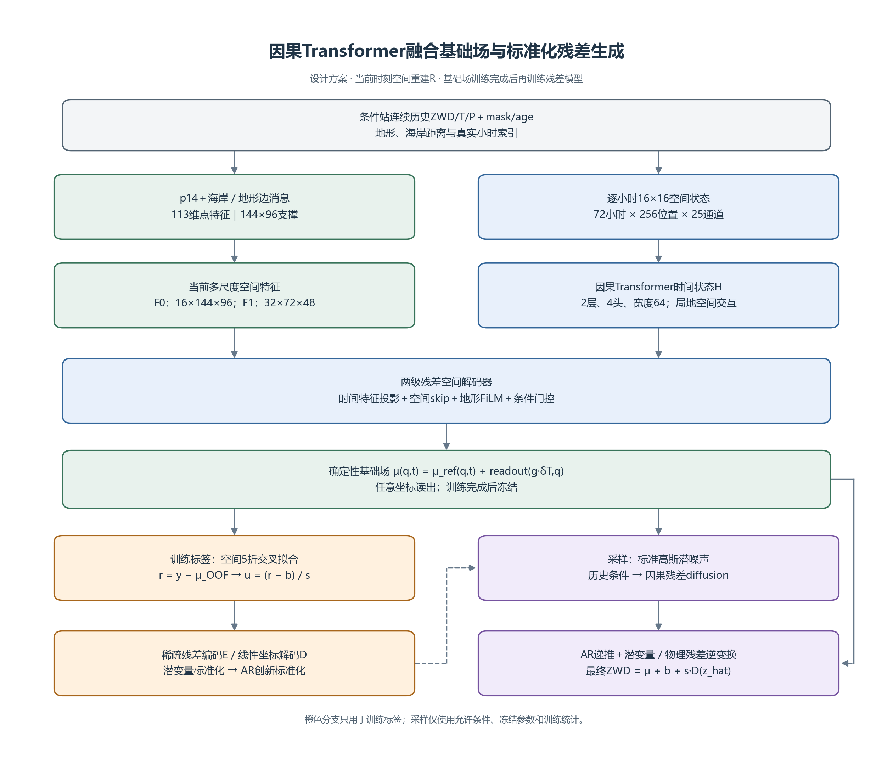
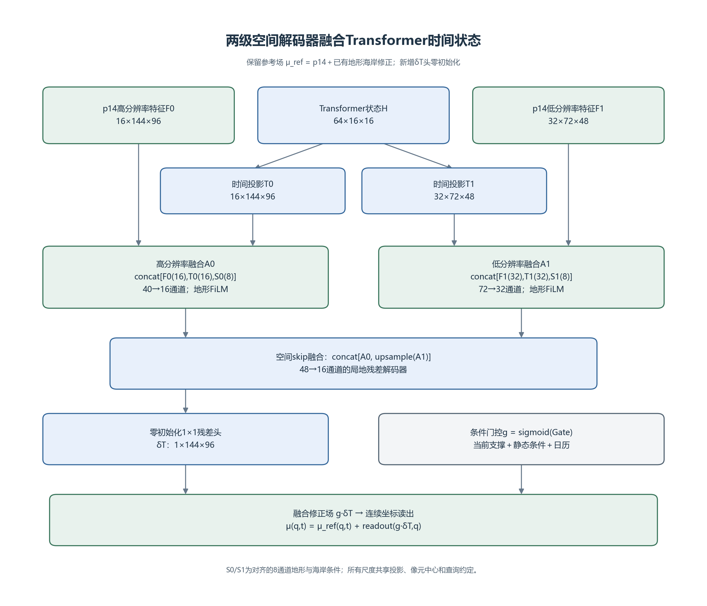
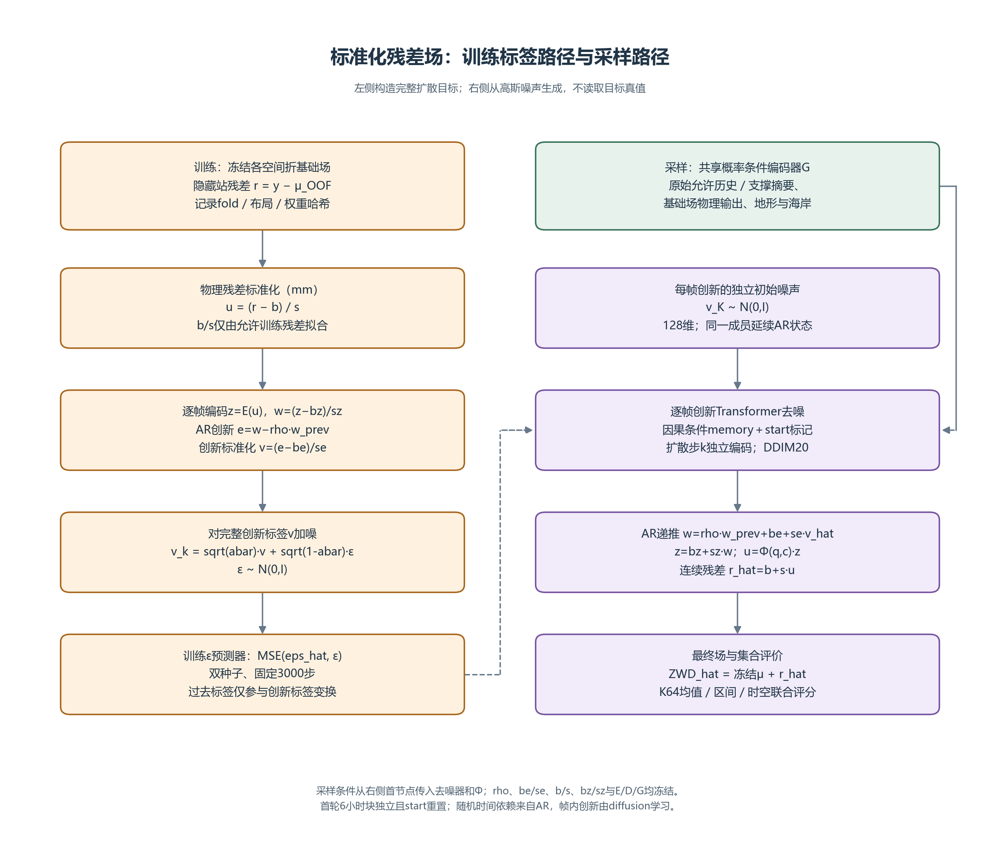

# 因果掩码Transformer与空间基础场融合：架构及标准化残差场

日期：2026-11-25。状态：架构设计完成，新增网络尚未实现或训练。本设计按用户指定的Transformer路线细化[下一阶段计划](../plans/2026-11-25-p14-fusion-next-stage.md)，优先实施时间特征与空间场的融合，再构建标准化残差生成模型。

## 1. 总体结构

模型分为确定性基础场与概率残差场两阶段。基础场保留p14、海岸和地形边消息，以因果Transformer编码连续历史；时间状态通过两级残差解码器与当前空间特征融合。基础场冻结后，在空间折外残差上拟合标准化和潜变量表示，再训练条件扩散。



[总流程SVG](../../figures/transformer_fusion_20261125/overview.svg)｜[融合细节SVG](../../figures/transformer_fusion_20261125/fusion_detail.svg)｜[残差训练与采样SVG](../../figures/transformer_fusion_20261125/residual_pipeline.svg)。图中绿色表示空间载体，蓝色表示时间编码，橙色表示训练标签与残差标准化，紫色表示随机生成；箭头表示数据依赖。

当前任务为R：使用条件站截至t的信息重建隐藏位置t时刻ZWD。内部支撑点用于表示连续场，最终按任意查询坐标读出；内部16×16或144×96支撑不等于真实细尺度精度。未来预报F另设起报时间与输入合同。

## 2. 现有模型与本次调整

实际代码位于工程`research_pipeline/studies/us_dense_zwd_20261105_v1/03_code/gnss_field_server`：

- `tools/terrain_diffusion/p14_fusion.py`：p14基础场、海岸/地形边消息和时间修正相加。
- `fixed_support.py`：p14的113维点特征、30通道支撑摘要和两级U-Net。
- `temporal_encoders.py`：逐位置时间Transformer，宽度64、4头、2层；已有上三角未来掩码。

最新旧结构已完成12个3000步训练配置、2个冻结对照。2020每月连续72小时、3布局的站宏RMSE双种子均值：p14续训9.947306 mm、空间特征9.936249 mm、Transformer9.950066 mm。Transformer两种子为9.993783/9.906348 mm，额外收益尚不稳定。新设计检验融合机制，现有结果不作为新结构有效的证明。来源见[本轮固定快照](../../../research/transformer_architecture_20261125/evidence_snapshot.json)。

| 环节 | 现有实现 | 新设计 |
|---|---|---|
| 历史空间表示 | 8×8支撑上的逐小时摘要 | 16×16逐小时摘要，保留8×8控制 |
| 时空交互 | 空间卷积后连续时间编码 | 每层交替逐帧局地卷积与逐位置因果注意力 |
| 时间与基础场融合 | 读出后数值相加 | 时间特征进入两级残差空间解码器 |
| 修正幅度 | 直接叠加 | 条件门控，残差输出头零初始化 |
| 输出头 | 通用6通道时间头取第1通道 | R任务单通道均值头，6小时残差块另建生成头 |
| 残差训练 | 尚未接入新p14残差扩散 | 基础场交叉拟合→残差标准化→潜变量扩散 |

## 3. 数据与三个mask

首轮历史L=72小时，每批连续12个目标小时；数据按唯一小时轴保存。训练时间依次遍历，只抽条件站，条件身份在整个历史和目标块固定；隐藏目标物理组排除在条件之外。

**因果mask**：时间注意力允许读取自身与过去，`M[i,j]=0`当`time[j]≤time[i]`，否则为负无穷。它约束真实物理时间，和扩散步k分开。R任务t帧可用条件站t时刻观测；如果改做预测t+1，动态输入仍截止t。

**观测mask**：ZWD、T、P分别保留有效标志；无观测的值填0，同时输入有效率与age，区分真实0和缺测。支撑全部缺测时保留位置、时间和缺测标记，不将整行注意力置成负无穷；通过有限值测试。归一化使用冻结训练统计，时间层采用逐token LayerNorm，空间归一化逐帧处理。

**站点角色mask**：目标站标签只进入损失和后续训练残差标签分支，当前及历史目标真值均不进入基础场或采样条件。这与随机遮时间点的MAE任务不同，本轮不新增未来填空目标。

2016–2018拟合、2019内层选择；配置冻结后2016–2019重拟合，2020做开发评价。split边界的历史、age和状态重置；禁止历史窗口跨split。410/137/138空间角色与原C/D隔离沿用合同。输入使用ZWD/T/P、地形、海岸，禁用PWV/IWV/TCWV/Tm。

## 4. 时间编码器：保留空间位置的因果Transformer

每小时在50/150/300 km尺度聚合条件站观测。首轮保留现有25通道含义：每尺度3个归一化变量均值、3个有效率、1个ZWD年龄，加4个日历正余弦。位置、高程和海岸通过独立静态投影输入。以后每变量独立age的31通道方案另立消融。

| 张量 | 形状 | 含义 |
|---|---|---|
| X | `[B,72,256,25]` | 16×16支撑上的连续历史 |
| A | `[256,8]` | 同投影空间坐标、地形与海岸条件 |
| E | `[B,72,256,64]` | 动态投影＋静态/实际时间位置编码 |
| H | `[B,256,64]` | 最后时刻的逐位置时间状态 |

输入投影25→64；静态投影8→64。两个时空块分别执行：逐帧16×16深度可分离3×3空间卷积→每支撑点72小时因果注意力→128维前馈网络，均带残差连接和归一化。4个注意力头，每头16维。空间卷积让相邻位置交换演变信息，时间注意力在固定空间索引上学习历史依赖。

注意力规模为`M×L²`，不建立`(M×L)²`全时空注意力。先保持显式因果mask；后续优化内核时验证布尔mask含义，PyTorch不同attention接口的True语义不能互换。

### 4.1 计算复用与窗口合同

12个连续目标小时需要83个唯一源小时。仅复用逐帧空间输入投影和独立空间卷积；训练期间不缓存旧参数产生的特征。然后按每个锚点提取恰好72小时序列，再执行完整时空块。块内后续空间卷积依赖不同窗口产生的时间状态，不跨锚点复用。

首轮不启用KV cache。多层局部因果注意力直接在83小时上运行，可能让后续输出经中间状态间接读取超过72小时历史，因此不能当作等价优化。验收要求同一小时单独运行与放入连续批次时输出一致。

## 5. 时间状态进入两级空间解码器



原p14与现有海岸/地形修正组成参考均值`mu_ref=mu_p14+delta_geo`。保留原权重与旧高程摘要约定；新时间融合分支输出与p14相同的标准化站点表面ZWD单位，最终转换为mm，不再额外对新修正乘一次3000 m高度衰减。

从原p14读取当前中间特征：`F0=[B,16,144,96]`，`F1=[B,32,72,48]`。将`H=[B,64,16,16]`分别线性投影为16/32通道，再按同一投影包围盒插值到两级特征分辨率，得到T0/T1。静态地形海岸投影为8通道S0/S1。

```text
A0 = ConvBlock(concat[F0(16), T0(16), S0(8)])     # 40 -> 16
A1 = ConvBlock(concat[F1(32), T1(32), S1(8)])     # 72 -> 32
R0 = ConvBlock(concat[A0(16), upsample(A1)(32)])   # 48 -> 16
delta_T = zero_initialized_1x1_head(R0)           # 16 -> 1
g = sigmoid(Gate(current_support, static, calendar))
mu(q,t) = mu_ref(q,t) + readout(g * delta_T, q)
```

门控输入为归一化当前30通道支撑、8通道静态条件和4个日历通道，42→16→1；初始偏置−2，末层权重零初始化。地形FiLM在A0/A1进行逐位置通道缩放与平移，映射由8维静态条件产生，初始为恒等。门控控制修正强度，FiLM表达地形差异，二者独立消融。

零初始化delta_T使新增网络初始输出精确等于mu_ref。基础场损失沿用标准化MSE＋0.1×相邻有效小时增量MSE。首轮固定3000步、两种子42/17，比较原联合训练与前500步冻结参考主干、后2500步小学习率联合训练；学习率日程见配套计划，不在2020选检查点。

内层训练使用原p14来源权重，海岸/地形分支从新初始化或合规的2016–2018拟合版本起步；不载入已训练到2019的现有完整融合last.pt。最终2016–2019重拟合从相同原始起点重新计3000步，不承接内层额外更新。

空间查询的坐标定义必须共用一套米/km约定、像元中心与align_corners设置；16×16时间支撑和144×96基础场均以该投影包围盒生成坐标。全场插值再查询与按查询点分块读出须复算一致。

## 6. 基础场冻结后构建标准化残差



残差定义在观测位置：`r(i,t)=y(i,t)−mu_OOF(i,t)`，单位mm。只有站点残差标签，未观测格点不填成真值。空间连续残差场由后续坐标解码器表示。

### 6.1 折外来源

沿训练池物理空间块固定5折，某折目标组所有年份不进入该折基础场训练、条件、统计与内层选择。各折基础场从新初始化训练，不热启动已见过该折标签的p14权重。对本设计与原相加结构最多两个候选，在剩余站2016–2018拟合、2019选择；折模型均值预测该折目标站。

2016–2018的折外残差用于残差模型拟合，2019折外残差用于选择。最终配置冻结后，各折重拟合至2019生成空间折外训练残差；全410站基础场另行重拟合并冻结供2020推断。每条残差保存fold、物理组、时间、条件布局、基础场权重和统计哈希。这里是开发研究中的交叉拟合，不产生新的盲测试集。

一个残差训练事件的主键固定为`(outer_fold, layout, six_hour_start)`，事件内条件集合在历史与六个目标小时保持不变。E仅编码本事件被留出折的残差标签，不能将同一小时五个折、不同背景或条件集合的残差拼成一幅场。不同折作为独立事件汇入概率训练。

### 6.2 共享概率条件接口

各折基础场独立训练，内部F/H通道的含义不同。概率模型因此使用独立且跨折共享的条件编码器G，输入同定义的原始允许站历史、静态条件、物理支撑摘要和以mm表示的基础场输出，不直接读取各折自由学习的F/H。最终全410站基础场也通过同一个G生成条件，保持表示接口一致。

G沿用本页逐位置因果Transformer形式，72小时、16×16、宽度64、2层4头；与E/D联合拟合允许训练残差后冻结。条件memory可将每帧空间状态池化至4×4供扩散cross-attention，完整16×16最后状态保留给Phi的局地查询。Phi接收8维静态、查询处64维G状态和1维物理均值，经73→128→D映射为基函数系数。G与基础场时间编码器权重独立，复用原始逐小时摘要，不复用未对齐的隐藏通道。

G动态输入为26通道：本页25通道摘要加同一折模型在16×16固定支撑点的1通道物理均值。均值先转换成mm，再用概率训练期统一登记的统计缩放；最终模型输出采用同一缩放。该共享缩放不采用各折隐藏通道或不同模型的输出归一化约定。

### 6.3 物理残差标准化

只对允许训练残差的有效站时求全局均值b与标准差s：

`u=(r−b)/s`，`s=max(std_train(r),0.1 mm)`。

首轮采用全局尺度，便于迁移到没有目标历史的新站；不使用2020误差、验证站统计或真实当前残差预测s。保存样本权重合同，首轮有效训练站时等权。反变换为`r_hat=b+s*u_hat`。这是可逆数值变换，不自动保证RMSE改善；高斯噪声在标准化空间按预定日程加入，基础场mu始终在扩散链外保留。

### 6.4 完整潜变量，而非虚构完整格网真值

逐帧集合编码器接收训练标签`{u_i, q_i, mask_i}`，聚合成z_t，默认D=128；64/256是重构容量对照。连续解码器为`u_hat(q,t)=Phi(q,c_≤t) z_t`，对z线性，Phi由坐标、地形/海岸和冻结基础场条件产生；同一z可查询不同坐标，查询列表不参与Phi的全局归一化。

E/D先训练2000步，损失只在真实有效残差站点计算，先检验遮站与空间留出重构；内层共同人口微RMSE≤1 mm为工程门槛。未达时保留编码结果并调整容量，不直接启动该扩散臂。训练标签编码器仅用于构造扩散训练目标，采样时不读取它。

首轮E为逐帧坐标集合编码：每个有效站的`[u(1),static(9)]`经10→64→128的MLP，按mask做均值与最大值聚合，拼接后256→D。目标表面残差不额外做高度指数转移。G仅用允许条件；E的标签输入与G的条件输入分开保存。空间留出重构采用概率训练池内固定物理组留出，组标签不参与该次E/D拟合，最终E/D在选定配置后重拟合允许训练残差。

缺测保留原小时轴，不插补目标真值；完全没有有效残差的帧不产生latent训练标签，其相邻创新配对也不计损失或rho统计。不会跨缺口寻找上一条有效标签充当相邻小时。验证报告每类有效帧与配对数量。

冻结E/D，按允许训练潜变量逐维求`bz,sz`，`w=(z−bz)/sz`，使用正下界和常量维度标记；这是第二层潜变量归一化，与mm残差的b/s分别保存。

## 7. 带时间条件的残差扩散

每个训练事件保留连续6小时潜残差`w=[B,6,D]`。在标签空间拟合逐通道AR系数rho，约束`|rho|≤0.95`；由块内相邻训练潜状态做带1e-4分母正则的最小二乘，再裁剪。定义训练创新`e_t=w_t−rho*w_(t−1)`，块首`wprev=0`，并输入start标记。用允许训练事件的be/se标准化`v_t=(e_t−be)/se`，se下界1e-4，首帧与后续帧均按该规则训练。

真实上一帧w仅参与上述训练标签变换，不进入G或去噪条件。rho/be/se训练后冻结，lag不跨fold、布局、块或split。该生成族假设给定条件后的逐帧创新独立，时间随机依赖由AR递推承担；diffusion学习每帧创新的多维分布，不把它解释为任意6小时联合score。

每帧分别加噪：`v_k=sqrt(alpha_bar_k)*v_t + sqrt(1−alpha_bar_k)*epsilon`，`epsilon~N(0,I)`。D=128时将当帧创新拆成16个8维通道组token，投影到128维；这些token是潜维分组，不是地理网格。去噪器2层、4头、前馈256，帧内token双向交互；cross-attention只读截至该帧的G memory，物理时间因果mask用于条件memory。扩散步k、真实小时和start分别编码。不会对整块相关状态w实施“严格下三角epsilon＋联合DDIM”。

首轮epsilon-MSE、100个cosine噪声步，每帧DDIM20采样，K64集合；K128与DDIM50为冻结模型的采样复核。逐帧创新均使用独立扩散初始噪声，同一成员保留自己的AR状态。其有效条件密度为`p(w_1:6|c)=product_t p_v(v_t|c_≤t,start_t)/product_d se_d`，每帧均有该Jacobian因子。

全链恢复：

```text
每帧epsilon -> sampled v_hat_t
w_hat_t = rho * w_hat_(t-1) + be + se * v_hat_t
z_hat = bz + sz * w_hat
u_hat(q,t) = Phi(q,c_<=t) * z_hat
r_hat(q,t) = b + s * u_hat(q,t)
ZWD_hat(q,t) = frozen_mu(q,t) + r_hat(q,t)
```

固定尺度先做，再研究自适应潜尺度。后者必须定义完整逆变换，不直接把任意可学习噪声倍数插入采样器。

独立高斯与相关高斯为同条件对照。相关高斯也使用同一Phi、rho、be/se，逐帧创新为带正对角的低秩＋对角高斯；diffusion替换该创新分布。双方的时间随机相关都来自相同AR递推，可分开识别AR与扩散收益；rho=0为独立时间对照。基础场mu对所有概率臂相同，条件位置头差异另报；diffusion的收益不预设为点值下降。

六小时块首轮独立采样，块首AR状态重置。年度小时增量包含块边界，块内与边界分别列样本数和评分。块内联合样本可以检验6小时变化；72小时或全年跨块联合生成另设状态传递实验。后到条件不会回溯修订已生成的早帧。

## 8. 架构消融与验收

| 编号 | 时间表示与融合 | 其余固定 | 目的 |
|---|---|---|---|
| T0 | 原8×8、2层因果时间注意力、输出相加 | 原配置复现 | 控制 |
| T1 | 16×16，仍输出相加 | 72h与宽度相同 | 空间压缩 |
| T2 | T1时间编码；两级融合，门控固定1、无新增FiLM | 同训练策略 | 解码层融合 |
| T3 | T2＋条件门控 | 同结构其余部分 | 修正强度 |
| T4 | T3＋逐层时空交替 | 相同层数与宽度 | 空间传播与历史协同 |
| T5 | T4＋恒等初始化地形FiLM | 相同海岸、地形输入 | 调制方式 |

完整候选为T5；按顺序训练便于定位净收益。短期不同时增加168小时、预测未来或扩大U-Net宽度。每配置3000步，参数量、实际小时呈现、显存和耗时公开。

T0/T1均重新运行并使用相同投影包围盒和查询定义；T0是旧网络结构的同接口控制，旧8×8坐标实现及历史分数另作精确复现。若坐标适配产生可测变化，先报告该变化，再计算T1相对T0的支撑分辨率效应。

验收包含：零初始化等价；同小时单独/批量一致；三种mask隔离；无未来信息的端到端扰动；新旧坐标对齐；查询增减与分块一致；缺测有限输出；标准化往返；折外标签隔离；潜重构；固定噪声下早帧不受未来条件影响。图件验证不替代这些网络测试。

模型选择使用2019内层，同条件两种子点值均改善且各自增量恶化≤0.01 mm才晋级。2020按已暴露开发人口配对报告，六类误差、海岸/季节分层、CRPS、覆盖率与成员shuffle沿用配套计划。扩散点值用集合均值，单成员与最优成员不作为基础场RMSE比较。

## 9. 实施接口与交付状态

建议新增`masked_transformer_fusion.py`提供`encode_history(history, static, hours, masks)`、`decode_correction(F0,F1,H,static,support)`与`forward(batch)`。`p14_oof_residuals.py`构造残差与fold清单，`p14_residual_probability.py`负责标准化、E/D和采样。以上为待实现接口；原实验代码继续保留复现。

本轮交付为设计文档、3张PNG＋3张SVG、可复现绘图脚本、证据快照与核验清单。训练配置按本页逐阶段实现；此时没有新增架构权重或扩散实测分数。

## 10. 与已有时序扩散的关系

[文献对照与借鉴建议](../../research_notes/2026-11-25-temporal-diffusion-comparison.md)说明历史条件、残差扩散与标准化的已有先例。本页固定AR＋逐帧创新扩散作为V1控制保留；条件转移rho(c)与条件位置/尺度是后续单独消融，尚未替换本页架构或图件。

频域扩展见[统一条件与空域/图谱去噪设计](../../research_notes/2026-11-25-spectral-diffusion-feasibility.md)。Transformer条件在每层去噪中融合；新锚点表示、图基、标准化创新和频域分支分别控制，不对任意128维latent直接宣称空间Fourier频率。
