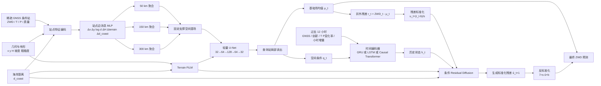
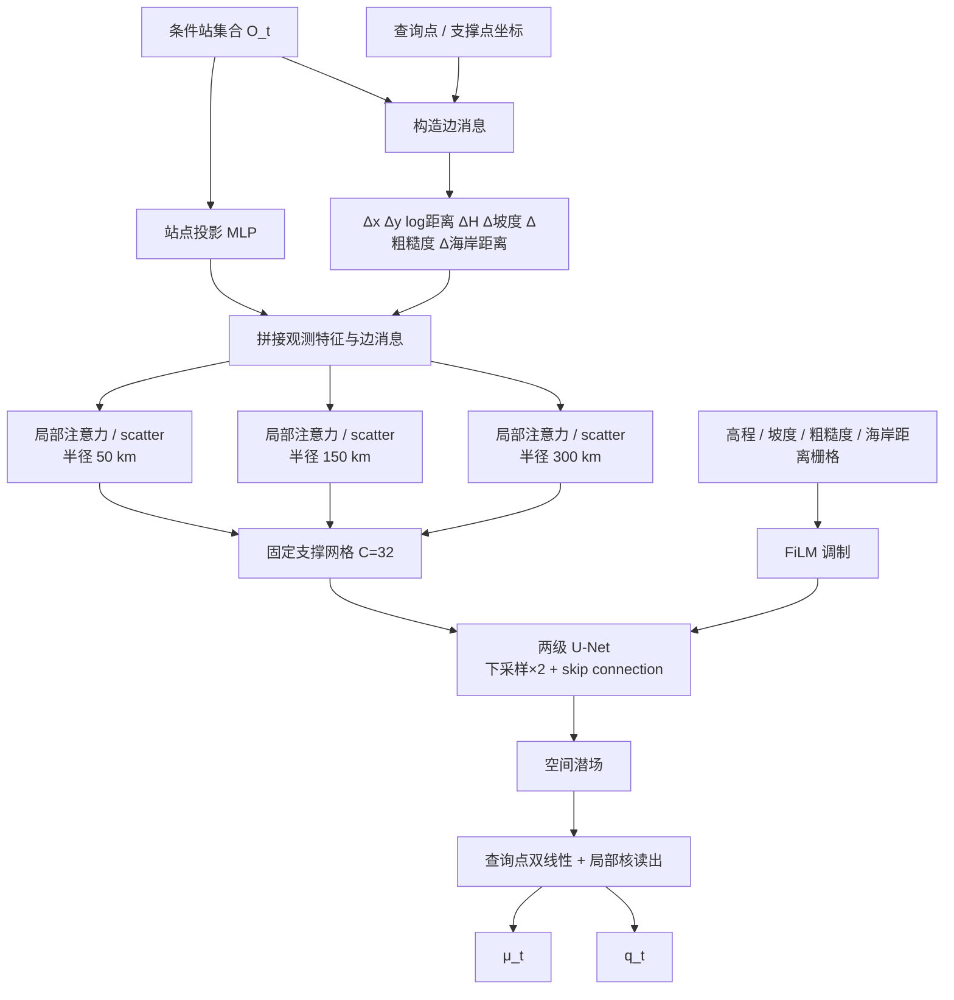
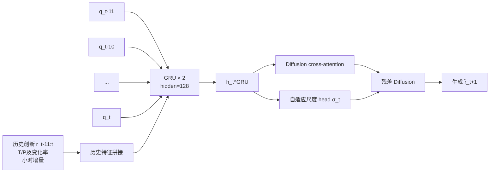
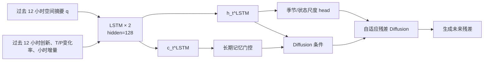
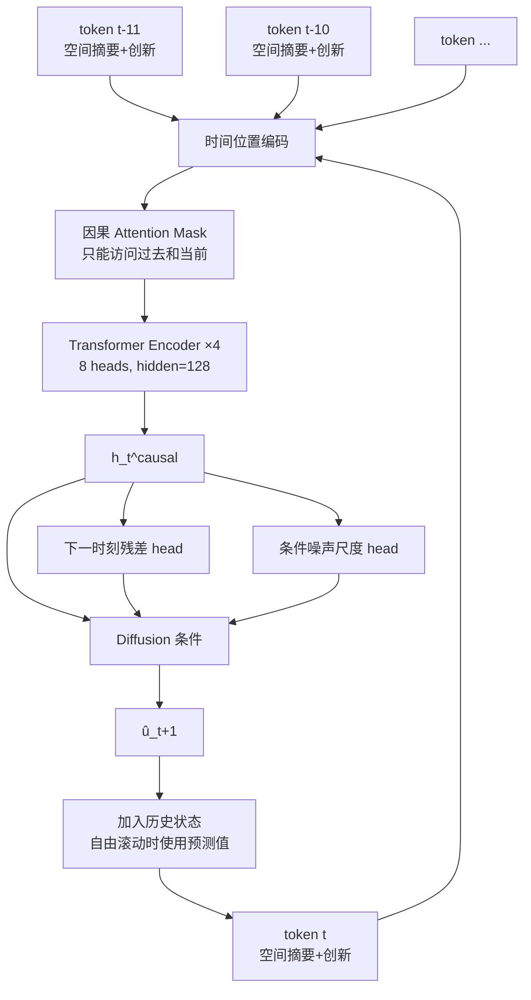
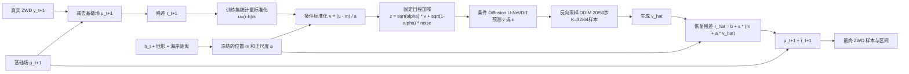
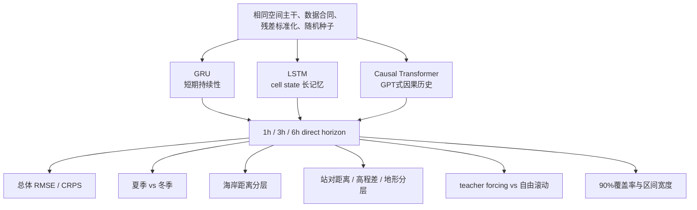
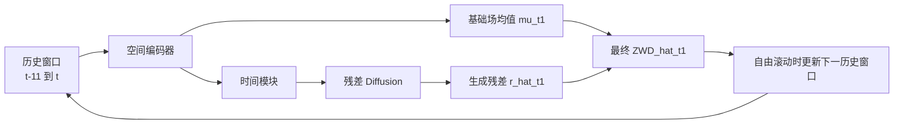

# 时空联合基础场与残差 Diffusion 架构图

> 执行前必读：[下一阶段入口与审阅修订](../../NEXT_STAGE.md)。本文件保留早期设计；时间边界、自适应尺度和执行路径以该入口修订为准。

版本：2026-11-25  
对应方案：[时间模块公平比较方案](2026-11-25-spatiotemporal-residual-diffusion-temporal-ablation.md)

## 1. 总体架构

## 2. 共享空间编码器

这里的关键是：观测站不直接拼到固定长度向量，而是通过**站点—查询点边消息**进入空间场。边消息包含海岸距离差，因此模型可以区分海岸带、海岸—内陆过渡带和内陆站点。

## 3. GRU 时间分支

GRU 只使用单向历史状态，适合先验证短期天气持续性。训练和推理均保持因果顺序。

## 4. LSTM 时间分支

LSTM 的 cell state 用于检验持续性天气过程是否需要比 GRU 更长的记忆。

## 5. Causal Transformer / GPT 式时间分支

训练阶段使用 teacher forcing；自由滚动阶段生成 (t+1) 后将预测状态加入历史，再预测 (t+2)。未来 token 永远不可见。

## 6. 残差 Diffusion 机制

采用条件残差标准化：位置与尺度头先拟合并冻结，扩散保持标准高斯终点和固定噪声日程。固定尺度对照取 m=0、a=1。详见统一入口的数学修订。

## 7. 三种时间模块的比较重点

## 8. 训练与推理边界

未来预报图中的 mu_t1 必须由截至 t 的历史预测得到，不读取 t+1 的真实观测。GitHub 支持时序图；此前版本未验证时序图兼容性就是失败原因。本次实际修正了流程图标签中未加引号的括号表达式。

## 9. 需要生成的结果图

- `architecture_overview.png`：总体架构；
- `space_encoder_coast_distance.png`：海岸距离与地形边消息；
- `temporal_module_comparison.png`：GRU/LSTM/causal Transformer；
- `residual_diffusion_flow.png`：标准化残差 diffusion；
- `seasonal_rmse_crps.png`：夏季/冬季分层；
- `coast_distance_profile.png`：海岸距离分层；
- `rollout_error_growth.png`：1/3/6 小时自由滚动误差增长。

GitHub 页面可以直接渲染以上 Mermaid 图；正式运行后再从同一结构导出 PNG/SVG，避免图示与代码架构漂移。
