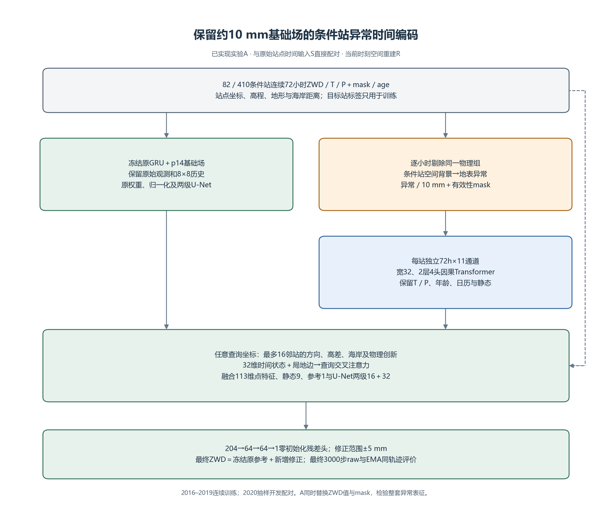

# 按10 mm尺度编码条件站空间异常

## 假设与对照

在已训练GRU+p14基础场上，汇总时间融合和查询时间融合的3000步双种子结果接近原参考。新增Q分支的修正RMS约0.1–0.3 mm，与目标残差的相关性较弱。原始站点时间编码正在检验保留站点信息是否有效；本项进一步检验时间输入与待修正残差的尺度及语义能否对齐。

代理选择的输入表征对照为：联合替换站点Transformer的ZWD时间值与其有效性掩码，检验按10 mm缩放的局地空间异常表征整体效果。其余网络、学习率、时间顺序、布局日程和参考源相同。原始ZWD继续输入冻结基础场及查询边的物理创新。本臂结果不能单独归因于数值缩放。

## 条件站异常

同一小时，可见条件站i的地表ZWD为z_i，海拔h_i以m计。先变换为共同高程的u_i=z_i exp(h_i/3000)。两条件站间距离d_ij以km计，固定权重为

`w_ij = exp[-0.5(d_ij/150)^2] / max(d_ij,10)^2`，有效范围450 km。

计算i的背景时，剔除i所属物理组的全部站，以及该小时缺测的站。背景为其他条件站u的加权均值，再乘exp(−h_i/3000)回到i的地表。时间输入第一维为`(z_i - background_i)/10 mm`，对应mask在自身有效且存在外组邻站时为1，其余为0。T/P、各自mask、观测年龄和日历维持原输入。

异常不读取隐藏站标签，不读取未来小时，不在目标查询集上拟合参数。10 mm是预先指定的固定物理尺度，背景为固定的条件站空间算子。它与后续扩散中的训练折残差标准化承担不同作用。

## 网络与训练

[可缩放SVG](../../figures/station_anomaly_20261125/architecture.svg)。虚线表示原始观测继续进入局地空间读出。

继承[原始站点序列与查询融合](2026-11-25-direct-station-query-fusion.md)的Transformer32、16邻站交叉注意力、冻结p14两级U-Net和204→64→64→1查询残差头。新增头零初始化；修正范围为±5 mm。历史72小时，每批连续12小时，2016–2019训练；3000步、seed42/17，AdamW新参数lr1e-4，MSE＋0.1小时增量MSE，EMA0.999。

条件布局仍为75%随机与25%100 km空洞；四个连续块内随机安排一个空洞块。基于每站独立序列计算异常后再展开历史窗，时间先后不变。最终raw与EMA预先登记，共享一次训练轨迹。

## 评价和来源

同一2020每月72小时×3布局×137登记开发站，按最终3000步配对原GRU和原始站点S臂。报告宏/微RMSE、MAE、bias、增量及距离、海岸、高程、地形、季节、站对差值；晋级判据沿用[精度衔接报告](../../research_notes/2026-11-25-precision-continuation.md)。训练2020标签不参与拟合，确认集/C/D标签保持隔离。

实现为`tools/terrain_diffusion/station_anomaly.py`，入口为`station_query --history-mode anomaly`，正式输出另设`20261125_station_anomaly_precision`。原始站点S进程已经加载原版本代码，协议中的`station_query.py`哈希对应Git提交`dd24a9a`。本次追加runner参数不改变原S进程，旧协议和源文件哈希保持原值；新A臂记录新代码及输入变换哈希。

CPU测试已验证共同高程常场归零、同物理组排除、缺测退化、站点置换等变和逐小时局地性；运行前另做真实数据接口探针。正式结果由实际运行产生，不将该设计当作精度收益。

只读审阅重放了每种子3000个连续训练块：因缺少450 km内其他物理组的有效邻站，异常掩码在seed42的561块、seed17的551块发生变化；对每块重叠历史去重，分别涉及35123/33177个站时。最终除A相对GRU外，同时按共同月份和种子直接计算A_raw−S_raw与A_ema−S_ema的区间。
