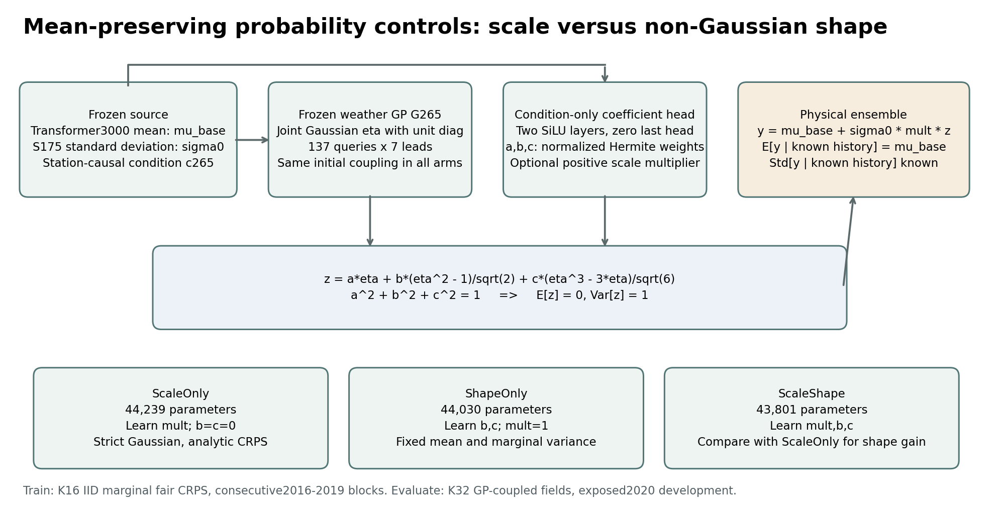

# 基础场均值保持的非Gaussian强对照

**状态：数学合同与真实缺测4更新已完成，尚无正式训练结果。** 此轨道作为概率形状和尺度的强对照，与已锁定G265→Local/Affine轨道并行，不替代原diffusion实验。依据[误差分离](../../research_notes/2026-11-26-diffusion-benefits-and-mean-error.md)及[下一步路线](../../research_notes/2026-11-26-next-breakthrough-directions.md)。

## 固定的输出中心与输入

每个起点/查询/lead的解析均值固定为源Transformer3000基础场mu_base，不采用S175的均值头修正。使用同源S175尺度sigma0、c175＋固定可见历史cw90，以及已完成G265的时空相关K。G265自身基于S175中心拟合，这一来源差异明确保留；所有新臂使用相同冻结K，不将相关来源的收益算入形状贡献。

给定条件后的eta为零均值、单位边际Gaussian场。令b=tanh(raw_b)、c=tanh(raw_c)，a=1/sqrt(1+b²+c²)，并定义：

`z=a*(eta+b*(eta²-1)/sqrt2+c*(eta³-3eta)/sqrt6)`。

Gaussian正交性保证解析均值0、方差1。若存在尺度头，mult=exp(clamp(raw_scale,-ln4,ln4))。物理输出为`mu_base+sigma0*mult*z`。初始raw全零，严格继承相同中心Gaussian，保持新增参数梯度可学习。理论均值固定不表示K32采样均值没有误差，正式点预测始终用mu_base。

## 三个近等参数消融

| 臂 | 输出 | 网络 | 参数（已核验） |
|---|---|---|---:|
| ScaleOnly | 7个scale | 265→114→114→7 | 44239 |
| ShapeOnly | 7个b＋7个c，scale=1 | 265→112→112→14 | 44030 |
| ScaleShape | 7个scale＋7个b＋7个c | 265→110→110→21 | 43801 |

两隐藏层SiLU，最后层零初始化。b/c范围为[-1,1]、a为正，构成单位方差的有限Hermite展开。模型表达非Gaussian边际形状；联合依赖来自相同G265初始过程与逐坐标条件映射。它不是扩散模型，也不宣称拟合了真实完整联合score。

## 训练合同

2016–2019原3000连续12h块、相同查询和源残差，不跳时间。每个有限标签参与损失，保留原缓存依未来可用性选目标站的事实。训练K16个独立标准Gaussian噪声，仅比较逐点proper CRPS；因此训练噪声可以在站间独立，边际期望与推断G265耦合一致。三臂共享噪声seed及流，重设初始化后的随机种子。

目标`e=(truth-mu_base)/training_scale[h]`，预测`gs*mult*z`，其中gs为冻结S175标准化尺度。训练fair CRPS对成员对差使用K(K-1)归一化，不用有偏经验CRPS。loss按全部有限标签平均，无标签则不更新。AdamW3e-4、weight_decay.01、同3000步cosine至.1初始率、梯度裁剪1、500 checkpoint、STOP flag。

## 推断与判断

固定开发137查询，从冻结G265相关K采样32个IID成员，分别逐点映射；同一superset初值保持子集路径一致。输出解析均值/标准差、K32公平CRPS、覆盖、四档站对、内部增量和energy。ScaleOnly为严格Gaussian，额外给解析CRPS；其他两臂均值/方差解析已知，不能将其称为Gaussian分布。

基准BaseCenterGaussian用同sigma0/G265相关，b=c=raw_scale=0。ScaleOnly−基准检验尺度校准；ShapeOnly−基准检验固定方差的非Gaussian形状；ScaleShape−ScaleOnly检验额外形状收益。均值逐值等于基础场，当前R精度由源决定。双种子、共同月份区间；以概率额外收益而非固定均值成绩判断形状价值。2020已暴露开发、strict_oof=false，确认138及原C/D不读；禁止PWV/IWV/TCWV/Tm。

正式来源需完成G265权重seal；4更新工程小试可使用已注册G265小试源，输出目录与状态明确区分。新代码不修改旧GP或Local/Affine实现/科学锁。计分实现新协议单独哈希绑定。

## 首批核验

6个数学合同与2个入口/工件守卫RED→GREEN；研究176项通过43.01s。Scale/Shape/Both真实缺测各4更新、18088有限标签，warm Gaussian最大差0，首批loss相同。旧GP与Local/Affine源码未改。工程小试不进入正式成绩排名。

独立review通过数学实现。正式评价增加专门recipe核验：参考/三臂均比对源GP seal、模式、缓存/embedding、K32、共同采样seed、评分代码；joint绑定lineage和计分源码。新生成与重用均核验。模型核心和已完成小试来源不改。176研究测试、568默认测试、19维护测试通过。
