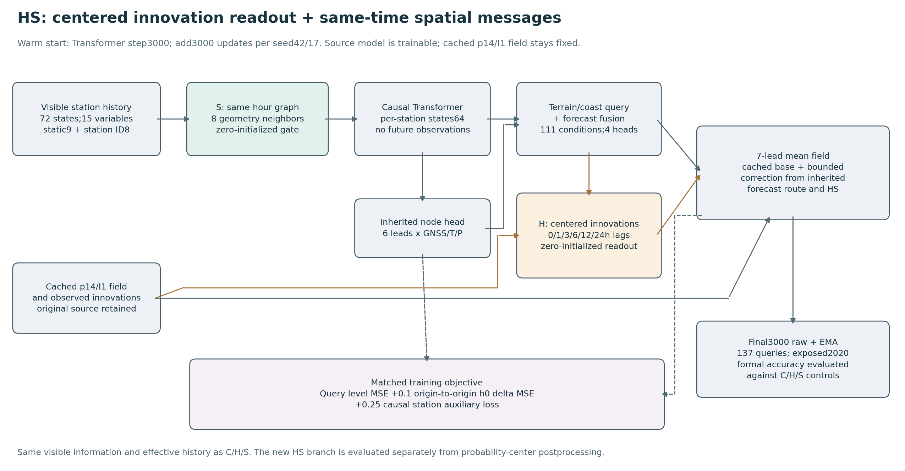

# H＋S：同起点时空融合的组合检验

## 假设与路线选择

已有H相对匹配续训C改善当前场，S相对C对六小时有小收益。组合可能互补，也可能因同刻空间混合改变创新读出而相互干扰。先完成这个直接组合，再决定是否采用更复杂的站点×滞后传播。

三个候选路线为：冻结概率中心后处理、既有H/S的组合、全新的有向时滞注意力。本轮选择H/S组合补足已有消融；它与正在执行的中心后处理是独立实验。用户已授权自主设计与实测，不新增审批环节。

## 架构与初始化

保留联合Transformer3000来源、p14/I1基础场、逐站原始GNSS/T/P、mask/age、站ID及有向地形/海岸查询。H为四空间头在每个历史lag内中心化后的创新读出；S为时间编码之前、同一历史时刻的几何邻站消息。

新`NativeMeanHS`继承H前向，替换为S的站点编码器。新增H读出零初始化，S gate零初始化；全部旧权重严格加载，初始点预测/embedding/辅助输出须与非零源模型一致。用构造前同一CPU RNG状态分别创建H和S，使两个分支的初始参数各自匹配原单臂，而非因组合的参数创建次序改变S初始化。

## 正式数据与预算

双种子42/17，均从各自联合Transformer step3000 checkpoint继续，完整恢复旧AdamW状态，旧参数lr1e-4、新参数lr3e-4，开启同一3000块cosine周期。辅助因果站点预测权重0.25，EMA0.999，源raw初始化EMA；恢复源训练RNG。

原query损失为h0均方误差＋0.5倍未来lead均方误差均值，并含0.1倍相邻起点h0误差差分；本轮保持它与0.25辅助因果损失不变，不新增同一起点内部lead差分损失。

训练使用原2016–2019连续12h块顺序0..2999，仅站点身份抽样；不跳日期或改变旧缓存。旧缓存按未来轨迹可用性挑选目标站的限制与非严格OOF状态继续保留。历史状态72h、上游原始依赖146h，与C/H/S一致。

缓存含34908唯一小时，末尾91块按旧协议顺序回绕复用；不把回绕边界拼接成跨2019→2016的历史。该既有数据重复随匹配C/H/S合同保留，不声称3000块的所有起点均唯一。

主评价2020每月8–10日三布局固定137查询，raw final3000为主、EMA并列；不按开发结果挑选checkpoint。与已有C/H/S按同新增预算比较，源3000另作预算参照。确认和原C/D标签隔离，不引入PWV类变量。若需要补充日期，固定final权重后全部同预算控制一并评价。

## 实现与验收

新增独立模型、训练/导出脚本及结果目录，不修改已训练C/H/S的源码、协议或结果。

1. RED→GREEN：非零源warm等价、H/S初始分支匹配、两个新增机制有梯度、因果前缀及查询子集/站点排列关系。
2. 真实同源缓存4更新工程小试，记录实际有限标签、loss/gradient与warm差；小试不作科学排名。
3. 双种子各3000，保留完整curve、checkpoint、source/code/cache哈希、raw/EMA导出及固定开发评价。
4. 当前场、六小时、当前小时增量、时效内部增量与分层误差同时评价；若只有相对源3000的收益，不归因组合架构，必须检验相对同续训C和已有H/S。
5. 核验、独立审阅及轻量证据同步GitHub。原始数组和权重留本机，剩余额度75%停止线继续有效。

本轮不声称组合有效，也不立即用开发最优均值替换已经锁定的概率模型源；后续基础场与残差概率校准需另建匹配来源。
