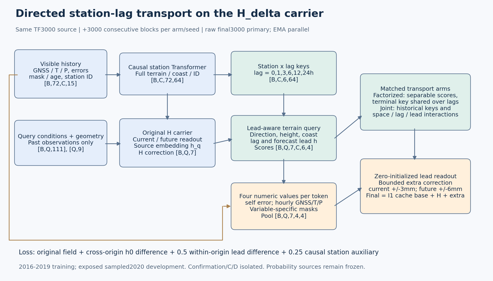

# 有向站点×滞后传递：同源H_delta上的结构消融

## 问题与设计

LOSO面板尚未形成清晰额外线性信号，因此沿用既有self创新。当前H的物理读出对各lag复用站点score，再组合lag/空间头；新增分支直接以查询时效h、站点j和历史lag共同决定读出。保留原p14/I1载体、逐站Transformer、原GNSS/T/P、mask/age、身份及有向地形/海岸信息。

原H路径逐式保持，新增分支不修改其嵌入输出。对源融合向量h_q生成七个时效query；读取同站历史状态及lag0/1/3/6/12/24。四个空间头带50/100/200/400km距离先验。关系特征为东西/南北位移、log距离、高差、海岸距离差、两个地形坡度差、起伏差、lag/24、预报时效/6，共10维。

每token保留四个数值：I1后self创新、小时GNSS增量、小时温度增量、小时气压增量。后两者按2K/2hPa对应10mm的特征尺度换算，不宣称物理等价；GNSS项沿用高程传递。各变量按自己的当前/相邻小时mask归一化，避免其他变量缺测稀释该变量权重。站点原始身份及完整天气历史保留于时间编码key。

新增逐时效readout零初始化，额外修正上限当前3mm、未来6mm；初始前向、嵌入及辅助输出须与源TF3000一致。之后输出为原H correction＋bounded新修正，不改变旧H的限幅公式。

## 两个同参数新臂

- factorized：所有lag读取站点末状态key，score的地理项与lag项可加分离；h仍进入两项，value仍保留每个lag的原数值。
- joint：使用该历史位置的因果状态key，地理/lag/h关系进入同一个MLP，允许站点、时间及预报时效交互。

两臂具有相同模块、参数量、初始参数值及显式value，区别是前向的时滞耦合方式。对照是已完成的H_delta；新臂和H_delta均从同一TF3000开始各新增3000，而不在H_delta上再多训一轮。该比较检验整套耦合机制，若有收益再分开消融历史key与非可分离edge，不单独归因其中一个。

历史状态72h/原始上游146h，query输出不相互池化，增删查询不改变共有位置预测。较早lag的Transformer状态只读取原窗口内截至该位置的前缀；完整旧H仍访问原72h末状态，未额外增加历史。

## 训练与评价合同

双种子42/17，原2016–2019连续块0..2999，AdamW源状态/RNG恢复，旧/新lr1e-4/3e-4，cosine3000，aux0.25，EMA0.999，增量权重0.5与H_delta一致。仅站点抽样，保持旧未来可用性选目标、末91块复用、历史PWV筛选及非严格OOF限制；确认及原C/D隔离。只使用原Z0/T/P信息。

raw final3000为主、EMA并列。主日历2020每月8–10日三布局，评价当前/六小时、两种小时增量、条件距离、高程/地形/海岸和站对差值。两种子及同日期共同月份区间并列。若主日历六小时方向有收益，冻结final权重后同H_delta及两新臂一起补充15–17日日历，不挑选checkpoint。

主要判据为joint相对H_delta的六小时站宏RMSE，同时检查当前场和增量代价；factorized用于判断新增参数/读出路径能否解释收益。当前2020日历已开发暴露，后续正式确认须另立冻结协议。

## 验收步骤

1. 测试RED→GREEN：source非零warm等价、两臂初始化逐tensor一致、读出激活后的查询子集/站点排列等价、变量mask、全空观测零输出、两个更新后的梯度。
2. 真实4更新：禁用新增分支时与旧H_delta共同参数/EMA/AdamW按名称及RNG精确等价；启用后确认有限loss和梯度、测显存和耗时。
3. 固定源码及来源合同，执行四个3000训练和raw/EMA主评价；按触发规则补充日期。
4. 来源/几何/final权重核验、配对分析、架构图和最终只读审阅，轻量成果同步GitHub。剩额75%停止新增研究。
