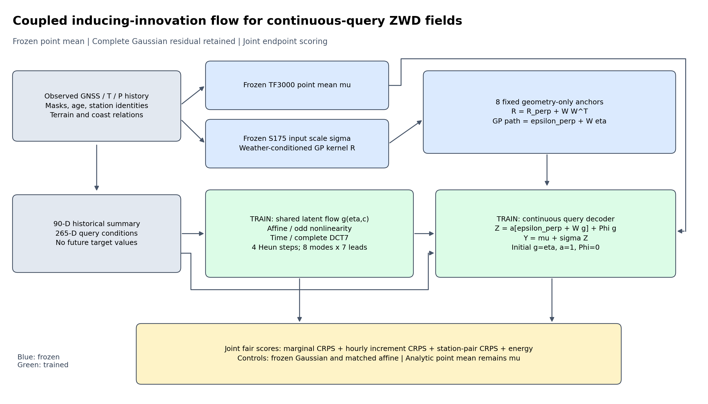

# 连续查询诱导创新流：固定均值、全残差过程与联合概率评分

## 研究任务

在约9.8mm当前基础场之上，检验共享非Gaussian潜过程能否改善六小时边际、站对与小时增量概率评分。此分支固定原TF3000均值，不将最新directed均值静默接入旧G265来源。它采用终端联合proper评分训练连续概率流，不是传统去噪score matching。

原[独立加法潜流](2026-11-26-projective-latent-flow.md)保留为工程证据。独立eta与零读出phi使流参数首步梯度为零，phi的初始化期望一阶梯度也为零；有限采样可使其随后启动，但入口较弱。新版本让潜变量成为GP本身的白化诱导创新。

## 数学与模型



冻结G265核R、原TF3000均值mu、S175条件尺度sigma。由训练静态前三维乘[1000/300,1000/300,2]得到GP坐标，以确定性最远点选8个互异虚拟锚点。无锚点标签，不随查询人口选锚点。

对同一历史条件，锚点只使用全局核，rho_anchor=1；查询–锚点交叉核为sqrt(rho_query)乘同一空间和七时效时间核。锚点坐标固定，查询坐标保留原天气变形；K_AA及K_QA均由同一PSD过程构成。

```text
W = K_QA K_AA^(-1/2)               [B,Q*7,8*7]
R_perp = R - W W^T
eta ~ N(0,I_56), epsilon_perp ~ N(0,R_perp), independent
xi_GP = epsilon_perp + W eta
Z = a(q,h) [xi_GP + W(g_theta(eta,c_global)-eta)] + Phi(q,h) g_theta(eta,c_global)
Y = mu + sigma Z
```

K_AA使用float64对称特征分解的主逆平方根。R_perp对称化并检查Cholesky；不静默添加jitter或裁剪特征值。保留完整epsilon_perp，不以8模式重构或截断全场。

查询头输入265维原条件加两维lead位置，输出a与8维Phi；a=exp(0.5tanh(raw_a))，Phi=0.5tanh(raw_Phi)/sqrt8。初始a=1、Phi=0、g(eta)=eta，逐样本精确保留完整GP。W通路允许流参数首步直接获得梯度。相同共享噪声和历史下，逐查询解码无query池化；核及W的查询子集边际一致。独立对子集重做Cholesky并不保证同一路径，这与分布一致性区分。

g用4步Heun演化，8次速度计算。Gaussian affine速度对latent线性且无偏置；odd速度为[f(x)-f(-x)]/2。两者均保持条件均值为零，affine保持Gaussian，odd可表达中心对称的非Gaussian。odd不覆盖所有偏态模型。输入尺度sigma被冻结，输出方差仍可被a、Phi和g修正，不能称四臂最终方差完全一致。

时间/频率候选分别在7个物理小时坐标或完整DCT7坐标上演化。DCT作用于白化诱导小时坐标，不直接等同实际ZWD物理频谱；完整变换不自动增加信息。物理预报lead h与生成积分时间theta分开。

## 正式配对与训练

四臂为affine_time、affine_frequency、odd_time、odd_frequency。参数53421/54161，差异约1.4%。均用265维query条件、90维历史摘要、8模式×7时效、4步Heun、同初始化与同噪声种子。加入冻结Gaussian过程作为零训练对照；affine为具有相同输入与近同容量的训练Gaussian控制。

2016–2019原3000个连续12h块，各种子42/17逐块3000次更新，不随机抽时间，不拼接2019到2016历史。每块原128查询中按固定种子独立抽32个，与未来标签无关；全部Q32进入生成，缺测只在评分mask。原128查询已受未来可用性筛选的旧源限制继续保留。

每次K8 IID联合成员。目标为边际fairCRPS＋0.25内部增量fairCRPS＋0.25四距离档站对fairCRPS＋0.1全场fair energy。各项按冻结Gaussian尺度归一；每距离档最多4站对，几何抽样不读目标标签。AdamW lr3e-4、weight_decay0.01、cosine3000至lr3e-5、梯度裁剪1，无EMA选优，使用最后3000权重。

主指标预先登记为odd_frequency相对affine_frequency六小时fairCRPS。Affine相对冻结Gaussian单独归因相关/尺度适配；同family频率相对时间用于频域归因。次要指标为当前CRPS、小时增量、四档站对、energy、覆盖率、10/20/30mm增湿/减湿事件、地形/海岸/季节/条件距离分层和成本。共同月份2000次重采样、固定双种子，不作多重比较校正。

## 评价与封存

主日历2020每月8–10日，12个月×3布局×72h，216块×12起点；137查询顺序固定0…136，当前/F6有标签站为135。K32 IID，采样种子261126、设备cuda，五臂共享同一eta与epsilon_perp采样流。每个模型重新生成同组噪声，不能混用旧GP样本与独立eta。

登记缓存、embedding、GP/S175/copula、模型与评分依赖哈希。评价拒绝部分月份、其他布局种子、重排query和变化缓存；来源、成员、布局种子、采样种子与设备进入lineage。解析点均值始终为TF3000，有限成员均值的RMSE另列。Gaussian/Affine可解析计算边际标准差及CRPS。

主日历odd_frequency平均F6 fairCRPS优于affine_frequency时，按冻结权重评价全部五臂补充日历15–17日，不再拟合。两日历均已开发暴露。输出原数组、权重本地保留，Git只同步代码、协议、曲线、指标、来源哈希与图。

## 工程证据与边界

- 核重建、正定、查询子集、暖启动、激活odd对称性、affine完整基底解析方差、耦合经验交叉协方差和预算/日历守卫共13项模型/runner测试通过。
- 四个CPU真实GNSS配置各四更新，初始共同噪声损失均0.7770045655；首步流梯度0.01004–0.02119；每步2688有限标签，真实4块的全部4臂循环耗时约4.78s，不含来源构造。
- 额外CUDA odd_frequency四更新完成，首步流梯度0.02451，body约0.83s；CPU/GPU抽样流不同，不据损失差异排名。验证代码后新增评价守卫，原CUDA训练runner源码另存到结果目录。
- 数值工程证据不代表开发预报收益。strict_oof=false、原历史PWV筛选和末91块复用限制保留；禁止水汽柱/PWV/IWV/TCWV/Tm条件或教师，确认及原C/D隔离。

下一项须经正式锁和来源审阅后启动。剩余额度75%停止新增研究。
