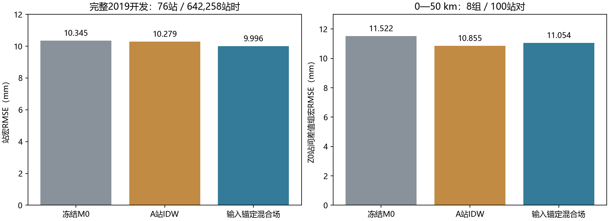
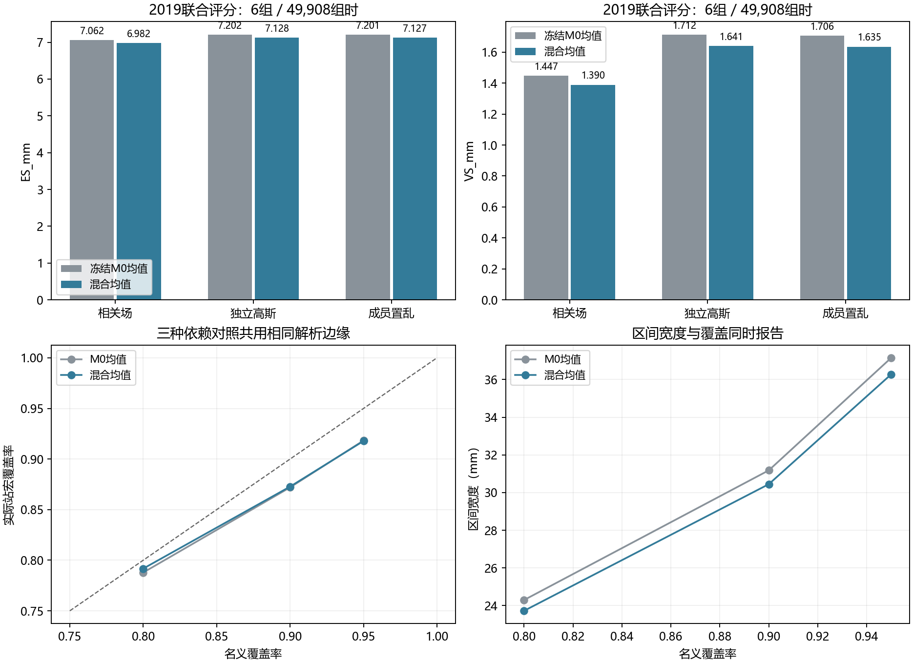
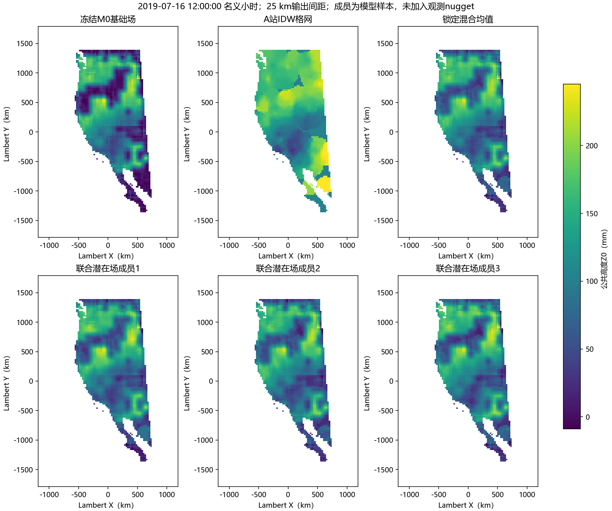

# 本机方法研究结果与生成模型接口

本轮已与内置网页Pro完成三轮研究审阅，并在本机完成条件模型、联合高斯、重尾与天气条件尺度实验。可继续采用的研究基础是**冻结M0与A站IDW的混合均值，加上天气条件化的局部空间相关高斯残差场**。它取得了全年开发集的点值与联合评分收益。25 km仍表示输出间距；独立站证据尚未支持新增真实细尺度信息的主张。

## 评价范围

A174为输入，B511的2018观测用于新增拟合，C2019为已查看的开发评价，D2020保持封存。M0沿用第5000步冻结EMA，曾使用B2016—17。B组留出检验新增方法的迁移，不代表整个M0链条从未见过这些物理站。

全年主点值人口固定为8760小时、76站、642258站时。联合评分限同小时至少4站合格的50 km密集格组，实际6组、49908组时、309138站时。两种人口分别报告。全年F0扩展表有103站、873417站时。所有场先发布Z0格网，再以同一双线性算子查询并乘exp(-H/3000)恢复地表ZWD。

本机新增均值参数只使用既有864个2018时刻。概率拟合使用其中合格的B站200 km单元，每组每时至少4站，复合似然共22120组时、352922站时。这是一轮小规模方法筛选，未使用2018全年训练量。

## 已核实的点值收益

唯一混合参数由B2018拟合，w=0.26112698785540106。

\[
\mu_{mix}=0.7388730121\mu_{M0}+0.2611269879I_A.
\]

该表达式作用于实际Z0发布格网，查询后与站端线性组合一致。它不强制穿过A站观测。

| 全年C2019方法 | 站宏RMSE mm | 微RMSE mm | 站宏MAE mm |
|---|---:|---:|---:|
| 冻结M0 | 10.344629 | 11.019856 | 7.984520 |
| A站IDW格网 | 10.278529 | 11.176887 | 7.956403 |
| 锁定混合场 | **9.995855** | **10.672188** | **7.720256** |

混合减M0为-0.348773 mm，2000次同步7日块配对95%区间[-0.398947,-0.285689]；混合减IDW为-0.282674 mm，区间[-0.413629,-0.166853]。全年包含53个有观测的时间块。C2019参与过开发，区间未包含全部方法选择的不确定性，不能作为最终盲测确认。

0—50 km的Z0差值组宏RMSE为M0 11.521995、IDW 10.854780、混合11.053903 mm。混合相对IDW的时间×密集组区间[-0.427653,+0.808148]跨零。安全100 km粗化比较只保留23站和1个近对，与主表100个近对分开解释。

## 当前空间概率模型

固定几何双平方基的中心间距为100/300 km，支撑半径150/450 km，逐格平方和归一。两个尺度分别1049/165个固定基系数。高斯模型只拟合三个方差参数，没有学习1214维逐时逆算系数。

\[
Z_0^{(k)}=\mu_{mix}+\sigma_1\Psi_1\xi_1^{(k)}+\sigma_2\Psi_2\xi_2^{(k)},
\quad \xi_\ell^{(k)}\sim N(0,I).
\]

站观测预测另加独立地表未解析误差项tau。混合均值下重新用B拟合后，sigma1=8.560606 mm、sigma2=0.010000 mm（Z0），tau=6.182703 mm（地表）。粗尺度触下界，当前复合似然没有检出额外贡献；200 km组内监督并不足以否定远距离相关性。tau合并了观测和未解析变化，不能解释成纯仪器噪声，也不加入发布场图像。

| 固定均值与概率模型 | 全年组宏ES | 全年组宏VS | 站宏CRPS mm |
|---|---:|---:|---:|
| M0＋局部相关高斯 | 7.061695 | 1.447426 | 5.854082 |
| 混合＋局部相关高斯 | **6.981668** | **1.389547** | **5.676224** |
| 混合＋相同边缘方差的独立高斯 | 7.127906 | 1.640829 | 5.676224 |
| 混合＋逐站成员置乱 | 7.127099 | 1.635386 | 5.676224 |

ES/VS均采用128成员，组内按既定算子评分。点值产品使用解析均值。独立高斯直接从diag(Sigma)抽样；成员置乱保留每站每小时的有限集合边缘，两者承担不同对照作用。高斯CRPS和区间使用解析边缘，三种依赖对照在理论上相同。

混合均值下，相关减独立高斯的ES为-0.146238、VS为-0.251282。7日时间×组2000次重采样区间分别[-0.226025,-0.073547]、[-0.350605,-0.150790]，14日敏感性方向一致。收益在6个密集组的范围内成立，不直接代表陆地区域面积平均误差或跨组联合分布。

混合高斯80/90/95%区间实际覆盖79.17/87.27/91.78%，平均宽度23.72/30.45/36.28 mm。高概率尾部仍欠覆盖。

## 优先概率候选：由A条件调节尺度

分层审计发现常数尺度模型冬季90%覆盖93.08%、夏季77.56%，高湿状态78.82%。因此另预登记一个两参数小试：保持混合均值、局部基和相关系数不变，由当小时A站共同有效Z0的中位数调节所有残差分量的尺度。中心、标准差和参数均只用B2018训练时刻估计。

\[
g(A)=\exp\{a+b(w_A-99.511701)/41.184960\},\qquad
a=-0.0305142,\quad b=0.1784344.
\]

潜在场采用g乘空间残差，站观测预测另加g乘tau的未解析项。9个完全缺A输入的2019小时采用已登记的标准化条件x=0回退，不填补评价值；其支持条件按原规则处理。g全年范围约0.690—1.826。

| 概率模型，混合均值固定 | 组宏ES | 组宏VS | 站宏CRPS mm |
|---|---:|---:|---:|
| 常数尺度联合高斯 | 6.981668 | 1.389547 | 5.676224 |
| **A条件尺度联合高斯** | **6.922572** | **1.368056** | **5.628545** |

条件减常数尺度的7日时间×组95%区间为ES[-0.10056,-0.02122]、VS[-0.03809,-0.00746]；14日方向一致。夏季90%覆盖升至82.80%、高湿升至85.09%，冬季降至89.81%、低湿降至89.07%。全年80/90/95%覆盖为78.57/87.13/91.90%，区间宽23.33/29.94/35.67 mm；因此结论为条件概率评分及季节平衡改善，全年覆盖并未整体改善。

该模型升为优先概率候选，常数尺度保留为匹配基线。C2019分层诊断参与了候选结构的动机，随后在同一开发年复评；参数没有用C拟合，结果仍属于开发证据。完整输入与组重采样核验见`../20261119_local_conditional_probability_v01/review_crossed.json`。

## 反证实验与保留结果

- 原2720→128全域线性条件头三折均选回零修正，训练误差改善未跨天气块迁移。当前证据约束这一具体实现和样本量，不足以否定全部条件或空间表示。
- 局部共享4/22特征岭回归、两尺度创新增益、单参数混合均实际拟合。v02使用456小时核心训练、120小时内层选参、288小时外层整周；内层来自5个天气块，各外折只用拟合B组选参数。零修正可被真正选中。22特征模型三折外层RMSE为7.170/7.875/7.998 mm；单参数混合7.169/7.852/8.027，收益互有差异。
- 固定C288小时上，局部22特征模型10.547862、IDW10.628515、M011.118019 mm。对IDW区间跨零，保留候选记录。此子集不代表全年排名，因此没有继续增加均值MLP。
- B残差超额峰度4.09触发一个重尾对照。固定混合高斯尺度矩阵，用B复合t似然拟合全局g=0.702255、自由度4.049872。其实际协方差为原高斯0.974326倍，径向尺度同时作用于场和未解析项。全年CRPS5.702956、ES7.017851、VS1.346169；80/90/95%覆盖72.49/84.32/91.56%。VS改善保留，但CRPS和前两级覆盖没有改善。按ES主选模与校准的既定目标，继续保留高斯。ES差异在时间×组重采样下未定。
- PCA压缩全域头作为诊断备选未运行。本轮优先检验无需B拟合空间基的局部共享路径，没有宣称已排除全域头的所有正则化解法。

## 与EDM/GAN衔接的新候选架构

当前可用基线是上述混合均值＋局部联合高斯。下一候选保留固定局部先验，将生成学习限制到观测支持的子空间。

将B拟合的sigma并入Psi，在这份固定协方差先验下，结合B2018几何、有效覆盖频率和站端tau构造白化观测矩阵，其右奇异向量为V。前32/64/128方向包含87.42/96.96/99.97%的观测算子平方谱能量。54个方向的奇异值大于1。这是带训练先验的观测敏感子空间，不是完全无标签的纯几何构造，也不构成细尺度可辨识证明。

\[
Z_0=\mu_{mix}+g(A)\Psi\{V_R^Tz_\theta(A,aux,\xi)+(I-V_R^TV_R)\epsilon\}.
\]

拟以R=64作为小试起点，EDM和GAN共享条件、表示和观测端ES，余项保持高斯。z为标准高斯时恢复当前高斯先验；本轮B站端协方差数值重建误差小于2.2e-13 mm²。这个检查验证线性代数接口，尚未训练该生成头，也未证明其精度收益。R64的空间迁移、条件独立余项假设、条件信息与均值漂移仍需后续小试检查。

固定V后，对无标签查询几何另算可学习分量占潜在场先验方差的比例：B活跃站平均95.47%，C几何有效站平均85.57%，陆地格点平均41.02%，100 km边界带35.28%。其余部分由高斯余项承载，不删去这些位置。96.96%的B加权谱能量不能外推成全陆地学习覆盖或分辨率。

Pro最终审阅要求：先核验实际18步Heun初始化采样与高斯统计一致；ES训练同时包含固定余项和站端未解析项；优化器只更新生成器；保留混合解析均值作为点产品，另报生成均值漂移。K=4成员内部不强制减均值。w/sigma/tau已看过B全部时刻，后续留块只称冻结基础产物上的生成增量开发。

EDM系数去噪目标若来自高斯先验或逆算，只作为初始化目标，不能称作真实细场。真实B观测端评分负责最终比较。生成器应回答相对匹配高斯的条件概率增量；伪高分辨率参考图不承担真值监督。

## 工程核验与复现

新增工具集中在tools/local_shared_field.py、local_method_nested.py、local_joint_field.py、local_probability_experiment.py、local_probability_full2019.py、local_probability_aggregate.py、local_student_field.py、local_observable_subspace.py和report_local_method_research.py，主训练包保持原版本。结果、参数、输入哈希与代码快照分别保存。

本轮相关60项测试通过，涵盖缺站和常量、留出标签扰动、Z0和地表查询、整周隔离、NLL梯度、采样拆批/子集/成员前缀、缺组月份对齐、Student-t CRPS数值积分和条件尺度恢复。实际发布格网查询抽检最大误差小于0.00005 mm。冻结M0哈希仍为605650e000ce4a0ab31d3d85996fd16316c978547fe9f2821c65c346cd1b86f0。

全年初次汇总在5、6月缺组时失败。所有月预测保留，修复后按固定组身份重建49908组时，缺测不填补。恢复锁文件单列FP32月预测与FP64评分。v01非嵌套候选记录和失败运行保留在实验清单中，不混入确认结果。

本轮实验在本机完成。M0及原数据保持冻结，2020未读取，未提交服务器收费作业。现阶段的合适研究基础已找到，最终生成模型和真实细尺度收益仍须按后续受控比较确定。

## 可核查研究来源

本轮网页讨论记录保存在../20261119_local_method_research_v01/，包括输入、三轮完整回复与截图。Pro提供方法审阅，所有数值来自本机运行。

- Gordon et al. ConvCNP, ICLR2020：https://arxiv.org/abs/1910.13556 。本轮借用局部值与密度机制，未完整复现ConvCNP。
- Markou et al. Gaussian NP, ICLR2022：https://arxiv.org/abs/2203.08775 。支持均值与联合分布分轨检验。
- Cressie & Johannesson. Fixed Rank Kriging,2008：https://doi.org/10.1111/j.1467-9868.2007.00633.x 。本轮使用固定局部基的简化模型，不称完整FRK复现。
- Pacchiardi et al. JMLR2024：https://jmlr.org/papers/v25/23-0038.html 。支持生成样本的观测端适当评分研究。
- Scheuerer & Hamill,2015：https://doi.org/10.1175/MWR-D-14-00269.1 。ES与变差评分共同描述依赖质量。

本轮属于针对当前问题的原始文献调研与方法小试，没有完成新颖性的穷尽检索。

该图展示全部陆地，含主评分支持域外。此时刻混合均值在域内有9个负格点，均位于输入支持域外，未为改善观感裁剪；1743个支持格点的混合均值均非负。随机场样本不是观测真值，观测nugget未加入格网。
