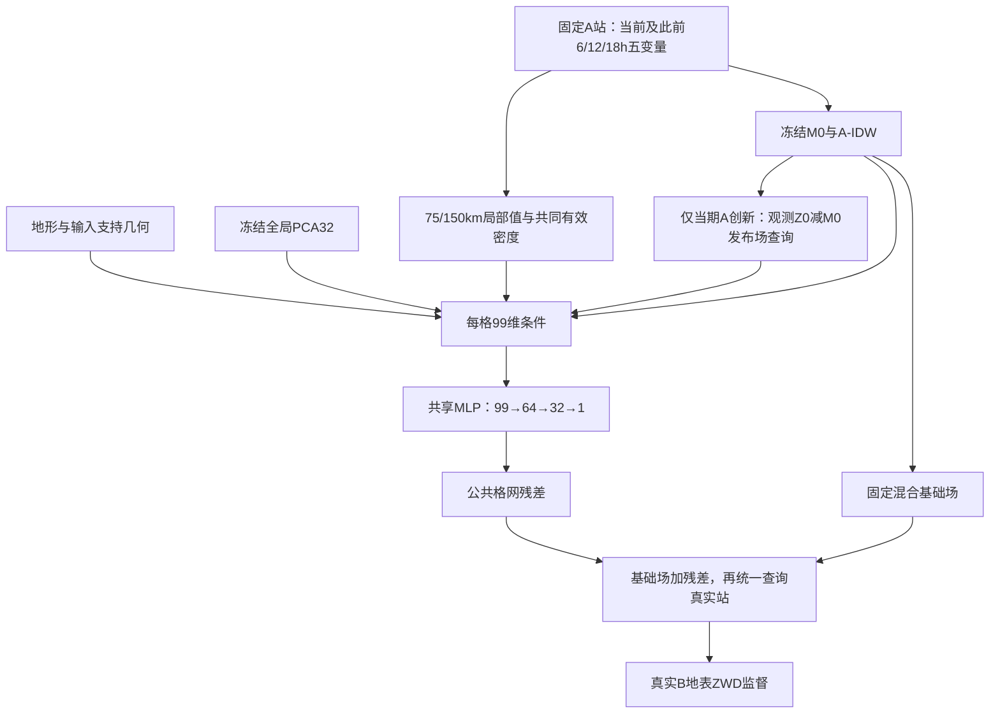

# 局部观测条件残差模型：下一轮研究与训练建议

状态：本机短试已完成。两轮网页Pro讨论、真实数据诊断及数值原型之后，已执行三臂×两折×1000步。结果未通过服务器晋级门槛，本轮停在本机；没有提交新的服务器作业。实施记录与结果位于`results/20261120_local_context_three_arm_v01`。以下方案保留设计依据，实际执行结果见第8节。

## 1. 目标与当前判断

研究目标是更充分利用稀疏A站的局部天气、历史变化和地形条件，提高发布Z0场在独立站上的精度，并为条件EDM/GAN提供更准确的共同均值。25km继续表示输出间距。

当前成熟mean的2019站宏RMSE为9.908290mm，旧mean为9.939550mm。新增0.031259mm改善的7日同步时间区间为[-0.042057,-0.019991]mm；同时重采样43个50km站单元后为[-0.110763,0.047726]mm，14日结果一致。它支持固定站群内的时间改善，尚不足以支持广泛空间迁移。

这43个点值单元包含单站单元，与联合ES评价中每小时至少4站的6个密集组是不同人口，区间分别解释。

分层结果：低于500m的站群由12.0391改善至11.9270mm，1500m以上站群由7.3221变为7.4229mm。站群的地理、密度和天气分布不同，这不是高程导致退化的因果结论。

本轮实测还包括：

| 诊断 | 实测 | 对下一轮的作用 |
|---|---|---|
| 输入PCA | 32维保留87.69%输入方差；64维96.16% | 值得检验局部信息，但方差不是目标信息 |
| 固定先验B辅助逆算 | 288小时三折留组，R64为7.2628、R128为7.1808mm，基准7.6701mm | 额外B当前观测下的表示诊断，不能当A-only精度界；不支持优先盲目扩秩 |
| 单参数Z0偏差修正 | 仅B训练池拟合0.02996mm，C RMSE9.9042mm | 简单整体平移不能提供较大收益 |
| 发布算子数值原型 | 格网四角过头再查询误差1.30e-6mm；R64投影查询误差1.78e-14mm | 小头可以保持发布一致性与完整投影梯度 |

目前先检验局部条件路径；不把延长训练、增加注意力或改用Diffusion本身当作收益来源。原M0已包含站点几何注意力与细格查询分支。

## 2. 首选架构

采用**共享局部格网残差头**，借鉴ConvCNP的值与密度编码，保留原生PyTorch和现有场查询接口。

该网络共8513个可训练参数，无站号或每格独立参数。不同位置的局部输入不同，因此其输出不再被限定为一组全域固定64系数。参数数目较小并不等同于表示空间较小。末层零初始化，零步严格返回相应对照的混合基础场。

四帧A数组与共同有效标志分别为`[b,4,174,5]`与`[b,4,174]`；初版保持五变量共同有效。局部路径不用PCA压缩。

| 格网输入 | 通道 |
|---|---:|
| 四时刻×两尺度×五变量局部值及一个共同密度 | 48 |
| 当前A创新的两尺度值和密度 | 4 |
| 高程、格网尺度起伏、东西/南北梯度、两尺度站地高差 | 6 |
| M0与A-IDW公共高度幅值 | 2 |
| 年、日周期量 | 4 |
| 陆地标志、最近有效A距离、150km有效邻站数 | 3 |
| 原全局PCA32广播 | 32 |
| 合计 | 99 |

局部值为带截断核的归一化聚合，密度单独保留。空邻域返回零值和零密度，真实零值保留正密度。核尺度固定75/150km，截断规则和归一化在实现前锁定；不搜索核宽。A创新为原始公共高度观测减去M0公共格网插值，不能把地表ZWD直接与Z0相减。

首轮仅计算当期M0创新：历史M0(t−18h)的四帧前向会进一步读到t−36h，超过本轮信息窗口。地形起伏优先采用现有25km高程格网邻域统计，并明确它是格网尺度描述；若使用原始细DEM的亚格网起伏，单独登记来源与分辨率。

## 3. 发布、投影与缺站契约

所有均值先在公共格网上产生，再按现有双线性查询和`exp(-H/3000)`恢复地表ZWD。点式MLP可仅计算查询四角后再插值，这与生成完整格网再查询等价；先插值99维特征再过MLP不等价。本次数值原型中的错误顺序差达1.23mm，仅说明算子不交换，不是GNSS精度结果。

表示对照将同一头产生的格网修正投影到`S=Psi V64^T`的空间。固定陆地格点权重W只用于定义几何L2投影，不宣称面积平均精度。采用薄QR或FP64分解，不构造全格网方阵。投影臂必须计算全部参与积分的陆地点，不能只用评分站附近格点；发布与海岸查询的贡献格点完整保留。

首轮Gaussian场扰动、g(A)、余项和站端tau完全冻结；tau只属于观测层，不进入发布格网。缺站场景要重建四帧条件、粗场、M0、IDW、PCA与g(A)，不复用完整A条件缓存。四帧均无有效A时，新增残差按预登记规则回退为零，发布基础场与状态；当前帧缺站但历史可用时，历史输入仍按合同保留。

## 4. 最小实验队列

### 本机准备与固定特征探针

1. 使用现有864小时M0格网缓存验证特征构造、来源、共同mask及信息窗口；该规模仅作开发探针。
2. 实现上述99通道的真实格网固定特征，查询B站后做带零候选的岭回归，并保留B拟合的单参数Z0纠偏。旧22特征实验已做过，不重复冒充新结果。
3. 新选参仅用内层B：原288锚点留作外层开发，从原训练池另留季节均衡整周作内层选模，均保留18小时缓冲。实际合格小时清单落盘。864小时缓存未必覆盖合适的内层周；若不足，补缓存或标为不可比较，不挪用外层选择超参数。

### 2026-11-20实际样本审计与执行规模

已将小时索引、站点折号及缓存缺口保存到`results/20261120_architecture_research_v01/training_design_v01.json`。这是训练设计清单，当前尚未启动新模型训练。

- 原B2018合格训练池6288小时；另留2018-02-22、05-03、08-23、11-22起始的四个完整内层周及前后18小时缓冲后，核心训练池为5472小时。
- 本机短试取核心训练384小时，每月32小时，覆盖全部12个月；内层96小时，每个留出周24个均匀时刻；原外层288锚点保持不变，总计768小时。
- 768小时中327小时已有M0格网缓存，需要补算441小时。既有864小时缓存若直接再扣除内层整周，会使核心样本缺少部分月份，因此不能直接沿用其剩余样本启动比较。
- B物理组按既有50km整组两折划分：名义234/277站，当前缓存人口中活跃204/244站；每折106组。实际评分人口随合法观测另行记录。冻结底座和历史统计已有B暴露，这仍是增量开发检验。
- 三臂×两折×每次最多1000更新，总上限6000更新；每次更新8小时。先完成缓存、99通道构造、缺站、标签隔离和发布查询测试，再运行10/100步速度与恢复短测。没有实测前不承诺总耗时。

这份清单只锁定样本和短试合同；新99通道构造器及阶段训练入口仍待实现。外层指标在内层唯一EMA选定后计算，不能用于学习率或早停选择。

### 三臂比较

| 臂 | 条件与输出 | 要排查的解释 |
|---|---|---|
| P0 | 现有PCA32→R64头，在同B折重新拟合 | 原条件路径的匹配强对照 |
| L64 | 新99维局部头，修正投影至R64 | 局部条件信息的增量 |
| LG | 同一新局部头，直接发布格网修正 | 放开固定输出子空间的增量 |

B物理组按50km单元整组分两折。三臂使用相同冻结M0+既有IDW混合底座、相同合法小时和噪声流。**不能使用已训练过全部B2018组的3700步成熟mean作为B留组试验的独立底座。** 既有混合参数、协方差和M0统计也有B暴露，结果仍称固定底座上的增量开发。最终C比较保留成熟mean的9.908290mm结果。

新短试合同建议：种子42、batch8、lr1e-4、warmup100、每臂每折最多1000次更新、每100步评价、300步后patience3、EMA=.99，保留零步候选。三臂训练都使用观测端ES K4，内层按ES锁定唯一EMA；raw仅作诊断。独立K64复核及解析均值站宏RMSE共同报告。所有短试设定与旧run分开，不改旧EMA或选择结果。

先完成三臂，再按结果决定：两种局部臂均优于P0，支持条件路径；LG额外稳定优于L64，才支持放开当前输出空间；只有训练误差改善时，停止扩容。若局部主臂有信号，再单列同架构MSE点产品对照，改变目标函数的贡献单独比较。创新通道的必要性需重新训练去创新消融，推理时置零只作敏感性检查。

## 5. 有限预算与推进门槛

把“值得继续研究”与“投入较大服务器训练”分开：

- 两折方向一致、合并区间支持小幅改善，可以保留科学线索，不自动扩训。
- 服务器晋级建议要求候选的外层站宏RMSE点估计至少低于P0及最佳简单局部线性控制3%，同时优于零修正底座；同步时间块×物理组区间上界小于0，人口和数值有效率保持一致。
- 3%是本轮资源标准，不是预计收益。点估计达到3%且区间低于0，只支持存在改善；区间上界也达到−3%才支持改善幅度至少3%。两折本身不是两个独立统计样本。
- 达上限仍下降记预算内未定；不凭这一现象自动续跑。区间跨零记证据不足，明确反方向则停止该方向。

实现时先在本机做10/100更新速度、显存和恢复短测。通过后才安排单张A800基准与预算锁。现有便携包主要保存站点均值，不保证具备全2018/2019的M0格网或查询角点缓存；完整条件缓存、M0前向和全年评价必须分别估时。不得把当前小MLP的分钟级更新耗时当作新链条的总预算。

按小时分片读取A原始资料和M0基础缓存，按批生成99通道；不保存全年完整条件格网，也不一次载入显存。正式代码只新增条件构造、小头、投影和阶段入口，复用现有评价/恢复接口，旧发布与权重保持只读。

## 6. 评价与后续生成模型

通过B门槛后，锁定唯一候选及全部规则，再做一次全年C2019开发评价。D2020继续封存。报告点值、概率、短距离差值、细/粗场对照和计算成本；空间组及7/14日块区间均保留。

分层覆盖：正常支持、固定输入稀疏与整块缺口、逐站、单站/全缺站、高程与地形起伏、A站距/密度、季节、B阈值定义的天气突变及复合困难情景。首轮天气突变可用A当前与6小时前状态变化，阈值只由B训练期拟定。场景样本数、失败和覆盖独立列出，不通过缩小评分人口取得收益。

图像结果采用预登记时刻的Z0均值/修正/样本/标准差图、独立站误差地图和变差函数；功率谱在共同区域、窗口和处理规则下作结构诊断。IDW/克里金参考图是条件或离线分析，不是真实高分辨率监督；不把SSIM、PSD与参考图接近直接当作细尺度真实性。

若新均值成立，冻结它，先建立完全匹配均值的Gaussian，再以相同合法条件、R64及Gaussian余项比较EDM/GAN。若使用局部隐藏特征，Gaussian与生成模型共享同版本条件。继续采用独立噪声池均值位移归因；不把新增均值收益算作分布形状收益。生成分支另行登记，不由本轮自动提交。

若随后重估协方差或区间尺度，优先使用B交叉拟合残差，单独核验与训练内残差拟合的差异；不以C标签拟合尺度。匹配Gaussian、EDM和GAN共享同一校准版本。

若局部三臂及线性控制反复出现训练可拟合、留组或新天气无收益，优先单独检验原生天气背景信息，而不是继续扩大网络。这里独立背景指独立于A空间插值生成过程，不保证与GNSS或ZHD辅助资料统计独立；需要重新审计资料来源及信息条件。

## 7. 来源与本轮产物

文献机制依据：

- Vaughan等，2022，ConvCNP气候降尺度：[论文](https://gmd.copernicus.org/articles/15/251/2022/)、[代码](https://github.com/anna-184702/convCNPClimate)。借鉴值/密度和局部条件，本文方案不是其完整复现；原论文存在独立天气格网输入。
- Ashman等，2025，Gridded TNP：[PMLR](https://proceedings.mlr.press/v267/ashman25a.html)、[代码](https://github.com/cambridge-mlg/gridded-tnp)。作为后续更强空间信息处理的候选，首轮不直接引入其架构规模。
- Markou等，2022，相关输出神经过程：[论文](https://arxiv.org/abs/2203.08775)。为均值和联合分布分开评价提供参考。
- CorrDiff：[公开稿](https://arxiv.org/abs/2309.15214)、[官方说明](https://github.com/NVIDIA/physicsnemo/blob/main/examples/weather/corrdiff/README.md)。借鉴确定性均值加残差生成，其密集高分辨率训练资料不等同于本项目稀疏站监督；无需引入外部软件环境。

本轮数据与脚本位于`results/20261120_architecture_research_v01`及对应`tools/architecture_*`：固定权重核验、PCA/逆算诊断、C配对区间/分层、B单参数纠偏、格网头与投影数值原型。网页Pro是方法复核，数值证据来自本机实际运行。

## 8. 本机执行结果（2026-11-20）

已补算441小时M0格网，复用327小时，共768小时。99维真实条件和训练恢复路径通过验核；三臂两折完成6000次正式更新，各组内层ES均选中1000步EMA。另有两版恢复验收各400次工程更新，与正式模型分目录保存。

外层288个B2018时刻共448个可评分站、126639个站时刻。站宏RMSE：冻结混合底座7.670150mm，PCA32/R64为7.679966mm，局部/R64为7.673157mm，局部/格网为7.683686mm，内层选定线性对照7.667293mm。两种局部模型均未通过3%及两折同向、配对区间门槛。本轮没有新增C2019全年评价，D2020保持封存。

这些B结果是固定历史底座上的增量开发诊断。总体ES拼接两个折模型各自留出站的均值，不对应一套可发布整场模型。外层12个24小时锚点在7/14日时间箱中形成相同分组，相关区间不提供两项独立的连续周尺度稳健性证据。

局部头在拟合组上的RMSE也仅小幅降低；当前结果尚不能把误差归因为局部信息不足或输出空间限制。优先区分优化效率与可预测信息，再决定下一轮；此次不自动扩大训练，也不将已下降的内层曲线称作收敛结论。
