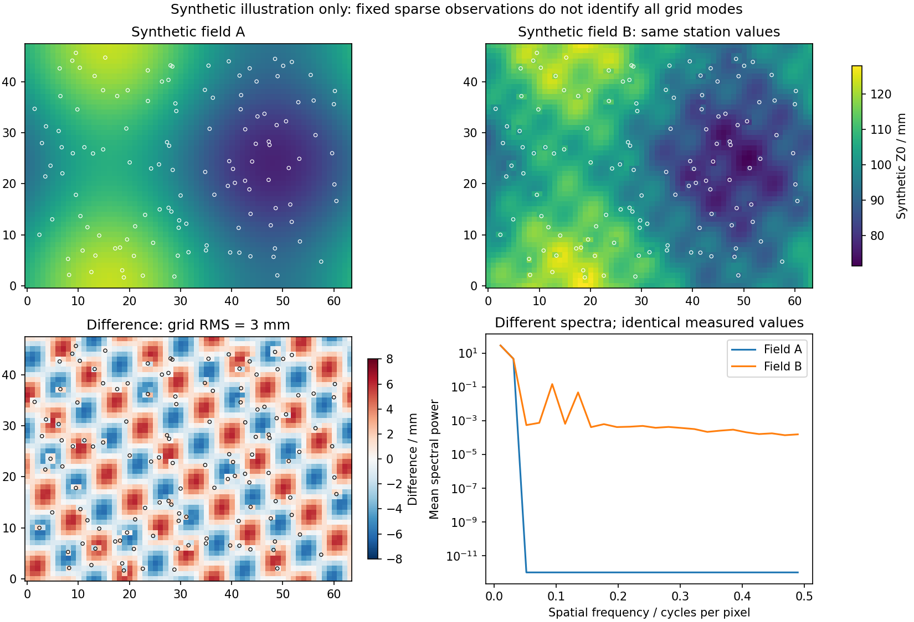

# 稀疏 GNSS 场生成的 U-Net 适用性与架构选择

日期：2026-11-21。状态：文献核验与架构建议，未修改训练实现，未启动本机训练或收费作业。Pro 审阅另存，不以网页模型意见替代原始证据。

## 判断

小型残差 U-Net 能作为本项目的空间生成骨干，值得与现有系数模型作正式比较。更合适的完整结构是“稀疏点的值/密度编码 → 多尺度空间处理 → 统一残差格网 → 固定站点查询”。U-Net 承担中间的空间处理，前端负责保留不规则站网信息，监督协议决定哪些空间变化能够被证据支持。

当前不能把“换成 U-Net”当成已经确认的提精度措施。原 M0 已有空间主干和几何注意力；最近完成的三臂试验，新增局部头是逐格点 MLP，没有检验邻域卷积处理器。V2 的 U-Net 尚未训练，两类结果应分开解释。

## 最相关的证据

| 技术路线 | 论文实际提供的证据 | 在本项目中的选择 |
|---|---|---|
| ConvCNP / SetConv | 用值通道和观测密度把不规则点映射到规则网格；基础模型的预测在给定条件后逐目标独立 | 借鉴条件前端，另建联合随机生成器；不把边缘高斯头称为整场随机模型 |
| CorrDiff / EDM U-Net | 均值场加残差去噪可以生成气象多尺度结构；训练目标来自稠密区域模式场 | 支持 U-Net 骨干与残差思路；我们的稠密去噪目标仍须单独落实 |
| Gridded TNP / Swin-TNP | 不规则点编码、网格上的高效窗口注意力；用 ERA5 在真实气象站坐标附近取值模拟站观测，并融合粗格网 | 有价值的替代处理器；不是实测 GNSS 验证，论文主配置仍预测边缘分布，需要另配联合生成分支 |
| GINO / GNO＋FNO | 图算子在不规则几何与潜在网格间转换，傅里叶算子处理全局信息 | 借鉴几何编码；原任务的 PDE 解场监督与本站网监督不同，首轮无需迁移完整系统 |
| Neural Diffusion Processes | 直接学习函数有限维边缘，具有站序等变性 | 适合研究点集扩散；原文不保证任意查询集合变化下的一般边缘一致性，增加格网解码器仍需验证 |
| DGMR | 稠密雷达序列条件下的空间连贯 GAN 生成 | 借鉴随机生成及联合评价，不能把我们的 IDW 图当成雷达式真值训练 PatchGAN |
| 评分规则生成网络 | 可用恰当评分规则训练随机网络，不必依靠对抗训练 | 支持观测端 ES 随机生成基线，未解决未观测格点分布的唯一恢复问题 |
| 稀疏站 SDA，JAMES 2025 | 先用完整 HRRR 分析场训练扩散先验，再在推理时引入气象站 | 为未来“外部天气场先验＋GNSS 引导”提供直接路线；不是仅靠稀疏站训练完整先验的证据 |

论文与代码链接、检索式及阅读限制见 [SOURCES.md](SOURCES.md)。Gridded-TNP 在 ICML 2025 正式发表，arXiv 版本标题含 Large Unstructured；视为同一研究。

## U-Net 可以承担什么

多尺度下采样、跳连和上采样适合同时处理大范围湿状态与局部创新、地形调制。144×96 的固定发布网格也适合卷积实现。残差参数化复用成熟均值，将新模型的自由度用于额外修正。

建议维持 V2 的小型 ResU-Net 规模作为起点：通道 32/64/128/128，分辨率 144×96→72×48→36×24→18×12 后逐级恢复。使用残差块、GroupNorm、SiLU、插值上采样加卷积。具体块数、感受野、参数量与显存尚未实测，不作已验收声明。

V2 已有的局部值/密度映射与 ConvCNP 思路接近，“加 SetConv”本身未必构成新模型。先准确命名为受 ConvCNP 启发的条件编码，保留已核验的共同有效规则和固定尺度。需要比较可学习的几何核时，只替换前端，保持同一 U-Net，检验改进究竟来自编码还是空间处理。

物理地形、边界与坐标会使实际任务不具有严格的平移对称性；不能因借用 ConvCNP 编码就宣称整个模型严格平移等变。全域生成保持每个小时/成员一份噪声及一张发布场，改变查询集合不触发重采样。

## 架构选择应由什么证据决定

空间处理器方面，有价值的文献备选是小型 Swin，而非笼统升级为大型 Transformer。Gridded-TNP 原文 Table 4 给出一个模拟站点温度实验：64×128 的 Swin-TNP 为 2.29M 参数，ConvCNP 为 9.36M；该配置说明 Transformer 可以比卷积基线更小。该实验在气象站位置附近抽取 ERA5 温度值，另有粗皮肤温度格网条件；其优势不能直接转换为实测 GNSS 的 ZWD 收益，论文硬件上的耗时也不能作为 A800 预算。

推荐先在同一信息条件与发布接口下比较 ResU-Net；如它的学习曲线和误差结构提示非局地组合不足，再以固定前端替换空间处理器为小 Swin。完整 Gridded-TNP 的自由点查询解码器会改变本项目发布契约，因此只借鉴编码/处理部分，最终仍经公共格网查询。

本轮不把 Swin 放进实施队列。Pro 推荐的生成路线备选则是“观测集合扩散＋共享格网解码”；客户端保留这一研究方向，但要求先通过分布闭环与观测噪声分离验证，详见末节。

GINO 的图到网格转换尤其适合输入/域几何变化；本项目的输出网格固定，首轮搬入完整 GINO 会同时改变几何编码、处理器、数值边界和部署依赖，难以解释收益来源。NDP 的点集去噪可以直接利用真实站值，但把其样本变成具有查询一致性的全域场仍是新任务，不能作为已有通用解法。

常见图像超分模型也提供可借鉴模块。SR3 本身采用 U-Net 迭代去噪，说明 U-Net 不是只能用于分割。SwinIR 用残差窗口注意力恢复图像，其标准超分损失依赖配对 HR 图像。两者的图像效果不直接构成当前稀疏 GNSS 场的精度证据；自然图像预训练纹理也不应被当成水汽场细节先验。

## 训练目标是目前更重要的未决项

设固定站点查询与高程恢复组成线性测量算子 H。若 Hδ=0，则 r 与 r+δ 在该站网上完全相同。站点 MSE、站点 ES、观测端判别器都无法区分这种差别。多个时刻和共享网络可以提供统计约束，但固定几何的共同零空间不会因重复同一站网而自动消失；新增站缺测子集也不增加测量方向。网络平滑性、先验场和参数共享选择的是其中一种空间外推。

这并不排除得到有价值的高分辨率产品。它决定了证据应来自整组留站、完整天气块、站间差值、粗化对照与概率校准，而不是插值图相似度。25 km 继续称输出间距。

本轮用合成的 48×64 格网与 128 个不规则点做了一个线性代数示例：先构造双线性测量矩阵 H，再将一个波动场投影到 H 的零空间。两张场的格网差 RMS 为 3 mm，128 点的预测最大差为 1.64×10⁻¹⁵ mm，功率谱却明显不同。这验证了“相同站点评分不唯一决定场纹理”这一数学现象；不是 GNSS 实测结果，不评价 U-Net、Diffusion 或 GAN 的实际效果。

脚本与数值记录：`nullspace_demo.py`、`nullspace_demo.json`。因此，PSD 可揭示模型选择了什么空间波动；判断波动是否真实，仍需要额外的观测或合格先验。

标准 EDM 去噪训练需要所建模随机变量的训练样本。完整且合格的独立格网/模拟场可以支撑场先验训练；真实 B 站残差可以支撑观测空间分布的训练，但不等价于完整格网真值。IDW、克里金、岭逆算或高斯采样能作代理/先验初始化，其生成规则必须记录，并保留去掉该初始化的对照。

外部分析场也需核对其 GNSS 同化来源、湿延迟转换和高程基准；“来自另一个数据产品”不自动等于统计独立真值。SDA 论文自身说明 HRRR 同化了其评价站资料，因此本项目应借鉴其先验与观测分层方法，不能照搬其独立性口径。

Ambient Diffusion 的测量学习理论有明确条件。其 Theorem 4.1 要求相应条件期望测量 Gram 矩阵满秩；在固定 GNSS 测量子空间里再随机丢站，一般保留共同零空间，不能直接套用该结论。

现有 ES-only EDM 采样参数化是一条可研究路线，但完整约 35 次去噪调用参与反传，比单次随机 U-Net 生成的 ES 更新昂贵；它不自动具备标准去噪训练的优势。应同时记录每步调用、更新耗时、卡时、显存以及相同质量下的采样成本。若单次随机生成已达到同等概率评分，多步采样必须提供额外收益才值得保留。

系数空间与格网空间的初始化也不同。现有 `SubspaceEDM` 的白化约定、`sigma_data=1` 及 `gaussian_gain` 属于其 R64 状态和既定采样器；新格网具有不同的空间协方差及幅值，不能照搬后声称保持旧 Gaussian。应使用训练期允许统计明确格网状态、单位、预条件和先验，并在第 0 步数值比较发布场及站端协方差。

## 建议的最小研究比较

1. 架构隔离试验沿用之前的固定 M0＋IDW 混合底座、数据角色、共同有效规则、站点查询、观测噪声和外层评价清单。69 通道的幅值取 M0/A-IDW，创新取 A 相对 M0 的量，保持两臂相同并新锁定语义；不混用 V2 中成熟均值创新的缓存。
2. 只比较同 69 通道的点式 MLP 与小 ResU-Net；两者均输出自由格网均值修正，固定同一 Gaussian 空间结构，采用相同观测端 ES、初始化、小时顺序与随机流。旧 99 通道短试不代替该匹配对照。该比较只作一次有限窗口，不扩展成持续均值调参；MSE 点产品另行登记时才运行。
3. 后续生成比较共同冻结选定均值，现有成熟 mean 保留为强对照。随机 ResU-Net 的 ES 训练可作单次前向概率对照；GAN 在匹配条件与主干上增加真实观测端对抗训练；Diffusion 使用相同空间表示，并明确标准去噪或 ES-only 路线的目标来源。均值改善不是开展联合概率研究的必要条件，旧 3% RMSE 门槛不套用到概率产品。
4. 对比 Diffusion/GAN 时，除了方法各自最佳产品，还需配对高斯/随机生成基线、均值位移隔离和成本比较。保持均值冻结时仍要检查生成残差的条件均值，冻结底座不等于生成器天然零均值。
5. 使用全部允许时间池，训练划分从 6288 小时资格池中扣除预登记内层整周和时间缓冲后锁定；不再用 384 小时反复增加更新来代替天气覆盖。全量指允许年份和角色内的合格资料，C/D 不进入训练。
6. 在完整 B 留出天气块上锁模型后作有限 C2019 开发评价，D2020 保持封存。单 A800 先实测再锁预算；本次调研不提交作业。

成熟 mean 已见过 B2018 训练资料。冻结它之后对新头做 B 留组/时间块划分，验证的是既有底座上的新增头，不是全链未见站/未见天气验证；若需要后者，须重训受影响的完整底座，并另行登记。现阶段应保留该暴露说明，而不为架构比较自动重训全部产物。

全量训练能回答有限样本和优化覆盖问题，不能单独证明站间细节真实性。若合理覆盖、稳定优化后，各种结构都只改善训练站，应优先检验原生天气背景带来的新增信息，而不是无限扩网络。

## 术语

| 术语 | 本文用法 |
|---|---|
| ResU-Net | 采用残差块的 U-Net 空间主干，不是生成目标函数 |
| SetConv | 从不规则观测集合到网格的值/密度表示 |
| EDM | 扩散模型预条件、训练和采样的设计框架；明确区分是否做了去噪训练 |
| ES | Energy Score，能量评分，用于观测向量的联合概率比较 |
| 发布格网 | 模型生成和最终查询共用的公共高度 Z0 场 |

## Pro 审阅

本轮已在内置浏览器的“Diffusion融合研究设计”对话提交实际三臂结果、V2 草案、数据角色和原始问题，页面模式为 Pro；已观察到完整回复及“回答已完成”状态。最初菜单显示的使用限额未阻止实际提交。原文见 `PRO_RESPONSE.txt`，原请求见 `PRO_PROMPT.txt`，网页末端完成截图见 `pro_completed.jpg`。原始页面文本保留为 `PRO_PAGE_TEXT.txt`；原文可能含网页数学公式的重复表示。

| Pro 建议 | 客户端处理 |
|---|---|
| SetConv 式条件＋小 ResU-Net 为主架构，不直接扩大自由格网 ES-only 扩散 | 采用。将空间处理器价值与生成分布价值分开验证 |
| 首轮 69 通道点式 MLP 对 ResU-Net，固定 Gaussian，B 诊断保留旧混合底座 | 采用有限比较；明确创新相对 M0，区别于 V2 的成熟均值创新语义。成熟 mean 留作后续强对照 |
| 使用全部 6288 小时，batch8 四遍为 3144 更新 | 修正。6288 是资格池口径，仍需按锁定清单处理内层留出与缓冲、角色和可用标签。若实际训练小时数为 N，则每遍更新数由采样器和尾批规则计算；仅 N=6288 且 batch8 时恰为 786。四遍只是待基准确认的有限窗口，不是收敛保证或已批准预算 |
| 观测集合扩散＋共享格网解码为唯一生成备选 | 保留，暂不实施。先用已知 Gaussian 输入核查“观测生成—解码—格网查询”后的均值、方差与相关结构；分离观测噪声，防止重复加入 τ |
| 暂不实现 GINO/FNO、Gridded TNP | 采用。它们留在文献比较中，需要具体误差证据才触发实现 |
| GAN 观测端判别器先做成员逐站置乱检查 | 采用为后续验收：检测联合依赖破坏的能力；真实/生成使用相同坐标和有效模式 |

额外核对：Gridded-TNP 的 ERA5 模拟站值及边缘似然假设已回到原文 Sections 2.1、5.2 与 Appendix E.2 核验。Pro 的数学零空间反例与本轮合成示例一致，但这不是当前真实训练已出现无约束纹理的实测判定。

本轮产物是选型研究与下一轮有限比较建议。旧 V2 文件和历史实现保留；不把建议稿、原网页意见或合成示例记为完成的神经网络实验。
