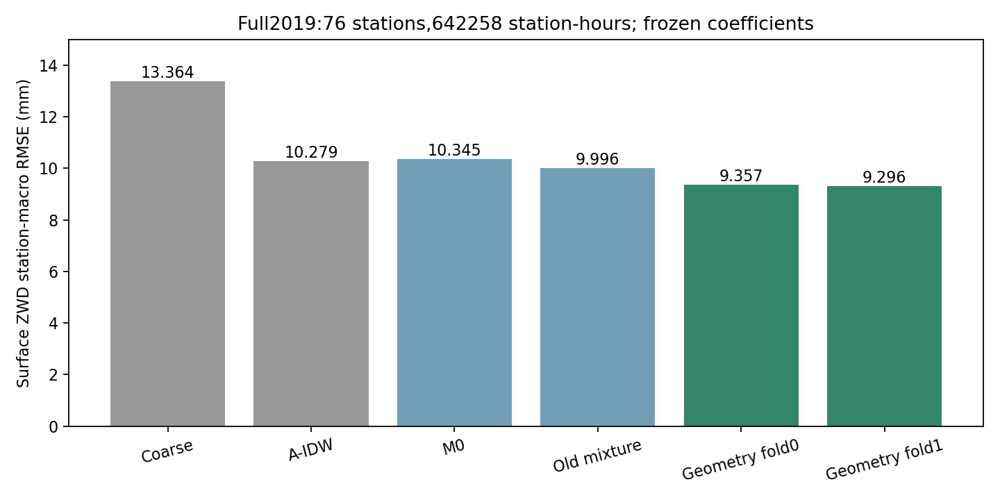

# 冻结几何底座全年验核

2019全年8760小时，76个可评分C站，642258站时刻。参数沿用已锁定的B站训练结果，未据全年C结果重新拟合或选折。

|方法|站宏RMSE(mm)|
|---|---:|
|Coarse|13.364027|
|A-IDW|10.278529|
|M0|10.344629|
|Old mixture|9.995856|
|Geometry fold0|9.356778|
|Geometry fold1|9.296074|

两份几何底座均优于旧混合底座与直接IDW，通过预登记点值门槛。7日/14日同步块区间见annual_paired_intervals.json。C2019属于已暴露开发年，D2020未读取。

M0格网重查与归档站值最大差0.000153mm；完整格网与查询角点实现最大差0.000054mm。

