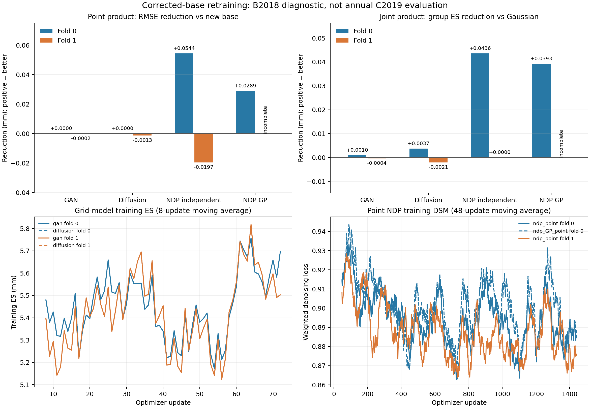

# 新几何底座复训结果

作业3688243已停止，单张A800累计3416秒（56分56秒），当前没有本批A800作业排队或运行。完成7/8项；最后一项第1折GP-NDP在第14/1440步保存后退出。Slurm记录FAILED，直接原因是预超时保护置位PAUSE后按保护逻辑保存退出，并非非有限数值错误。未追加服务器预算或启动新训练。

以下均为B2018已暴露的增量开发诊断：每折12个固定外层月度小时、128成员。第0折204站/2385站时刻，第1折244站/2812站时刻。两折分别报告，不能将折预测拼成单个可部署模型的联合分布。残差头尚未做全年C2019评价，D2020保持封存；此前几何底座全年C2019的9.296—9.357mm与本表不是同一评分总体。

## 点预测产品

| 方法（点产品） | 第0折RMSE / mm | 第1折RMSE / mm |
|---|---:|---:|
| 新几何底座 | 8.442603 | 8.436804 |
| GAN | 8.442603 | 8.436994 |
| Diffusion | 8.442603 | 8.438117 |
| 独立噪声NDP | 8.388169 | 8.456464 |
| GP噪声NDP | 8.413671 | 未完成 |

点产品由内层站宏RMSE选定。第0折GAN与Diffusion均选回第0步零修正模型；第1折GAN选择72步、Diffusion选择36步。第0折独立噪声NDP改善0.0544mm，第1折增加0.0197mm。GAN/DF此次没有形成稳定的新增点精度收益。

## 联合概率产品

| 联合产品 | 第0折组ES / mm | 第1折组ES / mm |
|---|---:|---:|
| 新底座＋高斯残差 | 5.644423 | 5.883459 |
| GAN | 5.643453 | 5.883878 |
| Diffusion | 5.640687 | 5.885551 |
| 独立噪声NDP | 5.600835 | 5.883429 |
| GP噪声NDP | 5.605147 | 未完成 |

联合产品独立按内层站组ES选模，不能把其点RMSE替换到点产品排名。Diffusion的组ES第0折降低0.003736mm、第1折增加0.002092mm；GAN第0折降低0.000970mm、第1折增加0.000418mm。这些变化小且未呈两折一致方向。

独立噪声NDP两折95%覆盖率从90.53%/89.55%增加到92.77%/91.42%，相应95%区间宽度从29.36/28.52mm增加到31.22/31.81mm。两折VS均增加，不能据此声称空间依赖改善。第0折GP-NDP的95%覆盖率为93.01%、宽度32.19mm，VS从1.3563降至1.3442；第1折尚无可比较结果。NDP当前是固定站点集合分布，不是连续高分辨率场。

## 曲线与运行判断

GAN/DF各72步只遍历576训练小时一次，尚不足以判定收敛或潜力上限。两者学到的外层均值修正RMS约0.04—0.095mm，主要保持在新底座附近。点NDP内层ES随训练下降，但外层收益存在折差异，下一步应先核查泛化及采样误差。

短基准含1.5倍余量估计3034.8秒，仍低估了完整队列的墙钟时间。例：第0折独立噪声NDP的训练循环含内层评价耗时720.1秒，而4步短测外推其更新耗时约84.2秒；第1折该循环为312.0秒。此差异需要对数据访问、同步、日志/检查点及评价分项计时，现有记录不足以将其归因于单个算子。

已从下载预测重新计算全部保存产品的站宏RMSE，与结果JSON误差小于1e-7mm；预测、选模权重及归档哈希均核验通过。原始记录保留，暂无新增训练。

下一步优先完成第1折GP-NDP，随后检查残差头修正幅度、学习率与更新量，再决定GAN/DF的配对延长试验。本次不以扩展开发数据重新挑选已报告产品。

