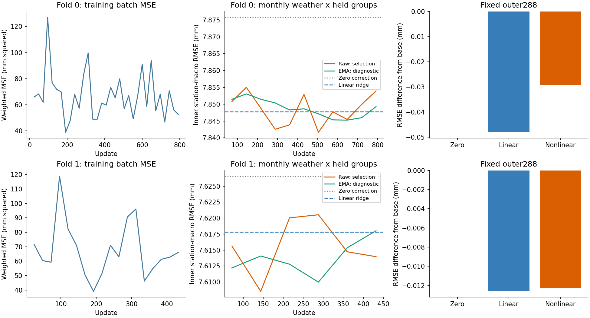

# 本机月度覆盖扩展实验结果

已完成预登记的两折训练：新增12个月度内层天气块，576训练小时、48内层评分小时、原288外层缓存锚点。空间站组和小网络保持不变；新内层与旧41小时人口不同，因此只在本轮共同人口内比较，不把数值变化当作跨轮精度提升。

|折|方法|内层站宏RMSE/mm|外层站宏RMSE/mm|
|---|---|---:|---:|
|0|zero|7.875842|7.578772|
|0|linear|7.847786|7.530793|
|0|nonlinear|7.841673|7.549593|
|1|zero|7.626558|7.746547|
|1|linear|7.617806|7.733974|
|1|nonlinear|7.608550|7.734263|

非线性模型在两折空间×天气内层均优于线性，但外层没有相应优势：折0线性更低，折1两者接近。两折内层相对底座的改善约0.434%/0.236%，未通过各≥0.5%的方向门槛。保留模型和证据，本轮不触发服务器或C2019新评价。

训练上限每折14遍1008步，恒定LR1e-4，raw选模、EMA半衰期一遍仅诊断。按至少4遍、连续4次正式评价未改善的规则，折0于792步结束、入选504步，折1于432步结束、入选144步。它们属于预登记早停，不能由此推断模型全局最优或生成模型潜力耗尽。

缓存912小时，其中343小时复用已有缓存，569小时新生成M0及A条件，输入准备约4.2分钟。均值网络训练很轻，新增计算主要在冻结基础场和条件构建。

## 核验

- 真实训练路径连续200步与100＋恢复100步按位一致；工程400更新单列。
- 新时间划分、缺站紧凑特征和高度偏置查询测试通过；全套测试结果见pytest_final.log。
- 冻结底座重查与原始B缓存最大误差0.000206 mm；入选新头全格网查询和重载误差见publication_checks.json，阈值0.001 mm。
- 所有目标仅用于拟合与固定人口评分；新时间清单先锁定。历史底座/先验及旧试验有B暴露，本轮称增量开发。D2020封存。

## 配对不确定性

- 折0：非线性−底座的天气块95%区间[-0.06043127633015102, 0.00781492843924144] mm；非线性−线性[-0.01161128316895481, 0.04919286478896539] mm。
- 折1：非线性−底座的天气块95%区间[-0.052464528819206824, 0.03282775032207421] mm；非线性−线性[-0.022964009997122937, 0.026209647560382233] mm。

外层12天气簇各含缓存锚点，不是完整逐小时周评分；同时给出50 km站组重采样区间，不按单个小时独立抽样。

## 短距离空间变化

以下为公共高度Z0站间差值的站对宏RMSE；站对数与同步有效站对时刻数随距离箱报告。高差≤100 m的地表ZWD结果另存increment_diagnostics.json。该项是锁定选模后的诊断，不用于重新挑选权重。

|折|距离/km|站对数|站对时刻数|底座/mm|线性/mm|非线性/mm|
|---|---|---:|---:|---:|---:|---:|
|0|0-25|235|66312|9.62030|9.62282|9.61285|
|0|25-50|297|83291|11.70321|11.64394|11.64803|
|0|50-100|857|241137|13.47445|13.33102|13.39218|
|0|100-200|1658|462422|14.95988|14.86179|14.90222|
|1|0-25|518|145858|9.20916|9.20121|9.19892|
|1|25-50|732|204394|12.31703|12.30432|12.31434|
|1|50-100|1535|426810|15.30167|15.27493|15.26394|
|1|100-200|3329|919195|15.86274|15.83608|15.80891|

## 继续安排

当前证据仍更支持保留简单对照，并检验条件均值改正为何在空间外层转移不足。后续先分析按站距、地形起伏和天气过程的残差，再登记单因素特征或监督改动。本次没有训练新版DF/GAN，也没有将略低的内层分数当作生成分支成功。

## 操作

本实验已完成。运行python tools/local_coverage_train.py只返回ALREADY_COMPLETE，不追加更新；python tools/local_coverage_report.py复核预测并重建报告。工程根目录使用原pytorch环境及PYTHONPATH=src;tools。

实际训练源码保存在source_run/，与原锁一致。审阅后的断点恢复修复与完整依赖锁适用于新实验；不回填原运行锁。新实验使用新ID、在输入构建前锁定tools/package源码和packed manifest，移除PAUSE后可按相同入口恢复，依赖变化会拒绝继续。本轮独立审阅及后验工程修复说明见FINAL_REVIEW.md。

本次训练已结束。配置见PLAN.md和training.lock.json；实际权重见fold_*/selected_weights.pt；两臂预测、选择清单和原始日志分别在fold_*；全场例图在publication_case.npz。

