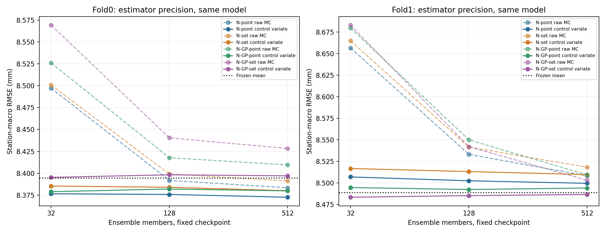
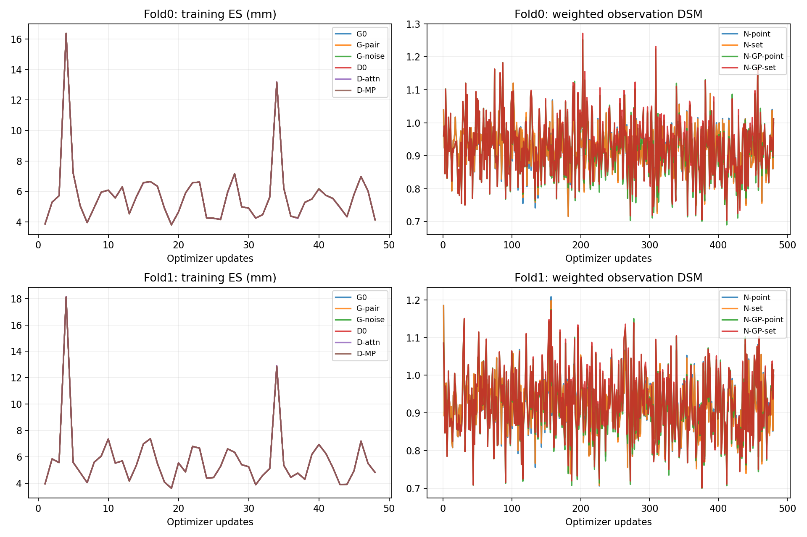
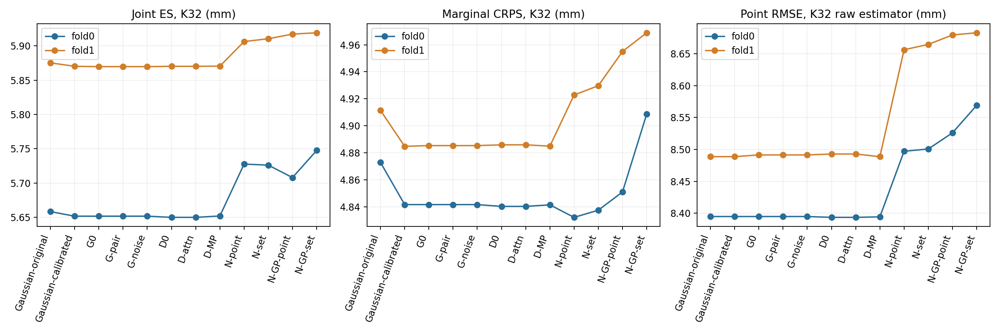
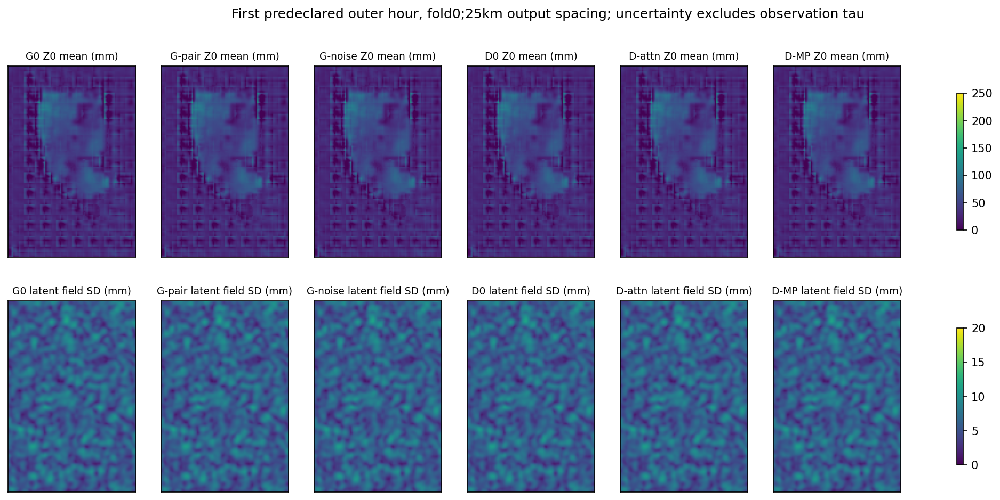
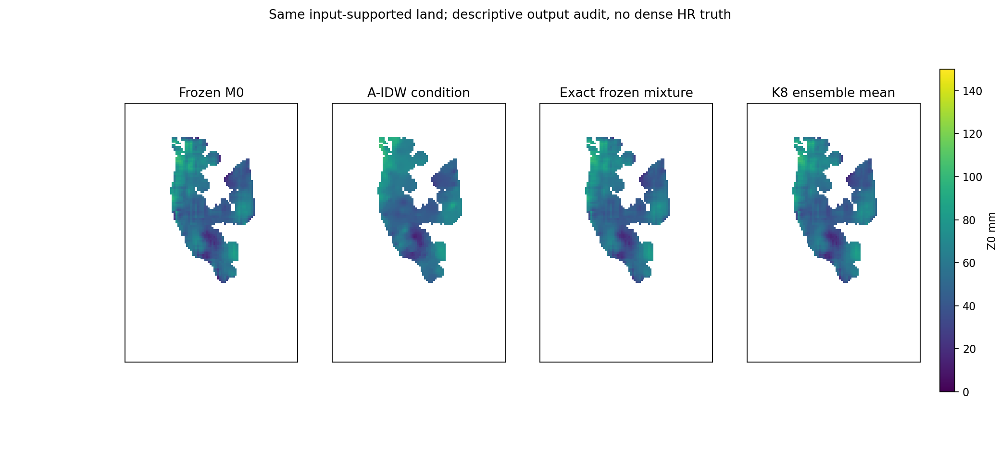

# 本机生成架构短程试验结果

状态：已完成24/24个模型及对照结果。本批已完成。

本批真实训练四项GAN/Diffusion本体消融，并训练NDP启发的站点集合去噪器及逐点对照。B2018属于带历史底座暴露的增量开发；C2019/D2020未读。本批48步格网训练用于机制筛查，不判断收敛或架构上限。

## 主要发现

四项格网本体改动尚未形成值得服务器扩训的稳定优势。注意力相对匹配Diffusion基线的ES变化约百万分之几毫米；GAN两种变体几乎重合；MP变体未同时改善两折联合分数。48步范围内的结果不能排除充分训练后的收益。

NDP观察空间DSM路线已能实际训练、生成联合站点集合并按固定留出站时刻评分，但当前仍不提供连续高分辨率场。512成员下，GP噪声逐点版本相对独立噪声逐点版本的VS约改善6.86%/3.28%，ES却分别增加0.01202/0.01126mm；其依赖改善主要来自引入已有空间先验，尚未达到联合概率晋级条件。

原32成员的点值差异受到约1.4mm均值采样标准误影响。固定检查点、增加到512成员并用已知零均值初始噪声做控制变量后，逐点NDP相对共同均值的站宏RMSE变化为−0.02216/+0.01079mm；十二日期配对95%区间分别为[−0.05790,0.01398]/[−0.02928,0.05917]mm，均跨0。没有把估计器方差降低归功于模型架构。

下一步建议先诊断共同底座已有的格网纹理、提高开发集合评分的采样稳定性，再预登记更长的匹配去噪训练。保留轻量逐点去噪与GP相关先验为对照，不据本轮短筛把注意力或更复杂生成器直接移交服务器。

|模型|折|更新/入选步|RMSE mm|ES mm|VS|CRPS mm|90%覆盖/宽度mm|均值MC标准误mm|
|---|---:|---|---:|---:|---:|---:|---|---:|
|Gaussian-original|0|0/0|8.39473|5.65820|1.39450|4.87291|0.884/27.187|0.000|
|Gaussian-calibrated|0|0/0|8.39473|5.65158|1.37177|4.84163|0.850/24.460|0.000|
|G0|0|48/0|8.39473|5.65158|1.37177|4.84163|0.850/24.460|0.000|
|G-pair|0|48/0|8.39473|5.65158|1.37177|4.84163|0.850/24.460|0.000|
|G-noise|0|48/0|8.39473|5.65158|1.37177|4.84163|0.850/24.460|0.000|
|D0|0|48/48|8.39341|5.64985|1.37148|4.84030|0.851/24.459|0.001|
|D-attn|0|48/48|8.39341|5.64985|1.37148|4.84030|0.851/24.459|0.001|
|D-MP|0|48/24|8.39421|5.65187|1.37183|4.84146|0.849/24.461|0.000|
|N-point|0|480/480|8.49717|5.72755|1.54021|4.83218|0.862/25.467|1.471|
|N-set|0|480/320|8.50070|5.72608|1.53386|4.83747|0.857/25.100|1.446|
|N-GP-point|0|480/480|8.52610|5.70789|1.42614|4.85098|0.870/25.905|1.501|
|N-GP-set|0|480/480|8.56925|5.74754|1.46362|4.90866|0.892/28.349|1.646|
|Gaussian-original|1|0/0|8.48866|5.87529|1.44890|4.91143|0.883/26.908|0.000|
|Gaussian-calibrated|1|0/0|8.48866|5.87023|1.44188|4.88478|0.861/24.889|0.000|
|G0|1|48/24|8.49141|5.86979|1.44193|4.88533|0.862/24.888|0.001|
|G-pair|1|48/24|8.49141|5.86979|1.44193|4.88532|0.862/24.888|0.001|
|G-noise|1|48/24|8.49141|5.86979|1.44193|4.88533|0.862/24.888|0.001|
|D0|1|48/24|8.49283|5.87022|1.44193|4.88590|0.861/24.888|0.001|
|D-attn|1|48/24|8.49282|5.87021|1.44193|4.88590|0.861/24.888|0.001|
|D-MP|1|48/48|8.48864|5.87052|1.44194|4.88490|0.861/24.889|0.000|
|N-point|1|480/480|8.65644|5.90634|1.48963|4.92282|0.862/25.590|1.478|
|N-set|1|480/480|8.66486|5.91048|1.49060|4.92964|0.865/25.698|1.480|
|N-GP-point|1|480/480|8.67966|5.91722|1.43750|4.95502|0.865/25.866|1.499|
|N-GP-set|1|480/480|8.68310|5.91917|1.44478|4.96888|0.874/26.861|1.555|

## 逐项对照

- G-pair 相对 G0：折0：ΔES=+0.000000、ΔVS=+0.000000、ΔCRPS=+0.000000、ΔRMSE=+0.000000 mm；折1：ΔES=-0.000001、ΔVS=+0.000000、ΔCRPS=-0.000001、ΔRMSE=+0.000000 mm。
- G-noise 相对 G0：折0：ΔES=+0.000000、ΔVS=+0.000000、ΔCRPS=+0.000000、ΔRMSE=+0.000000 mm；折1：ΔES=-0.000000、ΔVS=-0.000000、ΔCRPS=-0.000000、ΔRMSE=-0.000000 mm。
- D-attn 相对 D0：折0：ΔES=-0.000004、ΔVS=-0.000002、ΔCRPS=-0.000004、ΔRMSE=-0.000001 mm；折1：ΔES=-0.000003、ΔVS=-0.000000、ΔCRPS=+0.000001、ΔRMSE=-0.000001 mm。
- D-MP 相对 D0：折0：ΔES=+0.002015、ΔVS=+0.000356、ΔCRPS=+0.001155、ΔRMSE=+0.000803 mm；折1：ΔES=+0.000303、ΔVS=+0.000006、ΔCRPS=-0.000996、ΔRMSE=-0.004186 mm。
- N-set 相对 N-point：折0：ΔES=-0.001471、ΔVS=-0.006351、ΔCRPS=+0.005285、ΔRMSE=+0.003536 mm；折1：ΔES=+0.004146、ΔVS=+0.000964、ΔCRPS=+0.006823、ΔRMSE=+0.008428 mm。
- N-GP-point 相对 N-point：折0：ΔES=-0.019660、ΔVS=-0.114075、ΔCRPS=+0.018799、ΔRMSE=+0.028932 mm；折1：ΔES=+0.010887、ΔVS=-0.052133、ΔCRPS=+0.032195、ΔRMSE=+0.023223 mm。
- N-GP-set 相对 N-GP-point：折0：ΔES=+0.039655、ΔVS=+0.037477、ΔCRPS=+0.057675、ΔRMSE=+0.043157 mm；折1：ΔES=+0.001950、ΔVS=+0.007276、ΔCRPS=+0.013866、ΔRMSE=+0.003443 mm。

## 固定检查点的512成员采样复核

原K32选模与排名全部保留。以下仅增加采样成员，不重选权重；CV是减去已知零均值初始噪声的控制变量均值估计，不改变集合样本，也不作为架构收益。完整32/128/512前缀指标见sampling_stability.json。

|模型/折|原始MC均值RMSE|CV均值RMSE|原始/CV均值MC标准误|ES|VS|CRPS|
|---|---:|---:|---|---:|---:|---:|
|0/Gaussian-calibrated|8.39473|8.39473|0.0000/0.0000|5.70083|1.34950|4.72612|
|0/N-GP-point|8.40952|8.37984|0.3824/0.0814|5.71544|1.37783|4.71475|
|0/N-GP-set|8.42825|8.39700|0.4187/0.0441|5.75540|1.41091|4.76230|
|0/N-point|8.38343|8.37256|0.3740/0.0910|5.70342|1.47924|4.68996|
|0/N-set|8.39111|8.38001|0.3679/0.0979|5.70042|1.47347|4.69773|
|1/Gaussian-calibrated|8.48866|8.48866|0.0000/0.0000|5.88059|1.39983|4.77512|
|1/N-GP-point|8.50927|8.49399|0.3795/0.0837|5.91599|1.40677|4.79835|
|1/N-GP-set|8.50297|8.48648|0.3937/0.0696|5.91720|1.41279|4.80604|
|1/N-point|8.50812|8.49945|0.3740/0.0903|5.90472|1.45450|4.78336|
|1/N-set|8.51810|8.50954|0.3746/0.0908|5.90793|1.45496|4.79022|

## 解释边界

- Gaussian-calibrated只使用各折拟合B站和训练时刻的标准化残差估计共同缩放，所有格网生成器从它初始化；同时保留原Gaussian。
- 格网生成器按内层12小时、K16的最低ES选模，候选含第0步。入选0表示短筛未选中学习修正；各臂最终权重仍实际更新并保留。
- N-point/N-set用真实观测残差的加权去噪MSE训练480步，在有限站点集合上生成带观测误差的分布；采样不再额外添加tau。它们是NDP启发原型，不是原论文复现，也不提供连续场产品。
- N-GP-point/N-GP-set为看到第一折独立噪声结果后登记的增量试验，将前向及采样噪声改为固定高斯先验相关结构，保持单位边缘方差与其余训练设置；改善可能来自引入先验相关性。不得称作新独立确认。
- N-set注意力版本与N-point逐点版本的比较同时改变了信息混合能力与参数量；没有参数量完全匹配控制，不能将全部收益归因于空间注意力。
- NDP路线与格网路线的训练目标和更新预算不同，表格展示可行性，不据此宣称架构公平优胜。其点值使用完整MC均值；格网路线用已知高斯均值控制变量，故同时报告MC标准误。
- 各折独立报告；未把折模型拼成一个可部署联合场。十二外层时刻按月份先验选择；置信区间按采样日期重采样，仅作探索，不称全年7日/14日块验证。
- 原始预测与支持人口全部保留。field_examples图片色标固定；更丰富纹理不作为真实细节证据。下一步需更长训练、更多外层天气时刻与采样前缀稳定性后才决定服务器晋级。

## 共同底座的输出检查

代表小时的输入支持陆地上，M0东西向二阶差分RMS为8.503mm，A-IDW为3.257mm，冻结混合底座为6.366mm，K8集合均值为6.384mm。块状纹理在冻结底座中已经存在；这一单案例粗糙度检查不等于精度排序或已证明拼接错误。应另做格网周期与拼接边界对齐诊断，不将所有高频归因于新生成器。

