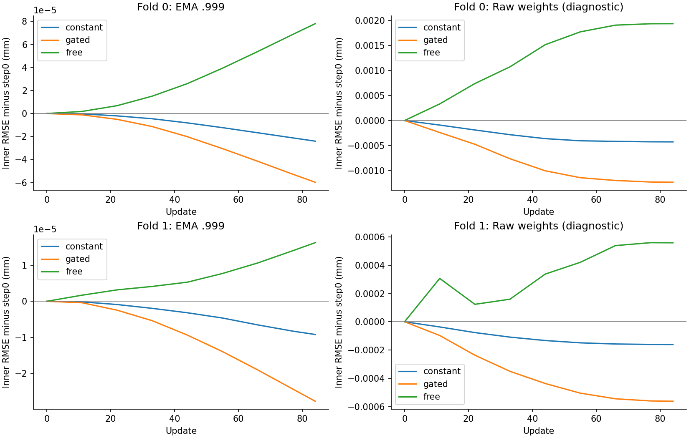
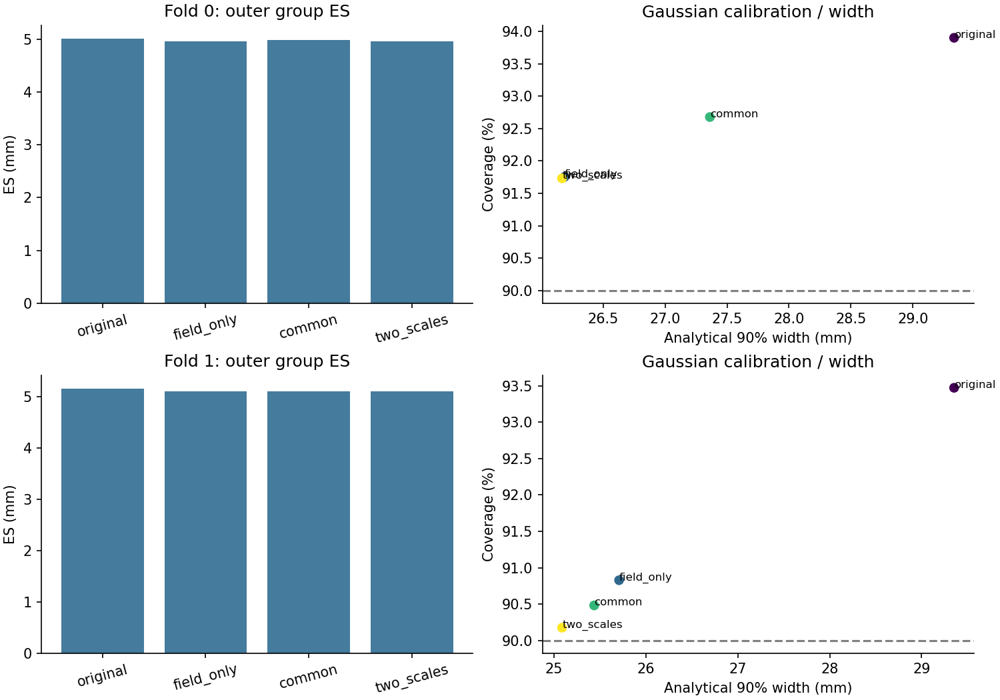

# 本机小实验结果与下一步判定

本轮完成了三个点式均值头的两折、两遍小训练，以及冻结均值后的Gaussian误差分配审计。小训练使用336小时，每折84次更新；内层为四个新天气块内41个缓存时刻和独立物理/50 km站组。外层为原12个注册天气周内288个缓存锚点，折0/1分别204/244站。这是B2018增量开发，不与上轮96小时或C2019全年数字直接排序。

|方法|折0外层站宏RMSE/mm|折1外层站宏RMSE/mm|
|---|---:|---:|
|zero|7.578772|7.746547|
|constant|7.578754|7.746503|
|gated|7.578739|7.746455|
|free|7.578772|7.746547|
|constant_exact|7.558446|7.712682|

constant_exact为训练资料精确拟合的两系数优化诊断，不参与匹配预算的选模。初步结果曾将它纳入折0选择；审阅后已排除，并重新冻结匹配训练均值、重做全部Gaussian校准。最终结果只读取reviewed目录与reviewed_results.json。

EMA=0.999在84步后仍保留约91.9%的初始权重贡献。原始权重曲线单列诊断，不在看到外层后追加选模。当前神经头修正很小，尚不足以判断结构容量，也没有达到收敛证据。

|折|匹配预算均值|Gaussian内层入选|空间尺度|独立项尺度|外层ES 原→新|解析90%覆盖|
|---|---|---:|---:|---:|---:|
|0|gated|common|0.9328|0.9328|5.0169 → 4.9812|92.68%|
|1|gated|two_scales|0.8297|0.8809|5.1666 → 5.1109|90.18%|

所有概率模型使用同一入选均值，缩放独立项不会改变RMSE。两个尺度是统计残差分配，不是仪器噪声的物理测定。二维NLL及100次同步天气块×原200 km站群重采样只作小样本稳定性诊断；旧版50 km重采样改变了估计目标，已判无效并由reviewed结果替代。

## 点值配对区间

- 折0，入选均值相对基础场：天气块95%区间 [-5.195685612915391e-05, -1.0808350718027891e-05] mm；叠加50 km站组重采样 [-6.966140637125751e-05, 2.6236125956202706e-06] mm。
- 折1，入选均值相对基础场：天气块95%区间 [-0.000143955307195176, -2.47233591764707e-05] mm；叠加50 km站组重采样 [-0.00020317878241287167, -1.6589640781505852e-05] mm。

12个天气簇各为缓存锚点，不是12个全小时完整周；原底座与概率先验有历史B暴露。C2019未读取评分，D2020保持封存。

## 下一步

保留M0＋IDW作为点值主对照。先在锁定的新空间内层上安排一次优化诊断：按实际更新总量设置EMA有效窗口，检查原始权重与EMA差异，以及当前A创新能解释的残差幅度。常数精确解跨折内层未一致改善，暂不据此替换基础均值。

Gaussian校准提供了比未校准先验更强的概率起点。后续先检验条件残差尾部/偏态与空间依赖是否仍有稳定问题，再比较确定性尺度/偏态小头；Diffusion/GAN沿用同一冻结均值和Gaussian对照。当前结果不支持直接扩大生成器，也不证明生成器无法获益。

本轮没有训练Diffusion/GAN，没有提交服务器作业。数学/查询和恢复验收用于确认工程路径；这些检查不替代独立站精度证据。

## 文件

- `reviewed_results.json`：修正选模后的全部指标、配对区间、原始权重诊断。
- `fold_*/reviewed/`：最终均值、锁定选择、原估计量重采样及全格网例图数据。
- `training_curves.png`、`point_comparison.png`、`station_gain_map.png`、`gaussian_allocation.png`、`probability_comparison.png`。
- `experiment.lock.json`、`code_snapshot/`：实际训练输入与版本；`review_acceptance.json`：后处理验收与旧文件替代关系。

## 空间与采样补充诊断

- 折0：入选均值修正RMS=0.000504 mm；Gaussian在同噪声前缀K64→K128下内层排序稳定=True。
- 折1：入选均值修正RMS=0.000965 mm；Gaussian在同噪声前缀K64→K128下内层排序稳定=True。

全部0—200 km外层站对的公共高程/近同高地表差值，以及稀疏、高程、地形起伏分组结果见scenario_diagnostics.json；每个距离箱附真实站对和站对时刻数。地形与天气展示不能替代全域HR真值。此次没有做完整288小时的100 km退化场对照，因此不据此提出新增有效空间分辨率的结论。

