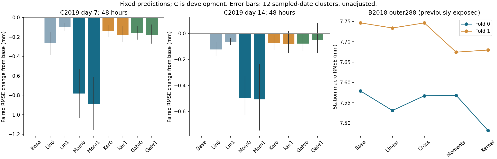
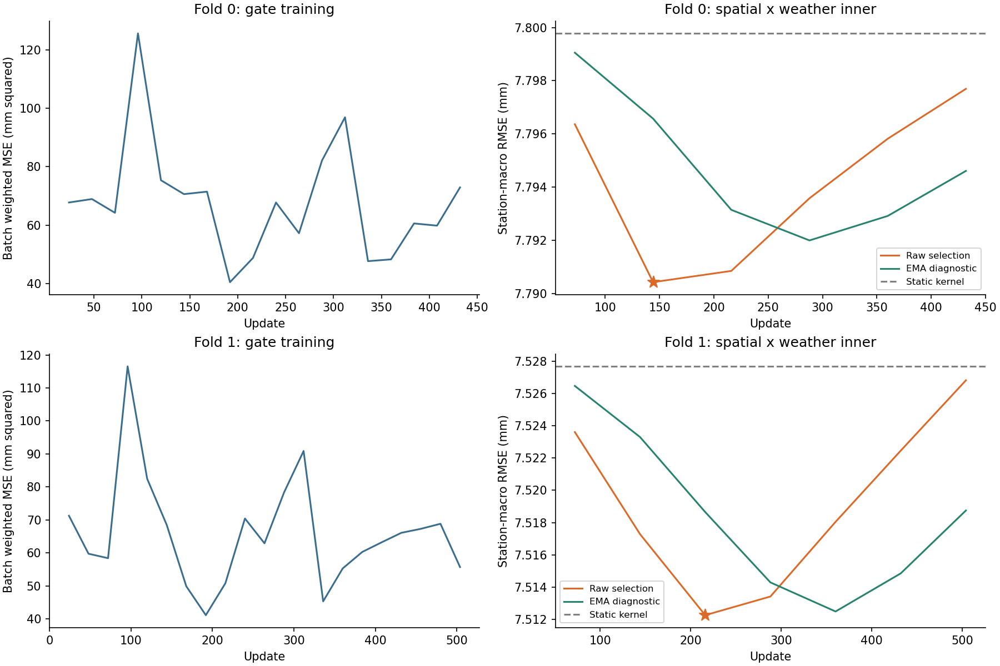
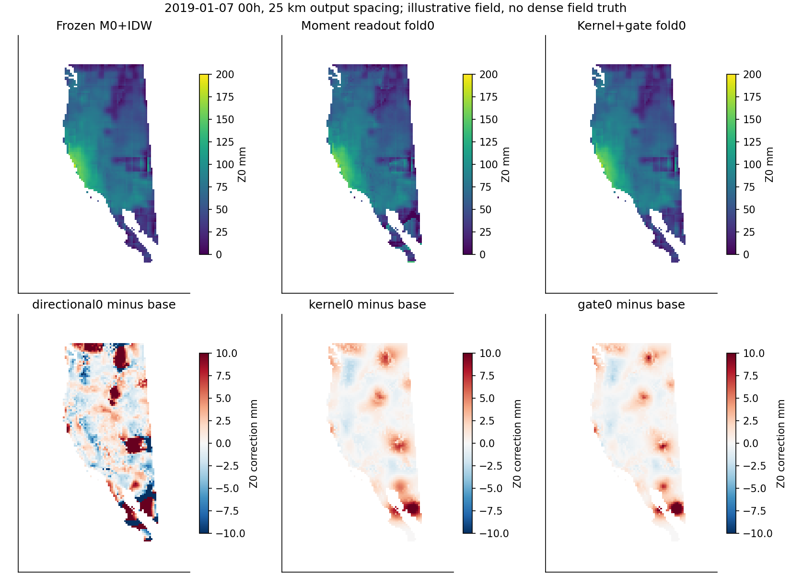

# 本机空间算子探索结果

已找到值得继续验证的方向：保留A站创新量的方向、高差和尺度信息，再映射到统一格网。两组固定C2019开发时刻均复现点值改善。当前证据更支持改善站点到格网的表达，而不是继续扩大原非线性预测头。

本批是用户授权的本机探索spike：三个有限算子家族、两折天气门控训练、两组各48个C开发时刻和数值复核。未修改生产源码及环境，未操作服务器或D2020。

## 结果与人口

B2018保持576训练小时、48空间×天气内层时刻、原288外层锚点。历史底座/先验和既往外层已有暴露，属于增量开发。C两组分别固定每月7日0/6/12/18时和14日3/9/15/21时，各48小时、76个可评分站；第二组在查看第一组后登记，模型和参数全部不变。C是已暴露开发年，D继续封存。先提交格网预测，再读取C标签。两折模型分别报告，没有按时刻或指标择优拼接。

|方法|B外层折0|B外层折1|C首组折0/折1|C复验折0/折1|
|---|---:|---:|---:|---:|
|混合底座|7.5788|7.7465|10.3264/10.3264|9.6203/9.6203|
|69维线性对照|7.5308|7.7340|10.0598/10.2270|9.4977/9.5563|
|方向与高差矩读出|7.5682|7.6745|9.5442/9.4340|9.1266/9.1136|
|地形核回归|7.4813|7.6797|10.1840/10.1494|9.5445/9.5405|
|核＋天气门控|7.4616|7.6735|10.1688/10.1502|9.5430/9.5687|

全部为同人口地表ZWD站宏RMSE，单位mm。首组方向矩相对底座约改善7.6%/8.6%，复验约5.1%/5.3%；不能将其外推成全年或6mm成果。原M0（未混合IDW）在两组为10.7162与10.0041 mm，作为额外背景对照。

方向矩在B折0外层未优于原线性对照；它的跨年份C收益值得保留，也需要全年评价核查。静态地形核在B两折均优于线性控制，但C折0仍是线性控制更低。两个方法各自报告，不拼成一个未经测试的组合。

## 结构与真实训练

方向矩：在50/100/200 km高斯尺度和无/750m高程相似核下，汇总A创新量的常数、东西、南北、高差四个矩，共24维；与原69维拼接后做格点线性ridge读出。ridge三强度只由B内层选择。这是具有方向和地形信息的集合到函数映射，不是已训练的图网络或U-Net升级。

后续B-only消融进一步收缩了归因：只保留6个尺度×高程核的加权均值，内层7.7536/7.5199、外层7.4522/7.6715；只保留无高程核的水平方向9列，内层7.8448/7.6113、外层7.5587/7.7378。因此当前更支持高程相似聚合与多尺度表达，尚不能把主要收益归功于有符号方向。6维简版尚未加入已锁C名单，不能套用24维版的C分数。

核旁路：在公共格点定义水平100 km、高程750 m的平滑协方差核，用真实A查询矩阵构建Kobs=QA Kgrid QA^T。对当小时A创新解线性系统，整体幅度仅用拟合B估计；两折均由内层选中噪声比0.1。底座本已使用A，因此此处是回归校正，不能解释成独立观测的贝叶斯更新，也不能证明山脊阻断水汽。

天气门控：8→16 SiLU→1，输出受限幅度乘核修正场，先格点乘法、后站高恢复和查询。共真实更新936步：折0/1为432/504步、入选144/216步。门控相对静态核的额外收益不稳定，复验折1反而高0.0282 mm；当前保留静态核为简洁控制，不把核的整体收益归给神经网络。

## 精度、细尺度与核验

配对区间按每组12个采样日期同步抽样2000次；合并96时刻另按月份同步抽样。均为未做多重比较调整的探索区间，不称全年7日/14日稳健性。完整区间见各组paired_intervals.json及C96_diagnostics.json。

在固定F∩S0∩T人口上比较原场与100 km平均后回采样场；每组只剩23个安全站，该细尺度子集不能代表全部76站或整个陆地区域。站间差值同时列公共Z0及高差≤100m地表结果，并记录站对数，见各组results.json和fine_comparison.json。

合并96时刻的等站权MSE分解显示，24维版既降低站均偏差项（35.69→27.78/26.32 mm²），也降低去均值时间误差项（78.09→71.11/70.88 mm²）。这不是仅靠静态站偏差解释的收益，但也不等于证明所有细尺度真实。该分解没有重校正任何评分预测。

全场范围检查发现：原底座在支持域外已有负Z0；24维折0在复验中另有1个支持格点为负。因此原始分数全部保留，另登记共同正值输出参数化Z0=0.1 logaddexp(0,raw_Z0/0.1)，对全部方法在格点、查询之前应用。输出检查和正值场分别见physical_output_checks.json与各组positive_fields.npz；包含全陆地和原支持标记，不删评分样本。它是事后工程约束检查，不算新增独立精度确认，也不能保证支持域外精度。

数值核验：原线性对照最大复算误差2.74e-8 mm；A站顺序置换误差0；零站输出零核修正、单站有限；两组发布格网重载查询误差0。M0相对原归档最大误差分别0.0000763/0.0001068 mm，均小于0.001 mm。未删除非有限预测或缩小评分人口。此处是spike数值验收，不新增宣称整套工程测试次数。

## Pro复核与下一步

内置Pro完成两轮复核，原文要点见PRO_REVIEW.md。采用其建议：原站到格网表达优先；核是回归旁路；门控收益单独检验；固定均值后重新校准Gaussian；生成器分别检验点值、细尺度与联合概率。

下一步先锁定方向矩读出、静态核与原69维线性三个候选，在完整2019评价稳定性，并完成同结构有/无高程核、方向矩及门控的配对归因。当前B-only消融见ablation_results.json；未扩大锁定C候选。将站均偏差和去均值时间误差仅作分解，不用于重新校正评分预测。

随后保留现有ResU-Net骨干，把已验证的站点几何聚合/核修正作为共享条件候选。优先比较6维简版与24维已验证版，不因名称更复杂而扩网。方向读出与核旁路属于已测试的两种均值方案；二者相加、共同送入网络仍需独立试验。选定并冻结共同均值后，Gaussian、Diffusion、GAN使用相同条件和评分人口。概率分支应保护均值，ES/VS收益不替代点值目标。详细后续安排见NEXT_PLAN.md。

若全年优势消失则保留更简单方法；若门控不稳定优于静态核则不扩门控。没有完整独立高分辨率目标场时，不把IDW图当作扩散真值。尚未运行新Diffusion/GAN训练、全年度新模型评价或服务器作业。

## 文件

- PLAN.md、experiment.lock.json：筛查设计与输入身份。
- GATE_TRAINING_PLAN.md、gate_training.lock.json、gate_fold_*/：真实训练与入选权重。
- C2019_confirmation/、C2019_replication/：协议、完整格网、逐站预测、指标与区间。
- numerical_acceptance.json：数值核验；delivery_manifest.json：交付哈希。
- 本目录*_spike.py：可复算探索代码；不替代正式可部署训练工程。

