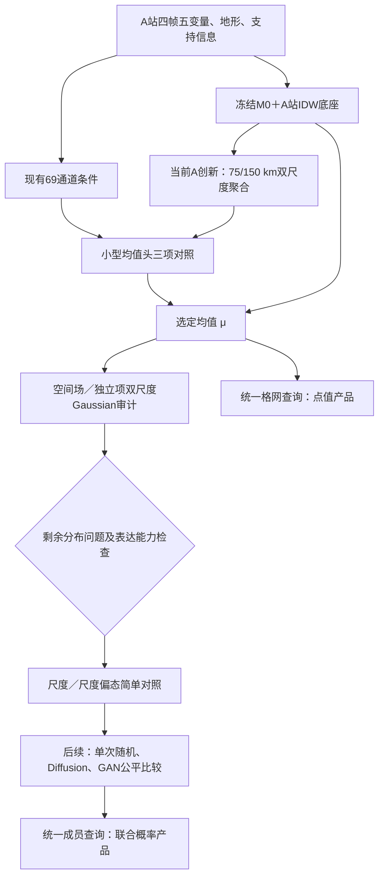

# GNSS场下一阶段结构与实验方案

版本：20261122_model_architecture_pro_v01。状态：方案与数学诊断完成；生产模型尚未实现，本轮未提交服务器作业。

## 1. 推荐方案与研究目标

保留冻结的M0＋A站IDW底座及现有小型ResU-Net。将点值均值修正与概率场学习分开训练、分开验收。下一批只做三个小型均值头及一项Gaussian双尺度校准审计；根据结果确定后续Diffusion/GAN采用的均值与随机场接口。

点值目标仍是可信的独立站精度改善，约6 mm是待验证目标。概率目标是空间联合分布与区间可信度。两类收益分别报告。25 km称输出间距；有效空间分辨率须由独立站间变化证据支持。

这次结构调整着重改变训练职责、零修正回退与空间选模机制。当前证据没有要求增加网络深度、注意力模块或Transformer。

## 2. 现有证据与瓶颈

同一B2018空间外层、同一评分人口下，站宏RMSE为：

|方法|折0/mm|折1/mm|
|---|---:|---:|
|冻结M0＋IDW|7.4228|7.5377|
|随机残差ResU-Net|7.6256|8.0191|
|Diffusion|7.6042|8.0419|
|GAN|7.7072|8.0470|

原生成器同时改变均值与分布。内层只在已拟合站的留出时刻选模，未直接检验新站组泛化；其学习均值修正未带来外层点值收益。12个预登记代表小时的K128本机推断复现了服务器前32成员，最大误差低于0.0001 mm，增加成员未扭转这些小时的点值方向。这降低了部署或单纯Monte Carlo误差作为主要解释的可能性，但不构成全年K128评价。

仅用允许的训练B站拟合空间幅度，α约0.60，已得到更好的ES/CRPS。它保持均值不变，不能解释为点值改善。当前τ=6.1827 mm来自残差模型拟合，包含未解析变化与观测误差，不能解释成独立测量的仪器噪声，也不能当作6 mm精度的物理下限。

只缩空间场、缩整个观测残差两种Gaussian的CRPS接近，VS有所不同，提示进一步检查场与独立项的分配。它尚未证明某个分配正确，亦未证明CRPS/ES原则上无法辨识参数。

这些结果属于带历史底座及先验B暴露的增量开发。原外层已用于本轮方法发现，继续用于探索性复核。C2019为开发资料，D2020保持封存。这里的7.4—7.5 mm不能与C2019全年RMSE直接排序。

## 3. 点值支路：均值独立优化

### 3.1 条件与创新

保持现有69通道缓存语义与归一化锁文件。点值头去掉最后两个绝对XY通道，得到 `C67:[n,67,144,96]`。这会减少直接坐标输入，但DEM和支持形态仍含位置线索，不能宣称已消除地理记忆。

当前A站共同高程观测为Z0。先在A位置查询当前冻结底座：

\[
e_{A,j}=Z_{0,A,j}-Q_{A,j}\mu_{base}.
\]

使用75 km、150 km Gaussian核，分别在3倍尺度处截断，即225/450 km；有效性沿用五变量共同有效与完整查询模板规则。归一化聚合得到 `J:[n,2,144,96]`，量纲为Z0毫米。无有效核邻站时为0，并保留密度/有效标记。评分支持域沿用锁定协议，不由这些较长核半径扩大。

现有条件48—51通道是“两个相对M0的创新值＋两个密度”，并非四个创新值。新增J是相对M0＋IDW，须单列接口和哈希，不能覆盖原缓存。A数据第一变量已为共同高程Z0，在这里不重复乘站高恢复系数。

### 3.2 唯一下一批点值矩阵

|编号|结构|修正公式|参数量|
|---|---|---|---:|
|P0|固定零修正|μ=μ_base|0|
|P1|两个全局常数，β=tanh(b)|Δμ=(β₁J₁+β₂J₂)/2|2|
|P2|共享1×1卷积MLP，67→32→16→2，SiLU|同P1，但β随条件变化|2738|
|P3|同宽自由MSE头，67→32→16→1，SiLU|Δμ=s₀·head(C67)|2721|

P1参数及P2/P3末层零初始化。s₀采用既有训练尺度锁值，量纲与Z0一致。所有候选都从原底座起步，只优化真实训练B站地表MSE：先生成最终格网，再经同一个Q和 `exp(-H/3000)` 查询。以每站训练有效时刻数构造固定权重，使均值损失对应站宏MSE；不临时按误差删站或删时刻。

P2有硬幅度界 `|Δμ|≤(|J1|+|J2|)/2`。底座本身吸收A观测，A自影响会缩小创新；若B残差可预测但J很小，P2可能受限。因此P3是必要的表达能力对照。去XY、零初始化及有界修正均不能保证训练后细节正确，需由独立站验证。

记录J幅度与B残差关系、β饱和率、均值修正RMS、训练与空间内层误差。如果P3优于P2，说明创新门控可能过紧；如果P1与P2相当，保留P1；如果三者均未通过门槛，保留P0。首批不再增加一个新的ResU-Net均值头。

## 4. 概率支路：先审计两项误差分配

固定点值胜出均值后，用相同允许的B训练资料重新拟合Gaussian。保留旧天气幅度g(t)、空间因子、相关长度；本批只增加两个正标量：

\[
Z_0^{(k)}=\mu+g(t)\alpha_f P^{(k)},\qquad
\hat y_j^{(k)}=e^{-H_j/3000}Q_jZ_0^{(k)}+g(t)\alpha_n\tau\eta_j^{(k)}.
\]

P为原冻结零均值空间Gaussian场，η是站端独立标准正态；τ只添加一次。发布的潜在场标准差与站端预测区间分别保存，不能把站端独立项伪装为连续空间纹理。

比较限制线 `α_n=1`（只缩场）、`α_f=α_n`（整体缩放）和自由二维模型。三个模型均用同一训练目标重拟合；旧α≈0.60的CRPS拟合点另作复现参照，不把不同目标拟合的数字混作公平选型。

拟合目标采用预登记站组的复合Gaussian NLL。令H为包含站高恢复及格网查询的空间因子，组内协方差为：

\[
\Sigma_t=g(t)^2[\alpha_f^2HH^\top+\alpha_n^2\tau^2I],\quad
L=\operatorname{mean}_{t,G}\frac{\log|\Sigma_{t,G}|+e_{t,G}^\top\Sigma_{t,G}^{-1}e_{t,G}+|G|\log(2\pi)}{2|G|}.
\]

站组仅由几何预登记；缺测时取真实有效主子矩阵，不补造标签。重叠组的NLL是复合目标，不能把组数当独立样本数。统计/线性代数使用FP64。拟合范围先登记为两个尺度均在[0.1,1.8]；若触边，作为边界诊断，不根据外层放宽。

空间内层站组ES用于比较限制线与二维模型，VS、CRPS及区间校准作核验。同时给出二维目标剖面、剖面曲率和天气块×物理站组重采样。如果存在长谷、参数互补而预测接近，应报告分配证据不足，选较简单且内层表现相当的限制模型。即使参数稳定，也只支持统计误差分配，不能识别仪器噪声成因。

本批固定相关长度，避免把场方差、短程相关、独立项同时放开。只有配对增量与距离分箱诊断持续显示相关结构失配，才另行登记相关长度实验。

## 5. 后续生成结构：保留小ResU-Net，采用条件推进

### 5.1 强简单对照：均值为零的非Gaussian载体

锁定均值与Gaussian后，先检查经条件均值/尺度处理后的偏态、尾部及空间依赖，按站组与天气块检验稳定性。当前站点—季节偏态只说明可能存在混合分布效应，尚不足以证明完整A条件下的偏态。

若存在稳定剩余分布信号，再比较尺度头与尺度—偏态头：共享点式MLP `69→32→16→2`，2802参数，输出h_a,h_b；

\[
a=\alpha_f\exp(\log2\tanh h_a),\quad b=\tanh h_b.
\]

设P,Q为相互独立、同协方差的完整Gaussian场，格点标准差s；在s>0处定义X=(P+Q)/(√2s)、Y=(P−Q)/(√2s)：

\[
T_b(Y)=\frac{Y+b(Y^2-1)/\sqrt2}{\sqrt{1+b^2}},\quad
R=sa\frac{X+T_b(Y)}{\sqrt2}.
\]

s=0处显式置R=0。尺度头固定b=0，尺度—偏态头可学b。最后发布 `μ+gR`，站端加 `gα_nτη` 一次。系数仅依赖条件，或后续与载体独立的系数噪声；不得读取P/Q，否则精确零均值保证失效。末层零初始化时逐成员复现已校准Gaussian。

此候选的单点矩与空间协方差已完成Gauss-Hermite积分复核。它同时改变边缘和协方差，胜出后还须与同协方差Gaussian比较，才可讨论超越二阶结构的收益。固定系数的格点偏态绝对值<1、超额峰度<3；初始b范围[-1,1]的偏态上限更小。当前校准Gaussian方差下，独立项对站端偏态的稀释因子中位约0.156。这个因子是旧协方差下的诊断，不能把格点偏态上限直接乘它当作新模型站端偏态的普遍上限；必须用新场四角联合矩或共同成员重新计算。它是待检验的强简单对照，尚不确定适合作为主生成器。

### 5.2 Diffusion/GAN的可比接口

只有上一步出现简单Gaussian解释不了的分布问题，才登记以下三臂。沿用ResU-Net宽度32/64/128/128，空间尺寸144×96→72×48→36×24→18×12，再对称上采样；不加新注意力模块。

|臂|输入与输出|优化|
|---|---|---|
|单次随机对照|条件69＋独立系数噪声2→两张系数图|观测ES-U|
|Diffusion|条件69＋两通道采样状态→两张系数图，sigma-FiLM，18步Heun/35次调用|通过完整采样器反传的观测ES-U|
|GAN|条件69＋独立系数噪声2→两张系数图；站端masked DeepSets判别器|ES-U＋预登记对抗项|

三臂共享载体定义与冻结底座，各自独立权重；同一成员的系数噪声ω、P、Q、η分别独立，成员之间也独立。不能把一份随机系数给所有成员共享。输入虽同为71通道，旧版的“69＋先验场＋白噪声”与新版“69＋双通道系数状态”语义不同，必须升级接口、禁止无校验加载旧权重。

Diffusion以同调度解析零网络采样结果作参照，检查FP32零初始化误差。本方案没有独立HR真值/系数真值，使用EDM预条件的采样器并不等于已做真实HR残差去噪训练。对外须称观测评分监督的扩散式采样参数化。不能将IDW参考图直接作为真值来补齐DSM监督。

若载体受限于空间协方差、且条件对称假设合理，可另登记反对称自由ResU-Net。若受限于偏态，则反对称模型不是补救。自由非对称生成器＋独立pilot中心化可作备选，但有限pilot仍有均值误差，须报告额外调用和误差，不能宣称精确均值保护。上述备选均不自动并入队列。

GAN实际对抗系数要在代码、完整配置和日志中一致。旧发布配置0.01与实际0.1的差异已经归档；新方案须显式锁值，不能沿用歧义字段或改写旧发布包。

## 6. 数据、训练规模与选模

保留原两折物理站组外层与天气外层作探索性复核。在每折允许拟合B内再按物理组留约20%作空间内层；选择种子42，只读几何与覆盖，不依据残差挑组。时间内层每季固定一个合格7日块，由时间顺序规则选择，排除已登记外层块；四帧历史使用18小时，训练目标与留出天气块之间加至少18小时隔离。具体小时、站组、缓冲与资格计数须在训练前锁清单。

主选模人口为空间留出组×留出天气块；另报告空间留出组×训练天气、拟合组×留出天气，区分两种泛化。旧底座/先验有历史B暴露，因此新内层也属于冻结底座条件下的增量验证，不称整链盲测。C/D标签扰动必须不改变新增输入、统计和预测；对于历史B暴露保留明确来源记录。

使用重新划分后的全部合格训练时刻，按小时生成完整144×96场，并监督当小时所有合格拟合B站。随机分支每小时至少4个合格训练站；公平比较固定共同训练清单及评价清单。缓存未覆盖的月份必须补齐并绑定哈希，不悄悄回退到旧小样本上限。

有效批量8小时，seed42。点值P1/P2/P3各最多2遍完整池，包含末尾不足8小时的小批量并按实际小时数归一；每遍步数 `ceil(N_train/8)`。旧5472小时对应684步/遍、2遍1368步；新空间/天气内层会改变小时资格，必须重算，不能硬编码1368。每遍独立打乱且不丢小时。首批不做Optuna或多种子搜索。

AdamW、LR1e-4、weight decay1e-4、梯度裁剪1.0、EMA0.999；warmup为总更新前5%，之后余弦至1e-6。第200步为启动检查；每1/4遍及遍末作内层评价，零候选始终参与。保存原始权重和EMA，两个分支均按预登记同一规则选模，记录EMA有效滞后。2遍是方向试验上限，不预称收敛；若仍下降，单独登记延长方案。

概率校准在该折同一拟合B×训练时刻上进行。先比较限制线与二维模型，内层锁定后再一次性外层复核；不做三个点头×三个校准方式的全交叉。后续载体小头最多2遍，三生成臂最多4遍；这些属于条件性后续方案，不是本批自动执行范围。

## 7. 推进门槛与评价产物

点值主指标为站宏RMSE，辅以微RMSE、MAE、偏差。晋级候选需两折空间×天气内层同向改善；配对天气块区间支持后再报告稳定收益，区间跨零时归为待确认，优先更简单的P0/P1。内层块数少时，同时列各块结果，不把几百个小时当独立样本。

细尺度另用0—25、25—50、50—100、100—200 km站对差值、公共高程Z0及高差≤100 m地表差值，并比较自身25 km发布场与4×4平均后100 km回采样场。点值改善但短距离差值不改善，称均值纠偏；不称真实细尺度恢复。

概率按固定站组宏ES选型，报告VS、CRPS-U与历史CRPS-V、随机化秩、80/90/95%区间宽度与覆盖。Gaussian给解析区间，生成器给同K集合区间；有限K样本分位数偏差另作参考，不能直接把K32约85%的90%区间覆盖全部解释为欠离散。筛选K16，完整候选K64，排序不稳才用相同噪声前缀K128。

生成模型推进条件为：同均值下，空间内层ES/VS较锁定Gaussian改善且CRPS不增加，改善在预登记天气块中可复现；偏态收益还须优于同协方差Gaussian。无剩余非Gaussian信号时，交付Gaussian结果并停止本轮生成结构扩容。没有预算内收益与证明Diffusion/GAN无效是不同结论。

主要图件：

1. 独立站RMSE及相对底座收益地图、逐块配对误差图。
2. 均值修正/J幅度/门控饱和图，分高度、稀疏度、地形起伏、边界、湿天气过程统计。
3. Gaussian二维NLL剖面与参数重采样图、距离分箱增量/协方差图。
4. 区间校准与宽度、秩直方图、原成员与逐站乱序成员的空间依赖比较。
5. 预登记天气过程的均值、标准差、成员、梯度与PSD。无独立HR真值的全图SSIM/PSD仅作诊断；不能因纹理像插值图而宣称精度更高。

同步7日天气块bootstrap及物理密集组重采样；时间样本不足完整独立块时，明确给出簇定义和数量。完整年度候选评价先用C2019开发，D2020在产品、K、种子、指标锁定后才启用。

## 8. 单张A800实施边界与验收

本次只形成方案与数学核验，不提交收费作业。实施时先完成本机数值/数据接口测试，再在单张A800短测真实路径并锁新增预算。旧批实际3.1928卡时另列累计账，不能把旧4卡时额度重新视为全额余额。

顺序为：内层清单与覆盖审计→点值三臂→冻结均值→Gaussian双尺度审计→探索性外层复核→决定生成结构。GPU最大并发1；CPU校准尽量本机完成。新ResU-Net/DF费用不可按旧684步直接线性承诺，须包含缓存、完整评价、K64/128与检查点时间。旧完整采样反传峰值约63 GB，反对称双图可能超80 GB，必须真实测量。

实施验收至少包括：

- 67/69/71通道名称、顺序、单位和缓存哈希一致；新J不覆盖旧M0创新。
- 无站、单站、持续缺站、padding、站序置换及18小时历史正确。
- P0/P1/P2/P3零初始化复现底座；所有均值和成员经发布格网重载查询误差≤0.001 mm。
- 新内层标签扰动不改变新增条件或训练统计；历史B基础产物暴露单独记录。
- Gaussian两参数在嵌套限制线上与相应模型数值一致；缺测主子矩阵及FP64 NLL梯度通过。
- 载体均值、矩、独立噪声和查询不交换的测试通过；v=0不伪造单位方差。
- 同一小时/成员在拆批、分块、查询子集变化后保持一致；不把±噪声配对当独立ES-U成员。
- 完整采样反传、有限预测检查、真实训练100＋恢复100与连续200步一致。
- 点/联合产品与checkpoint对应；预算、EMA、原始权重、数据游标及RNG可恢复。

本轮交付的是可实施的研究方案；训练收益、收敛步数、6 mm可达性及新架构的创新性均待实验确定。

## 9. 证据位置与方法来源

- 已完成试验与本机复核：`../20261122_generation_postrun_research_v01/RESULTS.md`、`gaussian_scale_control.json`、`member_stability_summary.json`。
- 本轮数学验证：`carrier_math_verification.json`；独立项与偏态证据：`NEW_EVIDENCE.md`、`tau_skew_dilution_audit.json`、`training_station_season_skew.json`。
- Pro协作会话：<https://chatgpt.com/c/6af6fa29-6a4c-83e8-a0a7-15d62767383b>；两轮已完成回答及采用/修正决定见`PRO_REVIEW.md`。网页模型建议作为审阅意见，不替代实测或推导证据。
- [Fleishman：A Method for Simulating Non-Normal Distributions](https://www.cambridge.org/core/journals/psychometrika/article/abs/method-for-simulating-nonnormal-distributions/8E300D33DA17699BFD8AA440F7D2BFDA)支持Gaussian多项式变换的方法家族；本项目载体组合与数值结论由本地独立推导验证，不据此宣称原创。
- [Olvera Astivia与Zumbo：A Cautionary Note on the Use of the Vale and Maurelli Method](https://pmc.ncbi.nlm.nih.gov/articles/PMC5965614/)提示模拟/样本偏态与峰度估计的波动，应结合块稳定性检查。Pro另提的O’Callaghan文献未完成书目核验，本方案不将其作为依据。
