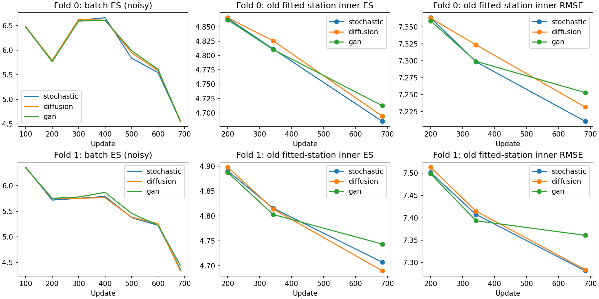
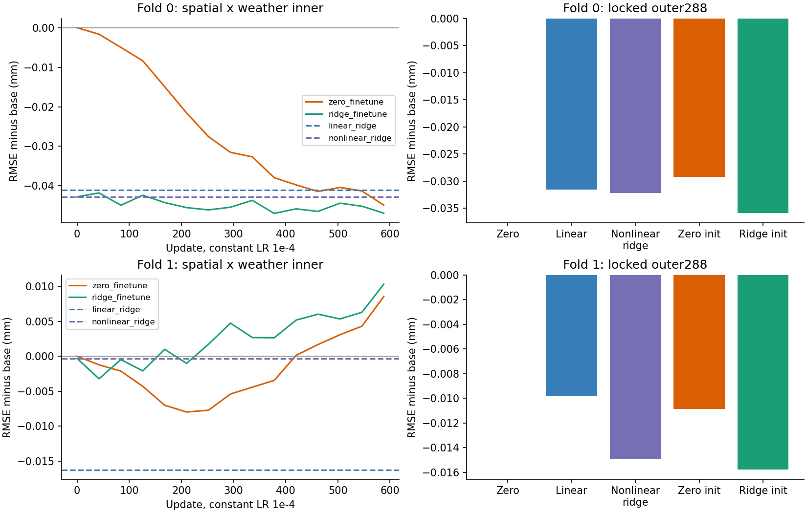
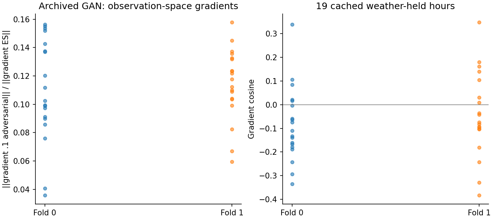

# 非线性改正、生成模型曲线与本机验证

本轮发现了可学习的小幅均值改正信号。解析读出初始化配合小残差网络，在一折空间内层与外层有更清楚的收益；另一折内层仍更支持线性模型。下一步应扩大同一模型的天气/站组覆盖，检验信号稳定性，再决定服务器训练。

本轮完成两组本机研究spike，共8次神经小训练、4752次更新，并完成线性/非线性解析读出及归档GAN判别器诊断。生产代码、旧实验、环境和服务器作业均未修改。没有新增C2019评分，D2020封存。

## 1. 现有成果与新增收益分开评价

已核验的C2019全年共同人口为76站、642258站时刻：粗场双线性13.3640 mm，A站IDW格网10.2785 mm，冻结M0为10.3446 mm。M0相对粗场的站宏RMSE下降约22.6%；M0与直接A站IDW的排名则不同。已有基础链条的收益应保留，生成式分支须在此之上证明额外价值。

来源：`../20261119_frozen_m0_audit/baseline_results.json`。下面的新数字来自B2018的288个外层缓存锚点，不与这些全年数字交叉排名。

## 2. 曲线说明了什么

重读六组真实日志后，原随机、Diffusion、GAN在200→342→684步的旧内层ES仍下降；但该内层使用拟合站组，改善没有迁移到外层新站组。单遍684步、末端LR降至1e-6，不构成充分收敛证据。GAN折1旧内层偏差增长至约+0.983 mm，值得单独分析其均值改正。

最新84步小头也未充分检验容量：EMA.999仍含约91.94%的初始化贡献。不过raw改善同样很小，EMA不能解释全部现象。总GAN loss又包含critic输出，不能将其下降直接当成精度或样本质量改善。

结论是DF/GAN的潜力尚未得到充分验证。曲线继续下降并不自动支持延长训练；需要同时观察跨站泛化、均值漂移、联合分布和计算成本。

## 3. 本机实际比较的结构

底座固定M0＋A站IDW。输入为旧67维条件和相对当前底座重算的两张A创新图，共69维；训练小时上标准化，不读目标值。与旧生成模型的“67条件＋XY”的69维语义不同，禁止凭通道数相同复用缓存或权重。

小网络为逐格点 `69→32` 的SiLU映射，接一个 `32→32` 的残差映射，块内缩放0.1，无BatchNorm，最后线性输出一张Z0改正图。输出按既有训练尺度恢复毫米，加到冻结底座。每格点先经过非线性，再用包含站高恢复的公共查询算子评分；格网偏置列经过查询后对应exp(-H/3000)，不是地表常数1。

|对照|训练/拟合内容|作用|
|---|---|---|
|零改正|无|保留底座|
|线性ridge|输入线性读出，三个固定正则强度|判断简单可迁移信号|
|非线性ridge|固定随机隐藏映射，解析拟合读出|绕开隐藏层优化，检验非线性表达|
|零读出微调|同一隐藏初始化，从零输出训练|检验优化启动|
|ridge读出微调|从解析非线性读出初始化，全网训练|检验学习表示的额外收益|

ridge强度仅为1e-4、0.01、1，以空间×天气内层选定；目标采用相同站宏地表MSE和对应读出正则。

第一组为600步、LR1e-3余弦至1e-5、EMA.95，raw/EMA预先共同登记。第二组按Pro建议做优化控制：14完整遍、588步、恒定LR1e-4、raw主选模，每42步评价；EMA半衰期42步，仅作诊断。两组改变了多个优化设置，不当作单因素因果对比。小网络及残差缩放也不是EDSR完整模型，更不宣称为原创结构。

每折仍使用336个独立训练小时、41个内层缓存时刻。拟合站为195/160，空间内层站为49/44；外层为原12个注册天气周内288个缓存锚点、204/244站。历史冻结底座/先验有B暴露，全部属于增量开发。

## 4. 恒定学习率控制的结果

|方法|折0内层RMSE|折0外层RMSE|折1内层RMSE|折1外层RMSE|
|---|---:|---:|---:|---:|
|冻结底座|8.224793|7.578772|8.262017|7.746547|
|线性ridge|8.183774|7.547186|8.245772|7.736746|
|非线性ridge|8.182018|7.546584|8.261701|7.731614|
|零读出微调|8.179919|7.549594|8.254049|7.735691|
|ridge读出微调|8.177818|7.542913|8.258797|7.730781|

单位均为mm。只按内层选模：折0入选第378步ridge初始化微调，折1入选线性ridge。不能根据折1外层更低就换成非线性。折0零初始化仍在末步588入选，ridge初始化较早入选；折1微调较早入选，继续拟合并未改善空间内层。单纯增加更新并不是统一解法。

两折入选产品相对底座的外层改善为0.03586/0.00980 mm。2000次同步12天气簇重采样的95%区间分别为[-0.06956,0.00262]、[-0.02823,0.01104] mm；加入50 km站组重采样后也跨零。非线性相对线性的差值区间亦跨零。它们是有方向的小信号，尚不足以确认稳定增益。

预登记门槛为两折空间内层均改善至少0.5%且外层同向。折0改善0.571%，折1约0.197%，门槛未通过。因此本轮没有触发C开发确认，也没有申请服务器。没有调低门槛来迁就结果。

## 5. GAN判别器诊断

使用原GAN入选EMA权重，在与本机缓存相交的19个原留天气小时上，分别检查旧拟合站组与外层站组。保持条件、坐标、掩码不变，逐站打乱成员编号，严格保留每站边缘样本。

外层观测值空间中，`||∂(0.1 adversarial)/∂y|| / ||∂ES/∂y||`的中位数为0.103/0.118，平均梯度余弦约-0.083/-0.042。对抗项并未在这个空间全面压倒ES，但存在方向冲突。这不是生成器参数梯度；不能据此直接重设对抗权重。

critic对原成员与乱序成员的平均分数有差异，且本例中乱序成员得分更高。这不证明判别器失效：生成器本身可能具有不合适的依赖结构，边缘保持的乱序也可能更接近某些观测统计。它说明还需要真实联合关系的诊断，不能把排列不变性等同于空间真实性。

## 6. 借鉴的机制与采用范围

|原始方法|本项目采用或候选机制|证据边界|
|---|---|---|
|[CorrDiff](https://arxiv.org/html/2309.15214v4)|确定性均值与随机残差分工|原文有稠密WRF监督，本项目没有相同的HR残差DSM条件|
|[EDSR](https://arxiv.org/html/1707.02921v1)|无BN及块内残差稳定机制|本轮是小MLP机制试验；0.1不是物理幅值保护，未分离其独立贡献|
|[随机特征与ridge](https://proceedings.mlr.press/v119/jacot20a.html)|解析读出作为优化诊断和初始化|随机MLP特征不是该论文Gaussian RF理论的直接实例，不移植其保证|
|[Deep Sets](https://arxiv.org/abs/1703.06114)|不规则站集的排列不变汇总|不自动保证学到联合空间分布|
|[评分规则生成训练](https://jmlr.org/papers/v25/23-0038.html)|观测端ES-U及明确的生成对照|支持评分训练思路，不保证从固定稀疏投影识别全场细节|

## 7. 下一步架构与顺序

保留小ResU-Net骨干；研究结构为“冻结基础场→轻量均值改正→冻结共同均值→概率残差”。先扩大本机B覆盖，仅比较线性ridge与同一小头ridge初始化微调，固定空间内层并先划天气块及18小时缓冲，再采样训练小时。暂不同时加入双线性交互、注意力或更深卷积，以便判断覆盖扩展是否保持收益。

旧5472小时池中，在排除已有768缓存时刻、新内层天气周及距所有336训练锚点18小时以内时刻后，可用候选为0。不能把锚点附近的新小时称为独立天气验证。下一覆盖扩展必须先重划天气分工；它仍称增量开发。增加小时数和增加独立天气过程分别计数。

若后续通过门槛，才启用提前锁定的C2019开发48小时确认（每月7/21日00/12小时）；这不是最终盲测。只有新覆盖、配对区间与线性/常数对照共同支持，才登记单张A800全合格时间池训练。约6 mm仍为待验证目标。

DF/GAN后续优先级是：真实站监督与空间×天气选模→共同均值与概率基线→均值保护及空间依赖诊断→最后再改骨干。保持同条件、同支持人口、同评价成员数，分别记网络调用与卡时。当前DF为观测ES监督的35次调用采样器，不称为完成了HR残差去噪学习。

如果未来GAN依赖诊断持续显示问题，可预登记一个小型站对分支：按固定距离箱汇总站间残差差值、相对位置与地形信息，与现有DeepSets点分支联合使用。它能直接提供二点关系特征，计算可用固定几何站对采样控制；这是尚未训练的候选，不是本轮已验证收益。双线性天气×地形特征也留作单因素候选。

## 8. 验证与文件

原实验指标复算误差低于1e-10；入选权重重载与完整格网查询误差均低于0.00002 mm，满足0.001 mm接口要求。ridge正规方程驻点逐次检查通过，所有训练损失和梯度有限。当前代码仅在研究目录，尚不是生产训练器；本轮未新增生产代码测试，原工程323项通过记录不冒称为新模型精度证明。

- `results.json`：600步探索组；`pro_optimizer_control_v01/results.json`：588步恒定LR控制组。
- `paired_intervals.json`、`critic_diagnostics.json`、`historical_curve_audit.json`：诊断原始值。
- `pro_optimizer_control_v01/fold_*/selection.lock.json`：先内层锁定、再外层评分。
- `pro_optimizer_control_v01/fold_*/publication/`：完整格网例图数据及查询复核。
- `PRO_REVIEW.md`：两轮网页Pro交接、取舍与待验证项；`validation.json`：核验及来源哈希。
