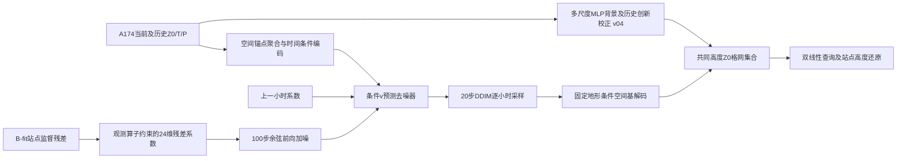

# 观测约束残差潜空间扩散：完整原型架构

目标是在A174当前与过去Z0/T/P条件下生成连续24小时ZWD格网集合，保留现有强背景。该架构直接使用扩散前向加噪、去噪训练与反向采样，不再用AR随机头代替diffusion。

## 数据流

## 1. 强背景与统一算子

冻结v03逐帧多尺度均值和v04当前/1h/3h创新ridge，不使用旧含PWV权重。共同高度格网均值记为mu_t，表面观测算子H_s包括四角双线性插值及exp(-height/3000)。输出Z0_t=mu_t+Phi z_t，站点输出H_s Z0_t。

本轮原型在现有站点查询处复用冻结背景数值；新残差Phi显式定义于全部144×96格网。完整发布可由已有背景格网流水线与此残差格网逐点相加。格网间距25km保持不变，不因采用diffusion就宣称更细有效分辨率。

## 2. 没有稠密真值时如何训练

在规则5×4空间锚点上构建200/500km两个尺度Gaussian基，并用地形高程调制得到80个候选基。通过B-fit站点几何下的SVD保留24个可观测方向。SVD只用站点几何，不用B-inner/outer标签。解码器Phi在所有格网节点定义，再通过同一H查询。

每个训练小时仅使用B-fit有效残差r=y-Hmu，用ridge求24维系数z=(Phi_B^T M Phi_B+0.1I)^(-1)Phi_B^T M r。之后仅用训练时刻系数统计进行标准化。这是受限空间模型的系数估计，不是稠密场真值，也没有证明未观测方向可识别。报告其训练重建误差和解释比例。扩散模型拟合的是该可观测残差子空间的分布。

此路线比直接把插值场作为高分辨率真值更容易明确监督含义。后续完整研究可将点估计改为观测似然下的潜变量后验，并审计其可识别条件；本轮不把ridge估计包装成后验样本。

## 3. 条件编码

20个空间锚点分别聚合A站当前Z0/T/P、1h与3h Z0变化及有效支持量，得到120维条件，加4维日/年周期编码，共124维。固定归一化，不用B标签构造条件。MLP124→64→64编码空间气象条件。

本轮保留已有效的多尺度背景，不强制使用此前性能较低的新图骨干。图注意力编码、距海岸特征可以作为后续同输入消融，此原型尚未加入。

## 4. 真正的条件扩散

扩散步k与物理小时t严格区分。100步余弦累积信噪比alpha_bar_k：

x_k=sqrt(alpha_bar_k) z_t + sqrt(1-alpha_bar_k) epsilon。

去噪器输入x_k、前一小时z_(t-1)、当前条件嵌入、16维扩散步正余弦编码和首小时标记，经两层128维SiLU输出24维v。训练目标v=sqrt(alpha_bar)epsilon-sqrt(1-alpha_bar)z_t，使用MSE。由v恢复z_hat=sqrt(alpha_bar)x_k-sqrt(1-alpha_bar)v_hat，避免高噪声时除以接近零的信号系数。

训练使用B-fit系数的前小时值，采样使用自己已生成的前小时值，构成p(z_1|c_1)∏p(z_t|z_(t-1),c_t)。它在物理时间上因果，属于同小时条件重建，不是未来天气预测。自由滚动与教师强制的差异由24h生成评分检验。首小时使用零历史并显式标记。

采样从标准Gaussian开始，使用预先固定20个DDIM步，eta=0；标准化z_hat截断至[-6,6]用于数值稳定，并报告触及比例。每个成员独立噪声，空间查询共享同一系数；时间连续性由前一小时条件学习，而不是事后平滑。

## 5. 对照与验收

### 用户追加的attention、Transformer与稀疏FFNN

实现四个配对候选：条件Gaussian、MLP diffusion、dense-FFN Diffusion Transformer、sparse-FFN Diffusion Transformer。后两者用24个带噪空间系数token，加入模式位置嵌入与扩散步编码；两层self-attention在系数之间通信，cross-attention读取20个A气象锚点token及24个前小时系数token。维度64、4头，每层残差与LayerNorm；没有未来小时token。

稀疏FFNN按本次实现解释为4专家、top2路由的前馈网络，每专家64→128→64，路由权重只在被选专家内归一化。加入0.01倍负载平衡项并记录专家占比；普通FFN为64→128→64。两者更新步数相同，参数量与实际算力不同，分别报告。稀疏在路由与梯度激活意义上成立；原型可为小规模验证同时计算四专家，不宣称已取得推理加速。权重剪枝型稀疏FFNN不在本轮实现范围。

注意力本身不提供新的观测信息；验收以固定人口概率评分和采样均值精度为准。对照的意义是判断空间条件交互与分专家处理能否改善，而不是预先选择参数最多的模型。

同样24维系数、条件和上一小时输入的条件对角Gaussian自回归网络作为生成对照，训练NLL。它检验扩散相对较简单条件分布是否有额外价值。保留v04原生成分支作为产品基线。

两种子42/17，四种模型各1500更新、batch128；每300步以B-inner自由滚动K16的CRPS+0.5增量CRPS选点。无B-inner潜目标拟合。八次训练完成后评月22/27日固定人口，K64与独立K128。均值报告采样均值并说明Monte Carlo误差，不能冒充解析均值。检查扩散恒等式、零噪声端点、因果条件、无B输入、站点/格网一致、来源哈希。

8mm是固定人口的均值目标；扩散的独立价值还必须体现为CRPS、时间增量评分和覆盖率。不能用更丰富纹理代替准确性或校准证据。当前历史数据队列仍受PWV筛选影响，正式论文协议须重建允许变量质控。

## 原理来源与迁移范围

2026-11-23定向查阅原始论文页面，非系统综述。

- Ho et al., DDPM：https://arxiv.org/abs/2006.11239 。采用前向Gaussian扩散与条件去噪训练；论文图像结果不转作本任务性能依据。
- Song et al., DDIM：https://arxiv.org/abs/2010.02502 。采用隐式少步采样，20步质量需本机验证。
- Tashiro et al., CSDI：https://arxiv.org/abs/2107.03502 。吸收观测条件下的概率时间序列建模；本文原型使用自回归潜变量，非CSDI复现。
- Daras et al., Ambient Diffusion：https://arxiv.org/abs/2305.19256 。提示不完整观测的扩散训练需要明确测量模型和技术条件。本项目固定站网不自动满足其恢复保证，本轮采用明确受限的可观测子空间。
