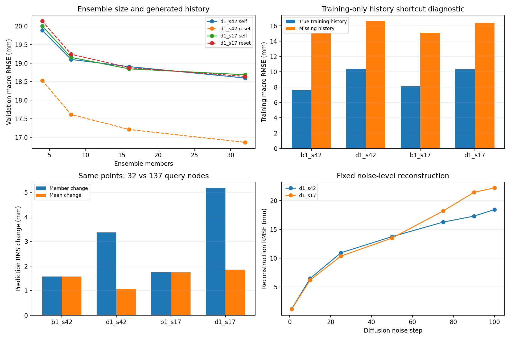

# v10性能瓶颈诊断与下一阶段路线

结论：优化过程有有效学习，尚无数值发散证据；当前首要问题是条件观测与高差关系没有充分转化为重建能力，其次是目标历史的训练/推理分布差异。查询图大小变化和小集合评分进一步影响结果。现有证据不支持直接增加网络规模或进入全量训练。

本次冻结权重，没有重训和选新冠军。只读取原训练410及验证137缓存，确认138和原C/D标签未读取。诊断脚本为 `tools/terrain_diffusion/diagnose.py`，所有权重与数据哈希见receipt.json。

## 1. 曲线显示优化是否正常

原曲线的随机训练目标确实下降。以前200步和最后200步均值比较：B1种子42的MSE从0.481降至0.141，种子17从0.469降至0.121；D1的v-MSE分别从0.786降至0.330、0.679降至0.373。验证也从早期约21–25mm下降至约16–19mm，说明参数更新学习到了可迁移信号。

但这不等同于收敛，也不足以判定过拟合。B1种子42在800步15.685mm，1000步回到17.235mm；种子17在600步16.913mm，1000步18.158mm。D1种子42在800步19.228mm，1000步22.219mm，而种子17在1000步仍降至17.778mm。不同种子的末段走势不一致，更符合短训、高方差更新和有限验证窗口共同作用，不能据此确认统一平台期。

当前日志的不足有明确来源：batch1、每步更换时段/条件/目标、50%真实目标历史、随机扩散步，同时改变了批难度。曲线中的训练恢复RMSE与自由生成RMSE并非同一任务。高斯损失为省略常数的标准化NLL，出现负数本身正常。日志没有梯度范数、裁剪比例或参数更新比，因此不能从曲线断言“没有梯度问题”；已有有限梯度测试和稳定损失支持数值可执行。

固定噪声级别诊断进一步说明总loss的局限。D1种子42在s=1的v-MSE约1.040，恢复误差1.17mm；s=100的v-MSE约0.162，恢复误差18.44mm。由恢复式可得：

`x0_hat − x0 = −sqrt(1−alpha_bar) × (v_hat−v)`。

因此低噪声下较高的v误差不一定造成较大ZWD误差。s=100几乎没有目标信息，主要考查条件重建，两个种子的恢复误差18.44/22.22mm。这把问题进一步指向条件信息利用，而不是单纯DDIM步数不足。

## 2. 优先级最高：稀疏观测和高差关系

新增两个不训练、不调参的描述性基线：最近16个条件站、距离平方反比权重；第二个沿用历史固定3000m尺度，先作 `u_i = ZWD_i × exp(H_i/3000)`，再插值并在查询高程逆变换。两者均只使用当前条件站ZWD，尺度没有用本轮验证标签调优。它们不是扩散教师，也没有接入模型背景。

| 同一人口与窗口，三布局等权 | 宏RMSE/mm |
|---|---:|
| 直接地表ZWD IDW | 16.885 |
| 固定高程修正IDW | 12.290 |
| B1确定性网络，两种子平均 | 16.299 |
| D1扩散，两种子平均 | 18.860 |

高程修正IDW在三布局分别13.744、11.354、11.772mm，改善不是只出现在单个布局。此对照来自1月/7月短窗口，下一步要扩大月份验证。它已经说明当前数据含有尚未被网络有效利用的高差信息，现有误差不应直接归因于稀疏站网的信息极限。

实现层面，查询特征有温度/气压多尺度汇聚，却没有直接的局地ZWD值摘要；ZWD需要通过条件MLP、空间层、Transformer和cross-attention才影响输出。高差仅进入attention logit偏置，没有进入对观测值的显式转换。1000步训练要从头学会观测传输和高程响应，路径较长。这是结构假设，需通过同预算消融检验。

建议保留直接ZWD扩散输出，在条件编码器中加入当前及历史ZWD的多尺度局地摘要、支持数量/距离/缺测信息，并让边消息显式接收ΔH、T、P与ZWD。可用可学习正尺度对观测做高差变换，再作为条件特征输入；不必把最终生成改成固定插值场加残差。固定3000m只作为对照，不应直接宣称普适大气尺度。

空间诊断中，最近名义条件站距离中位数77.9km，四分位数60.7–108.7km，最大381.1km。距离与站RMSE的Spearman相关在B1/D1种子42分别0.444/0.324。24小时误差中，单站单窗口均值偏移解释了约53.2%/60.7%的平方误差；其余时间形状误差仍明显。因此优先改善观测支撑和背景水平估计有依据，但不能仅做偏差修正就视为解决天气过程。

## 3. 真实历史与生成历史的差异

在四个训练窗口、相同32查询点、相同噪声、K32下，比较完整真实过去6小时与缺失历史。真实历史仅用于训练池诊断，未用验证站真实历史作为条件。

| 模型 | 有真实训练历史/mm | 无目标历史/mm |
|---|---:|---:|
| B1 seed42 | 7.621 | 15.057 |
| B1 seed17 | 8.100 | 15.108 |
| D1 seed42 | 10.358 | 16.577 |
| D1 seed17 | 10.329 | 16.350 |

模型显著依赖目标历史。这种依赖在训练设定内合理，但现有训练仅覆盖“完整真实6小时”与“全部缺失”两种情况；推理最初几小时出现部分历史，且值来自带误差的生成。历史值质量、误差相关性和mask长度均发生变化。

验证layout0、1月/7月各4h、独立噪声、K32：

| 模型 | 自生成历史/mm | 每小时清空目标历史/mm |
|---|---:|---:|
| B1 seed42 | 16.107 | 15.327 |
| B1 seed17 | 18.403 | 16.683 |
| D1 seed42 | 18.599 | 16.861 |
| D1 seed17 | 18.686 | 18.641 |

在这一诊断窗口，生成历史没有稳定点值收益。D1种子42清空历史后CRPS也从11.556降至10.288mm。上一轮成员打乱实验说明成员间存在可用时间对应，但“有时间关联”与“加入历史提升重建质量”是不同结论。

下一步应先得到可靠的无目标历史条件重建，再加入随机0–6小时历史长度、模型生成历史和训练期误差扰动；最后以完整4h生成链训练。清空历史是消融对照，最终仍保留连续生成目标。不要通过在验证时喂真实历史提升成绩。

## 4. 查询图变化与集合误差

保持相同保留坐标、条件和噪声，将137查询点缩成32点，B1输出RMS变化1.57/1.75mm。D1单成员RMS变化3.36/5.17mm，K32集合均值变化1.07/1.86mm。训练32点、验证137点使邻域数量与目标间消息改变，确实需要单独检验。对扩散，这个有限集合、共同噪声耦合的路径差异不能独自证明边缘分布不一致；需要多噪声重复检验均值、方差与空间增量分布。

后续优先把训练查询数扩展并混合到64/96/137/160，比较同一32保留点在扩展图中的输出。若变化仍大，可将生成过程定义在固定空间支撑节点上，再用查询解码器读取任意位置，避免发布场随查询列表而变化。该方案需要独立设计和消融，不应直接当作已验证改进。

K4还放大了点值评价的蒙特卡洛误差。D1在相同layout0与嵌套噪声下，K4→K32的宏RMSE为19.885→18.599mm、20.001→18.686mm，约减少1.3mm。但增大集合后仍远离8mm，主要问题没有消失。90%区间覆盖从0.429/0.508升至0.697/0.765，说明此前K4覆盖率混合了有限样本分位数误差与模型校准误差；K32下仍需改善校准。

## 5. 建议的下一轮实验顺序

先做三个可解释的配对，不立即同时更换模型、数据量与损失。

| 顺序 | 改动与对照 | 建议预算与判据 |
|---|---|---|
| A：条件重建 | 原B1 vs 加局地ZWD摘要/高差边消息；均不使用目标历史 | 种子42/17，各2000步；先超越同口径高程IDW，再扩月份；固定验证K条件 |
| B：生成质量 | 同一优选编码器下B2高斯 vs 直接扩散；无目标历史 | 各3000步；K16选点，K32复核；比较CRPS与宏RMSE约束，记录预训练成本 |
| C：时间收益 | 原50%真实历史方案 vs 随机历史长度/自生成历史课程，再4h微调 | 最多200–500步完整时序微调；点值、增量CRPS、校准、时间成员shuffle均报告 |

查询数一致性在A阶段以短配对预检，确认有效后对各臂统一采用；不在同一比较中让一侧享有更大查询数或更充分训练。A/B主评价扩展12个月×24h、三布局，并使用固定人口。扩大验证属于适应性开发，不重新称为盲测。确认138及C/D仍锁定。

增加步数应采用500/1000/2000/4000的可恢复检查点和相同固定诊断集，观察训练与验证是否共同改善。较大有效batch可降低更新方差，配合预先锁定warmup/cosine；是否值得保留要由配对决定。没有证据支持当前直接加深Transformer、增加扩散步数或全量堆数据就能达到8mm。

## 6. 必须补齐的监控

- 固定训练诊断集和验证集，使用相同噪声、相同查询规模、相同历史条件；与随机批loss分开画。
- v损失按噪声段记录，并同时记录各噪声段x0恢复RMSE，避免低噪声主导总loss解释。
- 分开记录无历史、真实历史、自生成历史的训练任务；真实历史成绩标为训练专用诊断。
- 梯度范数、裁剪比例、参数更新比、编码器/去噪器梯度贡献、学习率、EMA与原始权重差异。
- 每站条件/目标暴露次数、每月及地形/距离桶误差、固定K的CRPS/coverage/width，以及不同K的收敛性。
- 保存所有评价检查点而非只留best/last，使曲线变化能够回到权重和预测复核。

图中训练历史诊断、验证自生成历史诊断与固定噪声恢复是不同任务，不能将它们拼成一条性能提升曲线。原始诊断数值见diagnostics.json、idw.json、curve_statistics.json与spatial_error_decomposition.json。
