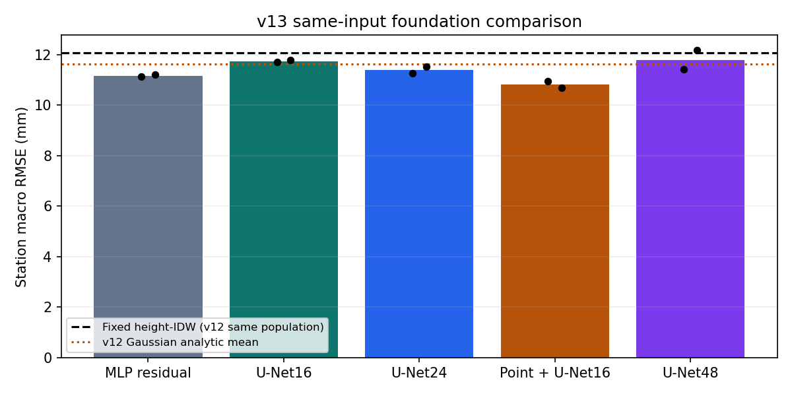
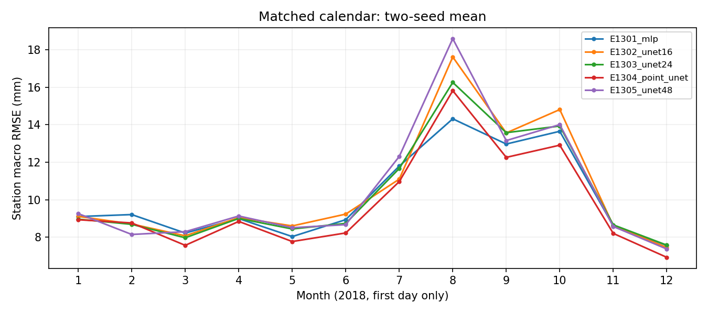

# v13：点特征与 U-Net 融合的基础场实验

2026-11-24，五种架构、每种两个种子全部完成。当前最值得继续验证的是点特征 MLP 与小 U-Net 的融合：平均站宏 RMSE 为 **10.828 mm**，比同输入 MLP 降低 0.347 mm（约 3.1%）。用户追加的大宽度 U-Net 为 **11.800 mm**，本轮加宽没有带来进一步收益。

## 同口径结果

宏 RMSE 先在每个测站上对有效时刻计算 RMSE，再平均测站及三个布局；表中均值再平均两个训练种子，不是模型集成预测的成绩。全部权重由内部时间监控选择。

| 编号 | 架构 | 参数量 | seed42 / mm | seed17 / mm | 均值 / mm |
|---|---|---:|---:|---:|---:|
| E1301 | 点特征残差 MLP，113→128→128 | 31,233 | 11.209 | 11.141 | 11.175 |
| E1302 | U-Net 16/32/64 | 122,609 | 11.784 | 11.706 | 11.745 |
| E1303 | U-Net 24/48/96 | 273,769 | 11.535 | 11.265 | 11.400 |
| E1304 | 点特征 MLP＋U-Net16 空间修正 | 153,842 | 10.701 | 10.955 | **10.828** |
| E1305 | 大宽度 U-Net 48/96/192 | 1,086,673 | 12.176 | 11.424 | 11.800 |

同评价人口的固定高程 IDW 为 12.066 mm，v12 相关高斯解析均值为 11.625 mm。历史约 9 mm U-Net 使用另一套输入、数据和划分，不能据此判断本轮退步。当前未达到 8 mm。

## 数据量、输入与训练安排

沿用当前允许变量数据合同：410 训练站、137 验证站、138 确认站；确认站及原 C/D 标签未读取。训练来自 2016/2017 年既有 72 个 36 小时片段，每片段展开 24 个有效因果预测时刻及两个条件布局，共 3,456 事件。按行号模 6 留出时间监控后，2,880 事件参与拟合，包含 1,440 个不同训练时刻、554,083 个不同有效站时标签及 923,640 个布局—站时监督条目。本轮增加的是既有日期的利用率，没有新增天气日期。

每事件使用 82 个条件站，其余合格物理组全部参与监督，不再截断为 128 个目标。布局一半随机、一半构造 150 km 有界空洞。训练最近条件站距离中位数为 43.05 km，验证为 77.93 km；75 分位数为 86.53/109.63 km，支撑距离分布仍有差异。

各模型使用同一套 113 维特征：41 维静态、时间、气象与支撑信息，加上 24 个历史变量的末值、均值和首末差。历史窗口为因果 12 小时，空间尺度为 50/150/300 km；背景为高差输运后的 150 km 高斯核 ZWD。没有 PWV、IWV、TCWV、Tm 输入或教师。历史站队列曾经过 PWV 完整率筛选，这一队列来源限制沿用现有合同。

AdamW 学习率 3e-4、权重衰减 1e-4、梯度裁剪 2，无 EMA；每次最多 600 秒，每 60 秒监控固定 96 事件，连续五次不改善早停。十次均使用完整预算，累计 392,406 次更新、6,009.626 秒拟合。等时预算下 MLP 约 6.4 万步、纯 U-Net 约 3.5 万步、融合约 2.5 万步，因此这是同算力时间筛查，不代表各架构充分收敛后的精度上限。

评价使用 2018 年每月 1 日的 24 小时、三个固定布局、137 站，共 115,386 个有效布局—站时条目。这是反复用于开发的抽样日历，不是全年或盲测结论。E1304 是观察首轮结果后追加的探索。

## 基础场如何查询

纯 U-Net 在固定 25 km、144×96 格网上处理特征，输出背景加修正；先转换到共同高程，再双线性查询，最后恢复实际测站高程。损失来自 GNSS 站点，没有将插值图当作稠密真值。

融合模型的预测为：

`ZWD(q) = 背景(q) + MLP(实际查询点的113维特征) + 高程还原后的U-Net空间修正(q)`。

点分支保留实际查询位置的信息，空间分支提供邻域修正。格网节点的站高减 DEM 高差为零，实际站点分支可以读取真实偏差；融合收益也包含解码结构和空间分支的变化，不能归因于单个高差变量。原生查询不依赖同时请求的其他查询点，但不等价于直接插值其 25 km 预览图。格网间距也不等于已验证的空间精度。

固定点背景与格网背景宏 RMSE 为 13.617670/13.616857 mm；两者逐点差异 RMS 为 0.178594 mm、最大 12.723015 mm。总分相似不表示逐点等价。

## 地形、空间差值与时间变化

两种子平均站宏 RMSE：

| 模型 | <500 m，55站 | 500–1500 m，51站 | ≥1500 m，31站 |
|---|---:|---:|---:|
| MLP | 12.353 | 10.772 | 9.749 |
| U-Net16 | 12.205 | 12.005 | 10.499 |
| U-Net24 | 11.857 | 11.470 | 10.472 |
| 点特征＋U-Net16 | **11.595** | 10.812 | **9.496** |
| U-Net48 | 12.160 | 12.315 | 10.312 |

融合优势主要出现在低海拔和高海拔组；中海拔均值略高于 MLP 约 0.04 mm，两种子方向不同。高程分组尚不能替代完整地形分类。

0–50 km 的 720 个站对差值 RMSE 从 7.758 降至 7.500 mm；50–150 km 的 519 个站对从 14.162 降至 13.121 mm，两种子方向一致。这支持已观测站对上的空间差值改善，尚无稠密真值验证整张场的细节。小时增量 RMSE 从约 5.839 降至 5.762 mm；本轮确定性历史条件模型尚未检验随机生成序列的联合时空一致性。

融合在 12 个抽样日中的 11 天优于 MLP。2018-08-01 是重点诊断日期：MLP 为 14.319 mm，融合为 15.820 mm，大 U-Net 为 18.592 mm。具体天气过程需要另外核查。

## 曲线说明了什么

固定训练面板及末轮权重诊断见 [fixed_training_diagnosis.json](fixed_training_diagnosis.json)。部分模型后期训练误差下降而外部误差上升，例如融合 seed42 从选中权重的 10.701 变为末轮的 11.280 mm；但融合 seed17 末轮反而从 10.955 改善至 10.804 mm。

大 U-Net seed42 的固定训练误差从 8.988 降至 8.744 mm，内部时间监控从 9.937 升至 10.085 mm，外部误差却从 12.176 降至 11.859 mm。说明时间监控和空间泛化的排序并不总一致。现有证据不支持统一判定为单纯过拟合或训练不足。主表保持原监控选模结果，末轮结果只用于诊断。

按 12 个抽样日进行 1,000 次共享日块重采样、在每次抽样内平均两个优化种子，融合相对 MLP 的差值为 −0.347 mm，95% 开发重采样区间为 [−0.729, 0.128] mm。其他 U-Net 差值区间也跨零。这反映抽样日历构成的敏感性，当前尚不能宣称统计显著或盲测泛化优势，详见 [配对分析](paired_development_bootstrap.json)。

## 下一轮优先级

1. 在训练站池内增加空间留出监控，联合时间监控选模，检查大距离支撑与高差场景。
2. 优先扩展天气日期覆盖并平衡条件站距离，以融合模型和 MLP 作配对对照；再判断延长训练及加宽融合空间分支是否值得。
3. 为有希望的基础场生成折外残差，使扩散学习未参与基础模型拟合样本上的残差分布。保留确定性基础场、相关高斯和残差扩散比较，同时评价 RMSE、CRPS、站对差值及时间增量。

本轮完成的是确定性基础场筛查，没有新增扩散或 GAN 训练。

## 复现与核验

29 项测试通过；[最终审计](final_audit.json)核验 22 组保存预测、20 个权重哈希及规范真值，最大指标复算差异 6.67e-7 mm。纯格网发布查询往返最大差异 1.53e-5 mm；GPU/CPU 特征实现最大差异约 0.0003453。曲线、场图、站点误差地图、24 小时案例和 CSV 均保留，权重与预测数组保留本机。

首六次拟合的原采样循环在换轮前取事件，导致后续每轮 2,880 事件中替换一个事件；复查三轮唯一事件数为 2880/2879/2879。修正后为 2880/2880/2880，后四次拟合使用修正顺序。原权重及其成绩保持原样，原源码由 source_receipt.json 和提交 0195541 保存；原运行 CRLF 与提交 LF 文本等价。详见 [审查记录](REVIEW.md)、[采样检查](sampler_review.json)和 [源码凭据](source_receipt.json)。

主要机器可读入口：[summary.csv](summary.csv)、[terrain.csv](terrain.csv)、[monthly.csv](monthly.csv)、[spatial_differences.csv](spatial_differences.csv)、[数据利用量](data_usage.json)、[支撑分布](support_distribution.json)。月度个别站点缺测使用有效标签汇总；所有总体指标有限。
