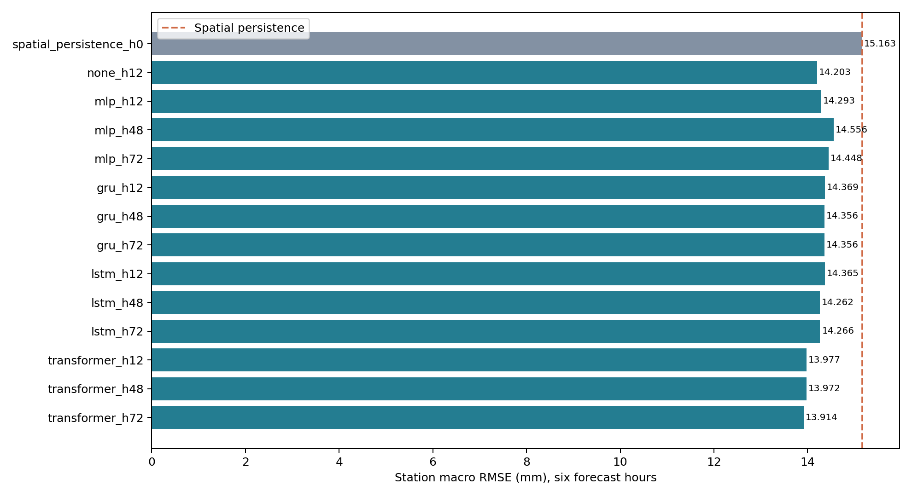
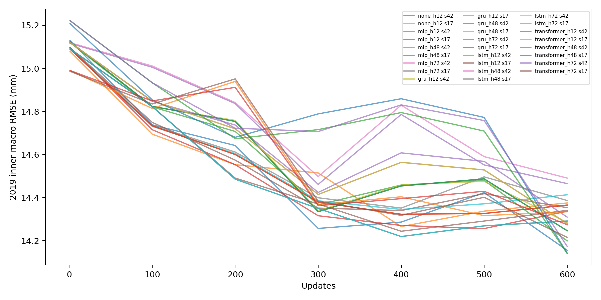
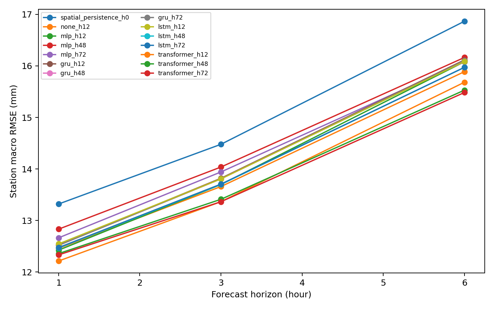
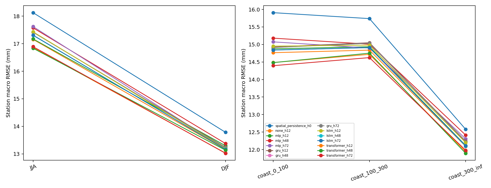
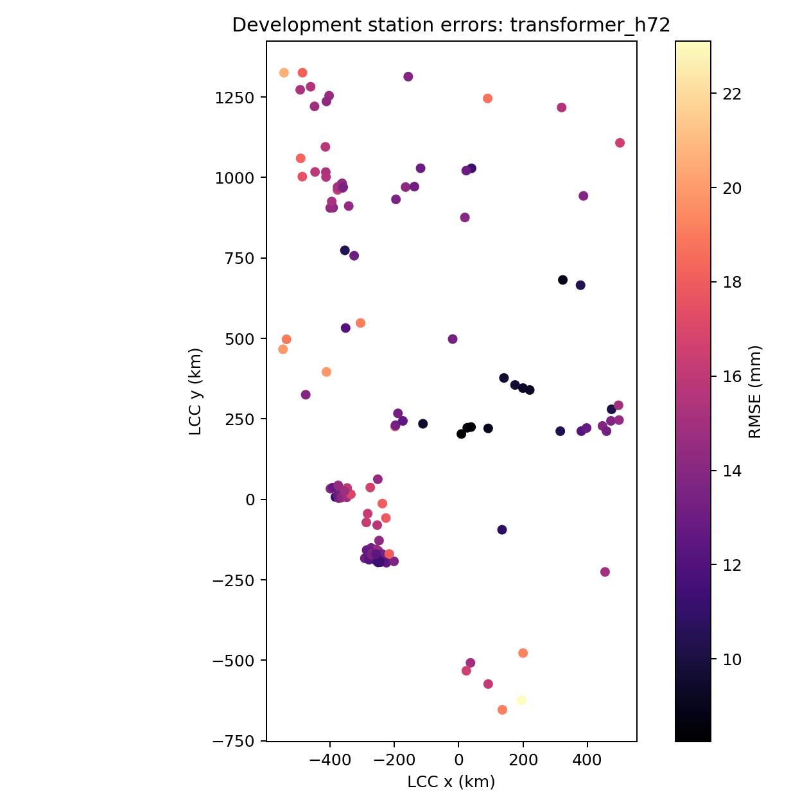

# 连续时空预报：本机配对筛查

状态：真实本机训练与2020抽样开发评价；非全年正式实验。

输入为条件站截至锚点的ZWD/T/P、地形与查询点海岸距离；隐藏目标站的所有历史不进入模型。
2016–2018抽样拟合，2019选择更新数；从头在2016–2019事件上按冻结更新数重拟合，再计算2020开发分数。开发标签预先缓存，未进入梯度或内层选模。
no-history分支指当前帧模型，仍共享观测年龄等可用性元数据；不同长度切片共享最长窗口计算的age，不是严格删去所有较早元数据的消融。
三个布局共144个开发事件（48个锚点），每事件生成连续6小时；137登记验证站中135站有效，共108954个有效站时评分记录（含布局重复）。
空间为8×8固定载体、小型卷积下采样/跳连、精确查询点IDW持久性残差跳连；海岸距离当前是C1静态特征。
本轮不代表p14复现，不含C2海岸边消息、折外残差diffusion或年度评价。

| 分支 | 双种子平均宏RMSE/mm | 1/3/6小时RMSE/mm | 增量宏RMSE/mm |
|---|---:|---|---:|
| spatial_persistence_h0 | 15.163 | 13.321/14.479/16.866 | 6.003 |
| none_h12 | 14.203 | 12.460/13.659/15.888 | 5.982 |
| mlp_h12 | 14.293 | 12.425/13.699/16.080 | 5.982 |
| mlp_h48 | 14.556 | 12.833/14.038/16.164 | 5.976 |
| mlp_h72 | 14.448 | 12.665/13.942/16.078 | 5.983 |
| gru_h12 | 14.369 | 12.527/13.820/16.116 | 5.990 |
| gru_h48 | 14.356 | 12.519/13.809/16.101 | 5.990 |
| gru_h72 | 14.356 | 12.519/13.809/16.101 | 5.990 |
| lstm_h12 | 14.365 | 12.546/13.808/16.086 | 5.994 |
| lstm_h48 | 14.262 | 12.469/13.700/15.972 | 5.995 |
| lstm_h72 | 14.266 | 12.475/13.707/15.972 | 5.994 |
| transformer_h12 | 13.977 | 12.215/13.366/15.683 | 5.988 |
| transformer_h48 | 13.972 | 12.359/13.412/15.529 | 5.990 |
| transformer_h72 | 13.914 | 12.333/13.365/15.484 | 6.001 |

本表点值使用确定性均值；未将模型平滑程度当作时间联合分布证据。
同人口周块配对bootstrap区间见 `paired_block_intervals.json`；1000次重采样按天气周分块，种子指标取均值，未将种子当作独立天气样本。
海岸、高程、支撑距离和夏冬分层见 `stratified_metrics.json`；站对差值见 `pair_metrics.json`。
开发数据已暴露，后续调参须标记开发回看。168小时、多分辨率、完整年度及diffusion仍按计划独立推进。

