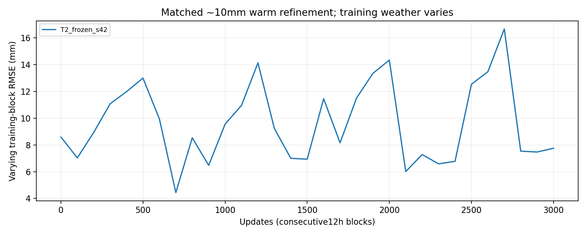

# 既有约10mm模型上的正式配对精度优化

参考保留原GRU+p14全部分支与归一化。所有候选训练3000步，2016–2019连续12小时批、仅条件站抽样；原2020每月72小时×3布局×137登记开发站评价。该开发队列已暴露。

| 配置 | 种子 | 步数 | 站宏RMSE/mm | 微RMSE/mm | 增量宏RMSE/mm |
|---|---:|---:|---:|---:|---:|
| reference | 42 | 0 | 9.998357 | 10.527209 | 5.584140 |
| T2_frozen | 42 | 3000 | 9.996576 | 10.522058 | 5.583300 |

仅列完成的最终3000步结果。尚在运行的配置不参与排名。

## 与同种子参考的配对差值

| 配置 | 种子 | 宏RMSE变化/mm | 配对月份bootstrap95%区间/mm |
|---|---:|---:|---|
| T2_frozen | 42 | -0.001781 | [-0.010853, 0.006930] |

差值为新模型减参考，负数代表改善。月份重采样保留同一天、布局和站点的配对，12个时间块给出的区间反映此开发样本的不确定性，不替代新年份评价。

[训练与结构合同](../../../docs/superpowers/plans/2026-11-25-warm-joint-precision.md)
[实际架构图](../../../docs/figures/joint_spectral_implementation_20261125/warm_10mm.png)

