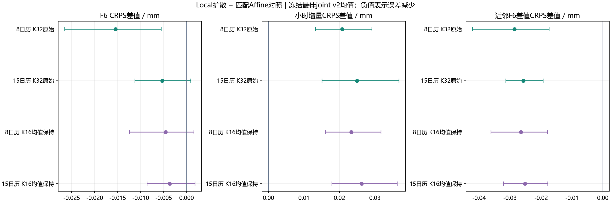

# 最佳joint v2基础场＋天气残差扩散：正式配对结果

2016–2019连续训练，两种子每臂3000块；2020主/补日历均为开发。点输出逐值等于原joint v2；raw K32与独立不重叠双场差分K16分别比较。概率Gaussian残差中心与确定性点输出分开。

| 日历 | 模型 | 当前CRPS/mm | F6 CRPS/mm | 增量CRPS/mm | 近邻F6差值CRPS/mm | energy/mm |
|---|---|---:|---:|---:|---:|---:|
| 8 | G265 | 5.477778 | 7.675242 | 3.214113 | 4.106552 | 8.465236 |
| 8 | affine | 5.474578 | 7.672983 | 3.119629 | 4.131975 | 8.452680 |
| 8 | local | 5.471461 | 7.657557 | 3.140358 | 4.103411 | 8.445007 |
| 8 | paired_G265 | 5.486338 | 7.698868 | 3.191629 | 4.112974 | 8.481504 |
| 8 | paired_affine | 5.483827 | 7.700225 | 3.100123 | 4.144778 | 8.479323 |
| 8 | paired_local | 5.484596 | 7.695685 | 3.123423 | 4.118285 | 8.477759 |
| 15 | G265 | 5.935474 | 8.771587 | 3.565154 | 4.589506 | 9.443149 |
| 15 | affine | 5.934546 | 8.755594 | 3.455852 | 4.607389 | 9.425775 |
| 15 | local | 5.938014 | 8.750280 | 3.480811 | 4.581669 | 9.425237 |
| 15 | paired_G265 | 5.940401 | 8.798254 | 3.547617 | 4.587616 | 9.459174 |
| 15 | paired_affine | 5.936742 | 8.798185 | 3.442379 | 4.614954 | 9.455780 |
| 15 | paired_local | 5.939360 | 8.794499 | 3.468609 | 4.589797 | 9.452246 |

## 主比较及均值保持比较

- 日历8，local−affine：F6差值-0.015427mm，改善0.2011%，95%月份区间[-0.026484826601037657, -0.005474458227746343]。
- 日历8，paired_local−paired_affine：F6差值-0.004540mm，改善0.0590%，95%月份区间[-0.012448439690902495, 0.001589212982444357]。
- 日历15，local−affine：F6差值-0.005314mm，改善0.0607%，95%月份区间[-0.011221602629458347, 0.0008977557884084587]。
- 日历15，paired_local−paired_affine：F6差值-0.003686mm，改善0.0419%，95%月份区间[-0.008557365113722655, 0.0018326078766086862]。

## 点输出与采样均值

| 日历 | 模型 | 确定性R / F6 mm | K成员均值R / F6 mm | 当前均值MSE差/mm²及区间 |
|---|---|---|---|---|
| 8 | G265 | 9.806169 / 13.852222 | 9.966701 / 14.066679 | 0.273897 [-0.1539018375176791, 0.9055180946367816] |
| 8 | affine | 9.806169 / 13.852222 | 9.979839 / 14.063818 | 0.295852 [-0.059496228696845024, 0.8465739890434727] |
| 8 | local | 9.806169 / 13.852222 | 9.968793 / 14.030505 | 0.150472 [-0.23581319604286952, 0.6940942539154115] |
| 8 | paired_G265 | 9.806169 / 13.852222 | 10.128674 / 14.364942 | 0.460591 [0.1305239671585289, 0.840132943090929] |
| 8 | paired_affine | 9.806169 / 13.852222 | 10.154994 / 14.383274 | 0.457169 [0.11108709501103915, 0.8542774924342149] |
| 8 | paired_local | 9.806169 / 13.852222 | 10.142855 / 14.366002 | 0.466021 [0.13155693232831908, 0.8492965180252602] |
| 15 | G265 | 10.767129 / 16.077837 | 10.938980 / 16.255585 | 0.045303 [-0.18625921927936903, 0.2609849788055766] |
| 15 | affine | 10.767129 / 16.077837 | 10.953231 / 16.228547 | 0.180301 [-0.22794562755850747, 0.5425884391719978] |
| 15 | local | 10.767129 / 16.077837 | 10.954791 / 16.216057 | 0.276726 [-0.029198726499978712, 0.5887369499983804] |
| 15 | paired_G265 | 10.767129 / 16.077837 | 11.121624 / 16.608653 | 0.269528 [-0.2631657962261178, 0.908126254920383] |
| 15 | paired_affine | 10.767129 / 16.077837 | 11.141967 / 16.625312 | 0.293647 [-0.23430976819592872, 0.9277582989033921] |
| 15 | paired_local | 10.767129 / 16.077837 | 11.136124 / 16.606974 | 0.286542 [-0.259113028478619, 0.9492187879924714] |

中心保持场的总体均值严格等于joint（float32存盘有舍入），K16实际成员均值仍含采样方差；均值MSE扣除s²/K是Monte Carlo估计，不能当作新的确定性RMSE。两个日历不拼接增量。

完整事件、条件站距离/海岸/高程/地形/季节、有限成员覆盖和来源见[summary.json](summary.json)。季节区间出现空月份抽样时标记NA。strict_oof=false；旧候选池未来可用性与历史质控限制保留，确认及原C/D未读。

