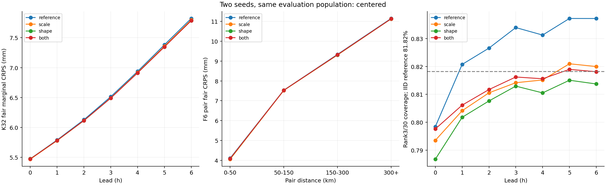

# 固定基础场均值：尺度与非Gaussian形状

2016–2019训练；2020抽样日期为开发暴露。双种子、K32 IID成员；不代表全年或严格折外。

| 模型 | 当前CRPS/mm | F6 CRPS/mm | 内部增量CRPS/mm | 0–50km F6差值CRPS/mm | energy/mm |
|---|---:|---:|---:|---:|---:|
| reference | 5.474047 | 7.822950 | 3.205329 | 4.105621 | 8.549818 |
| scale | 5.468268 | 7.798452 | 3.171146 | 4.054648 | 8.545489 |
| shape | 5.475206 | 7.788093 | 3.181201 | 4.077523 | 8.546191 |
| both | 5.472903 | 7.785675 | 3.190342 | 4.084995 | 8.547054 |

| 比较 | 指标 | 改善 | 差值95%区间 |
|---|---|---:|---|
| scale_vs_reference | crps_h0 | 0.106% | [-0.011926776784771923, 0.00015531751314604156] |
| scale_vs_reference | crps_h6 | 0.313% | [-0.047368743034517664, -0.008403472297265156] |
| scale_vs_reference | increment | 1.066% | [-0.04542760732402148, -0.025268921151368848] |
| scale_vs_reference | pair_0-50_h6 | 1.242% | [-0.07465424445815326, -0.03205406650768164] |
| scale_vs_reference | energy | 0.051% | [-0.014556709944497115, 0.0047436871983709905] |
| shape_vs_reference | crps_h0 | -0.021% | [-0.005093810242734783, 0.0071644909061445005] |
| shape_vs_reference | crps_h6 | 0.446% | [-0.06293571627655763, -0.0064857366715317995] |
| shape_vs_reference | increment | 0.753% | [-0.030466008640950386, -0.01855754211191929] |
| shape_vs_reference | pair_0-50_h6 | 0.684% | [-0.03994656477847373, -0.018665938430286976] |
| shape_vs_reference | energy | 0.042% | [-0.007795526456069386, 0.0005793381980156551] |
| both_vs_reference | crps_h0 | 0.021% | [-0.0076029619473432595, 0.0052365498477949905] |
| both_vs_reference | crps_h6 | 0.476% | [-0.06645645658921219, -0.007946792078444247] |
| both_vs_reference | increment | 0.468% | [-0.021342029237489853, -0.00982319945041588] |
| both_vs_reference | pair_0-50_h6 | 0.502% | [-0.03327432726186519, -0.011415754357642166] |
| both_vs_reference | energy | 0.032% | [-0.006687107826656217, 0.00104000598655105] |
| both_vs_scale | crps_h0 | -0.085% | [-0.0034041378209632633, 0.01379823770488894] |
| both_vs_scale | crps_h6 | 0.164% | [-0.03835227618433276, 0.014698920775681492] |
| both_vs_scale | increment | -0.605% | [0.014196018141633635, 0.024937967746214925] |
| both_vs_scale | pair_0-50_h6 | -0.748% | [0.016936210189478502, 0.0448129410202038] |
| both_vs_scale | energy | -0.018% | [-0.008696076415266077, 0.013922732420241585] |
| both_vs_shape | crps_h0 | 0.042% | [-0.00378832689350877, -0.0007078891760913832] |
| both_vs_shape | crps_h6 | 0.031% | [-0.00527311641850387, 0.0007621077040014782] |
| both_vs_shape | increment | -0.287% | [0.007406455936608193, 0.010839820729536938] |
| both_vs_shape | pair_0-50_h6 | -0.183% | [0.0031863700404230503, 0.012303277616698312] |
| both_vs_shape | energy | -0.010% | [-0.0016319263841708526, 0.003374767637259951] |
| shape_vs_scale | crps_h0 | -0.127% | [-0.00019674408114504123, 0.014777137568136306] |
| shape_vs_scale | crps_h6 | 0.133% | [-0.03380944911893363, 0.014437024265561033] |
| shape_vs_scale | increment | -0.317% | [0.005273544920519092, 0.01603099630776516] |
| shape_vs_scale | pair_0-50_h6 | -0.564% | [0.012278709405174275, 0.03553480127714862] |
| shape_vs_scale | energy | -0.008% | [-0.007718576322483229, 0.011130698538318072] |

## 均值与作用范围

概率分数表使用同一总体上的K32 fair估计；Gaussian解析分数及四距离档、覆盖、逐月和来源另列JSON。DDIM为边际及增量采样器复核，未另做全场joint评分，表中NA表示未评估。
均值诊断以(barY-y)^2-s²/K估计条件均值MSE；与确定性基础场相减，单位mm²。它可逐点为负，不等于生成样本自身RMSE，也不宜开方后声称精确RMSE。

| 模型 | 当前均值MSE相对基础场/mm² | 95%区间 | F6差值/mm² | 95%区间 |
|---|---:|---|---:|---|
| reference | 0.119003 | [-0.22376190750888272, 0.44540858355165375] | -0.227641 | [-1.172726273246971, 0.7191586659196652] |
| scale | 0.128310 | [-0.20974008094060798, 0.4555780954991748] | -0.212279 | [-1.0826100506006404, 0.6668395422529337] |
| shape | 0.121304 | [-0.2339814848446939, 0.44800558279048364] | -0.095231 | [-1.0416730855135228, 0.8446704475740533] |
| both | 0.134295 | [-0.24018825935722632, 0.48438290156203906] | -0.092900 | [-1.0692486808895247, 0.8686944886622252] |

## 六小时快速变化事件

沿用先前冻结的10/20/30mm阈值，主阈值20mm；将相同定义应用于本轮新模型，属开发探索。增湿与减湿均在全部有效起点上评分。所有阈值与事件计数见JSON。

| 比较 | 方向 | 指标 | 改善 | 差值95%区间 |
|---|---|---|---:|---|
| scale_vs_reference | increase | brier | 0.676% | [-0.0008041352908828943, -0.00017899958804651862] |
| scale_vs_reference | increase | tail | 0.599% | [-0.007719293548069135, -0.0003360705637316044] |
| scale_vs_reference | decrease | brier | 1.342% | [-0.0015363845812409016, -0.00012290928524581412] |
| scale_vs_reference | decrease | tail | 0.963% | [-0.014664147809873938, 0.00079761859120371] |
| shape_vs_reference | increase | brier | 0.690% | [-0.0008164814999583089, -0.00018961906865218583] |
| shape_vs_reference | increase | tail | 0.244% | [-0.004819649897475786, 0.0016699631546130233] |
| shape_vs_reference | decrease | brier | 1.145% | [-0.0014183501427350747, -3.156059681459005e-05] |
| shape_vs_reference | decrease | tail | 0.296% | [-0.005882185907564545, 0.0015529767302346592] |
| both_vs_reference | increase | brier | 0.420% | [-0.0005464759033665396, -7.705723206773876e-05] |
| both_vs_reference | increase | tail | -0.024% | [-0.002545088596390832, 0.0025279560973228378] |
| both_vs_reference | decrease | brier | 0.749% | [-0.001045323591792616, 7.526551632217094e-05] |
| both_vs_reference | decrease | tail | -0.145% | [-0.0012979256277301713, 0.0030874936258797666] |
| both_vs_scale | increase | brier | -0.258% | [-1.1141690868616404e-05, 0.0003910488048373892] |
| both_vs_scale | increase | tail | -0.626% | [0.0013100563888511255, 0.00697082959934092] |
| both_vs_scale | decrease | brier | -0.601% | [0.00015795202447056237, 0.0005494835831179611] |
| both_vs_scale | decrease | tail | -1.119% | [0.001999266182232659, 0.01367021913727962] |
| both_vs_shape | increase | brier | -0.272% | [4.4274920757035446e-05, 0.0003183676750545428] |
| both_vs_shape | increase | tail | -0.268% | [9.698780555253728e-05, 0.0033505571619762307] |
| both_vs_shape | decrease | brier | -0.401% | [9.960413887875071e-05, 0.0003763219195688387] |
| both_vs_shape | decrease | tail | -0.442% | [0.0011876890631472346, 0.004854434314226677] |
| shape_vs_scale | increase | brier | 0.014% | [-0.0001347737425342166, 0.00012496996147454858] |
| shape_vs_scale | increase | tail | -0.357% | [0.0008270114490207355, 0.003949325299102546] |
| shape_vs_scale | decrease | brier | -0.199% | [-1.504749030051614e-06, 0.0002225703008513619] |
| shape_vs_scale | decrease | tail | -0.674% | [0.0007011552938267346, 0.008813552440706947] |

三臂和reference的解析分布均值均逐值等于TF3000基础场，约9.818mm；K32样本均值含有限采样误差。reference与scale为Gaussian；shape/both为Hermite场，不提供虚构的Gaussian解析CRPS。

月份共同重采样2000次，两个种子共享月份，区间未经多重比较校正。确认及原C/D标签未读取。

完整记录见[summary.json](summary.json)。
