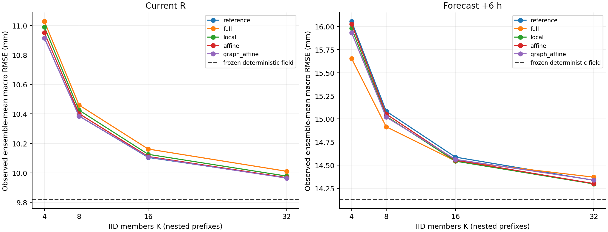

# 扩散均值误差：有限采样与模型修正分离

当前/6h为同一主日历，双种子平均。32成员为独立成员；基础场与真实标签逐值一致。

| 模型 | 原32成员均值R/mm | 扣除采样方差后的R估计/mm | 原32成员均值F6/mm | 扣除采样方差后的F6估计/mm |
|---|---:|---:|---:|---:|
| reference | 9.966152 | 9.821699 | 14.336112 | 14.078024 |
| full | 10.010537 | 9.854385 | 14.370339 | 14.186204 |
| local | 9.977826 | 9.823225 | 14.296932 | 14.044784 |
| affine | 9.967303 | 9.817399 | 14.300590 | 14.042103 |
| graph_affine | 9.964183 | 9.819600 | 14.338402 | 14.106636 |

无偏性针对均方误差MSE：`E[(barY-y)^2-s²/K]=(E[Y]-y)^2`。逐点估计可负，保持原值；先按原layout/站点聚合，再取平方根得到上表描述性估计，平方根本身不具无偏性。正式比较使用下列micro MSE差值及月份区间，而非把表中小数当作精确分布均值RMSE。

| 比较 | 当前MSE差/mm² | 当前差值95%区间 | F6 MSE差/mm² | F6差值95%区间 |
|---|---:|---|---:|---|
| reference_vs_base | 0.261457 | [-0.16987117362358461, 0.8694222823467618] | -1.208185 | [-4.084695239903203, 1.436261210706697] |
| full_vs_base | 1.112595 | [0.1696547143736617, 2.1880096710431465] | 4.586914 | [-2.195196397132634, 12.633331626917427] |
| full_vs_reference | 0.851137 | [0.08191460617901167, 1.7326812355953947] | 5.795099 | [-1.4276360777519592, 13.434211625618083] |
| local_vs_base | 0.257805 | [-0.16688934671899597, 0.7839923550537303] | -2.447579 | [-5.946390967781941, 0.6074961078729167] |
| local_vs_reference | -0.003652 | [-0.1589531265244798, 0.13436908705126643] | -1.239393 | [-2.0117575107868073, -0.5462801318659328] |
| affine_vs_base | 0.139598 | [-0.23908695449848574, 0.6272712572600848] | -2.490502 | [-6.147555663944705, 0.7463661200116837] |
| affine_vs_reference | -0.121859 | [-0.32668264897283744, 0.06744387317170389] | -1.282316 | [-2.1469573940419777, -0.5733364390274847] |
| graph_affine_vs_base | 0.167731 | [-0.4123869577802487, 0.6679208524587449] | 1.472007 | [-5.667952622470179, 8.794375788171685] |
| graph_affine_vs_reference | -0.093726 | [-0.739630588789329, 0.47812899359024197] | 2.680192 | [-4.636314008246465, 9.760456860862654] |

相同月份共同重采样、共享两个种子；2020已暴露开发，区间为探索性且未多重比较校正。K曲线来自嵌套成员前缀，相邻点相关，不是独立重复实验。解析Gaussian均值在JSON单列，可检验估计量的有限成员波动。

所有来源哈希、采样方差项与负值计数见[mean_sampling_audit.json](mean_sampling_audit.json)。
