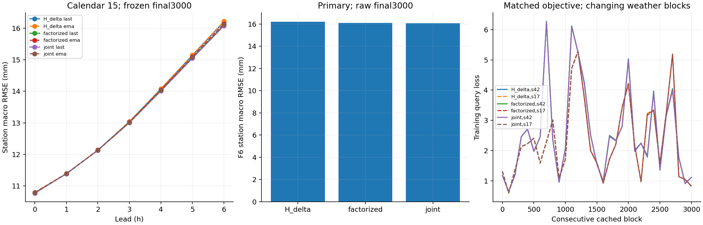

# 有向站点×滞后传递：同源同预算的真实训练结果

2016–2019原连续缓存，同源TF3000各新增3000，种子42/17；2020每月15日起72h三布局，已暴露开发。raw final3000为主，EMA并列。H_delta为匹配对照；factorized/joint增加同参数四头数值传递，joint使用历史key和空间/lag交互。三者损失均含0.5内部增量及原跨起点差分。

| 模型 | 权重 | 当前站宏RMSE/mm | 六小时站宏RMSE/mm | 跨起点当前增量站宏RMSE/mm | 同起点内部增量microRMSE/mm |
|---|---|---:|---:|---:|---:|
| H_delta | last | 10.786318 | 16.207798 | 6.317700 | 6.597349 |
| H_delta | ema | 10.796624 | 16.220839 | 6.323938 | 6.600848 |
| factorized | last | 10.770065 | 16.109646 | 6.282639 | 6.584765 |
| factorized | ema | 10.784431 | 16.144759 | 6.294814 | 6.590647 |
| joint | last | 10.767129 | 16.077837 | 6.253898 | 6.580253 |
| joint | ema | 10.780526 | 16.121395 | 6.272910 | 6.586683 |

## 配对比较

- joint_vs_H_delta_last：内部增量micro RMSE差值-0.017095mm，95%共同月份区间[-0.021568261593745808, -0.013098525870041133]；当前/六小时站宏RMSE区间[[-0.03786178255421535, -0.0012551771582256534], [-0.17132973747933394, -0.08752787564693244]]；跨起点当前增量区间[-0.07585787550490783, -0.05101608466722938]。
- factorized_vs_H_delta_last：内部增量micro RMSE差值-0.012584mm，95%共同月份区间[-0.01559035451640095, -0.009501492208448715]；当前/六小时站宏RMSE区间[[-0.0296920765858252, -0.005139629026064316], [-0.13887752532955164, -0.05955178376680763]]；跨起点当前增量区间[-0.042483383781482996, -0.02813488965809455]。
- joint_vs_factorized_last：内部增量micro RMSE差值-0.004512mm，95%共同月份区间[-0.006597742865959544, -0.0025941085926612707]；当前/六小时站宏RMSE区间[[-0.011995410624129788, 0.005429904491156091], [-0.04913708886327397, -0.013652727152086644]]；跨起点当前增量区间[-0.03871545672314247, -0.019910015948906824]。
- joint_vs_H_delta_ema：内部增量micro RMSE差值-0.014165mm，95%共同月份区间[-0.0173389262390372, -0.011095565572023604]；当前/六小时站宏RMSE区间[[-0.03172817900963665, -0.0017837024313244042], [-0.12620804635563632, -0.07085948053879322]]；跨起点当前增量区间[-0.06059465213217996, -0.040811082342879584]。
- factorized_vs_H_delta_ema：内部增量micro RMSE差值-0.010201mm，95%共同月份区间[-0.012328853174227317, -0.007992838608358954]；当前/六小时站宏RMSE区间[[-0.023103514172891738, -0.0032285136009695004], [-0.10295371063464218, -0.049229066965878546]]；跨起点当前增量区间[-0.03481670460661492, -0.02374264305866121]。
- joint_vs_factorized_ema：内部增量micro RMSE差值-0.003964mm，95%共同月份区间[-0.005694679759313037, -0.00251816326998513]；当前/六小时站宏RMSE区间[[-0.011164966980098745, 0.0028060423888336306], [-0.03991950206513044, -0.00550086595778367]]；跨起点当前增量区间[-0.030029664461984205, -0.014469260053016235]。

差值为名称中的前者减后者，负值表示误差减少。主指标是raw joint相对H_delta的F6站宏RMSE；内部增量micro为次要指标。月份重采样对两模型及两种子共享。分层记录为MSE，不与站宏RMSE混排；稀疏季节分层若空重采样，区间记NA。
final3000 raw/EMA逐tensor、同一源权重/缓存、truth/reference逐值、导出数组、几何/条件距离及lineage哈希均核验。strict_oof=false，未来可用性选站等旧数据限制保留；确认及原C/D标签未读，区间条件于两个固定种子且未经多重比较校正。

完整来源、分层与配对结果见[summary.json](summary.json)。
