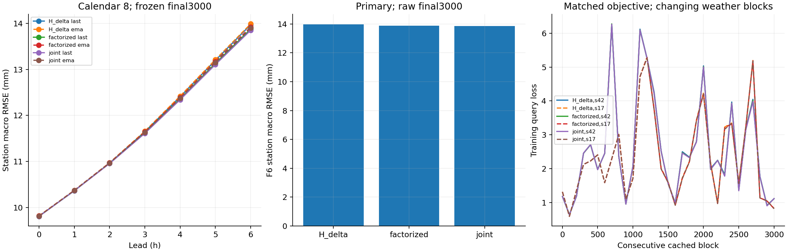

# 有向站点×滞后传递：同源同预算的真实训练结果

2016–2019原连续缓存，同源TF3000各新增3000，种子42/17；2020每月8日起72h三布局，已暴露开发。raw final3000为主，EMA并列。H_delta为匹配对照；factorized/joint增加同参数四头数值传递，joint使用历史key和空间/lag交互。三者损失均含0.5内部增量及原跨起点差分。

| 模型 | 权重 | 当前站宏RMSE/mm | 六小时站宏RMSE/mm | 跨起点当前增量站宏RMSE/mm | 同起点内部增量microRMSE/mm |
|---|---|---:|---:|---:|---:|
| H_delta | last | 9.811195 | 13.973126 | 5.544171 | 5.801856 |
| H_delta | ema | 9.817214 | 13.990427 | 5.549516 | 5.804415 |
| factorized | last | 9.806618 | 13.877675 | 5.516887 | 5.792387 |
| factorized | ema | 9.815029 | 13.921500 | 5.526604 | 5.797236 |
| joint | last | 9.806169 | 13.852222 | 5.494214 | 5.789937 |
| joint | ema | 9.813204 | 13.903354 | 5.510328 | 5.795171 |

## 配对比较

- joint_vs_H_delta_last：内部增量micro RMSE差值-0.011918mm，95%共同月份区间[-0.0190428731282705, -0.005686244356198524]；当前/六小时站宏RMSE区间[[-0.014378748615363346, 0.006674059700042704], [-0.1749161493133034, -0.06379828480316664]]；跨起点当前增量区间[-0.05816470828878506, -0.042398865006338805]。
- factorized_vs_H_delta_last：内部增量micro RMSE差值-0.009469mm，95%共同月份区间[-0.014433983106593617, -0.005356191173538361]；当前/六小时站宏RMSE区间[[-0.011816447106911187, 0.004730066113576456], [-0.139575464583733, -0.04538688549134139]]；跨起点当前增量区间[-0.03042198337609183, -0.02416799701115309]。
- joint_vs_factorized_last：内部增量micro RMSE差值-0.002449mm，95%共同月份区间[-0.004968374230222461, 3.8985691938475376e-05]；当前/六小时站宏RMSE区间[[-0.00550589958587735, 0.0044660546012552866], [-0.03939983938210041, -0.011612937347496428]]；跨起点当前增量区间[-0.029220672430894167, -0.01603879705223246]。
- joint_vs_H_delta_ema：内部增量micro RMSE差值-0.009244mm，95%共同月份区间[-0.01468261447404764, -0.004738119886382576]；当前/六小时站宏RMSE区间[[-0.011247366140664372, 0.004778257009877764], [-0.12593188499618196, -0.045508409157324806]]；跨起点当前增量区间[-0.04551346423031, -0.03339932013304334]。
- factorized_vs_H_delta_ema：内部增量micro RMSE差值-0.007179mm，95%共同月份区间[-0.010967594436421035, -0.004085844032381903]；当前/六小时站宏RMSE区间[[-0.007519502717920812, 0.004576786220319732], [-0.10109849017618484, -0.033770815494364795]]；跨起点当前增量区间[-0.025497360637922205, -0.020386799561007824]。
- joint_vs_factorized_ema：内部增量micro RMSE差值-0.002065mm，95%共同月份区间[-0.0038274432114046688, -0.00032558962288763523]；当前/六小时站宏RMSE区间[[-0.005572894341597001, 0.0018310471403637939], [-0.029914543499649948, -0.007062614405589114]]；跨起点当前增量区间[-0.021334056867806584, -0.011325063387096958]。

差值为名称中的前者减后者，负值表示误差减少。主指标是raw joint相对H_delta的F6站宏RMSE；内部增量micro为次要指标。月份重采样对两模型及两种子共享。分层记录为MSE，不与站宏RMSE混排；稀疏季节分层若空重采样，区间记NA。
final3000 raw/EMA逐tensor、同一源权重/缓存、truth/reference逐值、导出数组、几何/条件距离及lineage哈希均核验。strict_oof=false，未来可用性选站等旧数据限制保留；确认及原C/D标签未读，区间条件于两个固定种子且未经多重比较校正。

完整来源、分层与配对结果见[summary.json](summary.json)。
