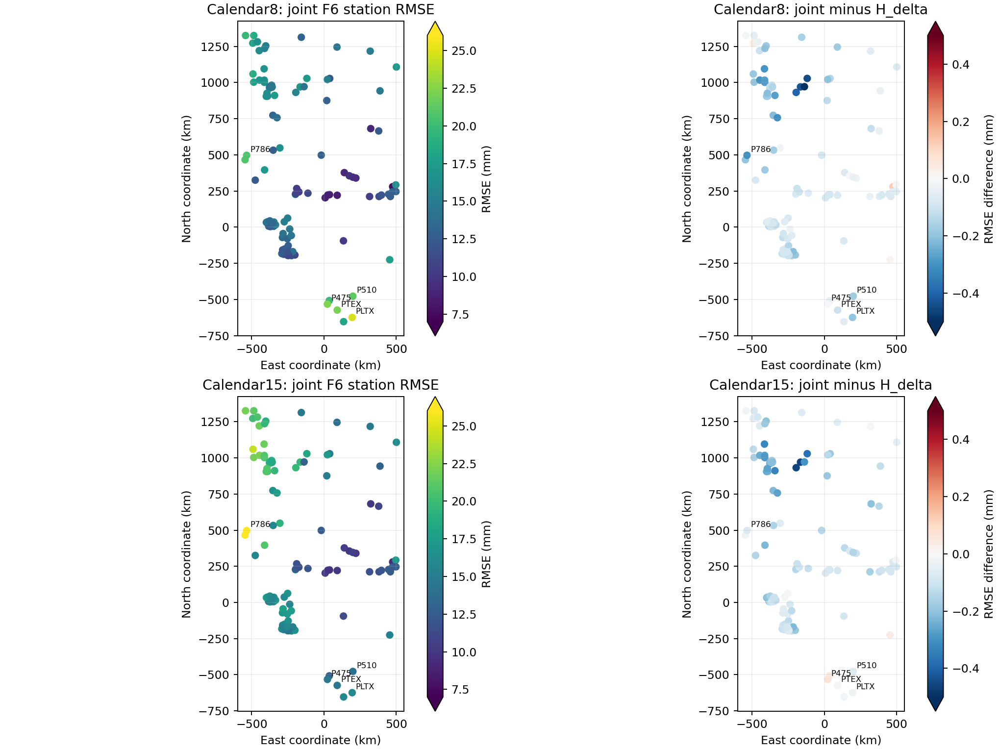

# 有向时滞v2逐站与尾部误差

同两种子、raw final3000、已暴露2020抽样日期。站点RMSE按每布局分别对月份/小时计算后平均布局；宏RMSE再平均站点与种子，与原评价一致。micro/MAE/Bias/P90/P95先每种子汇总全部布局再平均种子。P90/P95为绝对误差分位数，单位mm。无标签站记NA，地图为站点值，不代表格网真值。

| 日历 | 模型 | 时效 | 宏RMSE | microRMSE | MAE | Bias | P90 | P95 |
|---|---|---|---:|---:|---:|---:|---:|---:|
| 8 | H_delta | 0h | 9.8112 | 10.3313 | 7.5572 | -0.2655 | 16.5474 | 21.3825 |
| 8 | H_delta | 6h | 13.9731 | 14.4085 | 10.7535 | -0.3061 | 23.2414 | 29.3790 |
| 8 | factorized | 0h | 9.8066 | 10.3283 | 7.5564 | -0.2741 | 16.5384 | 21.3630 |
| 8 | factorized | 6h | 13.8777 | 14.3139 | 10.6948 | -0.3412 | 23.0655 | 29.1710 |
| 8 | joint | 0h | 9.8062 | 10.3278 | 7.5565 | -0.2775 | 16.5399 | 21.3688 |
| 8 | joint | 6h | 13.8522 | 14.2891 | 10.6788 | -0.3400 | 23.0178 | 29.0925 |
| 15 | H_delta | 0h | 10.7863 | 11.3141 | 8.1846 | -0.2645 | 17.9104 | 23.1375 |
| 15 | H_delta | 6h | 16.2078 | 16.6528 | 12.3288 | -1.1344 | 26.8185 | 34.2518 |
| 15 | factorized | 0h | 10.7701 | 11.2973 | 8.1753 | -0.2508 | 17.9020 | 23.1022 |
| 15 | factorized | 6h | 16.1096 | 16.5539 | 12.2492 | -1.0954 | 26.6228 | 34.0250 |
| 15 | joint | 0h | 10.7671 | 11.2940 | 8.1726 | -0.2575 | 17.8914 | 23.0982 |
| 15 | joint | 6h | 16.0778 | 16.5219 | 12.2245 | -1.0944 | 26.5663 | 33.9631 |

## 预先指定的高误差站

| 日历 | 站点 | H_delta F6 RMSE | joint F6 RMSE | 差值 | joint P95 |
|---|---|---:|---:|---:|---:|
| 8 | P475 | 22.3157 | 22.3093 | -0.0064 | 46.9044 |
| 8 | P510 | 21.3931 | 21.2127 | -0.1804 | 44.8484 |
| 8 | P786 | 21.0963 | 20.7919 | -0.3044 | 41.7569 |
| 8 | PLTX | 24.9413 | 24.7451 | -0.1962 | 53.8468 |
| 8 | PTEX | 22.2439 | 22.1379 | -0.1059 | 48.4944 |
| 15 | P475 | 14.4618 | 14.5300 | 0.0682 | 28.4652 |
| 15 | P510 | 13.9814 | 13.9132 | -0.0682 | 27.9673 |
| 15 | P786 | 28.0720 | 27.9993 | -0.0727 | 55.8041 |
| 15 | PLTX | 15.9291 | 15.9022 | -0.0270 | 34.1277 |
| 15 | PTEX | 14.5199 | 14.5100 | -0.0099 | 29.0747 |

完整137站、两日历和来源见[summary.json](summary.json)。逐站描述不替代主报告的共同月份整体区间，当前结果不作完整年度或独立确认结论。
