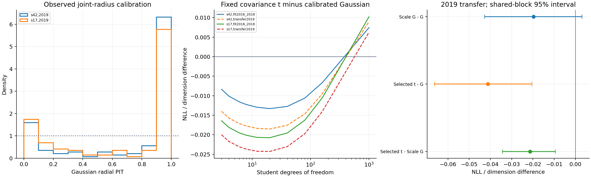

# 完整残差场重尾诊断：Gaussian尺度校准后仍有联合对数评分信号

每种子48个预先固定训练块，2016–2018拟合常数探针、2019检验探针迁移。原TF3000/G265/Affine来源已经拟合2019，因此不是整模型独立留年验证。没有读取2020或确认/C/D标签。

| 种子 | 训练内选择 | Gaussian方差校准倍数 | 2019 Gaussian NLL/d | 2019尺度Gaussian | 2019所选t |
|---|---|---:|---:|---:|---:|
| 42 | t20 | 1.27303 | 3.218653 | 3.198150 | 3.179614 |
| 17 | t20 | 1.33799 | 3.187328 | 3.168296 | 3.144020 |

## 配对块区间

- scaled_gaussian_vs_gaussian：NLL/d差值-0.019768，95%共同块区间[-0.042754619945397365, 0.0030807843627391218]。
- selected_tail_vs_gaussian：NLL/d差值-0.041173，95%共同块区间[-0.06628826887157425, -0.02045565494422222]。
- selected_tail_vs_scaled_gaussian：NLL/d差值-0.021405，95%共同块区间[-0.034341331983206005, -0.009478216240648115]。

## 径向校准

| 种子 | 2019 Gaussian PIT>95% | 尺度Gaussian | 所选t | 校准参考 |
|---|---:|---:|---:|---:|
| 42 | 0.5764 | 0.3056 | 0.1806 | 0.05 |
| 17 | 0.5625 | 0.2361 | 0.1667 | 0.05 |

固定协方差Student-t具有相同均值和协方差；尺度Gaussian的常数只由2016–2018拟合。对数评分改善不能直接换算成CRPS、RMSE或事件收益，也不能排除遗漏天气依赖尺度/相关误配。下一步应加入同天气输入的条件Gaussian尺度控制。
生成自校验的q/d均值约1.000，Gaussian径向PIT>95%比例约4.8%–5.3%；真实2019残差对应比例约56%–58%。这支持继续研究联合残差分布，并非协方差实现错误的直接迹象。

完整半径、有效维数、代码/权重/协议哈希见[summary.json](summary.json)。48块诊断不代表神经3000更新或2020正式预测收益。旧strict_oof=false、目标未来可用性筛选和历史QC来源限制保留。
